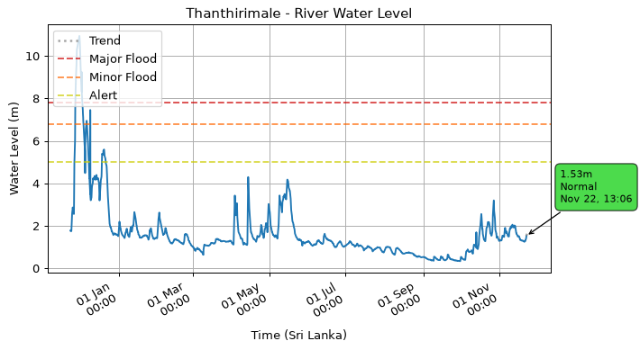

# lk_irrigation 🇱🇰

Realtime Data about *River Water Levels* in Sri Lanka, from the [Irrigation Deptartment](https://www.irrigation.gov.lk)'s [Hydrology and Disaster Management](https://www.irrigation.gov.lk/web/index.php?option=com_content&view=article&id=27&Itemid=128&lang=en) Division.

- [Complete Dataset](data/rwlds) with **317,954 measurements** from **39** stations.
- [Scrape and load logic](src/lk_irrigation/rwld/RiverWaterLevelDataLoadMixin.py)
- [Original Data source](https://www.arcgis.com/apps/dashboards/2cffe83c9ff5497d97375498bdf3ff38)

🇱🇰 River water alerts: No active alerts.
Source: Sri Lanka Irrigation Department https://www.irrigation.gov.lk
Repo: https://github.com/nuuuwan/lk_irrigation
## River Water Level Map

## Latest measurements

*There were **28** measurements in the last **1 hour**.*

| Measured At | Station (River Basin) | Level (m) | Alert Level | Rate-of-Rise (m/hr) | Rising Alert |
| --- | --- | ---: | --- | ---: | --- |
| 2026-11-17 04:32:46 | Manampitiya (Mahaweli Ganga) | 1.19 | 🟢 Normal | -0.020 |  |
| 2026-11-17 04:29:36 | Panadugama (Nilwala Ganga) | 4.05 | 🟢 Normal | -0.023 |  |
| 2026-11-17 04:29:27 | Holombuwa (Kelani Ganga) | 0.73 | 🟢 Normal | -0.007 |  |
| 2026-11-17 04:27:15 | Peradeniya (Mahaweli Ganga) | 2.89 | 🟢 Normal | -0.015 |  |
| 2026-11-17 04:14:55 | Thawalama (Gin Ganga) | 1.83 | 🟢 Normal | 0.018 | 🔺 Rising |
| 2026-11-17 04:13:35 | Baddegama (Gin Ganga) | 1.73 | 🟢 Normal | -108.000 |  |
| 2026-11-17 04:13:34 | Baddegama (Gin Ganga) | 1.76 | 🟢 Normal | -108.000 |  |
| 2026-11-17 04:13:32 | Baddegama (Gin Ganga) | 1.78 | 🟢 Normal | -108.000 |  |
| 2026-11-17 04:12:53 | Ellagawa (Kalu Ganga) | 5.22 | 🟢 Normal | -0.009 |  |
| 2026-11-17 04:12:26 | Deraniyagala (Kelani Ganga) | 0.69 | 🟢 Normal | 0.017 | 🔺 Rising |
| 2026-11-17 04:07:27 | Wellawaya (Kirindi Oya) | 1.40 | 🟢 Normal | 0.019 | 🔺 Rising |
| 2026-11-17 04:06:27 | Nagalagam Street (Kelani Ganga) | 0.61 | 🟢 Normal | 0.134 | 🔺 Rising |
| 2026-11-17 04:05:53 | Putupaula (Kalu Ganga) | 0.70 | 🟢 Normal | 0.092 | 🔺 Rising |
| 2026-11-17 04:05:17 | Rathnapura (Kalu Ganga) | 1.59 | 🟢 Normal | 0.000 |  |
| 2026-11-17 04:05:09 | Glencourse (Kelani Ganga) | 10.39 | 🟢 Normal | 0.039 | 🔺 Rising |
| 2026-11-17 04:03:43 | Siyambalanduwa (Heda Oya) | 0.53 | 🟢 Normal | 0.000 |  |
| 2026-11-17 04:03:21 | Norwood (Kelani Ganga) | 0.97 | 🟢 Normal | 0.000 |  |
| 2026-11-17 04:03:05 | Giriulla (Maha Oya) | 1.35 | 🟢 Normal | 0.000 |  |
| 2026-11-17 04:03:05 | Dunamale (Aththanagalu Oya) | 1.75 | 🟢 Normal | 0.000 |  |
| 2026-11-17 04:03:01 | Badalgama (Maha Oya) | 2.64 | 🟢 Normal | -0.010 |  |
| 2026-11-17 04:02:53 | Kithulgala (Kelani Ganga) | 2.04 | 🟢 Normal | -0.010 |  |
| 2026-11-17 04:02:48 | Padiyathalawa (Maduru Oya) | 0.40 | 🟢 Normal | 0.000 |  |
| 2026-11-17 04:02:24 | Yaka Wewa (Ma Oya) | 0.53 | 🟢 Normal | 0.000 |  |
| 2026-11-17 04:02:09 | Horowpothana (Yan Oya) | 2.00 | 🟢 Normal | -0.010 |  |
| 2026-11-17 04:02:03 | Moragaswewa (Deduru Oya) | 0.66 | 🟢 Normal | 0.000 |  |
| 2026-11-17 04:01:56 | Kalawellawa (Millakanda) (Kalu Ganga) | 2.45 | 🟢 Normal | -0.071 |  |
| 2026-11-17 04:01:46 | Moraketiya (Walawe Ganga) | 1.71 | 🟢 Normal | 0.000 |  |
| 2026-11-17 04:01:29 | Thanamalwila (Kirindi Oya) | 1.45 | 🟢 Normal | 0.020 | 🔺 Rising |

## Latest by Station

*⌛ = Latest measurement is older than **24 hours**.*

| Measured At | Station (River Basin) | Level (m) | Alert Level | Rate-of-Rise (m/hr) | Rising Alert |
| --- | --- | ---: | --- | ---: | --- |
| 2026-11-17 04:06:27 | Nagalagam Street (Kelani Ganga) | 0.61 | 🟢 Normal | 0.134 | 🔺 Rising |
| 2026-11-17 04:05:53 | Putupaula (Kalu Ganga) | 0.70 | 🟢 Normal | 0.092 | 🔺 Rising |
| 2026-11-17 04:05:09 | Glencourse (Kelani Ganga) | 10.39 | 🟢 Normal | 0.039 | 🔺 Rising |
| 2026-11-17 04:01:29 | Thanamalwila (Kirindi Oya) | 1.45 | 🟢 Normal | 0.020 | 🔺 Rising |
| 2026-11-17 04:07:27 | Wellawaya (Kirindi Oya) | 1.40 | 🟢 Normal | 0.019 | 🔺 Rising |
| 2026-11-17 04:14:55 | Thawalama (Gin Ganga) | 1.83 | 🟢 Normal | 0.018 | 🔺 Rising |
| 2026-11-17 04:12:26 | Deraniyagala (Kelani Ganga) | 0.69 | 🟢 Normal | 0.017 | 🔺 Rising |
| 2026-11-17 04:01:06 | Nakkala (Kumbukkan Oya) | 0.89 | 🟢 Normal | 0.000 |  |
| 2026-11-17 04:02:03 | Moragaswewa (Deduru Oya) | 0.66 | 🟢 Normal | 0.000 |  |
| 2026-11-17 04:00:59 | Nawalapitiya (Mahaweli Ganga) | 1.24 | 🟢 Normal | 0.000 |  |
| 2026-11-17 04:02:24 | Yaka Wewa (Ma Oya) | 0.53 | 🟢 Normal | 0.000 |  |
| 2026-11-17 04:03:05 | Giriulla (Maha Oya) | 1.35 | 🟢 Normal | 0.000 |  |
| 2026-11-16 18:04:42 | Galgamuwa (Mee Oya) | 0.28 | 🟢 Normal | 0.000 |  |
| 2026-11-17 03:41:17 | Magura (Kalu Ganga) | 1.70 | 🟢 Normal | 0.000 |  |
| 2026-11-17 04:03:21 | Norwood (Kelani Ganga) | 0.97 | 🟢 Normal | 0.000 |  |
| 2026-11-17 04:02:48 | Padiyathalawa (Maduru Oya) | 0.40 | 🟢 Normal | 0.000 |  |
| 2026-11-17 04:01:46 | Moraketiya (Walawe Ganga) | 1.71 | 🟢 Normal | 0.000 |  |
| 2026-11-17 04:03:43 | Siyambalanduwa (Heda Oya) | 0.53 | 🟢 Normal | 0.000 |  |
| 2026-11-17 04:03:05 | Dunamale (Aththanagalu Oya) | 1.75 | 🟢 Normal | 0.000 |  |
| 2026-11-17 04:01:16 | Thaldena (Mahaweli Ganga) | 0.57 | 🟢 Normal | 0.000 |  |
| 2026-11-17 03:04:08 | Katharagama (Menik Ganga) | -0.04 | 🟢 Normal | 0.000 |  |
| 2026-11-17 04:05:17 | Rathnapura (Kalu Ganga) | 1.59 | 🟢 Normal | 0.000 |  |
| 2026-11-16 18:00:40 | Thanthirimale (Malwathu Oya) | 1.50 | 🟢 Normal | 0.000 |  |
| 2026-11-17 02:01:14 | Kuda Oya (Kirindi Oya) | 1.58 | 🟢 Normal | 0.000 |  |
| 2026-11-17 04:29:27 | Holombuwa (Kelani Ganga) | 0.73 | 🟢 Normal | -0.007 |  |
| 2026-11-17 04:12:53 | Ellagawa (Kalu Ganga) | 5.22 | 🟢 Normal | -0.009 |  |
| 2026-11-17 03:08:41 | Urawa (Nilwala Ganga) | 0.96 | 🟢 Normal | -0.009 |  |
| 2026-11-17 03:07:22 | Hanwella (Kelani Ganga) | 1.99 | 🟢 Normal | -0.009 |  |
| 2026-11-17 04:02:09 | Horowpothana (Yan Oya) | 2.00 | 🟢 Normal | -0.010 |  |
| 2026-11-17 04:03:01 | Badalgama (Maha Oya) | 2.64 | 🟢 Normal | -0.010 |  |
| 2026-11-17 04:02:53 | Kithulgala (Kelani Ganga) | 2.04 | 🟢 Normal | -0.010 |  |
| 2026-11-17 04:27:15 | Peradeniya (Mahaweli Ganga) | 2.89 | 🟢 Normal | -0.015 |  |
| 2026-11-17 04:32:46 | Manampitiya (Mahaweli Ganga) | 1.19 | 🟢 Normal | -0.020 |  |
| 2026-11-17 03:26:46 | Thalgahagoda (Nilwala Ganga) | 1.22 | 🟢 Normal | -0.023 |  |
| 2026-11-17 04:29:36 | Panadugama (Nilwala Ganga) | 4.05 | 🟢 Normal | -0.023 |  |
| 2026-11-16 18:02:17 | Weraganthota (Mahaweli Ganga) | -1.91 | 🟢 Normal | -0.041 |  |
| 2026-11-17 04:01:56 | Kalawellawa (Millakanda) (Kalu Ganga) | 2.45 | 🟢 Normal | -0.071 |  |
| 2026-11-17 04:00:14 | Pitabeddara (Nilwala Ganga) | 1.31 | 🟢 Normal | -36.000 |  |
| 2026-11-17 04:13:35 | Baddegama (Gin Ganga) | 1.73 | 🟢 Normal | -108.000 |  |

## River Water Level Charts by Station

### Nagalagam Street (Kelani Ganga)

### Putupaula (Kalu Ganga)

### Glencourse (Kelani Ganga)

### Thanamalwila (Kirindi Oya)

### Wellawaya (Kirindi Oya)

### Thawalama (Gin Ganga)

### Deraniyagala (Kelani Ganga)

### Nakkala (Kumbukkan Oya)

### Moragaswewa (Deduru Oya)

### Nawalapitiya (Mahaweli Ganga)

### Yaka Wewa (Ma Oya)

### Giriulla (Maha Oya)

### Galgamuwa (Mee Oya)

### Magura (Kalu Ganga)

### Norwood (Kelani Ganga)

### Padiyathalawa (Maduru Oya)

### Moraketiya (Walawe Ganga)

### Siyambalanduwa (Heda Oya)

### Dunamale (Aththanagalu Oya)

### Thaldena (Mahaweli Ganga)

### Katharagama (Menik Ganga)

### Rathnapura (Kalu Ganga)

### Thanthirimale (Malwathu Oya)

### Kuda Oya (Kirindi Oya)

### Holombuwa (Kelani Ganga)

### Ellagawa (Kalu Ganga)

### Urawa (Nilwala Ganga)

### Hanwella (Kelani Ganga)

### Horowpothana (Yan Oya)

### Badalgama (Maha Oya)

### Kithulgala (Kelani Ganga)

### Peradeniya (Mahaweli Ganga)

### Manampitiya (Mahaweli Ganga)

### Thalgahagoda (Nilwala Ganga)

### Panadugama (Nilwala Ganga)

### Weraganthota (Mahaweli Ganga)

### Kalawellawa (Millakanda) (Kalu Ganga)

.png)

### Pitabeddara (Nilwala Ganga)

### Baddegama (Gin Ganga)

