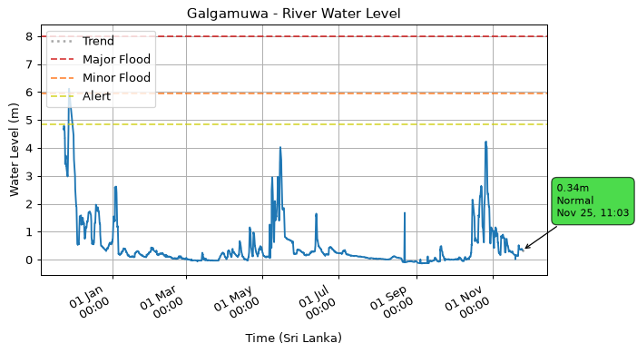

# lk_irrigation 🇱🇰

Realtime Data about *River Water Levels* in Sri Lanka, from the [Irrigation Deptartment](https://www.irrigation.gov.lk)'s [Hydrology and Disaster Management](https://www.irrigation.gov.lk/web/index.php?option=com_content&view=article&id=27&Itemid=128&lang=en) Division.

- [Complete Dataset](data/rwlds) with **319,482 measurements** from **39** stations.
- [Scrape and load logic](src/lk_irrigation/rwld/RiverWaterLevelDataLoadMixin.py)
- [Original Data source](https://www.arcgis.com/apps/dashboards/2cffe83c9ff5497d97375498bdf3ff38)

🇱🇰 River water alerts: No active alerts.
Source: Sri Lanka Irrigation Department https://www.irrigation.gov.lk
Repo: https://github.com/nuuuwan/lk_irrigation
## River Water Level Map

## Latest measurements

*There were **20** measurements in the last **1 hour**.*

| Measured At | Station (River Basin) | Level (m) | Alert Level | Rate-of-Rise (m/hr) | Rising Alert |
| --- | --- | ---: | --- | ---: | --- |
| 2026-11-18 21:03:15 | Thawalama (Gin Ganga) | 1.66 | 🟢 Normal | -0.010 |  |
| 2026-11-18 21:03:14 | Nakkala (Kumbukkan Oya) | 0.80 | 🟢 Normal | -0.010 |  |
| 2026-11-18 21:03:07 | Kalawellawa (Millakanda) (Kalu Ganga) | 2.01 | 🟢 Normal | 0.011 | 🔺 Rising |
| 2026-11-18 21:02:24 | Manampitiya (Mahaweli Ganga) | 1.09 | 🟢 Normal | -0.010 |  |
| 2026-11-18 21:02:21 | Kuda Oya (Kirindi Oya) | 1.60 | 🟢 Normal | -0.010 |  |
| 2026-11-18 21:02:17 | Wellawaya (Kirindi Oya) | 1.21 | 🟢 Normal | -0.010 |  |
| 2026-11-18 21:02:09 | Hanwella (Kelani Ganga) | 1.73 | 🟢 Normal | -0.030 |  |
| 2026-11-18 21:02:05 | Moraketiya (Walawe Ganga) | 2.72 | 🟢 Normal | -0.030 |  |
| 2026-11-18 21:02:04 | Thaldena (Mahaweli Ganga) | 0.47 | 🟢 Normal | -0.010 |  |
| 2026-11-18 21:01:51 | Norwood (Kelani Ganga) | 0.89 | 🟢 Normal | 0.000 |  |
| 2026-11-18 21:01:46 | Yaka Wewa (Ma Oya) | 0.50 | 🟢 Normal | 0.000 |  |
| 2026-11-18 21:01:40 | Ellagawa (Kalu Ganga) | 4.96 | 🟢 Normal | -0.010 |  |
| 2026-11-18 21:01:37 | Horowpothana (Yan Oya) | 1.82 | 🟢 Normal | 0.000 |  |
| 2026-11-18 21:01:26 | Nawalapitiya (Mahaweli Ganga) | 1.16 | 🟢 Normal | 0.000 |  |
| 2026-11-18 21:01:10 | Rathnapura (Kalu Ganga) | 1.51 | 🟢 Normal | 0.000 |  |
| 2026-11-18 21:00:29 | Magura (Kalu Ganga) | 1.46 | 🟢 Normal | 0.000 |  |
| 2026-11-18 21:00:22 | Siyambalanduwa (Heda Oya) | 0.52 | 🟢 Normal | 0.000 |  |
| 2026-11-18 20:26:20 | Thalgahagoda (Nilwala Ganga) | 0.73 | 🟢 Normal | 0.000 |  |
| 2026-11-18 20:22:16 | Panadugama (Nilwala Ganga) | 3.46 | 🟢 Normal | -0.009 |  |
| 2026-11-18 20:12:12 | Katharagama (Menik Ganga) | 0.10 | 🟢 Normal | -0.009 |  |

## Latest by Station

*⌛ = Latest measurement is older than **24 hours**.*

| Measured At | Station (River Basin) | Level (m) | Alert Level | Rate-of-Rise (m/hr) | Rising Alert |
| --- | --- | ---: | --- | ---: | --- |
| 2026-11-18 20:02:19 | Peradeniya (Mahaweli Ganga) | 2.78 | 🟢 Normal | 0.030 | 🔺 Rising |
| 2026-11-18 20:03:15 | Putupaula (Kalu Ganga) | 0.58 | 🟢 Normal | 0.021 | 🔺 Rising |
| 2026-11-18 21:03:07 | Kalawellawa (Millakanda) (Kalu Ganga) | 2.01 | 🟢 Normal | 0.011 | 🔺 Rising |
| 2026-11-18 20:05:18 | Thanamalwila (Kirindi Oya) | 1.32 | 🟢 Normal | 0.010 | 🔺 Rising |
| 2026-11-18 18:02:04 | Weraganthota (Mahaweli Ganga) | -2.04 | 🟢 Normal | 0.000 |  |
| 2026-11-18 20:02:48 | Moragaswewa (Deduru Oya) | 0.56 | 🟢 Normal | 0.000 |  |
| 2026-11-18 21:01:26 | Nawalapitiya (Mahaweli Ganga) | 1.16 | 🟢 Normal | 0.000 |  |
| 2026-11-18 21:01:46 | Yaka Wewa (Ma Oya) | 0.50 | 🟢 Normal | 0.000 |  |
| 2026-11-18 21:01:37 | Horowpothana (Yan Oya) | 1.82 | 🟢 Normal | 0.000 |  |
| 2026-11-18 18:02:13 | Galgamuwa (Mee Oya) | 0.18 | 🟢 Normal | 0.000 |  |
| 2026-11-18 21:00:29 | Magura (Kalu Ganga) | 1.46 | 🟢 Normal | 0.000 |  |
| 2026-11-18 20:02:03 | Pitabeddara (Nilwala Ganga) | 1.17 | 🟢 Normal | 0.000 |  |
| 2026-11-18 21:01:51 | Norwood (Kelani Ganga) | 0.89 | 🟢 Normal | 0.000 |  |
| 2026-11-18 20:04:31 | Nagalagam Street (Kelani Ganga) | 0.55 | 🟢 Normal | 0.000 |  |
| 2026-11-18 21:00:22 | Siyambalanduwa (Heda Oya) | 0.52 | 🟢 Normal | 0.000 |  |
| 2026-11-18 20:05:54 | Badalgama (Maha Oya) | 2.54 | 🟢 Normal | 0.000 |  |
| 2026-11-18 20:04:28 | Holombuwa (Kelani Ganga) | 0.64 | 🟢 Normal | 0.000 |  |
| 2026-11-18 21:01:10 | Rathnapura (Kalu Ganga) | 1.51 | 🟢 Normal | 0.000 |  |
| 2026-11-18 18:02:10 | Thanthirimale (Malwathu Oya) | 1.31 | 🟢 Normal | 0.000 |  |
| 2026-11-18 20:26:20 | Thalgahagoda (Nilwala Ganga) | 0.73 | 🟢 Normal | 0.000 |  |
| 2026-11-18 20:12:12 | Katharagama (Menik Ganga) | 0.10 | 🟢 Normal | -0.009 |  |
| 2026-11-18 20:05:53 | Padiyathalawa (Maduru Oya) | 0.34 | 🟢 Normal | -0.009 |  |
| 2026-11-18 20:22:16 | Panadugama (Nilwala Ganga) | 3.46 | 🟢 Normal | -0.009 |  |
| 2026-11-18 21:02:24 | Manampitiya (Mahaweli Ganga) | 1.09 | 🟢 Normal | -0.010 |  |
| 2026-11-18 21:03:14 | Nakkala (Kumbukkan Oya) | 0.80 | 🟢 Normal | -0.010 |  |
| 2026-11-18 21:01:40 | Ellagawa (Kalu Ganga) | 4.96 | 🟢 Normal | -0.010 |  |
| 2026-11-18 20:07:12 | Giriulla (Maha Oya) | 1.28 | 🟢 Normal | -0.010 |  |
| 2026-11-18 20:08:31 | Baddegama (Gin Ganga) | 1.33 | 🟢 Normal | -0.010 |  |
| 2026-11-18 21:02:17 | Wellawaya (Kirindi Oya) | 1.21 | 🟢 Normal | -0.010 |  |
| 2026-11-18 21:02:21 | Kuda Oya (Kirindi Oya) | 1.60 | 🟢 Normal | -0.010 |  |
| 2026-11-18 21:02:04 | Thaldena (Mahaweli Ganga) | 0.47 | 🟢 Normal | -0.010 |  |
| 2026-11-18 21:03:15 | Thawalama (Gin Ganga) | 1.66 | 🟢 Normal | -0.010 |  |
| 2026-11-18 20:03:53 | Urawa (Nilwala Ganga) | 0.86 | 🟢 Normal | -0.011 |  |
| 2026-11-18 20:02:31 | Dunamale (Aththanagalu Oya) | 1.43 | 🟢 Normal | -0.020 |  |
| 2026-11-18 20:03:19 | Kithulgala (Kelani Ganga) | 1.91 | 🟢 Normal | -0.029 |  |
| 2026-11-18 21:02:05 | Moraketiya (Walawe Ganga) | 2.72 | 🟢 Normal | -0.030 |  |
| 2026-11-18 21:02:09 | Hanwella (Kelani Ganga) | 1.73 | 🟢 Normal | -0.030 |  |
| 2026-11-18 20:06:00 | Glencourse (Kelani Ganga) | 9.86 | 🟢 Normal | -0.057 |  |
| 2026-11-18 20:03:19 | Deraniyagala (Kelani Ganga) | 0.54 | 🟢 Normal | -0.069 |  |

## River Water Level Charts by Station

### Peradeniya (Mahaweli Ganga)

### Putupaula (Kalu Ganga)

### Kalawellawa (Millakanda) (Kalu Ganga)

.png)

### Thanamalwila (Kirindi Oya)

### Weraganthota (Mahaweli Ganga)

### Moragaswewa (Deduru Oya)

### Nawalapitiya (Mahaweli Ganga)

### Yaka Wewa (Ma Oya)

### Horowpothana (Yan Oya)

### Galgamuwa (Mee Oya)

### Magura (Kalu Ganga)

### Pitabeddara (Nilwala Ganga)

### Norwood (Kelani Ganga)

### Nagalagam Street (Kelani Ganga)

### Siyambalanduwa (Heda Oya)

### Badalgama (Maha Oya)

### Holombuwa (Kelani Ganga)

### Rathnapura (Kalu Ganga)

### Thanthirimale (Malwathu Oya)

### Thalgahagoda (Nilwala Ganga)

### Katharagama (Menik Ganga)

### Padiyathalawa (Maduru Oya)

### Panadugama (Nilwala Ganga)

### Manampitiya (Mahaweli Ganga)

### Nakkala (Kumbukkan Oya)

### Ellagawa (Kalu Ganga)

### Giriulla (Maha Oya)

### Baddegama (Gin Ganga)

### Wellawaya (Kirindi Oya)

### Kuda Oya (Kirindi Oya)

### Thaldena (Mahaweli Ganga)

### Thawalama (Gin Ganga)

### Urawa (Nilwala Ganga)

### Dunamale (Aththanagalu Oya)

### Kithulgala (Kelani Ganga)

### Moraketiya (Walawe Ganga)

### Hanwella (Kelani Ganga)

### Glencourse (Kelani Ganga)

### Deraniyagala (Kelani Ganga)

