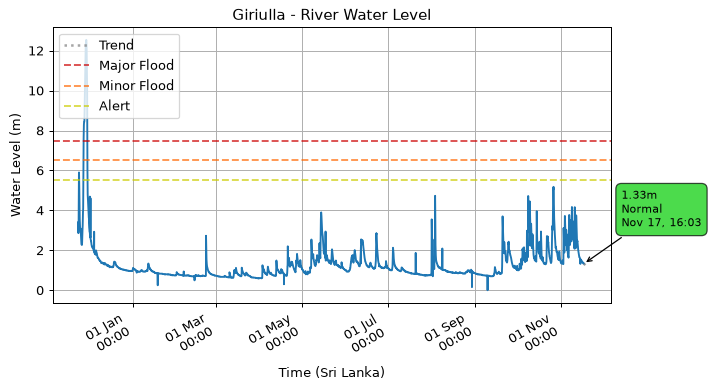

# lk_irrigation 🇱🇰

Realtime Data about *River Water Levels* in Sri Lanka, from the [Irrigation Deptartment](https://www.irrigation.gov.lk)'s [Hydrology and Disaster Management](https://www.irrigation.gov.lk/web/index.php?option=com_content&view=article&id=27&Itemid=128&lang=en) Division.

- [Complete Dataset](data/rwlds) with **325,760 measurements** from **39** stations.
- [Scrape and load logic](src/lk_irrigation/rwld/RiverWaterLevelDataLoadMixin.py)
- [Original Data source](https://www.arcgis.com/apps/dashboards/2cffe83c9ff5497d97375498bdf3ff38)

🇱🇰 River water alerts: 🟡 Dunamale — Alert
Source: Sri Lanka Irrigation Department https://www.irrigation.gov.lk
Repo: https://github.com/nuuuwan/lk_irrigation
## River Water Level Map

## Latest measurements

*There were **17** measurements in the last **1 hour**.*

| Measured At | Station (River Basin) | Level (m) | Alert Level | Rate-of-Rise (m/hr) | Rising Alert |
| --- | --- | ---: | --- | ---: | --- |
| 2026-11-26 01:02:56 | Putupaula (Kalu Ganga) | 1.28 | 🟢 Normal | -0.032 |  |
| 2026-11-26 01:02:45 | Siyambalanduwa (Heda Oya) | 0.93 | 🟢 Normal | -0.033 |  |
| 2026-11-26 01:02:33 | Thaldena (Mahaweli Ganga) | 0.83 | 🟢 Normal | -0.020 |  |
| 2026-11-26 01:02:31 | Moragaswewa (Deduru Oya) | 2.28 | 🟢 Normal | 0.323 | 🔺 Rising |
| 2026-11-26 01:02:29 | Kithulgala (Kelani Ganga) | 1.83 | 🟢 Normal | -0.020 |  |
| 2026-11-26 01:02:25 | Peradeniya (Mahaweli Ganga) | 4.90 | 🟢 Normal | -0.088 |  |
| 2026-11-26 01:02:24 | Dunamale (Aththanagalu Oya) | 3.70 | 🟡 Alert | 0.079 | 🔺 Rising |
| 2026-11-26 01:02:18 | Glencourse (Kelani Ganga) | 12.29 | 🟢 Normal | 0.000 |  |
| 2026-11-26 01:02:12 | Badalgama (Maha Oya) | 3.68 | 🟢 Normal | 0.090 | 🔺 Rising |
| 2026-11-26 01:02:11 | Thanamalwila (Kirindi Oya) | 1.87 | 🟢 Normal | -0.030 |  |
| 2026-11-26 01:01:47 | Moraketiya (Walawe Ganga) | 1.93 | 🟢 Normal | -0.020 |  |
| 2026-11-26 01:01:39 | Ellagawa (Kalu Ganga) | 6.21 | 🟢 Normal | -0.035 |  |
| 2026-11-26 01:01:38 | Katharagama (Menik Ganga) | 0.12 | 🟢 Normal | 0.000 |  |
| 2026-11-26 01:01:32 | Panadugama (Nilwala Ganga) | 4.17 | 🟢 Normal | -0.037 |  |
| 2026-11-26 01:00:31 | Nawalapitiya (Mahaweli Ganga) | 1.57 | 🟢 Normal | -0.010 |  |
| 2026-11-26 01:00:23 | Thawalama (Gin Ganga) | 2.29 | 🟢 Normal | 0.011 | 🔺 Rising |
| 2026-11-26 01:00:07 | Nakkala (Kumbukkan Oya) | 1.01 | 🟢 Normal | 0.000 |  |

## Latest by Station

*⌛ = Latest measurement is older than **24 hours**.*

| Measured At | Station (River Basin) | Level (m) | Alert Level | Rate-of-Rise (m/hr) | Rising Alert |
| --- | --- | ---: | --- | ---: | --- |
| 2026-11-26 01:02:24 | Dunamale (Aththanagalu Oya) | 3.70 | 🟡 Alert | 0.079 | 🔺 Rising |
| 2026-11-26 00:03:12 | Kalawellawa (Millakanda) (Kalu Ganga) | 4.89 | 🟢 Normal | 254.618 | 🔺 Rising |
| 2026-11-26 00:03:55 | Yaka Wewa (Ma Oya) | 2.71 | 🟢 Normal | 79.560 | 🔺 Rising |
| 2026-11-25 20:05:34 | Magura (Kalu Ganga) | 3.40 | 🟢 Normal | 0.483 | 🔺 Rising |
| 2026-11-26 01:02:31 | Moragaswewa (Deduru Oya) | 2.28 | 🟢 Normal | 0.323 | 🔺 Rising |
| 2026-11-26 00:03:46 | Hanwella (Kelani Ganga) | 3.34 | 🟢 Normal | 0.230 | 🔺 Rising |
| 2026-11-26 00:01:19 | Nagalagam Street (Kelani Ganga) | 0.64 | 🟢 Normal | 0.154 | 🔺 Rising |
| 2026-11-25 18:02:46 | Weraganthota (Mahaweli Ganga) | -1.84 | 🟢 Normal | 0.141 | 🔺 Rising |
| 2026-11-26 00:04:00 | Rathnapura (Kalu Ganga) | 2.74 | 🟢 Normal | 0.124 | 🔺 Rising |
| 2026-11-26 00:04:08 | Giriulla (Maha Oya) | 2.93 | 🟢 Normal | 0.107 | 🔺 Rising |
| 2026-11-26 01:02:12 | Badalgama (Maha Oya) | 3.68 | 🟢 Normal | 0.090 | 🔺 Rising |
| 2026-11-25 18:02:35 | Thanthirimale (Malwathu Oya) | 1.47 | 🟢 Normal | 0.053 | 🔺 Rising |
| 2026-11-25 18:00:42 | Galgamuwa (Mee Oya) | 0.45 | 🟢 Normal | 0.033 | 🔺 Rising |
| 2026-11-26 01:00:23 | Thawalama (Gin Ganga) | 2.29 | 🟢 Normal | 0.011 | 🔺 Rising |
| 2026-11-26 00:05:57 | Wellawaya (Kirindi Oya) | 1.55 | 🟢 Normal | 0.000 |  |
| 2026-11-26 01:00:07 | Nakkala (Kumbukkan Oya) | 1.01 | 🟢 Normal | 0.000 |  |
| 2026-11-26 00:02:48 | Norwood (Kelani Ganga) | 0.91 | 🟢 Normal | 0.000 |  |
| 2026-11-26 01:02:18 | Glencourse (Kelani Ganga) | 12.29 | 🟢 Normal | 0.000 |  |
| 2026-11-26 01:01:38 | Katharagama (Menik Ganga) | 0.12 | 🟢 Normal | 0.000 |  |
| 2026-11-26 00:16:56 | Urawa (Nilwala Ganga) | 1.02 | 🟢 Normal | 0.000 |  |
| 2026-11-26 01:00:31 | Nawalapitiya (Mahaweli Ganga) | 1.57 | 🟢 Normal | -0.010 |  |
| 2026-11-25 23:06:35 | Pitabeddara (Nilwala Ganga) | 1.30 | 🟢 Normal | -0.010 |  |
| 2026-11-26 00:18:09 | Thalgahagoda (Nilwala Ganga) | 1.00 | 🟢 Normal | -0.015 |  |
| 2026-11-26 00:07:27 | Kuda Oya (Kirindi Oya) | 1.70 | 🟢 Normal | -0.019 |  |
| 2026-11-26 01:01:47 | Moraketiya (Walawe Ganga) | 1.93 | 🟢 Normal | -0.020 |  |
| 2026-11-26 01:02:29 | Kithulgala (Kelani Ganga) | 1.83 | 🟢 Normal | -0.020 |  |
| 2026-11-26 01:02:33 | Thaldena (Mahaweli Ganga) | 0.83 | 🟢 Normal | -0.020 |  |
| 2026-11-26 00:08:23 | Baddegama (Gin Ganga) | 1.90 | 🟢 Normal | -0.022 |  |
| 2026-11-22 17:02:02⌛ | Padiyathalawa (Maduru Oya) | 0.36 | 🟢 Normal | -0.022 |  |
| 2026-11-25 23:01:24 | Horowpothana (Yan Oya) | 2.72 | 🟢 Normal | -0.023 |  |
| 2026-11-26 01:02:11 | Thanamalwila (Kirindi Oya) | 1.87 | 🟢 Normal | -0.030 |  |
| 2026-11-26 01:02:56 | Putupaula (Kalu Ganga) | 1.28 | 🟢 Normal | -0.032 |  |
| 2026-11-26 01:02:45 | Siyambalanduwa (Heda Oya) | 0.93 | 🟢 Normal | -0.033 |  |
| 2026-11-26 01:01:39 | Ellagawa (Kalu Ganga) | 6.21 | 🟢 Normal | -0.035 |  |
| 2026-11-26 01:01:32 | Panadugama (Nilwala Ganga) | 4.17 | 🟢 Normal | -0.037 |  |
| 2026-11-26 00:05:52 | Manampitiya (Mahaweli Ganga) | 1.34 | 🟢 Normal | -0.041 |  |
| 2026-11-26 00:02:48 | Deraniyagala (Kelani Ganga) | 1.08 | 🟢 Normal | -0.061 |  |
| 2026-11-26 01:02:25 | Peradeniya (Mahaweli Ganga) | 4.90 | 🟢 Normal | -0.088 |  |
| 2026-11-26 00:09:05 | Holombuwa (Kelani Ganga) | 2.29 | 🟢 Normal | -0.166 |  |

## River Water Level Charts by Station

### Dunamale (Aththanagalu Oya)

### Kalawellawa (Millakanda) (Kalu Ganga)

.png)

### Yaka Wewa (Ma Oya)

### Magura (Kalu Ganga)

### Moragaswewa (Deduru Oya)

### Hanwella (Kelani Ganga)

### Nagalagam Street (Kelani Ganga)

### Weraganthota (Mahaweli Ganga)

### Rathnapura (Kalu Ganga)

### Giriulla (Maha Oya)

### Badalgama (Maha Oya)

### Thanthirimale (Malwathu Oya)

### Galgamuwa (Mee Oya)

### Thawalama (Gin Ganga)

### Wellawaya (Kirindi Oya)

### Nakkala (Kumbukkan Oya)

### Norwood (Kelani Ganga)

### Glencourse (Kelani Ganga)

### Katharagama (Menik Ganga)

### Urawa (Nilwala Ganga)

### Nawalapitiya (Mahaweli Ganga)

### Pitabeddara (Nilwala Ganga)

### Thalgahagoda (Nilwala Ganga)

### Kuda Oya (Kirindi Oya)

### Moraketiya (Walawe Ganga)

### Kithulgala (Kelani Ganga)

### Thaldena (Mahaweli Ganga)

### Baddegama (Gin Ganga)

### Padiyathalawa (Maduru Oya)

### Horowpothana (Yan Oya)

### Thanamalwila (Kirindi Oya)

### Putupaula (Kalu Ganga)

### Siyambalanduwa (Heda Oya)

### Ellagawa (Kalu Ganga)

### Panadugama (Nilwala Ganga)

### Manampitiya (Mahaweli Ganga)

### Deraniyagala (Kelani Ganga)

### Peradeniya (Mahaweli Ganga)

### Holombuwa (Kelani Ganga)

