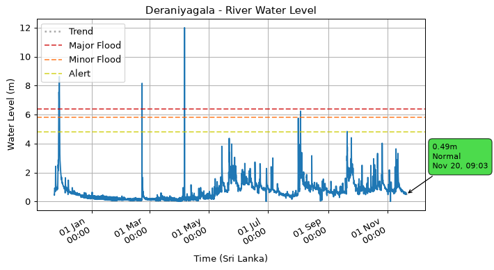

# lk_irrigation 🇱🇰

Realtime Data about *River Water Levels* in Sri Lanka, from the [Irrigation Deptartment](https://www.irrigation.gov.lk)'s [Hydrology and Disaster Management](https://www.irrigation.gov.lk/web/index.php?option=com_content&view=article&id=27&Itemid=128&lang=en) Division.

- [Complete Dataset](data/rwlds) with **318,717 measurements** from **39** stations.
- [Scrape and load logic](src/lk_irrigation/rwld/RiverWaterLevelDataLoadMixin.py)
- [Original Data source](https://www.arcgis.com/apps/dashboards/2cffe83c9ff5497d97375498bdf3ff38)

🇱🇰 River water alerts: No active alerts.
Source: Sri Lanka Irrigation Department https://www.irrigation.gov.lk
Repo: https://github.com/nuuuwan/lk_irrigation
## River Water Level Map

## Latest measurements

*There were **39** measurements in the last **1 hour**.*

| Measured At | Station (River Basin) | Level (m) | Alert Level | Rate-of-Rise (m/hr) | Rising Alert |
| --- | --- | ---: | --- | ---: | --- |
| 2026-11-18 00:16:24 | Dunamale (Aththanagalu Oya) | 1.62 | 🟢 Normal | 0.000 |  |
| 2026-11-18 00:11:59 | Kuda Oya (Kirindi Oya) | 1.59 | 🟢 Normal | 0.000 |  |
| 2026-11-18 00:10:38 | Panadugama (Nilwala Ganga) | 3.30 | 🟢 Normal | -6.945 |  |
| 2026-11-18 00:10:08 | Glencourse (Kelani Ganga) | 10.31 | 🟢 Normal | 0.036 | 🔺 Rising |
| 2026-11-18 00:09:53 | Rathnapura (Kalu Ganga) | 1.65 | 🟢 Normal | 0.000 |  |
| 2026-11-18 00:09:32 | Magura (Kalu Ganga) | 1.66 | 🟢 Normal | 0.038 | 🔺 Rising |
| 2026-11-18 00:09:22 | Thawalama (Gin Ganga) | 1.80 | 🟢 Normal | 0.000 |  |
| 2026-11-18 00:08:40 | Holombuwa (Kelani Ganga) | 0.68 | 🟢 Normal | 0.000 |  |
| 2026-11-18 00:08:39 | Holombuwa (Kelani Ganga) | 0.68 | 🟢 Normal | 0.000 |  |
| 2026-11-18 00:08:14 | Katharagama (Menik Ganga) | -0.06 | 🟢 Normal | 0.000 |  |
| 2026-11-18 00:07:45 | Wellawaya (Kirindi Oya) | 1.36 | 🟢 Normal | 0.000 |  |
| 2026-11-18 00:06:23 | Padiyathalawa (Maduru Oya) | 0.37 | 🟢 Normal | 0.000 |  |
| 2026-11-18 00:06:00 | Nagalagam Street (Kelani Ganga) | 0.46 | 🟢 Normal | -0.028 |  |
| 2026-11-18 00:05:38 | Badalgama (Maha Oya) | 2.61 | 🟢 Normal | 0.000 |  |
| 2026-11-18 00:05:27 | Panadugama (Nilwala Ganga) | 3.90 | 🟢 Normal | -6.945 |  |
| 2026-11-18 00:05:24 | Peradeniya (Mahaweli Ganga) | 2.74 | 🟢 Normal | -0.039 |  |
| 2026-11-18 00:05:17 | Nawalapitiya (Mahaweli Ganga) | 1.21 | 🟢 Normal | -0.009 |  |
| 2026-11-18 00:05:15 | Urawa (Nilwala Ganga) | 0.89 | 🟢 Normal | -0.010 |  |
| 2026-11-18 00:04:51 | Ellagawa (Kalu Ganga) | 5.03 | 🟢 Normal | 0.000 |  |
| 2026-11-18 00:04:23 | Deraniyagala (Kelani Ganga) | 0.63 | 🟢 Normal | -0.010 |  |
| 2026-11-18 00:04:21 | Horowpothana (Yan Oya) | 1.88 | 🟢 Normal | 0.000 |  |
| 2026-11-18 00:04:05 | Thanamalwila (Kirindi Oya) | 1.39 | 🟢 Normal | 0.000 |  |
| 2026-11-18 00:03:59 | Pitabeddara (Nilwala Ganga) | 1.18 | 🟢 Normal | 0.000 |  |
| 2026-11-18 00:03:56 | Norwood (Kelani Ganga) | 0.93 | 🟢 Normal | 0.000 |  |
| 2026-11-18 00:03:42 | Baddegama (Gin Ganga) | 1.57 | 🟢 Normal | 0.000 |  |
| 2026-11-18 00:03:32 | Kithulgala (Kelani Ganga) | 2.07 | 🟢 Normal | 0.000 |  |
| 2026-11-18 00:03:17 | Giriulla (Maha Oya) | 1.31 | 🟢 Normal | -0.010 |  |
| 2026-11-18 00:02:52 | Kalawellawa (Millakanda) (Kalu Ganga) | 2.49 | 🟢 Normal | 0.000 |  |
| 2026-11-18 00:02:47 | Yaka Wewa (Ma Oya) | 0.52 | 🟢 Normal | 0.000 |  |
| 2026-11-18 00:02:18 | Manampitiya (Mahaweli Ganga) | 1.13 | 🟢 Normal | 0.000 |  |
| 2026-11-18 00:02:16 | Moragaswewa (Deduru Oya) | 0.61 | 🟢 Normal | -0.010 |  |
| 2026-11-18 00:02:07 | Thaldena (Mahaweli Ganga) | 0.52 | 🟢 Normal | 0.000 |  |
| 2026-11-18 00:01:50 | Moraketiya (Walawe Ganga) | 1.08 | 🟢 Normal | 0.000 |  |
| 2026-11-18 00:01:44 | Hanwella (Kelani Ganga) | 1.93 | 🟢 Normal | 0.010 | 🔺 Rising |
| 2026-11-18 00:01:40 | Nakkala (Kumbukkan Oya) | 0.85 | 🟢 Normal | 0.000 |  |
| 2026-11-18 00:01:26 | Kuda Oya (Kirindi Oya) | 1.59 | 🟢 Normal | 0.000 |  |
| 2026-11-18 00:01:13 | Siyambalanduwa (Heda Oya) | 0.51 | 🟢 Normal | 0.000 |  |
| 2026-11-18 00:01:09 | Thalgahagoda (Nilwala Ganga) | 1.00 | 🟢 Normal | 0.000 |  |
| 2026-11-18 00:00:16 | Wellawaya (Kirindi Oya) | 1.36 | 🟢 Normal | 0.000 |  |

## Latest by Station

*⌛ = Latest measurement is older than **24 hours**.*

| Measured At | Station (River Basin) | Level (m) | Alert Level | Rate-of-Rise (m/hr) | Rising Alert |
| --- | --- | ---: | --- | ---: | --- |
| 2026-11-17 23:14:31 | Putupaula (Kalu Ganga) | 0.70 | 🟢 Normal | 0.061 | 🔺 Rising |
| 2026-11-18 00:09:32 | Magura (Kalu Ganga) | 1.66 | 🟢 Normal | 0.038 | 🔺 Rising |
| 2026-11-18 00:10:08 | Glencourse (Kelani Ganga) | 10.31 | 🟢 Normal | 0.036 | 🔺 Rising |
| 2026-11-18 00:01:44 | Hanwella (Kelani Ganga) | 1.93 | 🟢 Normal | 0.010 | 🔺 Rising |
| 2026-11-18 00:03:32 | Kithulgala (Kelani Ganga) | 2.07 | 🟢 Normal | 0.000 |  |
| 2026-11-17 18:03:49 | Weraganthota (Mahaweli Ganga) | -2.19 | 🟢 Normal | 0.000 |  |
| 2026-11-18 00:07:45 | Wellawaya (Kirindi Oya) | 1.36 | 🟢 Normal | 0.000 |  |
| 2026-11-18 00:01:40 | Nakkala (Kumbukkan Oya) | 0.85 | 🟢 Normal | 0.000 |  |
| 2026-11-18 00:02:47 | Yaka Wewa (Ma Oya) | 0.52 | 🟢 Normal | 0.000 |  |
| 2026-11-18 00:04:21 | Horowpothana (Yan Oya) | 1.88 | 🟢 Normal | 0.000 |  |
| 2026-11-17 18:03:41 | Galgamuwa (Mee Oya) | 0.23 | 🟢 Normal | 0.000 |  |
| 2026-11-18 00:03:59 | Pitabeddara (Nilwala Ganga) | 1.18 | 🟢 Normal | 0.000 |  |
| 2026-11-18 00:03:56 | Norwood (Kelani Ganga) | 0.93 | 🟢 Normal | 0.000 |  |
| 2026-11-18 00:04:51 | Ellagawa (Kalu Ganga) | 5.03 | 🟢 Normal | 0.000 |  |
| 2026-11-18 00:03:42 | Baddegama (Gin Ganga) | 1.57 | 🟢 Normal | 0.000 |  |
| 2026-11-18 00:06:23 | Padiyathalawa (Maduru Oya) | 0.37 | 🟢 Normal | 0.000 |  |
| 2026-11-18 00:01:50 | Moraketiya (Walawe Ganga) | 1.08 | 🟢 Normal | 0.000 |  |
| 2026-11-18 00:01:13 | Siyambalanduwa (Heda Oya) | 0.51 | 🟢 Normal | 0.000 |  |
| 2026-11-18 00:16:24 | Dunamale (Aththanagalu Oya) | 1.62 | 🟢 Normal | 0.000 |  |
| 2026-11-18 00:02:07 | Thaldena (Mahaweli Ganga) | 0.52 | 🟢 Normal | 0.000 |  |
| 2026-11-18 00:08:14 | Katharagama (Menik Ganga) | -0.06 | 🟢 Normal | 0.000 |  |
| 2026-11-18 00:05:38 | Badalgama (Maha Oya) | 2.61 | 🟢 Normal | 0.000 |  |
| 2026-11-18 00:08:40 | Holombuwa (Kelani Ganga) | 0.68 | 🟢 Normal | 0.000 |  |
| 2026-11-18 00:02:18 | Manampitiya (Mahaweli Ganga) | 1.13 | 🟢 Normal | 0.000 |  |
| 2026-11-18 00:09:53 | Rathnapura (Kalu Ganga) | 1.65 | 🟢 Normal | 0.000 |  |
| 2026-11-17 18:01:44 | Thanthirimale (Malwathu Oya) | 1.34 | 🟢 Normal | 0.000 |  |
| 2026-11-18 00:09:22 | Thawalama (Gin Ganga) | 1.80 | 🟢 Normal | 0.000 |  |
| 2026-11-18 00:01:09 | Thalgahagoda (Nilwala Ganga) | 1.00 | 🟢 Normal | 0.000 |  |
| 2026-11-18 00:11:59 | Kuda Oya (Kirindi Oya) | 1.59 | 🟢 Normal | 0.000 |  |
| 2026-11-18 00:04:05 | Thanamalwila (Kirindi Oya) | 1.39 | 🟢 Normal | 0.000 |  |
| 2026-11-18 00:02:52 | Kalawellawa (Millakanda) (Kalu Ganga) | 2.49 | 🟢 Normal | 0.000 |  |
| 2026-11-18 00:05:17 | Nawalapitiya (Mahaweli Ganga) | 1.21 | 🟢 Normal | -0.009 |  |
| 2026-11-18 00:04:23 | Deraniyagala (Kelani Ganga) | 0.63 | 🟢 Normal | -0.010 |  |
| 2026-11-18 00:03:17 | Giriulla (Maha Oya) | 1.31 | 🟢 Normal | -0.010 |  |
| 2026-11-18 00:05:15 | Urawa (Nilwala Ganga) | 0.89 | 🟢 Normal | -0.010 |  |
| 2026-11-18 00:02:16 | Moragaswewa (Deduru Oya) | 0.61 | 🟢 Normal | -0.010 |  |
| 2026-11-18 00:06:00 | Nagalagam Street (Kelani Ganga) | 0.46 | 🟢 Normal | -0.028 |  |
| 2026-11-18 00:05:24 | Peradeniya (Mahaweli Ganga) | 2.74 | 🟢 Normal | -0.039 |  |
| 2026-11-18 00:10:38 | Panadugama (Nilwala Ganga) | 3.30 | 🟢 Normal | -6.945 |  |

## River Water Level Charts by Station

### Putupaula (Kalu Ganga)

### Magura (Kalu Ganga)

### Glencourse (Kelani Ganga)

### Hanwella (Kelani Ganga)

### Kithulgala (Kelani Ganga)

### Weraganthota (Mahaweli Ganga)

### Wellawaya (Kirindi Oya)

### Nakkala (Kumbukkan Oya)

### Yaka Wewa (Ma Oya)

### Horowpothana (Yan Oya)

### Galgamuwa (Mee Oya)

### Pitabeddara (Nilwala Ganga)

### Norwood (Kelani Ganga)

### Ellagawa (Kalu Ganga)

### Baddegama (Gin Ganga)

### Padiyathalawa (Maduru Oya)

### Moraketiya (Walawe Ganga)

### Siyambalanduwa (Heda Oya)

### Dunamale (Aththanagalu Oya)

### Thaldena (Mahaweli Ganga)

### Katharagama (Menik Ganga)

### Badalgama (Maha Oya)

### Holombuwa (Kelani Ganga)

### Manampitiya (Mahaweli Ganga)

### Rathnapura (Kalu Ganga)

### Thanthirimale (Malwathu Oya)

### Thawalama (Gin Ganga)

### Thalgahagoda (Nilwala Ganga)

### Kuda Oya (Kirindi Oya)

### Thanamalwila (Kirindi Oya)

### Kalawellawa (Millakanda) (Kalu Ganga)

.png)

### Nawalapitiya (Mahaweli Ganga)

### Deraniyagala (Kelani Ganga)

### Giriulla (Maha Oya)

### Urawa (Nilwala Ganga)

### Moragaswewa (Deduru Oya)

### Nagalagam Street (Kelani Ganga)

### Peradeniya (Mahaweli Ganga)

### Panadugama (Nilwala Ganga)

