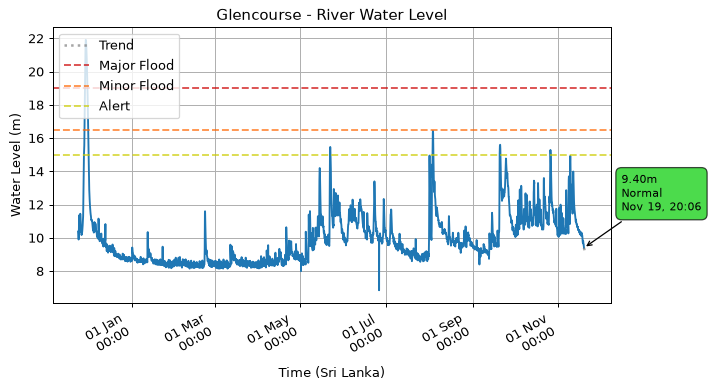

# lk_irrigation 🇱🇰

Realtime Data about *River Water Levels* in Sri Lanka, from the [Irrigation Deptartment](https://www.irrigation.gov.lk)'s [Hydrology and Disaster Management](https://www.irrigation.gov.lk/web/index.php?option=com_content&view=article&id=27&Itemid=128&lang=en) Division.

- [Complete Dataset](data/rwlds) with **318,031 measurements** from **39** stations.
- [Scrape and load logic](src/lk_irrigation/rwld/RiverWaterLevelDataLoadMixin.py)
- [Original Data source](https://www.arcgis.com/apps/dashboards/2cffe83c9ff5497d97375498bdf3ff38)

🇱🇰 River water alerts: No active alerts.
Source: Sri Lanka Irrigation Department https://www.irrigation.gov.lk
Repo: https://github.com/nuuuwan/lk_irrigation
## River Water Level Map

## Latest measurements

*There were **38** measurements in the last **1 hour**.*

| Measured At | Station (River Basin) | Level (m) | Alert Level | Rate-of-Rise (m/hr) | Rising Alert |
| --- | --- | ---: | --- | ---: | --- |
| 2026-11-17 06:33:35 | Galgamuwa (Mee Oya) | 0.30 | 🟢 Normal | 0.002 |  |
| 2026-11-17 06:16:19 | Horowpothana (Yan Oya) | 2.00 | 🟢 Normal | 0.000 |  |
| 2026-11-17 06:10:38 | Moragaswewa (Deduru Oya) | 0.66 | 🟢 Normal | 0.088 | 🔺 Rising |
| 2026-11-17 06:08:23 | Baddegama (Gin Ganga) | 1.71 | 🟢 Normal | -0.010 |  |
| 2026-11-17 06:07:39 | Nagalagam Street (Kelani Ganga) | 0.76 | 🟢 Normal | 0.000 |  |
| 2026-11-17 06:07:17 | Kalawellawa (Millakanda) (Kalu Ganga) | 2.60 | 🟢 Normal | 0.043 | 🔺 Rising |
| 2026-11-17 06:07:14 | Yaka Wewa (Ma Oya) | 0.52 | 🟢 Normal | -0.009 |  |
| 2026-11-17 06:06:03 | Holombuwa (Kelani Ganga) | 0.73 | 🟢 Normal | 0.000 |  |
| 2026-11-17 06:05:50 | Panadugama (Nilwala Ganga) | 3.99 | 🟢 Normal | -0.028 |  |
| 2026-11-17 06:05:47 | Thaldena (Mahaweli Ganga) | 0.56 | 🟢 Normal | 0.000 |  |
| 2026-11-17 06:05:10 | Deraniyagala (Kelani Ganga) | 0.66 | 🟢 Normal | -0.010 |  |
| 2026-11-17 06:04:44 | Hanwella (Kelani Ganga) | 2.08 | 🟢 Normal | 0.020 | 🔺 Rising |
| 2026-11-17 06:04:33 | Wellawaya (Kirindi Oya) | 1.34 | 🟢 Normal | -0.039 |  |
| 2026-11-17 06:04:20 | Glencourse (Kelani Ganga) | 10.35 | 🟢 Normal | -0.029 |  |
| 2026-11-17 06:04:11 | Katharagama (Menik Ganga) | -0.04 | 🟢 Normal | 0.000 |  |
| 2026-11-17 06:04:09 | Nawalapitiya (Mahaweli Ganga) | 1.24 | 🟢 Normal | 0.010 | 🔺 Rising |
| 2026-11-17 06:03:47 | Padiyathalawa (Maduru Oya) | 0.40 | 🟢 Normal | 0.000 |  |
| 2026-11-17 06:03:31 | Rathnapura (Kalu Ganga) | 1.58 | 🟢 Normal | 0.000 |  |
| 2026-11-17 06:03:24 | Siyambalanduwa (Heda Oya) | 0.52 | 🟢 Normal | -0.012 |  |
| 2026-11-17 06:03:09 | Urawa (Nilwala Ganga) | 0.96 | 🟢 Normal | 0.000 |  |
| 2026-11-17 06:03:08 | Nakkala (Kumbukkan Oya) | 0.88 | 🟢 Normal | -0.010 |  |
| 2026-11-17 06:03:03 | Norwood (Kelani Ganga) | 0.97 | 🟢 Normal | 0.000 |  |
| 2026-11-17 06:02:56 | Weraganthota (Mahaweli Ganga) | -2.02 | 🟢 Normal | -0.009 |  |
| 2026-11-17 06:02:54 | Peradeniya (Mahaweli Ganga) | 2.78 | 🟢 Normal | -0.059 |  |
| 2026-11-17 06:02:51 | Giriulla (Maha Oya) | 1.34 | 🟢 Normal | 0.000 |  |
| 2026-11-17 06:02:51 | Thawalama (Gin Ganga) | 1.83 | 🟢 Normal | 0.000 |  |
| 2026-11-17 06:02:39 | Dunamale (Aththanagalu Oya) | 1.74 | 🟢 Normal | -0.027 |  |
| 2026-11-17 06:02:27 | Thanamalwila (Kirindi Oya) | 1.46 | 🟢 Normal | 0.000 |  |
| 2026-11-17 06:02:22 | Ellagawa (Kalu Ganga) | 5.18 | 🟢 Normal | -0.022 |  |
| 2026-11-17 06:02:19 | Badalgama (Maha Oya) | 2.62 | 🟢 Normal | -0.010 |  |
| 2026-11-17 06:02:09 | Pitabeddara (Nilwala Ganga) | 1.30 | 🟢 Normal | -0.012 |  |
| 2026-11-17 06:01:55 | Magura (Kalu Ganga) | 1.67 | 🟢 Normal | -0.012 |  |
| 2026-11-17 06:01:31 | Putupaula (Kalu Ganga) | 0.82 | 🟢 Normal | 0.059 | 🔺 Rising |
| 2026-11-17 06:01:22 | Kithulgala (Kelani Ganga) | 2.05 | 🟢 Normal | 0.000 |  |
| 2026-11-17 06:01:14 | Manampitiya (Mahaweli Ganga) | 1.16 | 🟢 Normal | 0.000 |  |
| 2026-11-17 06:01:14 | Kuda Oya (Kirindi Oya) | 1.55 | 🟢 Normal | -0.008 |  |
| 2026-11-17 06:01:09 | Moraketiya (Walawe Ganga) | 1.71 | 🟢 Normal | 0.000 |  |
| 2026-11-17 06:00:22 | Thalgahagoda (Nilwala Ganga) | 1.11 | 🟢 Normal | -0.057 |  |

## Latest by Station

*⌛ = Latest measurement is older than **24 hours**.*

| Measured At | Station (River Basin) | Level (m) | Alert Level | Rate-of-Rise (m/hr) | Rising Alert |
| --- | --- | ---: | --- | ---: | --- |
| 2026-11-17 06:10:38 | Moragaswewa (Deduru Oya) | 0.66 | 🟢 Normal | 0.088 | 🔺 Rising |
| 2026-11-17 06:01:31 | Putupaula (Kalu Ganga) | 0.82 | 🟢 Normal | 0.059 | 🔺 Rising |
| 2026-11-17 06:07:17 | Kalawellawa (Millakanda) (Kalu Ganga) | 2.60 | 🟢 Normal | 0.043 | 🔺 Rising |
| 2026-11-17 06:04:44 | Hanwella (Kelani Ganga) | 2.08 | 🟢 Normal | 0.020 | 🔺 Rising |
| 2026-11-17 06:04:09 | Nawalapitiya (Mahaweli Ganga) | 1.24 | 🟢 Normal | 0.010 | 🔺 Rising |
| 2026-11-17 06:33:35 | Galgamuwa (Mee Oya) | 0.30 | 🟢 Normal | 0.002 |  |
| 2026-11-17 06:01:22 | Kithulgala (Kelani Ganga) | 2.05 | 🟢 Normal | 0.000 |  |
| 2026-11-17 06:02:51 | Giriulla (Maha Oya) | 1.34 | 🟢 Normal | 0.000 |  |
| 2026-11-17 06:16:19 | Horowpothana (Yan Oya) | 2.00 | 🟢 Normal | 0.000 |  |
| 2026-11-17 06:03:03 | Norwood (Kelani Ganga) | 0.97 | 🟢 Normal | 0.000 |  |
| 2026-11-17 06:03:47 | Padiyathalawa (Maduru Oya) | 0.40 | 🟢 Normal | 0.000 |  |
| 2026-11-17 06:07:39 | Nagalagam Street (Kelani Ganga) | 0.76 | 🟢 Normal | 0.000 |  |
| 2026-11-17 06:01:09 | Moraketiya (Walawe Ganga) | 1.71 | 🟢 Normal | 0.000 |  |
| 2026-11-17 06:05:47 | Thaldena (Mahaweli Ganga) | 0.56 | 🟢 Normal | 0.000 |  |
| 2026-11-17 06:04:11 | Katharagama (Menik Ganga) | -0.04 | 🟢 Normal | 0.000 |  |
| 2026-11-17 06:06:03 | Holombuwa (Kelani Ganga) | 0.73 | 🟢 Normal | 0.000 |  |
| 2026-11-17 06:01:14 | Manampitiya (Mahaweli Ganga) | 1.16 | 🟢 Normal | 0.000 |  |
| 2026-11-17 06:03:31 | Rathnapura (Kalu Ganga) | 1.58 | 🟢 Normal | 0.000 |  |
| 2026-11-16 18:00:40 | Thanthirimale (Malwathu Oya) | 1.50 | 🟢 Normal | 0.000 |  |
| 2026-11-17 06:02:51 | Thawalama (Gin Ganga) | 1.83 | 🟢 Normal | 0.000 |  |
| 2026-11-17 06:03:09 | Urawa (Nilwala Ganga) | 0.96 | 🟢 Normal | 0.000 |  |
| 2026-11-17 06:02:27 | Thanamalwila (Kirindi Oya) | 1.46 | 🟢 Normal | 0.000 |  |
| 2026-11-17 06:01:14 | Kuda Oya (Kirindi Oya) | 1.55 | 🟢 Normal | -0.008 |  |
| 2026-11-17 06:02:56 | Weraganthota (Mahaweli Ganga) | -2.02 | 🟢 Normal | -0.009 |  |
| 2026-11-17 06:07:14 | Yaka Wewa (Ma Oya) | 0.52 | 🟢 Normal | -0.009 |  |
| 2026-11-17 06:05:10 | Deraniyagala (Kelani Ganga) | 0.66 | 🟢 Normal | -0.010 |  |
| 2026-11-17 06:03:08 | Nakkala (Kumbukkan Oya) | 0.88 | 🟢 Normal | -0.010 |  |
| 2026-11-17 06:08:23 | Baddegama (Gin Ganga) | 1.71 | 🟢 Normal | -0.010 |  |
| 2026-11-17 06:02:19 | Badalgama (Maha Oya) | 2.62 | 🟢 Normal | -0.010 |  |
| 2026-11-17 06:03:24 | Siyambalanduwa (Heda Oya) | 0.52 | 🟢 Normal | -0.012 |  |
| 2026-11-17 06:01:55 | Magura (Kalu Ganga) | 1.67 | 🟢 Normal | -0.012 |  |
| 2026-11-17 06:02:09 | Pitabeddara (Nilwala Ganga) | 1.30 | 🟢 Normal | -0.012 |  |
| 2026-11-17 06:02:22 | Ellagawa (Kalu Ganga) | 5.18 | 🟢 Normal | -0.022 |  |
| 2026-11-17 06:02:39 | Dunamale (Aththanagalu Oya) | 1.74 | 🟢 Normal | -0.027 |  |
| 2026-11-17 06:05:50 | Panadugama (Nilwala Ganga) | 3.99 | 🟢 Normal | -0.028 |  |
| 2026-11-17 06:04:20 | Glencourse (Kelani Ganga) | 10.35 | 🟢 Normal | -0.029 |  |
| 2026-11-17 06:04:33 | Wellawaya (Kirindi Oya) | 1.34 | 🟢 Normal | -0.039 |  |
| 2026-11-17 06:00:22 | Thalgahagoda (Nilwala Ganga) | 1.11 | 🟢 Normal | -0.057 |  |
| 2026-11-17 06:02:54 | Peradeniya (Mahaweli Ganga) | 2.78 | 🟢 Normal | -0.059 |  |

## River Water Level Charts by Station

### Moragaswewa (Deduru Oya)

### Putupaula (Kalu Ganga)

### Kalawellawa (Millakanda) (Kalu Ganga)

.png)

### Hanwella (Kelani Ganga)

### Nawalapitiya (Mahaweli Ganga)

### Galgamuwa (Mee Oya)

### Kithulgala (Kelani Ganga)

### Giriulla (Maha Oya)

### Horowpothana (Yan Oya)

### Norwood (Kelani Ganga)

### Padiyathalawa (Maduru Oya)

### Nagalagam Street (Kelani Ganga)

### Moraketiya (Walawe Ganga)

### Thaldena (Mahaweli Ganga)

### Katharagama (Menik Ganga)

### Holombuwa (Kelani Ganga)

### Manampitiya (Mahaweli Ganga)

### Rathnapura (Kalu Ganga)

### Thanthirimale (Malwathu Oya)

### Thawalama (Gin Ganga)

### Urawa (Nilwala Ganga)

### Thanamalwila (Kirindi Oya)

### Kuda Oya (Kirindi Oya)

### Weraganthota (Mahaweli Ganga)

### Yaka Wewa (Ma Oya)

### Deraniyagala (Kelani Ganga)

### Nakkala (Kumbukkan Oya)

### Baddegama (Gin Ganga)

### Badalgama (Maha Oya)

### Siyambalanduwa (Heda Oya)

### Magura (Kalu Ganga)

### Pitabeddara (Nilwala Ganga)

### Ellagawa (Kalu Ganga)

### Dunamale (Aththanagalu Oya)

### Panadugama (Nilwala Ganga)

### Glencourse (Kelani Ganga)

### Wellawaya (Kirindi Oya)

### Thalgahagoda (Nilwala Ganga)

### Peradeniya (Mahaweli Ganga)

