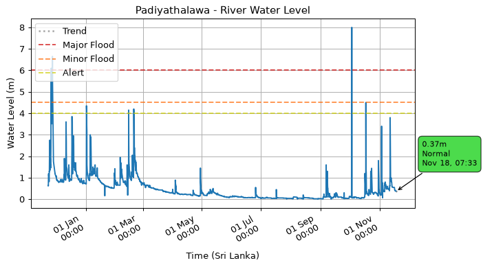

# lk_irrigation 🇱🇰

Realtime Data about *River Water Levels* in Sri Lanka, from the [Irrigation Deptartment](https://www.irrigation.gov.lk)'s [Hydrology and Disaster Management](https://www.irrigation.gov.lk/web/index.php?option=com_content&view=article&id=27&Itemid=128&lang=en) Division.

- [Complete Dataset](data/rwlds) with **327,793 measurements** from **39** stations.
- [Scrape and load logic](src/lk_irrigation/rwld/RiverWaterLevelDataLoadMixin.py)
- [Original Data source](https://www.arcgis.com/apps/dashboards/2cffe83c9ff5497d97375498bdf3ff38)

🇱🇰 River water alerts: 🟡 Kalawellawa (Millakanda) — Alert; 🟡 Dunamale — Alert; 🟡 Moraketiya — Alert; 🟡 Panadugama — Alert
Source: Sri Lanka Irrigation Department https://www.irrigation.gov.lk
Repo: https://github.com/nuuuwan/lk_irrigation
## River Water Level Map

## Latest measurements

*There were **38** measurements in the last **1 hour**.*

| Measured At | Station (River Basin) | Level (m) | Alert Level | Rate-of-Rise (m/hr) | Rising Alert |
| --- | --- | ---: | --- | ---: | --- |
| 2026-11-28 08:32:01 | Urawa (Nilwala Ganga) | 1.13 | 🟢 Normal | -0.055 |  |
| 2026-11-28 08:22:58 | Horowpothana (Yan Oya) | 2.37 | 🟢 Normal | -0.007 |  |
| 2026-11-28 08:19:28 | Panadugama (Nilwala Ganga) | 5.52 | 🟡 Alert | -0.029 |  |
| 2026-11-28 08:12:58 | Thanthirimale (Malwathu Oya) | 1.44 | 🟢 Normal | -0.008 |  |
| 2026-11-28 08:11:38 | Badalgama (Maha Oya) | 4.12 | 🟢 Normal | -0.076 |  |
| 2026-11-28 08:09:56 | Katharagama (Menik Ganga) | 0.14 | 🟢 Normal | -0.010 |  |
| 2026-11-28 08:09:48 | Nagalagam Street (Kelani Ganga) | 0.59 | 🟢 Normal | -0.131 |  |
| 2026-11-28 08:09:10 | Manampitiya (Mahaweli Ganga) | 1.90 | 🟢 Normal | 0.044 | 🔺 Rising |
| 2026-11-28 08:08:34 | Galgamuwa (Mee Oya) | 0.67 | 🟢 Normal | -0.062 |  |
| 2026-11-28 08:06:57 | Holombuwa (Kelani Ganga) | 1.45 | 🟢 Normal | -0.124 |  |
| 2026-11-28 08:06:47 | Peradeniya (Mahaweli Ganga) | 2.90 | 🟢 Normal | -0.020 |  |
| 2026-11-28 08:06:46 | Giriulla (Maha Oya) | 2.96 | 🟢 Normal | -0.134 |  |
| 2026-11-28 08:05:44 | Moraketiya (Walawe Ganga) | 3.20 | 🟡 Alert | 0.000 |  |
| 2026-11-28 08:05:34 | Magura (Kalu Ganga) | 3.79 | 🟢 Normal | -0.067 |  |
| 2026-11-28 08:05:22 | Thalgahagoda (Nilwala Ganga) | 1.20 | 🟢 Normal | 0.045 | 🔺 Rising |
| 2026-11-28 08:05:20 | Norwood (Kelani Ganga) | 0.96 | 🟢 Normal | 0.000 |  |
| 2026-11-28 08:04:45 | Putupaula (Kalu Ganga) | 1.76 | 🟢 Normal | 0.042 | 🔺 Rising |
| 2026-11-28 08:04:21 | Padiyathalawa (Maduru Oya) | 0.68 | 🟢 Normal | 0.000 |  |
| 2026-11-28 08:04:15 | Thawalama (Gin Ganga) | 2.46 | 🟢 Normal | 0.065 | 🔺 Rising |
| 2026-11-28 08:03:57 | Rathnapura (Kalu Ganga) | 2.66 | 🟢 Normal | -0.093 |  |
| 2026-11-28 08:03:51 | Hanwella (Kelani Ganga) | 4.08 | 🟢 Normal | -0.049 |  |
| 2026-11-28 08:03:41 | Siyambalanduwa (Heda Oya) | 0.94 | 🟢 Normal | -0.038 |  |
| 2026-11-28 08:03:32 | Kalawellawa (Millakanda) (Kalu Ganga) | 5.20 | 🟡 Alert | 0.052 | 🔺 Rising |
| 2026-11-28 08:03:21 | Baddegama (Gin Ganga) | 2.06 | 🟢 Normal | -0.021 |  |
| 2026-11-28 08:03:12 | Kithulgala (Kelani Ganga) | 1.47 | 🟢 Normal | -0.488 |  |
| 2026-11-28 08:02:55 | Kuda Oya (Kirindi Oya) | 2.54 | 🟢 Normal | -0.088 |  |
| 2026-11-28 08:02:48 | Dunamale (Aththanagalu Oya) | 3.99 | 🟡 Alert | 0.034 | 🔺 Rising |
| 2026-11-28 08:02:41 | Pitabeddara (Nilwala Ganga) | 2.45 | 🟢 Normal | -0.067 |  |
| 2026-11-28 08:02:18 | Deraniyagala (Kelani Ganga) | 0.81 | 🟢 Normal | -0.020 |  |
| 2026-11-28 08:02:17 | Glencourse (Kelani Ganga) | 11.83 | 🟢 Normal | -0.138 |  |
| 2026-11-28 08:02:17 | Ellagawa (Kalu Ganga) | 7.32 | 🟢 Normal | -0.030 |  |
| 2026-11-28 08:02:08 | Thanamalwila (Kirindi Oya) | 2.23 | 🟢 Normal | -0.049 |  |
| 2026-11-28 08:01:50 | Yaka Wewa (Ma Oya) | 0.50 | 🟢 Normal | 0.000 |  |
| 2026-11-28 08:01:47 | Wellawaya (Kirindi Oya) | 1.55 | 🟢 Normal | -0.031 |  |
| 2026-11-28 08:01:07 | Nawalapitiya (Mahaweli Ganga) | 1.33 | 🟢 Normal | -0.010 |  |
| 2026-11-28 08:01:06 | Moragaswewa (Deduru Oya) | 2.32 | 🟢 Normal | -0.028 |  |
| 2026-11-28 08:00:31 | Thaldena (Mahaweli Ganga) | 0.71 | 🟢 Normal | -0.010 |  |
| 2026-11-28 08:00:12 | Nakkala (Kumbukkan Oya) | 1.03 | 🟢 Normal | -0.010 |  |

## Latest by Station

*⌛ = Latest measurement is older than **24 hours**.*

| Measured At | Station (River Basin) | Level (m) | Alert Level | Rate-of-Rise (m/hr) | Rising Alert |
| --- | --- | ---: | --- | ---: | --- |
| 2026-11-28 08:03:32 | Kalawellawa (Millakanda) (Kalu Ganga) | 5.20 | 🟡 Alert | 0.052 | 🔺 Rising |
| 2026-11-28 08:02:48 | Dunamale (Aththanagalu Oya) | 3.99 | 🟡 Alert | 0.034 | 🔺 Rising |
| 2026-11-28 08:05:44 | Moraketiya (Walawe Ganga) | 3.20 | 🟡 Alert | 0.000 |  |
| 2026-11-28 08:19:28 | Panadugama (Nilwala Ganga) | 5.52 | 🟡 Alert | -0.029 |  |
| 2026-11-28 08:04:15 | Thawalama (Gin Ganga) | 2.46 | 🟢 Normal | 0.065 | 🔺 Rising |
| 2026-11-28 08:05:22 | Thalgahagoda (Nilwala Ganga) | 1.20 | 🟢 Normal | 0.045 | 🔺 Rising |
| 2026-11-28 08:09:10 | Manampitiya (Mahaweli Ganga) | 1.90 | 🟢 Normal | 0.044 | 🔺 Rising |
| 2026-11-28 08:04:45 | Putupaula (Kalu Ganga) | 1.76 | 🟢 Normal | 0.042 | 🔺 Rising |
| 2026-11-28 07:00:16 | Weraganthota (Mahaweli Ganga) | -1.32 | 🟢 Normal | 0.031 | 🔺 Rising |
| 2026-11-28 08:01:50 | Yaka Wewa (Ma Oya) | 0.50 | 🟢 Normal | 0.000 |  |
| 2026-11-28 08:05:20 | Norwood (Kelani Ganga) | 0.96 | 🟢 Normal | 0.000 |  |
| 2026-11-28 08:04:21 | Padiyathalawa (Maduru Oya) | 0.68 | 🟢 Normal | 0.000 |  |
| 2026-11-28 08:22:58 | Horowpothana (Yan Oya) | 2.37 | 🟢 Normal | -0.007 |  |
| 2026-11-28 08:12:58 | Thanthirimale (Malwathu Oya) | 1.44 | 🟢 Normal | -0.008 |  |
| 2026-11-28 08:09:56 | Katharagama (Menik Ganga) | 0.14 | 🟢 Normal | -0.010 |  |
| 2026-11-28 08:00:31 | Thaldena (Mahaweli Ganga) | 0.71 | 🟢 Normal | -0.010 |  |
| 2026-11-28 08:00:12 | Nakkala (Kumbukkan Oya) | 1.03 | 🟢 Normal | -0.010 |  |
| 2026-11-28 08:01:07 | Nawalapitiya (Mahaweli Ganga) | 1.33 | 🟢 Normal | -0.010 |  |
| 2026-11-28 08:06:47 | Peradeniya (Mahaweli Ganga) | 2.90 | 🟢 Normal | -0.020 |  |
| 2026-11-28 08:02:18 | Deraniyagala (Kelani Ganga) | 0.81 | 🟢 Normal | -0.020 |  |
| 2026-11-28 08:03:21 | Baddegama (Gin Ganga) | 2.06 | 🟢 Normal | -0.021 |  |
| 2026-11-28 08:01:06 | Moragaswewa (Deduru Oya) | 2.32 | 🟢 Normal | -0.028 |  |
| 2026-11-28 08:02:17 | Ellagawa (Kalu Ganga) | 7.32 | 🟢 Normal | -0.030 |  |
| 2026-11-28 08:01:47 | Wellawaya (Kirindi Oya) | 1.55 | 🟢 Normal | -0.031 |  |
| 2026-11-28 08:03:41 | Siyambalanduwa (Heda Oya) | 0.94 | 🟢 Normal | -0.038 |  |
| 2026-11-28 08:03:51 | Hanwella (Kelani Ganga) | 4.08 | 🟢 Normal | -0.049 |  |
| 2026-11-28 08:02:08 | Thanamalwila (Kirindi Oya) | 2.23 | 🟢 Normal | -0.049 |  |
| 2026-11-28 08:32:01 | Urawa (Nilwala Ganga) | 1.13 | 🟢 Normal | -0.055 |  |
| 2026-11-28 08:08:34 | Galgamuwa (Mee Oya) | 0.67 | 🟢 Normal | -0.062 |  |
| 2026-11-28 08:05:34 | Magura (Kalu Ganga) | 3.79 | 🟢 Normal | -0.067 |  |
| 2026-11-28 08:02:41 | Pitabeddara (Nilwala Ganga) | 2.45 | 🟢 Normal | -0.067 |  |
| 2026-11-28 08:11:38 | Badalgama (Maha Oya) | 4.12 | 🟢 Normal | -0.076 |  |
| 2026-11-28 08:02:55 | Kuda Oya (Kirindi Oya) | 2.54 | 🟢 Normal | -0.088 |  |
| 2026-11-28 08:03:57 | Rathnapura (Kalu Ganga) | 2.66 | 🟢 Normal | -0.093 |  |
| 2026-11-28 08:06:57 | Holombuwa (Kelani Ganga) | 1.45 | 🟢 Normal | -0.124 |  |
| 2026-11-28 08:09:48 | Nagalagam Street (Kelani Ganga) | 0.59 | 🟢 Normal | -0.131 |  |
| 2026-11-28 08:06:46 | Giriulla (Maha Oya) | 2.96 | 🟢 Normal | -0.134 |  |
| 2026-11-28 08:02:17 | Glencourse (Kelani Ganga) | 11.83 | 🟢 Normal | -0.138 |  |
| 2026-11-28 08:03:12 | Kithulgala (Kelani Ganga) | 1.47 | 🟢 Normal | -0.488 |  |

## River Water Level Charts by Station

### Kalawellawa (Millakanda) (Kalu Ganga)

.png)

### Dunamale (Aththanagalu Oya)

### Moraketiya (Walawe Ganga)

### Panadugama (Nilwala Ganga)

### Thawalama (Gin Ganga)

### Thalgahagoda (Nilwala Ganga)

### Manampitiya (Mahaweli Ganga)

### Putupaula (Kalu Ganga)

### Weraganthota (Mahaweli Ganga)

### Yaka Wewa (Ma Oya)

### Norwood (Kelani Ganga)

### Padiyathalawa (Maduru Oya)

### Horowpothana (Yan Oya)

### Thanthirimale (Malwathu Oya)

### Katharagama (Menik Ganga)

### Thaldena (Mahaweli Ganga)

### Nakkala (Kumbukkan Oya)

### Nawalapitiya (Mahaweli Ganga)

### Peradeniya (Mahaweli Ganga)

### Deraniyagala (Kelani Ganga)

### Baddegama (Gin Ganga)

### Moragaswewa (Deduru Oya)

### Ellagawa (Kalu Ganga)

### Wellawaya (Kirindi Oya)

### Siyambalanduwa (Heda Oya)

### Hanwella (Kelani Ganga)

### Thanamalwila (Kirindi Oya)

### Urawa (Nilwala Ganga)

### Galgamuwa (Mee Oya)

### Magura (Kalu Ganga)

### Pitabeddara (Nilwala Ganga)

### Badalgama (Maha Oya)

### Kuda Oya (Kirindi Oya)

### Rathnapura (Kalu Ganga)

### Holombuwa (Kelani Ganga)

### Nagalagam Street (Kelani Ganga)

### Giriulla (Maha Oya)

### Glencourse (Kelani Ganga)

### Kithulgala (Kelani Ganga)

