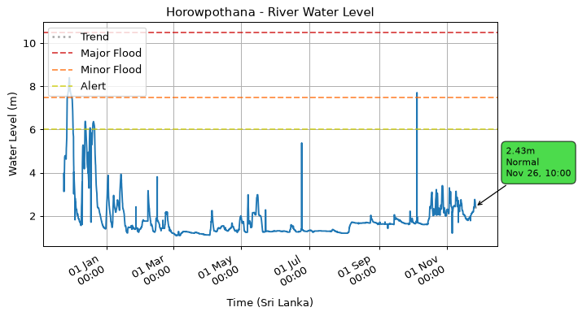

# lk_irrigation 🇱🇰

Realtime Data about *River Water Levels* in Sri Lanka, from the [Irrigation Deptartment](https://www.irrigation.gov.lk)'s [Hydrology and Disaster Management](https://www.irrigation.gov.lk/web/index.php?option=com_content&view=article&id=27&Itemid=128&lang=en) Division.

- [Complete Dataset](data/rwlds) with **327,153 measurements** from **39** stations.
- [Scrape and load logic](src/lk_irrigation/rwld/RiverWaterLevelDataLoadMixin.py)
- [Original Data source](https://www.arcgis.com/apps/dashboards/2cffe83c9ff5497d97375498bdf3ff38)

🇱🇰 River water alerts: 🟡 Kalawellawa (Millakanda) — Alert; 🟡 Moraketiya — Alert; 🟡 Dunamale — Alert
Source: Sri Lanka Irrigation Department https://www.irrigation.gov.lk
Repo: https://github.com/nuuuwan/lk_irrigation
## River Water Level Map

## Latest measurements

*There were **20** measurements in the last **1 hour**.*

| Measured At | Station (River Basin) | Level (m) | Alert Level | Rate-of-Rise (m/hr) | Rising Alert |
| --- | --- | ---: | --- | ---: | --- |
| 2026-11-27 15:03:02 | Kalawellawa (Millakanda) (Kalu Ganga) | 5.28 | 🟡 Alert | -0.020 |  |
| 2026-11-27 15:02:45 | Pitabeddara (Nilwala Ganga) | 1.29 | 🟢 Normal | 0.000 |  |
| 2026-11-27 15:02:35 | Norwood (Kelani Ganga) | 0.97 | 🟢 Normal | -0.020 |  |
| 2026-11-27 15:02:32 | Kuda Oya (Kirindi Oya) | 2.37 | 🟢 Normal | 0.000 |  |
| 2026-11-27 15:02:30 | Wellawaya (Kirindi Oya) | 1.50 | 🟢 Normal | -0.020 |  |
| 2026-11-27 15:02:29 | Thanthirimale (Malwathu Oya) | 1.58 | 🟢 Normal | -0.020 |  |
| 2026-11-27 15:02:25 | Deraniyagala (Kelani Ganga) | 0.66 | 🟢 Normal | -0.030 |  |
| 2026-11-27 15:02:19 | Horowpothana (Yan Oya) | 2.39 | 🟢 Normal | 0.000 |  |
| 2026-11-27 15:02:08 | Thawalama (Gin Ganga) | 2.11 | 🟢 Normal | -0.043 |  |
| 2026-11-27 15:01:59 | Yaka Wewa (Ma Oya) | 0.50 | 🟢 Normal | 0.000 |  |
| 2026-11-27 15:01:58 | Moraketiya (Walawe Ganga) | 3.05 | 🟡 Alert | -0.022 |  |
| 2026-11-27 15:01:24 | Kithulgala (Kelani Ganga) | 1.73 | 🟢 Normal | 0.000 |  |
| 2026-11-27 15:01:22 | Moragaswewa (Deduru Oya) | 3.31 | 🟢 Normal | -0.023 |  |
| 2026-11-27 15:01:20 | Ellagawa (Kalu Ganga) | 6.56 | 🟢 Normal | -0.041 |  |
| 2026-11-27 15:01:06 | Nawalapitiya (Mahaweli Ganga) | 1.51 | 🟢 Normal | 0.145 | 🔺 Rising |
| 2026-11-27 15:01:04 | Kuda Oya (Kirindi Oya) | 2.37 | 🟢 Normal | 0.000 |  |
| 2026-11-27 15:00:59 | Weraganthota (Mahaweli Ganga) | -1.89 | 🟢 Normal | -0.030 |  |
| 2026-11-27 15:00:51 | Manampitiya (Mahaweli Ganga) | 2.05 | 🟢 Normal | -0.105 |  |
| 2026-11-27 15:00:27 | Nakkala (Kumbukkan Oya) | 1.21 | 🟢 Normal | -0.040 |  |
| 2026-11-27 14:25:14 | Urawa (Nilwala Ganga) | 0.93 | 🟢 Normal | -0.010 |  |

## Latest by Station

*⌛ = Latest measurement is older than **24 hours**.*

| Measured At | Station (River Basin) | Level (m) | Alert Level | Rate-of-Rise (m/hr) | Rising Alert |
| --- | --- | ---: | --- | ---: | --- |
| 2026-11-27 15:03:02 | Kalawellawa (Millakanda) (Kalu Ganga) | 5.28 | 🟡 Alert | -0.020 |  |
| 2026-11-27 15:01:58 | Moraketiya (Walawe Ganga) | 3.05 | 🟡 Alert | -0.022 |  |
| 2026-11-27 14:02:18 | Dunamale (Aththanagalu Oya) | 3.83 | 🟡 Alert | -0.050 |  |
| 2026-11-27 15:01:06 | Nawalapitiya (Mahaweli Ganga) | 1.51 | 🟢 Normal | 0.145 | 🔺 Rising |
| 2026-11-27 14:04:07 | Nagalagam Street (Kelani Ganga) | 0.73 | 🟢 Normal | 0.094 | 🔺 Rising |
| 2026-11-27 14:01:51 | Putupaula (Kalu Ganga) | 1.51 | 🟢 Normal | 0.031 | 🔺 Rising |
| 2026-11-27 15:01:24 | Kithulgala (Kelani Ganga) | 1.73 | 🟢 Normal | 0.000 |  |
| 2026-11-27 15:01:59 | Yaka Wewa (Ma Oya) | 0.50 | 🟢 Normal | 0.000 |  |
| 2026-11-27 15:02:19 | Horowpothana (Yan Oya) | 2.39 | 🟢 Normal | 0.000 |  |
| 2026-11-27 15:02:45 | Pitabeddara (Nilwala Ganga) | 1.29 | 🟢 Normal | 0.000 |  |
| 2026-11-27 14:09:45 | Baddegama (Gin Ganga) | 2.13 | 🟢 Normal | 0.000 |  |
| 2026-11-27 14:11:54 | Thalgahagoda (Nilwala Ganga) | 0.90 | 🟢 Normal | 0.000 |  |
| 2026-11-27 15:02:32 | Kuda Oya (Kirindi Oya) | 2.37 | 🟢 Normal | 0.000 |  |
| 2026-11-27 14:06:48 | Katharagama (Menik Ganga) | 0.28 | 🟢 Normal | -0.010 |  |
| 2026-11-27 14:25:14 | Urawa (Nilwala Ganga) | 0.93 | 🟢 Normal | -0.010 |  |
| 2026-11-27 13:09:16 | Galgamuwa (Mee Oya) | 0.92 | 🟢 Normal | -0.018 |  |
| 2026-11-27 14:05:42 | Padiyathalawa (Maduru Oya) | 0.75 | 🟢 Normal | -0.020 |  |
| 2026-11-27 15:02:35 | Norwood (Kelani Ganga) | 0.97 | 🟢 Normal | -0.020 |  |
| 2026-11-27 15:02:29 | Thanthirimale (Malwathu Oya) | 1.58 | 🟢 Normal | -0.020 |  |
| 2026-11-27 14:02:07 | Thanamalwila (Kirindi Oya) | 2.25 | 🟢 Normal | -0.020 |  |
| 2026-11-27 15:02:30 | Wellawaya (Kirindi Oya) | 1.50 | 🟢 Normal | -0.020 |  |
| 2026-11-27 14:03:28 | Thaldena (Mahaweli Ganga) | 0.60 | 🟢 Normal | -0.022 |  |
| 2026-11-27 14:04:13 | Panadugama (Nilwala Ganga) | 4.26 | 🟢 Normal | -0.023 |  |
| 2026-11-27 15:01:22 | Moragaswewa (Deduru Oya) | 3.31 | 🟢 Normal | -0.023 |  |
| 2026-11-27 15:02:25 | Deraniyagala (Kelani Ganga) | 0.66 | 🟢 Normal | -0.030 |  |
| 2026-11-27 15:00:59 | Weraganthota (Mahaweli Ganga) | -1.89 | 🟢 Normal | -0.030 |  |
| 2026-11-27 15:00:27 | Nakkala (Kumbukkan Oya) | 1.21 | 🟢 Normal | -0.040 |  |
| 2026-11-27 15:01:20 | Ellagawa (Kalu Ganga) | 6.56 | 🟢 Normal | -0.041 |  |
| 2026-11-27 15:02:08 | Thawalama (Gin Ganga) | 2.11 | 🟢 Normal | -0.043 |  |
| 2026-11-27 14:04:37 | Siyambalanduwa (Heda Oya) | 1.09 | 🟢 Normal | -0.050 |  |
| 2026-11-27 14:03:33 | Hanwella (Kelani Ganga) | 3.14 | 🟢 Normal | -0.059 |  |
| 2026-11-27 14:01:10 | Rathnapura (Kalu Ganga) | 2.51 | 🟢 Normal | -0.064 |  |
| 2026-11-27 14:06:31 | Peradeniya (Mahaweli Ganga) | 3.40 | 🟢 Normal | -0.086 |  |
| 2026-11-27 14:07:15 | Magura (Kalu Ganga) | 3.98 | 🟢 Normal | -0.089 |  |
| 2026-11-27 14:02:18 | Glencourse (Kelani Ganga) | 10.77 | 🟢 Normal | -0.090 |  |
| 2026-11-27 14:05:22 | Badalgama (Maha Oya) | 4.58 | 🟢 Normal | -0.092 |  |
| 2026-11-27 14:04:39 | Holombuwa (Kelani Ganga) | 1.31 | 🟢 Normal | -0.096 |  |
| 2026-11-27 14:14:30 | Giriulla (Maha Oya) | 3.53 | 🟢 Normal | -0.099 |  |
| 2026-11-27 15:00:51 | Manampitiya (Mahaweli Ganga) | 2.05 | 🟢 Normal | -0.105 |  |

## River Water Level Charts by Station

### Kalawellawa (Millakanda) (Kalu Ganga)

.png)

### Moraketiya (Walawe Ganga)

### Dunamale (Aththanagalu Oya)

### Nawalapitiya (Mahaweli Ganga)

### Nagalagam Street (Kelani Ganga)

### Putupaula (Kalu Ganga)

### Kithulgala (Kelani Ganga)

### Yaka Wewa (Ma Oya)

### Horowpothana (Yan Oya)

### Pitabeddara (Nilwala Ganga)

### Baddegama (Gin Ganga)

### Thalgahagoda (Nilwala Ganga)

### Kuda Oya (Kirindi Oya)

### Katharagama (Menik Ganga)

### Urawa (Nilwala Ganga)

### Galgamuwa (Mee Oya)

### Padiyathalawa (Maduru Oya)

### Norwood (Kelani Ganga)

### Thanthirimale (Malwathu Oya)

### Thanamalwila (Kirindi Oya)

### Wellawaya (Kirindi Oya)

### Thaldena (Mahaweli Ganga)

### Panadugama (Nilwala Ganga)

### Moragaswewa (Deduru Oya)

### Deraniyagala (Kelani Ganga)

### Weraganthota (Mahaweli Ganga)

### Nakkala (Kumbukkan Oya)

### Ellagawa (Kalu Ganga)

### Thawalama (Gin Ganga)

### Siyambalanduwa (Heda Oya)

### Hanwella (Kelani Ganga)

### Rathnapura (Kalu Ganga)

### Peradeniya (Mahaweli Ganga)

### Magura (Kalu Ganga)

### Glencourse (Kelani Ganga)

### Badalgama (Maha Oya)

### Holombuwa (Kelani Ganga)

### Giriulla (Maha Oya)

### Manampitiya (Mahaweli Ganga)

