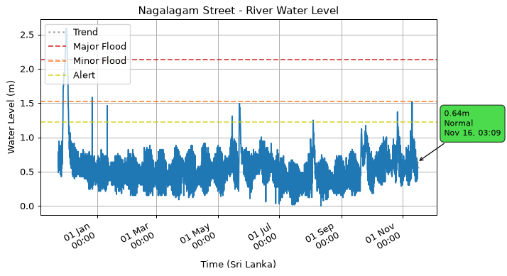
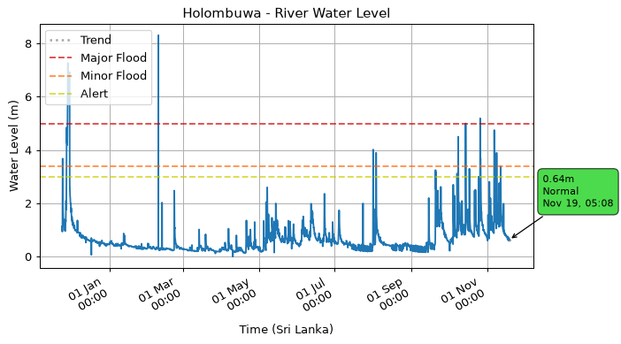

# lk_irrigation 🇱🇰

Realtime Data about *River Water Levels* in Sri Lanka, from the [Irrigation Deptartment](https://www.irrigation.gov.lk)'s [Hydrology and Disaster Management](https://www.irrigation.gov.lk/web/index.php?option=com_content&view=article&id=27&Itemid=128&lang=en) Division.

- [Complete Dataset](data/rwlds) with **327,587 measurements** from **39** stations.
- [Scrape and load logic](src/lk_irrigation/rwld/RiverWaterLevelDataLoadMixin.py)
- [Original Data source](https://www.arcgis.com/apps/dashboards/2cffe83c9ff5497d97375498bdf3ff38)

🇱🇰 River water alerts: 🟡 Dunamale — Alert; 🟡 Panadugama — Alert; 🟡 Moraketiya — Alert; 🟡 Kalawellawa (Millakanda) — Alert
Source: Sri Lanka Irrigation Department https://www.irrigation.gov.lk
Repo: https://github.com/nuuuwan/lk_irrigation
## River Water Level Map

## Latest measurements

*There were **17** measurements in the last **1 hour**.*

| Measured At | Station (River Basin) | Level (m) | Alert Level | Rate-of-Rise (m/hr) | Rising Alert |
| --- | --- | ---: | --- | ---: | --- |
| 2026-11-28 03:03:35 | Deraniyagala (Kelani Ganga) | 1.12 | 🟢 Normal | -0.098 |  |
| 2026-11-28 03:03:31 | Thawalama (Gin Ganga) | 2.21 | 🟢 Normal | -0.041 |  |
| 2026-11-28 03:02:55 | Kuda Oya (Kirindi Oya) | 3.45 | 🟢 Normal | -0.262 |  |
| 2026-11-28 03:02:43 | Dunamale (Aththanagalu Oya) | 3.80 | 🟡 Alert | 0.050 | 🔺 Rising |
| 2026-11-28 03:02:41 | Giriulla (Maha Oya) | 3.45 | 🟢 Normal | -0.112 |  |
| 2026-11-28 03:02:39 | Ellagawa (Kalu Ganga) | 7.38 | 🟢 Normal | 0.020 | 🔺 Rising |
| 2026-11-28 03:02:32 | Moragaswewa (Deduru Oya) | 2.71 | 🟢 Normal | -0.059 |  |
| 2026-11-28 03:02:25 | Yaka Wewa (Ma Oya) | 0.50 | 🟢 Normal | 0.000 |  |
| 2026-11-28 03:02:15 | Moraketiya (Walawe Ganga) | 3.80 | 🟡 Alert | 0.000 |  |
| 2026-11-28 03:02:03 | Manampitiya (Mahaweli Ganga) | 1.60 | 🟢 Normal | -0.010 |  |
| 2026-11-28 03:01:45 | Glencourse (Kelani Ganga) | 12.35 | 🟢 Normal | -0.109 |  |
| 2026-11-28 03:01:35 | Peradeniya (Mahaweli Ganga) | 3.28 | 🟢 Normal | -0.087 |  |
| 2026-11-28 03:01:09 | Kalawellawa (Millakanda) (Kalu Ganga) | 5.12 | 🟡 Alert | -0.040 |  |
| 2026-11-28 03:01:03 | Nakkala (Kumbukkan Oya) | 1.08 | 🟢 Normal | -0.010 |  |
| 2026-11-28 03:00:08 | Wellawaya (Kirindi Oya) | 0.16 | 🟢 Normal | -1.518 |  |
| 2026-11-28 02:36:28 | Urawa (Nilwala Ganga) | 1.90 | 🟢 Normal | -0.142 |  |
| 2026-11-28 02:22:56 | Thaldena (Mahaweli Ganga) | 0.75 | 🟢 Normal | -0.081 |  |

## Latest by Station

*⌛ = Latest measurement is older than **24 hours**.*

| Measured At | Station (River Basin) | Level (m) | Alert Level | Rate-of-Rise (m/hr) | Rising Alert |
| --- | --- | ---: | --- | ---: | --- |
| 2026-11-28 03:02:43 | Dunamale (Aththanagalu Oya) | 3.80 | 🟡 Alert | 0.050 | 🔺 Rising |
| 2026-11-28 01:04:00 | Panadugama (Nilwala Ganga) | 5.40 | 🟡 Alert | 0.021 | 🔺 Rising |
| 2026-11-28 03:02:15 | Moraketiya (Walawe Ganga) | 3.80 | 🟡 Alert | 0.000 |  |
| 2026-11-28 03:01:09 | Kalawellawa (Millakanda) (Kalu Ganga) | 5.12 | 🟡 Alert | -0.040 |  |
| 2026-11-28 02:19:53 | Nagalagam Street (Kelani Ganga) | 0.79 | 🟢 Normal | 0.126 | 🔺 Rising |
| 2026-11-28 02:02:18 | Badalgama (Maha Oya) | 4.32 | 🟢 Normal | 0.122 | 🔺 Rising |
| 2026-11-28 02:05:11 | Hanwella (Kelani Ganga) | 4.21 | 🟢 Normal | 0.061 | 🔺 Rising |
| 2026-11-28 02:14:51 | Pitabeddara (Nilwala Ganga) | 2.70 | 🟢 Normal | 0.049 | 🔺 Rising |
| 2026-11-28 02:07:27 | Magura (Kalu Ganga) | 3.92 | 🟢 Normal | 0.036 | 🔺 Rising |
| 2026-11-28 03:02:39 | Ellagawa (Kalu Ganga) | 7.38 | 🟢 Normal | 0.020 | 🔺 Rising |
| 2026-11-28 02:04:42 | Thalgahagoda (Nilwala Ganga) | 0.93 | 🟢 Normal | 0.012 | 🔺 Rising |
| 2026-11-28 02:03:55 | Baddegama (Gin Ganga) | 2.11 | 🟢 Normal | 0.011 | 🔺 Rising |
| 2026-11-28 02:03:05 | Kithulgala (Kelani Ganga) | 1.83 | 🟢 Normal | 0.000 |  |
| 2026-11-28 03:02:25 | Yaka Wewa (Ma Oya) | 0.50 | 🟢 Normal | 0.000 |  |
| 2026-11-28 00:03:47 | Horowpothana (Yan Oya) | 2.38 | 🟢 Normal | 0.000 |  |
| 2026-11-27 18:04:37 | Galgamuwa (Mee Oya) | 0.88 | 🟢 Normal | 0.000 |  |
| 2026-11-28 01:19:43 | Padiyathalawa (Maduru Oya) | 0.74 | 🟢 Normal | 0.000 |  |
| 2026-11-28 02:04:02 | Katharagama (Menik Ganga) | 0.23 | 🟢 Normal | -0.005 |  |
| 2026-11-28 02:11:58 | Rathnapura (Kalu Ganga) | 3.16 | 🟢 Normal | -0.009 |  |
| 2026-11-28 03:01:03 | Nakkala (Kumbukkan Oya) | 1.08 | 🟢 Normal | -0.010 |  |
| 2026-11-28 03:02:03 | Manampitiya (Mahaweli Ganga) | 1.60 | 🟢 Normal | -0.010 |  |
| 2026-11-28 01:04:28 | Putupaula (Kalu Ganga) | 1.40 | 🟢 Normal | -0.011 |  |
| 2026-11-28 02:06:42 | Siyambalanduwa (Heda Oya) | 1.19 | 🟢 Normal | -0.027 |  |
| 2026-11-27 18:01:42 | Thanthirimale (Malwathu Oya) | 1.50 | 🟢 Normal | -0.031 |  |
| 2026-11-28 03:03:31 | Thawalama (Gin Ganga) | 2.21 | 🟢 Normal | -0.041 |  |
| 2026-11-27 18:00:16 | Weraganthota (Mahaweli Ganga) | -1.98 | 🟢 Normal | -0.041 |  |
| 2026-11-28 02:01:03 | Nawalapitiya (Mahaweli Ganga) | 1.42 | 🟢 Normal | -0.050 |  |
| 2026-11-28 03:02:32 | Moragaswewa (Deduru Oya) | 2.71 | 🟢 Normal | -0.059 |  |
| 2026-11-28 02:22:56 | Thaldena (Mahaweli Ganga) | 0.75 | 🟢 Normal | -0.081 |  |
| 2026-11-28 03:01:35 | Peradeniya (Mahaweli Ganga) | 3.28 | 🟢 Normal | -0.087 |  |
| 2026-11-28 03:03:35 | Deraniyagala (Kelani Ganga) | 1.12 | 🟢 Normal | -0.098 |  |
| 2026-11-28 03:01:45 | Glencourse (Kelani Ganga) | 12.35 | 🟢 Normal | -0.109 |  |
| 2026-11-28 03:02:41 | Giriulla (Maha Oya) | 3.45 | 🟢 Normal | -0.112 |  |
| 2026-11-28 02:36:28 | Urawa (Nilwala Ganga) | 1.90 | 🟢 Normal | -0.142 |  |
| 2026-11-28 02:16:55 | Thanamalwila (Kirindi Oya) | 3.12 | 🟢 Normal | -0.180 |  |
| 2026-11-28 03:02:55 | Kuda Oya (Kirindi Oya) | 3.45 | 🟢 Normal | -0.262 |  |
| 2026-11-28 02:11:24 | Holombuwa (Kelani Ganga) | 2.05 | 🟢 Normal | -0.263 |  |
| 2026-11-28 03:00:08 | Wellawaya (Kirindi Oya) | 0.16 | 🟢 Normal | -1.518 |  |
| 2026-11-28 02:03:21 | Norwood (Kelani Ganga) | 0.99 | 🟢 Normal | -36.000 |  |

## River Water Level Charts by Station

### Dunamale (Aththanagalu Oya)

### Panadugama (Nilwala Ganga)

### Moraketiya (Walawe Ganga)

### Kalawellawa (Millakanda) (Kalu Ganga)

.png)

### Nagalagam Street (Kelani Ganga)

### Badalgama (Maha Oya)

### Hanwella (Kelani Ganga)

### Pitabeddara (Nilwala Ganga)

### Magura (Kalu Ganga)

### Ellagawa (Kalu Ganga)

### Thalgahagoda (Nilwala Ganga)

### Baddegama (Gin Ganga)

### Kithulgala (Kelani Ganga)

### Yaka Wewa (Ma Oya)

### Horowpothana (Yan Oya)

### Galgamuwa (Mee Oya)

### Padiyathalawa (Maduru Oya)

### Katharagama (Menik Ganga)

### Rathnapura (Kalu Ganga)

### Nakkala (Kumbukkan Oya)

### Manampitiya (Mahaweli Ganga)

### Putupaula (Kalu Ganga)

### Siyambalanduwa (Heda Oya)

### Thanthirimale (Malwathu Oya)

### Thawalama (Gin Ganga)

### Weraganthota (Mahaweli Ganga)

### Nawalapitiya (Mahaweli Ganga)

### Moragaswewa (Deduru Oya)

### Thaldena (Mahaweli Ganga)

### Peradeniya (Mahaweli Ganga)

### Deraniyagala (Kelani Ganga)

### Glencourse (Kelani Ganga)

### Giriulla (Maha Oya)

### Urawa (Nilwala Ganga)

### Thanamalwila (Kirindi Oya)

### Kuda Oya (Kirindi Oya)

### Holombuwa (Kelani Ganga)

### Wellawaya (Kirindi Oya)

### Norwood (Kelani Ganga)

