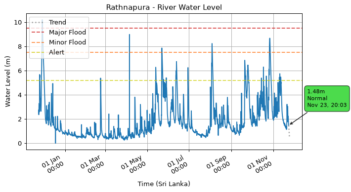

# lk_irrigation 🇱🇰

Realtime Data about *River Water Levels* in Sri Lanka, from the [Irrigation Deptartment](https://www.irrigation.gov.lk)'s [Hydrology and Disaster Management](https://www.irrigation.gov.lk/web/index.php?option=com_content&view=article&id=27&Itemid=128&lang=en) Division.

- [Complete Dataset](data/rwlds) with **323,581 measurements** from **39** stations.
- [Scrape and load logic](src/lk_irrigation/rwld/RiverWaterLevelDataLoadMixin.py)
- [Original Data source](https://www.arcgis.com/apps/dashboards/2cffe83c9ff5497d97375498bdf3ff38)

🇱🇰 River water alerts: No active alerts.
Source: Sri Lanka Irrigation Department https://www.irrigation.gov.lk
Repo: https://github.com/nuuuwan/lk_irrigation
## River Water Level Map

## Latest measurements

*There were **16** measurements in the last **1 hour**.*

| Measured At | Station (River Basin) | Level (m) | Alert Level | Rate-of-Rise (m/hr) | Rising Alert |
| --- | --- | ---: | --- | ---: | --- |
| 2026-11-23 13:02:51 | Kithulgala (Kelani Ganga) | 1.46 | 🟢 Normal | 0.010 | 🔺 Rising |
| 2026-11-23 13:02:40 | Wellawaya (Kirindi Oya) | 1.19 | 🟢 Normal | -0.025 |  |
| 2026-11-23 13:02:38 | Deraniyagala (Kelani Ganga) | 0.44 | 🟢 Normal | 0.021 | 🔺 Rising |
| 2026-11-23 13:02:23 | Baddegama (Gin Ganga) | 1.69 | 🟢 Normal | -0.020 |  |
| 2026-11-23 13:02:20 | Glencourse (Kelani Ganga) | 9.43 | 🟢 Normal | -0.010 |  |
| 2026-11-23 13:02:17 | Siyambalanduwa (Heda Oya) | 0.48 | 🟢 Normal | 0.000 |  |
| 2026-11-23 13:01:46 | Yaka Wewa (Ma Oya) | 0.48 | 🟢 Normal | 0.000 |  |
| 2026-11-23 13:01:44 | Moraketiya (Walawe Ganga) | 1.68 | 🟢 Normal | 0.031 | 🔺 Rising |
| 2026-11-23 13:01:41 | Nawalapitiya (Mahaweli Ganga) | 1.10 | 🟢 Normal | 0.000 |  |
| 2026-11-23 13:01:37 | Manampitiya (Mahaweli Ganga) | 1.03 | 🟢 Normal | 0.000 |  |
| 2026-11-23 13:01:29 | Thanamalwila (Kirindi Oya) | 1.37 | 🟢 Normal | -0.011 |  |
| 2026-11-23 13:01:11 | Pitabeddara (Nilwala Ganga) | 1.13 | 🟢 Normal | 0.000 |  |
| 2026-11-23 13:00:35 | Horowpothana (Yan Oya) | 2.15 | 🟢 Normal | 0.000 |  |
| 2026-11-23 13:00:31 | Nakkala (Kumbukkan Oya) | 0.74 | 🟢 Normal | 0.000 |  |
| 2026-11-23 13:00:19 | Nagalagam Street (Kelani Ganga) | 0.61 | 🟢 Normal | 0.031 | 🔺 Rising |
| 2026-11-23 13:00:11 | Weraganthota (Mahaweli Ganga) | -2.04 | 🟢 Normal | -0.020 |  |

## Latest by Station

*⌛ = Latest measurement is older than **24 hours**.*

| Measured At | Station (River Basin) | Level (m) | Alert Level | Rate-of-Rise (m/hr) | Rising Alert |
| --- | --- | ---: | --- | ---: | --- |
| 2026-11-23 12:04:09 | Putupaula (Kalu Ganga) | 0.83 | 🟢 Normal | 0.080 | 🔺 Rising |
| 2026-11-23 13:00:19 | Nagalagam Street (Kelani Ganga) | 0.61 | 🟢 Normal | 0.031 | 🔺 Rising |
| 2026-11-23 13:01:44 | Moraketiya (Walawe Ganga) | 1.68 | 🟢 Normal | 0.031 | 🔺 Rising |
| 2026-11-23 13:02:38 | Deraniyagala (Kelani Ganga) | 0.44 | 🟢 Normal | 0.021 | 🔺 Rising |
| 2026-11-23 12:03:30 | Thaldena (Mahaweli Ganga) | 0.41 | 🟢 Normal | 0.019 | 🔺 Rising |
| 2026-11-23 12:04:22 | Hanwella (Kelani Ganga) | 1.17 | 🟢 Normal | 0.010 | 🔺 Rising |
| 2026-11-23 13:02:51 | Kithulgala (Kelani Ganga) | 1.46 | 🟢 Normal | 0.010 | 🔺 Rising |
| 2026-11-23 13:00:31 | Nakkala (Kumbukkan Oya) | 0.74 | 🟢 Normal | 0.000 |  |
| 2026-11-23 13:01:41 | Nawalapitiya (Mahaweli Ganga) | 1.10 | 🟢 Normal | 0.000 |  |
| 2026-11-23 13:01:46 | Yaka Wewa (Ma Oya) | 0.48 | 🟢 Normal | 0.000 |  |
| 2026-11-23 12:02:31 | Giriulla (Maha Oya) | 1.37 | 🟢 Normal | 0.000 |  |
| 2026-11-23 13:00:35 | Horowpothana (Yan Oya) | 2.15 | 🟢 Normal | 0.000 |  |
| 2026-11-23 12:19:58 | Galgamuwa (Mee Oya) | 0.37 | 🟢 Normal | 0.000 |  |
| 2026-11-23 13:01:11 | Pitabeddara (Nilwala Ganga) | 1.13 | 🟢 Normal | 0.000 |  |
| 2026-11-23 12:03:53 | Norwood (Kelani Ganga) | 0.83 | 🟢 Normal | 0.000 |  |
| 2026-11-23 13:02:17 | Siyambalanduwa (Heda Oya) | 0.48 | 🟢 Normal | 0.000 |  |
| 2026-11-23 12:06:53 | Katharagama (Menik Ganga) | -0.08 | 🟢 Normal | 0.000 |  |
| 2026-11-23 12:04:32 | Badalgama (Maha Oya) | 2.61 | 🟢 Normal | 0.000 |  |
| 2026-11-23 12:06:18 | Holombuwa (Kelani Ganga) | 0.58 | 🟢 Normal | 0.000 |  |
| 2026-11-23 13:01:37 | Manampitiya (Mahaweli Ganga) | 1.03 | 🟢 Normal | 0.000 |  |
| 2026-11-23 12:05:32 | Urawa (Nilwala Ganga) | 0.80 | 🟢 Normal | 0.000 |  |
| 2026-11-23 12:04:00 | Thalgahagoda (Nilwala Ganga) | 0.79 | 🟢 Normal | 0.000 |  |
| 2026-11-23 11:05:33 | Kalawellawa (Millakanda) (Kalu Ganga) | 3.54 | 🟢 Normal | 0.000 |  |
| 2026-11-23 12:21:29 | Dunamale (Aththanagalu Oya) | 1.13 | 🟢 Normal | -0.008 |  |
| 2026-11-23 12:02:17 | Thanthirimale (Malwathu Oya) | 1.44 | 🟢 Normal | -0.010 |  |
| 2026-11-23 13:02:20 | Glencourse (Kelani Ganga) | 9.43 | 🟢 Normal | -0.010 |  |
| 2026-11-23 12:02:21 | Kuda Oya (Kirindi Oya) | 1.68 | 🟢 Normal | -0.010 |  |
| 2026-11-23 13:01:29 | Thanamalwila (Kirindi Oya) | 1.37 | 🟢 Normal | -0.011 |  |
| 2026-11-23 13:02:23 | Baddegama (Gin Ganga) | 1.69 | 🟢 Normal | -0.020 |  |
| 2026-11-23 13:00:11 | Weraganthota (Mahaweli Ganga) | -2.04 | 🟢 Normal | -0.020 |  |
| 2026-11-23 12:02:37 | Thawalama (Gin Ganga) | 1.70 | 🟢 Normal | -0.021 |  |
| 2026-11-22 17:02:02 | Padiyathalawa (Maduru Oya) | 0.36 | 🟢 Normal | -0.022 |  |
| 2026-11-23 13:02:40 | Wellawaya (Kirindi Oya) | 1.19 | 🟢 Normal | -0.025 |  |
| 2026-11-23 12:08:35 | Rathnapura (Kalu Ganga) | 1.68 | 🟢 Normal | -0.039 |  |
| 2026-11-23 12:02:53 | Ellagawa (Kalu Ganga) | 5.38 | 🟢 Normal | -0.041 |  |
| 2026-11-23 12:01:33 | Moragaswewa (Deduru Oya) | 1.20 | 🟢 Normal | -0.044 |  |
| 2026-11-23 12:06:42 | Peradeniya (Mahaweli Ganga) | 2.45 | 🟢 Normal | -0.048 |  |
| 2026-11-23 12:01:59 | Panadugama (Nilwala Ganga) | 3.84 | 🟢 Normal | -0.050 |  |
| 2026-11-23 12:06:19 | Magura (Kalu Ganga) | 2.20 | 🟢 Normal | -0.095 |  |

## River Water Level Charts by Station

### Putupaula (Kalu Ganga)

### Nagalagam Street (Kelani Ganga)

### Moraketiya (Walawe Ganga)

### Deraniyagala (Kelani Ganga)

### Thaldena (Mahaweli Ganga)

### Hanwella (Kelani Ganga)

### Kithulgala (Kelani Ganga)

### Nakkala (Kumbukkan Oya)

### Nawalapitiya (Mahaweli Ganga)

### Yaka Wewa (Ma Oya)

### Giriulla (Maha Oya)

### Horowpothana (Yan Oya)

### Galgamuwa (Mee Oya)

### Pitabeddara (Nilwala Ganga)

### Norwood (Kelani Ganga)

### Siyambalanduwa (Heda Oya)

### Katharagama (Menik Ganga)

### Badalgama (Maha Oya)

### Holombuwa (Kelani Ganga)

### Manampitiya (Mahaweli Ganga)

### Urawa (Nilwala Ganga)

### Thalgahagoda (Nilwala Ganga)

### Kalawellawa (Millakanda) (Kalu Ganga)

.png)

### Dunamale (Aththanagalu Oya)

### Thanthirimale (Malwathu Oya)

### Glencourse (Kelani Ganga)

### Kuda Oya (Kirindi Oya)

### Thanamalwila (Kirindi Oya)

### Baddegama (Gin Ganga)

### Weraganthota (Mahaweli Ganga)

### Thawalama (Gin Ganga)

### Padiyathalawa (Maduru Oya)

### Wellawaya (Kirindi Oya)

### Rathnapura (Kalu Ganga)

### Ellagawa (Kalu Ganga)

### Moragaswewa (Deduru Oya)

### Peradeniya (Mahaweli Ganga)

### Panadugama (Nilwala Ganga)

### Magura (Kalu Ganga)

