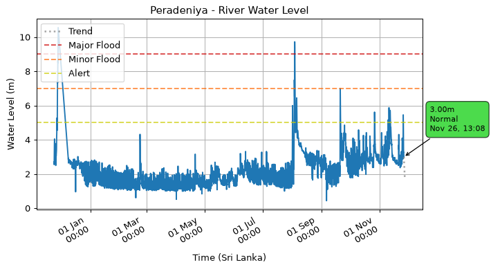

# lk_irrigation 🇱🇰

Realtime Data about *River Water Levels* in Sri Lanka, from the [Irrigation Deptartment](https://www.irrigation.gov.lk)'s [Hydrology and Disaster Management](https://www.irrigation.gov.lk/web/index.php?option=com_content&view=article&id=27&Itemid=128&lang=en) Division.

- [Complete Dataset](data/rwlds) with **324,786 measurements** from **39** stations.
- [Scrape and load logic](src/lk_irrigation/rwld/RiverWaterLevelDataLoadMixin.py)
- [Original Data source](https://www.arcgis.com/apps/dashboards/2cffe83c9ff5497d97375498bdf3ff38)

🇱🇰 River water alerts: 🟡 Dunamale — Alert; 🟡 Moraketiya — Alert
Source: Sri Lanka Irrigation Department https://www.irrigation.gov.lk
Repo: https://github.com/nuuuwan/lk_irrigation
## River Water Level Map

## Latest measurements

*There were **13** measurements in the last **1 hour**.*

| Measured At | Station (River Basin) | Level (m) | Alert Level | Rate-of-Rise (m/hr) | Rising Alert |
| --- | --- | ---: | --- | ---: | --- |
| 2026-11-24 22:02:59 | Siyambalanduwa (Heda Oya) | 1.18 | 🟢 Normal | 0.300 | 🔺 Rising |
| 2026-11-24 22:02:52 | Wellawaya (Kirindi Oya) | 1.29 | 🟢 Normal | 0.070 | 🔺 Rising |
| 2026-11-24 22:02:51 | Kithulgala (Kelani Ganga) | 1.98 | 🟢 Normal | 0.000 |  |
| 2026-11-24 22:02:46 | Pitabeddara (Nilwala Ganga) | 1.68 | 🟢 Normal | 0.201 | 🔺 Rising |
| 2026-11-24 22:02:41 | Manampitiya (Mahaweli Ganga) | 1.15 | 🟢 Normal | 0.020 | 🔺 Rising |
| 2026-11-24 22:02:32 | Yaka Wewa (Ma Oya) | 0.48 | 🟢 Normal | 0.000 |  |
| 2026-11-24 22:02:29 | Panadugama (Nilwala Ganga) | 3.85 | 🟢 Normal | 0.000 |  |
| 2026-11-24 22:02:10 | Rathnapura (Kalu Ganga) | 2.98 | 🟢 Normal | 0.404 | 🔺 Rising |
| 2026-11-24 22:01:36 | Holombuwa (Kelani Ganga) | 2.02 | 🟢 Normal | -0.368 |  |
| 2026-11-24 22:01:32 | Thanamalwila (Kirindi Oya) | 1.27 | 🟢 Normal | 0.022 | 🔺 Rising |
| 2026-11-24 22:01:18 | Kuda Oya (Kirindi Oya) | 1.88 | 🟢 Normal | 0.169 | 🔺 Rising |
| 2026-11-24 22:00:39 | Moraketiya (Walawe Ganga) | 3.50 | 🟡 Alert | 0.104 | 🔺 Rising |
| 2026-11-24 21:59:59 | Thaldena (Mahaweli Ganga) | 0.43 | 🟢 Normal | 0.000 |  |

## Latest by Station

*⌛ = Latest measurement is older than **24 hours**.*

| Measured At | Station (River Basin) | Level (m) | Alert Level | Rate-of-Rise (m/hr) | Rising Alert |
| --- | --- | ---: | --- | ---: | --- |
| 2026-11-24 21:03:13 | Dunamale (Aththanagalu Oya) | 3.46 | 🟡 Alert | 0.302 | 🔺 Rising |
| 2026-11-24 22:00:39 | Moraketiya (Walawe Ganga) | 3.50 | 🟡 Alert | 0.104 | 🔺 Rising |
| 2026-11-24 22:02:10 | Rathnapura (Kalu Ganga) | 2.98 | 🟢 Normal | 0.404 | 🔺 Rising |
| 2026-11-24 21:04:18 | Glencourse (Kelani Ganga) | 12.50 | 🟢 Normal | 0.372 | 🔺 Rising |
| 2026-11-24 21:07:54 | Hanwella (Kelani Ganga) | 2.76 | 🟢 Normal | 0.368 | 🔺 Rising |
| 2026-11-24 22:02:59 | Siyambalanduwa (Heda Oya) | 1.18 | 🟢 Normal | 0.300 | 🔺 Rising |
| 2026-11-24 21:00:34 | Magura (Kalu Ganga) | 3.10 | 🟢 Normal | 0.239 | 🔺 Rising |
| 2026-11-24 22:02:46 | Pitabeddara (Nilwala Ganga) | 1.68 | 🟢 Normal | 0.201 | 🔺 Rising |
| 2026-11-24 21:04:13 | Baddegama (Gin Ganga) | 1.96 | 🟢 Normal | 0.177 | 🔺 Rising |
| 2026-11-24 21:10:16 | Urawa (Nilwala Ganga) | 1.85 | 🟢 Normal | 0.174 | 🔺 Rising |
| 2026-11-24 21:08:12 | Ellagawa (Kalu Ganga) | 5.70 | 🟢 Normal | 0.170 | 🔺 Rising |
| 2026-11-24 22:01:18 | Kuda Oya (Kirindi Oya) | 1.88 | 🟢 Normal | 0.169 | 🔺 Rising |
| 2026-11-24 21:06:14 | Deraniyagala (Kelani Ganga) | 0.76 | 🟢 Normal | 0.147 | 🔺 Rising |
| 2026-11-24 21:02:30 | Nakkala (Kumbukkan Oya) | 1.02 | 🟢 Normal | 0.070 | 🔺 Rising |
| 2026-11-24 22:02:52 | Wellawaya (Kirindi Oya) | 1.29 | 🟢 Normal | 0.070 | 🔺 Rising |
| 2026-11-24 21:10:34 | Thawalama (Gin Ganga) | 2.85 | 🟢 Normal | 0.059 | 🔺 Rising |
| 2026-11-24 21:09:32 | Nagalagam Street (Kelani Ganga) | 0.30 | 🟢 Normal | 0.029 | 🔺 Rising |
| 2026-11-24 21:07:00 | Moragaswewa (Deduru Oya) | 1.22 | 🟢 Normal | 0.028 | 🔺 Rising |
| 2026-11-24 22:01:32 | Thanamalwila (Kirindi Oya) | 1.27 | 🟢 Normal | 0.022 | 🔺 Rising |
| 2026-11-24 21:01:08 | Horowpothana (Yan Oya) | 2.37 | 🟢 Normal | 0.021 | 🔺 Rising |
| 2026-11-24 22:02:41 | Manampitiya (Mahaweli Ganga) | 1.15 | 🟢 Normal | 0.020 | 🔺 Rising |
| 2026-11-24 21:04:27 | Giriulla (Maha Oya) | 2.65 | 🟢 Normal | 0.019 | 🔺 Rising |
| 2026-11-24 21:10:48 | Norwood (Kelani Ganga) | 1.03 | 🟢 Normal | 0.010 | 🔺 Rising |
| 2026-11-24 22:02:51 | Kithulgala (Kelani Ganga) | 1.98 | 🟢 Normal | 0.000 |  |
| 2026-11-24 22:02:32 | Yaka Wewa (Ma Oya) | 0.48 | 🟢 Normal | 0.000 |  |
| 2026-11-24 18:02:13 | Galgamuwa (Mee Oya) | 0.39 | 🟢 Normal | 0.000 |  |
| 2026-11-24 22:02:29 | Panadugama (Nilwala Ganga) | 3.85 | 🟢 Normal | 0.000 |  |
| 2026-11-24 21:59:59 | Thaldena (Mahaweli Ganga) | 0.43 | 🟢 Normal | 0.000 |  |
| 2026-11-24 21:20:56 | Katharagama (Menik Ganga) | -0.08 | 🟢 Normal | 0.000 |  |
| 2026-11-24 21:08:30 | Badalgama (Maha Oya) | 3.57 | 🟢 Normal | 0.000 |  |
| 2026-11-24 18:01:28 | Thanthirimale (Malwathu Oya) | 1.26 | 🟢 Normal | 0.000 |  |
| 2026-11-24 21:08:48 | Thalgahagoda (Nilwala Ganga) | 0.85 | 🟢 Normal | 0.000 |  |
| 2026-11-24 21:00:27 | Kalawellawa (Millakanda) (Kalu Ganga) | 2.74 | 🟢 Normal | 0.000 |  |
| 2026-11-24 18:04:37 | Weraganthota (Mahaweli Ganga) | -2.50 | 🟢 Normal | -0.019 |  |
| 2026-11-24 21:04:31 | Peradeniya (Mahaweli Ganga) | 4.04 | 🟢 Normal | -0.020 |  |
| 2026-11-22 17:02:02⌛ | Padiyathalawa (Maduru Oya) | 0.36 | 🟢 Normal | -0.022 |  |
| 2026-11-24 19:07:58 | Putupaula (Kalu Ganga) | 0.55 | 🟢 Normal | -0.073 |  |
| 2026-11-24 21:04:58 | Nawalapitiya (Mahaweli Ganga) | 1.93 | 🟢 Normal | -0.220 |  |
| 2026-11-24 22:01:36 | Holombuwa (Kelani Ganga) | 2.02 | 🟢 Normal | -0.368 |  |

## River Water Level Charts by Station

### Dunamale (Aththanagalu Oya)

### Moraketiya (Walawe Ganga)

### Rathnapura (Kalu Ganga)

### Glencourse (Kelani Ganga)

### Hanwella (Kelani Ganga)

### Siyambalanduwa (Heda Oya)

### Magura (Kalu Ganga)

### Pitabeddara (Nilwala Ganga)

### Baddegama (Gin Ganga)

### Urawa (Nilwala Ganga)

### Ellagawa (Kalu Ganga)

### Kuda Oya (Kirindi Oya)

### Deraniyagala (Kelani Ganga)

### Nakkala (Kumbukkan Oya)

### Wellawaya (Kirindi Oya)

### Thawalama (Gin Ganga)

### Nagalagam Street (Kelani Ganga)

### Moragaswewa (Deduru Oya)

### Thanamalwila (Kirindi Oya)

### Horowpothana (Yan Oya)

### Manampitiya (Mahaweli Ganga)

### Giriulla (Maha Oya)

### Norwood (Kelani Ganga)

### Kithulgala (Kelani Ganga)

### Yaka Wewa (Ma Oya)

### Galgamuwa (Mee Oya)

### Panadugama (Nilwala Ganga)

### Thaldena (Mahaweli Ganga)

### Katharagama (Menik Ganga)

### Badalgama (Maha Oya)

### Thanthirimale (Malwathu Oya)

### Thalgahagoda (Nilwala Ganga)

### Kalawellawa (Millakanda) (Kalu Ganga)

.png)

### Weraganthota (Mahaweli Ganga)

### Peradeniya (Mahaweli Ganga)

### Padiyathalawa (Maduru Oya)

### Putupaula (Kalu Ganga)

### Nawalapitiya (Mahaweli Ganga)

### Holombuwa (Kelani Ganga)

