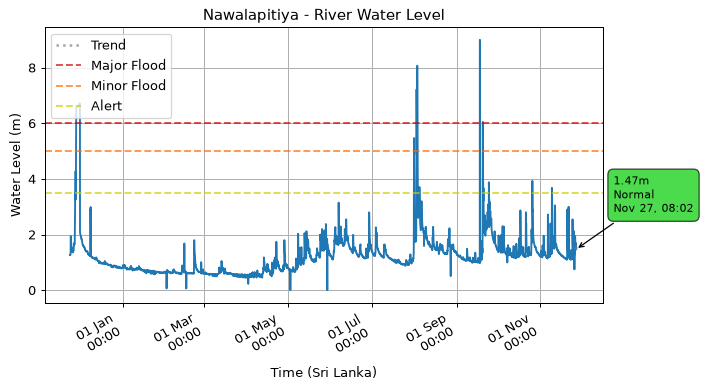

# lk_irrigation 🇱🇰

Realtime Data about *River Water Levels* in Sri Lanka, from the [Irrigation Deptartment](https://www.irrigation.gov.lk)'s [Hydrology and Disaster Management](https://www.irrigation.gov.lk/web/index.php?option=com_content&view=article&id=27&Itemid=128&lang=en) Division.

- [Complete Dataset](data/rwlds) with **324,121 measurements** from **39** stations.
- [Scrape and load logic](src/lk_irrigation/rwld/RiverWaterLevelDataLoadMixin.py)
- [Original Data source](https://www.arcgis.com/apps/dashboards/2cffe83c9ff5497d97375498bdf3ff38)

🇱🇰 River water alerts: No active alerts.
Source: Sri Lanka Irrigation Department https://www.irrigation.gov.lk
Repo: https://github.com/nuuuwan/lk_irrigation
## River Water Level Map

## Latest measurements

*There were **15** measurements in the last **1 hour**.*

| Measured At | Station (River Basin) | Level (m) | Alert Level | Rate-of-Rise (m/hr) | Rising Alert |
| --- | --- | ---: | --- | ---: | --- |
| 2026-11-24 04:03:08 | Glencourse (Kelani Ganga) | 11.81 | 🟢 Normal | -0.092 |  |
| 2026-11-24 04:02:59 | Deraniyagala (Kelani Ganga) | 0.81 | 🟢 Normal | 0.000 |  |
| 2026-11-24 04:02:57 | Deraniyagala (Kelani Ganga) | 0.81 | 🟢 Normal | 0.000 |  |
| 2026-11-24 04:02:45 | Siyambalanduwa (Heda Oya) | 0.45 | 🟢 Normal | 0.000 |  |
| 2026-11-24 04:02:26 | Thaldena (Mahaweli Ganga) | 0.45 | 🟢 Normal | -0.050 |  |
| 2026-11-24 04:02:10 | Moragaswewa (Deduru Oya) | 0.80 | 🟢 Normal | 0.020 | 🔺 Rising |
| 2026-11-24 04:02:03 | Wellawaya (Kirindi Oya) | 1.22 | 🟢 Normal | -0.054 |  |
| 2026-11-24 04:02:03 | Dunamale (Aththanagalu Oya) | 1.90 | 🟢 Normal | 0.210 | 🔺 Rising |
| 2026-11-24 04:01:45 | Giriulla (Maha Oya) | 4.44 | 🟢 Normal | -0.149 |  |
| 2026-11-24 04:01:36 | Peradeniya (Mahaweli Ganga) | 2.86 | 🟢 Normal | -0.083 |  |
| 2026-11-24 04:01:21 | Yaka Wewa (Ma Oya) | 0.48 | 🟢 Normal | 0.000 |  |
| 2026-11-24 04:01:18 | Pitabeddara (Nilwala Ganga) | 1.25 | 🟢 Normal | 0.060 | 🔺 Rising |
| 2026-11-24 04:00:51 | Nakkala (Kumbukkan Oya) | 0.73 | 🟢 Normal | 0.000 |  |
| 2026-11-24 04:00:47 | Thalgahagoda (Nilwala Ganga) | 0.72 | 🟢 Normal | -0.020 |  |
| 2026-11-24 03:48:29 | Nawalapitiya (Mahaweli Ganga) | 1.13 | 🟢 Normal | -0.006 |  |

## Latest by Station

*⌛ = Latest measurement is older than **24 hours**.*

| Measured At | Station (River Basin) | Level (m) | Alert Level | Rate-of-Rise (m/hr) | Rising Alert |
| --- | --- | ---: | --- | ---: | --- |
| 2026-11-24 03:13:18 | Ellagawa (Kalu Ganga) | 5.09 | 🟢 Normal | 18.000 | 🔺 Rising |
| 2026-11-24 03:04:27 | Kalawellawa (Millakanda) (Kalu Ganga) | 3.26 | 🟢 Normal | 0.973 | 🔺 Rising |
| 2026-11-24 03:08:23 | Hanwella (Kelani Ganga) | 2.00 | 🟢 Normal | 0.430 | 🔺 Rising |
| 2026-11-24 03:02:18 | Badalgama (Maha Oya) | 2.94 | 🟢 Normal | 0.217 | 🔺 Rising |
| 2026-11-24 04:02:03 | Dunamale (Aththanagalu Oya) | 1.90 | 🟢 Normal | 0.210 | 🔺 Rising |
| 2026-11-24 03:03:50 | Kithulgala (Kelani Ganga) | 1.83 | 🟢 Normal | 0.117 | 🔺 Rising |
| 2026-11-24 03:14:01 | Panadugama (Nilwala Ganga) | 3.67 | 🟢 Normal | 0.084 | 🔺 Rising |
| 2026-11-24 03:03:12 | Putupaula (Kalu Ganga) | 0.93 | 🟢 Normal | 0.064 | 🔺 Rising |
| 2026-11-24 04:01:18 | Pitabeddara (Nilwala Ganga) | 1.25 | 🟢 Normal | 0.060 | 🔺 Rising |
| 2026-11-24 03:04:00 | Nagalagam Street (Kelani Ganga) | 0.76 | 🟢 Normal | 0.037 | 🔺 Rising |
| 2026-11-24 03:06:10 | Rathnapura (Kalu Ganga) | 2.14 | 🟢 Normal | 0.028 | 🔺 Rising |
| 2026-11-24 04:02:10 | Moragaswewa (Deduru Oya) | 0.80 | 🟢 Normal | 0.020 | 🔺 Rising |
| 2026-11-24 03:05:49 | Baddegama (Gin Ganga) | 1.78 | 🟢 Normal | 0.011 | 🔺 Rising |
| 2026-11-24 00:04:06 | Horowpothana (Yan Oya) | 2.19 | 🟢 Normal | 0.005 |  |
| 2026-11-24 04:00:51 | Nakkala (Kumbukkan Oya) | 0.73 | 🟢 Normal | 0.000 |  |
| 2026-11-24 04:01:21 | Yaka Wewa (Ma Oya) | 0.48 | 🟢 Normal | 0.000 |  |
| 2026-11-23 18:05:14 | Galgamuwa (Mee Oya) | 0.36 | 🟢 Normal | 0.000 |  |
| 2026-11-24 04:02:59 | Deraniyagala (Kelani Ganga) | 0.81 | 🟢 Normal | 0.000 |  |
| 2026-11-24 04:02:45 | Siyambalanduwa (Heda Oya) | 0.45 | 🟢 Normal | 0.000 |  |
| 2026-11-24 03:02:18 | Kuda Oya (Kirindi Oya) | 1.52 | 🟢 Normal | -0.003 |  |
| 2026-11-24 03:13:48 | Katharagama (Menik Ganga) | -0.10 | 🟢 Normal | -0.005 |  |
| 2026-11-24 03:48:29 | Nawalapitiya (Mahaweli Ganga) | 1.13 | 🟢 Normal | -0.006 |  |
| 2026-11-24 03:02:56 | Thawalama (Gin Ganga) | 1.97 | 🟢 Normal | -0.010 |  |
| 2026-11-24 03:01:54 | Thanamalwila (Kirindi Oya) | 1.19 | 🟢 Normal | -0.013 |  |
| 2026-11-24 03:06:38 | Norwood (Kelani Ganga) | 0.86 | 🟢 Normal | -0.019 |  |
| 2026-11-24 03:02:32 | Manampitiya (Mahaweli Ganga) | 1.06 | 🟢 Normal | -0.020 |  |
| 2026-11-23 18:02:13 | Thanthirimale (Malwathu Oya) | 1.32 | 🟢 Normal | -0.020 |  |
| 2026-11-24 04:00:47 | Thalgahagoda (Nilwala Ganga) | 0.72 | 🟢 Normal | -0.020 |  |
| 2026-11-22 17:02:02⌛ | Padiyathalawa (Maduru Oya) | 0.36 | 🟢 Normal | -0.022 |  |
| 2026-11-24 03:00:43 | Moraketiya (Walawe Ganga) | 2.20 | 🟢 Normal | -0.033 |  |
| 2026-11-24 04:02:26 | Thaldena (Mahaweli Ganga) | 0.45 | 🟢 Normal | -0.050 |  |
| 2026-11-23 18:00:35 | Weraganthota (Mahaweli Ganga) | -2.49 | 🟢 Normal | -0.050 |  |
| 2026-11-24 04:02:03 | Wellawaya (Kirindi Oya) | 1.22 | 🟢 Normal | -0.054 |  |
| 2026-11-24 03:04:38 | Urawa (Nilwala Ganga) | 1.89 | 🟢 Normal | -0.076 |  |
| 2026-11-24 04:01:36 | Peradeniya (Mahaweli Ganga) | 2.86 | 🟢 Normal | -0.083 |  |
| 2026-11-24 04:03:08 | Glencourse (Kelani Ganga) | 11.81 | 🟢 Normal | -0.092 |  |
| 2026-11-24 04:01:45 | Giriulla (Maha Oya) | 4.44 | 🟢 Normal | -0.149 |  |
| 2026-11-24 03:15:55 | Holombuwa (Kelani Ganga) | 1.38 | 🟢 Normal | -0.307 |  |
| 2026-11-24 03:07:22 | Magura (Kalu Ganga) | 2.18 | 🟢 Normal | -1.091 |  |

## River Water Level Charts by Station

### Ellagawa (Kalu Ganga)

### Kalawellawa (Millakanda) (Kalu Ganga)

.png)

### Hanwella (Kelani Ganga)

### Badalgama (Maha Oya)

### Dunamale (Aththanagalu Oya)

### Kithulgala (Kelani Ganga)

### Panadugama (Nilwala Ganga)

### Putupaula (Kalu Ganga)

### Pitabeddara (Nilwala Ganga)

### Nagalagam Street (Kelani Ganga)

### Rathnapura (Kalu Ganga)

### Moragaswewa (Deduru Oya)

### Baddegama (Gin Ganga)

### Horowpothana (Yan Oya)

### Nakkala (Kumbukkan Oya)

### Yaka Wewa (Ma Oya)

### Galgamuwa (Mee Oya)

### Deraniyagala (Kelani Ganga)

### Siyambalanduwa (Heda Oya)

### Kuda Oya (Kirindi Oya)

### Katharagama (Menik Ganga)

### Nawalapitiya (Mahaweli Ganga)

### Thawalama (Gin Ganga)

### Thanamalwila (Kirindi Oya)

### Norwood (Kelani Ganga)

### Manampitiya (Mahaweli Ganga)

### Thanthirimale (Malwathu Oya)

### Thalgahagoda (Nilwala Ganga)

### Padiyathalawa (Maduru Oya)

### Moraketiya (Walawe Ganga)

### Thaldena (Mahaweli Ganga)

### Weraganthota (Mahaweli Ganga)

### Wellawaya (Kirindi Oya)

### Urawa (Nilwala Ganga)

### Peradeniya (Mahaweli Ganga)

### Glencourse (Kelani Ganga)

### Giriulla (Maha Oya)

### Holombuwa (Kelani Ganga)

### Magura (Kalu Ganga)

