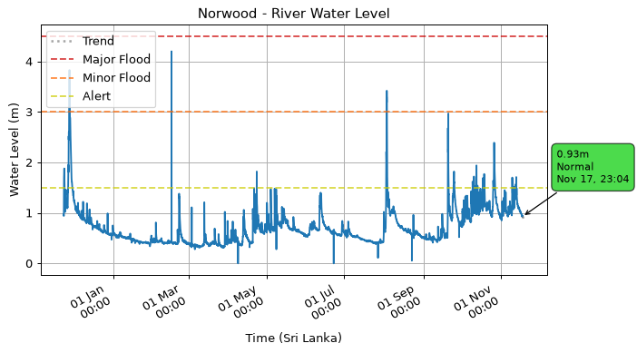
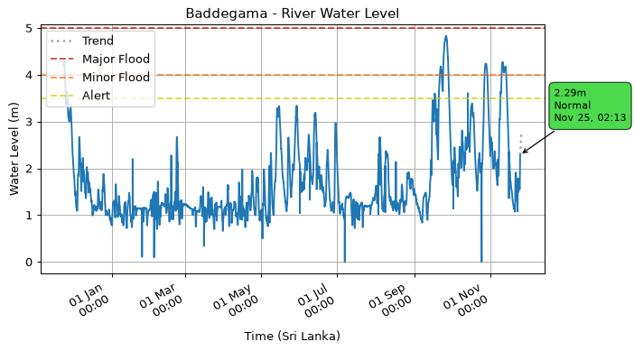

# lk_irrigation 🇱🇰

Realtime Data about *River Water Levels* in Sri Lanka, from the [Irrigation Deptartment](https://www.irrigation.gov.lk)'s [Hydrology and Disaster Management](https://www.irrigation.gov.lk/web/index.php?option=com_content&view=article&id=27&Itemid=128&lang=en) Division.

- [Complete Dataset](data/rwlds) with **327,714 measurements** from **39** stations.
- [Scrape and load logic](src/lk_irrigation/rwld/RiverWaterLevelDataLoadMixin.py)
- [Original Data source](https://www.arcgis.com/apps/dashboards/2cffe83c9ff5497d97375498bdf3ff38)

🇱🇰 River water alerts: 🟡 Dunamale — Alert; 🟡 Panadugama — Alert; 🟡 Kalawellawa (Millakanda) — Alert; 🟡 Moraketiya — Alert
Source: Sri Lanka Irrigation Department https://www.irrigation.gov.lk
Repo: https://github.com/nuuuwan/lk_irrigation
## River Water Level Map

## Latest measurements

*There were **39** measurements in the last **1 hour**.*

| Measured At | Station (River Basin) | Level (m) | Alert Level | Rate-of-Rise (m/hr) | Rising Alert |
| --- | --- | ---: | --- | ---: | --- |
| 2026-11-28 06:12:05 | Norwood (Kelani Ganga) | 0.97 | 🟢 Normal | 0.000 |  |
| 2026-11-28 06:11:09 | Thanamalwila (Kirindi Oya) | 2.40 | 🟢 Normal | -576.000 |  |
| 2026-11-28 06:11:08 | Thanamalwila (Kirindi Oya) | 2.56 | 🟢 Normal | -576.000 |  |
| 2026-11-28 06:08:56 | Nagalagam Street (Kelani Ganga) | 0.85 | 🟢 Normal | -0.127 |  |
| 2026-11-28 06:08:52 | Panadugama (Nilwala Ganga) | 5.57 | 🟡 Alert | 0.030 | 🔺 Rising |
| 2026-11-28 06:07:05 | Thalgahagoda (Nilwala Ganga) | 1.10 | 🟢 Normal | 0.068 | 🔺 Rising |
| 2026-11-28 06:07:05 | Holombuwa (Kelani Ganga) | 1.55 | 🟢 Normal | -0.058 |  |
| 2026-11-28 06:07:03 | Urawa (Nilwala Ganga) | 1.30 | 🟢 Normal | 0.000 |  |
| 2026-11-28 06:06:51 | Peradeniya (Mahaweli Ganga) | 2.98 | 🟢 Normal | -0.109 |  |
| 2026-11-28 06:05:48 | Horowpothana (Yan Oya) | 2.38 | 🟢 Normal | 0.000 |  |
| 2026-11-28 06:05:25 | Putupaula (Kalu Ganga) | 1.60 | 🟢 Normal | 0.100 | 🔺 Rising |
| 2026-11-28 06:05:07 | Yaka Wewa (Ma Oya) | 0.50 | 🟢 Normal | 0.000 |  |
| 2026-11-28 06:05:02 | Katharagama (Menik Ganga) | 0.16 | 🟢 Normal | -0.020 |  |
| 2026-11-28 06:04:43 | Urawa (Nilwala Ganga) | 1.30 | 🟢 Normal | 0.000 |  |
| 2026-11-28 06:04:43 | Hanwella (Kelani Ganga) | 4.18 | 🟢 Normal | -0.044 |  |
| 2026-11-28 06:04:36 | Pitabeddara (Nilwala Ganga) | 2.61 | 🟢 Normal | -0.582 |  |
| 2026-11-28 06:03:55 | Giriulla (Maha Oya) | 3.17 | 🟢 Normal | -0.081 |  |
| 2026-11-28 06:03:31 | Padiyathalawa (Maduru Oya) | 0.68 | 🟢 Normal | -0.032 |  |
| 2026-11-28 06:03:30 | Kithulgala (Kelani Ganga) | 1.90 | 🟢 Normal | 5.625 | 🔺 Rising |
| 2026-11-28 06:03:29 | Kuda Oya (Kirindi Oya) | 2.84 | 🟢 Normal | -0.169 |  |
| 2026-11-28 06:03:28 | Manampitiya (Mahaweli Ganga) | 1.70 | 🟢 Normal | 0.193 | 🔺 Rising |
| 2026-11-28 06:03:21 | Moraketiya (Walawe Ganga) | 3.23 | 🟡 Alert | -0.411 |  |
| 2026-11-28 06:03:07 | Dunamale (Aththanagalu Oya) | 3.96 | 🟡 Alert | 0.063 | 🔺 Rising |
| 2026-11-28 06:02:41 | Nawalapitiya (Mahaweli Ganga) | 1.36 | 🟢 Normal | -0.020 |  |
| 2026-11-28 06:02:35 | Siyambalanduwa (Heda Oya) | 0.99 | 🟢 Normal | -0.041 |  |
| 2026-11-28 06:02:26 | Badalgama (Maha Oya) | 4.32 | 🟢 Normal | -0.218 |  |
| 2026-11-28 06:02:25 | Weraganthota (Mahaweli Ganga) | -1.35 | 🟢 Normal | 0.052 | 🔺 Rising |
| 2026-11-28 06:02:21 | Glencourse (Kelani Ganga) | 12.09 | 🟢 Normal | -0.099 |  |
| 2026-11-28 06:02:19 | Thawalama (Gin Ganga) | 2.32 | 🟢 Normal | 0.153 | 🔺 Rising |
| 2026-11-28 06:02:18 | Deraniyagala (Kelani Ganga) | 0.86 | 🟢 Normal | -0.121 |  |
| 2026-11-28 06:01:57 | Ellagawa (Kalu Ganga) | 7.38 | 🟢 Normal | -0.020 |  |
| 2026-11-28 06:01:56 | Moragaswewa (Deduru Oya) | 2.35 | 🟢 Normal | -0.109 |  |
| 2026-11-28 06:01:49 | Rathnapura (Kalu Ganga) | 2.85 | 🟢 Normal | -0.088 |  |
| 2026-11-28 06:01:32 | Wellawaya (Kirindi Oya) | 1.60 | 🟢 Normal | -0.029 |  |
| 2026-11-28 06:01:31 | Thaldena (Mahaweli Ganga) | 0.70 | 🟢 Normal | -0.149 |  |
| 2026-11-28 06:01:26 | Nakkala (Kumbukkan Oya) | 1.05 | 🟢 Normal | -0.010 |  |
| 2026-11-28 06:00:16 | Magura (Kalu Ganga) | 3.90 | 🟢 Normal | -0.061 |  |
| 2026-11-28 05:59:46 | Kithulgala (Kelani Ganga) | 1.55 | 🟢 Normal | 5.625 | 🔺 Rising |
| 2026-11-28 05:48:07 | Pitabeddara (Nilwala Ganga) | 2.77 | 🟢 Normal | -0.582 |  |

## Latest by Station

*⌛ = Latest measurement is older than **24 hours**.*

| Measured At | Station (River Basin) | Level (m) | Alert Level | Rate-of-Rise (m/hr) | Rising Alert |
| --- | --- | ---: | --- | ---: | --- |
| 2026-11-28 06:03:07 | Dunamale (Aththanagalu Oya) | 3.96 | 🟡 Alert | 0.063 | 🔺 Rising |
| 2026-11-28 06:08:52 | Panadugama (Nilwala Ganga) | 5.57 | 🟡 Alert | 0.030 | 🔺 Rising |
| 2026-11-28 04:01:19 | Kalawellawa (Millakanda) (Kalu Ganga) | 5.10 | 🟡 Alert | -0.020 |  |
| 2026-11-28 06:03:21 | Moraketiya (Walawe Ganga) | 3.23 | 🟡 Alert | -0.411 |  |
| 2026-11-28 06:03:30 | Kithulgala (Kelani Ganga) | 1.90 | 🟢 Normal | 5.625 | 🔺 Rising |
| 2026-11-28 06:03:28 | Manampitiya (Mahaweli Ganga) | 1.70 | 🟢 Normal | 0.193 | 🔺 Rising |
| 2026-11-28 06:02:19 | Thawalama (Gin Ganga) | 2.32 | 🟢 Normal | 0.153 | 🔺 Rising |
| 2026-11-28 06:05:25 | Putupaula (Kalu Ganga) | 1.60 | 🟢 Normal | 0.100 | 🔺 Rising |
| 2026-11-28 06:07:05 | Thalgahagoda (Nilwala Ganga) | 1.10 | 🟢 Normal | 0.068 | 🔺 Rising |
| 2026-11-28 06:02:25 | Weraganthota (Mahaweli Ganga) | -1.35 | 🟢 Normal | 0.052 | 🔺 Rising |
| 2026-11-28 06:05:07 | Yaka Wewa (Ma Oya) | 0.50 | 🟢 Normal | 0.000 |  |
| 2026-11-28 06:05:48 | Horowpothana (Yan Oya) | 2.38 | 🟢 Normal | 0.000 |  |
| 2026-11-27 18:04:37 | Galgamuwa (Mee Oya) | 0.88 | 🟢 Normal | 0.000 |  |
| 2026-11-28 06:12:05 | Norwood (Kelani Ganga) | 0.97 | 🟢 Normal | 0.000 |  |
| 2026-11-28 05:03:43 | Baddegama (Gin Ganga) | 2.11 | 🟢 Normal | 0.000 |  |
| 2026-11-28 06:07:03 | Urawa (Nilwala Ganga) | 1.30 | 🟢 Normal | 0.000 |  |
| 2026-11-28 06:01:26 | Nakkala (Kumbukkan Oya) | 1.05 | 🟢 Normal | -0.010 |  |
| 2026-11-28 06:02:41 | Nawalapitiya (Mahaweli Ganga) | 1.36 | 🟢 Normal | -0.020 |  |
| 2026-11-28 06:01:57 | Ellagawa (Kalu Ganga) | 7.38 | 🟢 Normal | -0.020 |  |
| 2026-11-28 06:05:02 | Katharagama (Menik Ganga) | 0.16 | 🟢 Normal | -0.020 |  |
| 2026-11-28 06:01:32 | Wellawaya (Kirindi Oya) | 1.60 | 🟢 Normal | -0.029 |  |
| 2026-11-27 18:01:42 | Thanthirimale (Malwathu Oya) | 1.50 | 🟢 Normal | -0.031 |  |
| 2026-11-28 06:03:31 | Padiyathalawa (Maduru Oya) | 0.68 | 🟢 Normal | -0.032 |  |
| 2026-11-28 06:02:35 | Siyambalanduwa (Heda Oya) | 0.99 | 🟢 Normal | -0.041 |  |
| 2026-11-28 06:04:43 | Hanwella (Kelani Ganga) | 4.18 | 🟢 Normal | -0.044 |  |
| 2026-11-28 06:07:05 | Holombuwa (Kelani Ganga) | 1.55 | 🟢 Normal | -0.058 |  |
| 2026-11-28 06:00:16 | Magura (Kalu Ganga) | 3.90 | 🟢 Normal | -0.061 |  |
| 2026-11-28 06:03:55 | Giriulla (Maha Oya) | 3.17 | 🟢 Normal | -0.081 |  |
| 2026-11-28 06:01:49 | Rathnapura (Kalu Ganga) | 2.85 | 🟢 Normal | -0.088 |  |
| 2026-11-28 06:02:21 | Glencourse (Kelani Ganga) | 12.09 | 🟢 Normal | -0.099 |  |
| 2026-11-28 06:06:51 | Peradeniya (Mahaweli Ganga) | 2.98 | 🟢 Normal | -0.109 |  |
| 2026-11-28 06:01:56 | Moragaswewa (Deduru Oya) | 2.35 | 🟢 Normal | -0.109 |  |
| 2026-11-28 06:02:18 | Deraniyagala (Kelani Ganga) | 0.86 | 🟢 Normal | -0.121 |  |
| 2026-11-28 06:08:56 | Nagalagam Street (Kelani Ganga) | 0.85 | 🟢 Normal | -0.127 |  |
| 2026-11-28 06:01:31 | Thaldena (Mahaweli Ganga) | 0.70 | 🟢 Normal | -0.149 |  |
| 2026-11-28 06:03:29 | Kuda Oya (Kirindi Oya) | 2.84 | 🟢 Normal | -0.169 |  |
| 2026-11-28 06:02:26 | Badalgama (Maha Oya) | 4.32 | 🟢 Normal | -0.218 |  |
| 2026-11-28 06:04:36 | Pitabeddara (Nilwala Ganga) | 2.61 | 🟢 Normal | -0.582 |  |
| 2026-11-28 06:11:09 | Thanamalwila (Kirindi Oya) | 2.40 | 🟢 Normal | -576.000 |  |

## River Water Level Charts by Station

### Dunamale (Aththanagalu Oya)

### Panadugama (Nilwala Ganga)

### Kalawellawa (Millakanda) (Kalu Ganga)

.png)

### Moraketiya (Walawe Ganga)

### Kithulgala (Kelani Ganga)

### Manampitiya (Mahaweli Ganga)

### Thawalama (Gin Ganga)

### Putupaula (Kalu Ganga)

### Thalgahagoda (Nilwala Ganga)

### Weraganthota (Mahaweli Ganga)

### Yaka Wewa (Ma Oya)

### Horowpothana (Yan Oya)

### Galgamuwa (Mee Oya)

### Norwood (Kelani Ganga)

### Baddegama (Gin Ganga)

### Urawa (Nilwala Ganga)

### Nakkala (Kumbukkan Oya)

### Nawalapitiya (Mahaweli Ganga)

### Ellagawa (Kalu Ganga)

### Katharagama (Menik Ganga)

### Wellawaya (Kirindi Oya)

### Thanthirimale (Malwathu Oya)

### Padiyathalawa (Maduru Oya)

### Siyambalanduwa (Heda Oya)

### Hanwella (Kelani Ganga)

### Holombuwa (Kelani Ganga)

### Magura (Kalu Ganga)

### Giriulla (Maha Oya)

### Rathnapura (Kalu Ganga)

### Glencourse (Kelani Ganga)

### Peradeniya (Mahaweli Ganga)

### Moragaswewa (Deduru Oya)

### Deraniyagala (Kelani Ganga)

### Nagalagam Street (Kelani Ganga)

### Thaldena (Mahaweli Ganga)

### Kuda Oya (Kirindi Oya)

### Badalgama (Maha Oya)

### Pitabeddara (Nilwala Ganga)

### Thanamalwila (Kirindi Oya)

