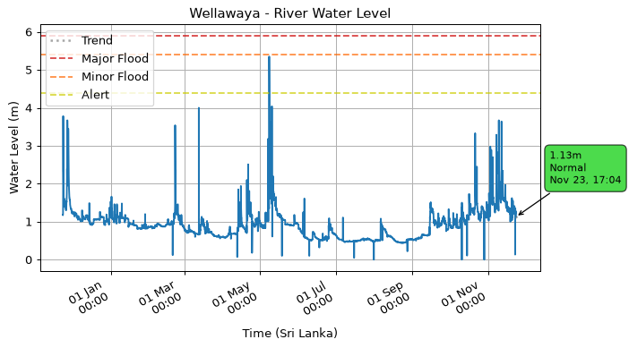

# lk_irrigation 🇱🇰

Realtime Data about *River Water Levels* in Sri Lanka, from the [Irrigation Deptartment](https://www.irrigation.gov.lk)'s [Hydrology and Disaster Management](https://www.irrigation.gov.lk/web/index.php?option=com_content&view=article&id=27&Itemid=128&lang=en) Division.

- [Complete Dataset](data/rwlds) with **326,715 measurements** from **39** stations.
- [Scrape and load logic](src/lk_irrigation/rwld/RiverWaterLevelDataLoadMixin.py)
- [Original Data source](https://www.arcgis.com/apps/dashboards/2cffe83c9ff5497d97375498bdf3ff38)

🇱🇰 River water alerts: 🟡 Dunamale — Alert; 🟡 Kalawellawa (Millakanda) — Alert; 🟡 Moraketiya — Alert; 🟡 Magura — Alert
Source: Sri Lanka Irrigation Department https://www.irrigation.gov.lk
Repo: https://github.com/nuuuwan/lk_irrigation
## River Water Level Map

## Latest measurements

*There were **38** measurements in the last **1 hour**.*

| Measured At | Station (River Basin) | Level (m) | Alert Level | Rate-of-Rise (m/hr) | Rising Alert |
| --- | --- | ---: | --- | ---: | --- |
| 2026-11-27 03:33:18 | Thaldena (Mahaweli Ganga) | 0.76 | 🟢 Normal | -0.015 |  |
| 2026-11-27 03:27:32 | Yaka Wewa (Ma Oya) | 2.29 | 🟢 Normal | 0.522 | 🔺 Rising |
| 2026-11-27 03:16:30 | Panadugama (Nilwala Ganga) | 4.43 | 🟢 Normal | 12.000 | 🔺 Rising |
| 2026-11-27 03:16:15 | Panadugama (Nilwala Ganga) | 4.38 | 🟢 Normal | 12.000 | 🔺 Rising |
| 2026-11-27 03:15:22 | Baddegama (Gin Ganga) | 1.75 | 🟢 Normal | 0.018 | 🔺 Rising |
| 2026-11-27 03:15:20 | Kithulgala (Kelani Ganga) | 1.82 | 🟢 Normal | 0.104 | 🔺 Rising |
| 2026-11-27 03:14:55 | Siyambalanduwa (Heda Oya) | 2.43 | 🟢 Normal | -0.079 |  |
| 2026-11-27 03:13:02 | Holombuwa (Kelani Ganga) | 1.80 | 🟢 Normal | 0.144 | 🔺 Rising |
| 2026-11-27 03:12:58 | Thawalama (Gin Ganga) | 2.88 | 🟢 Normal | -468.000 |  |
| 2026-11-27 03:12:57 | Thawalama (Gin Ganga) | 3.01 | 🟢 Normal | -468.000 |  |
| 2026-11-27 03:12:56 | Thawalama (Gin Ganga) | 3.05 | 🟢 Normal | -468.000 |  |
| 2026-11-27 03:12:55 | Thawalama (Gin Ganga) | 3.00 | 🟢 Normal | -468.000 |  |
| 2026-11-27 03:10:28 | Thanamalwila (Kirindi Oya) | 2.68 | 🟢 Normal | -0.210 |  |
| 2026-11-27 03:10:26 | Nagalagam Street (Kelani Ganga) | 0.85 | 🟢 Normal | 0.111 | 🔺 Rising |
| 2026-11-27 03:08:19 | Urawa (Nilwala Ganga) | 0.85 | 🟢 Normal | 0.000 |  |
| 2026-11-27 03:07:55 | Ellagawa (Kalu Ganga) | 6.80 | 🟢 Normal | 180.000 | 🔺 Rising |
| 2026-11-27 03:07:54 | Ellagawa (Kalu Ganga) | 6.75 | 🟢 Normal | 180.000 | 🔺 Rising |
| 2026-11-27 03:07:00 | Norwood (Kelani Ganga) | 1.24 | 🟢 Normal | 0.009 | 🔺 Rising |
| 2026-11-27 03:06:00 | Thalgahagoda (Nilwala Ganga) | 0.78 | 🟢 Normal | 0.015 | 🔺 Rising |
| 2026-11-27 03:05:35 | Badalgama (Maha Oya) | 4.71 | 🟢 Normal | 0.075 | 🔺 Rising |
| 2026-11-27 03:05:15 | Deraniyagala (Kelani Ganga) | 0.80 | 🟢 Normal | -0.011 |  |
| 2026-11-27 03:04:43 | Katharagama (Menik Ganga) | 0.62 | 🟢 Normal | -0.053 |  |
| 2026-11-27 03:04:43 | Padiyathalawa (Maduru Oya) | 1.40 | 🟢 Normal | -0.024 |  |
| 2026-11-27 03:04:25 | Peradeniya (Mahaweli Ganga) | 3.96 | 🟢 Normal | 0.170 | 🔺 Rising |
| 2026-11-27 03:04:16 | Magura (Kalu Ganga) | 4.60 | 🟡 Alert | -720.000 |  |
| 2026-11-27 03:04:15 | Magura (Kalu Ganga) | 4.80 | 🟡 Alert | -720.000 |  |
| 2026-11-27 03:04:14 | Moragaswewa (Deduru Oya) | 4.48 | 🟢 Normal | -0.090 |  |
| 2026-11-27 03:04:11 | Nawalapitiya (Mahaweli Ganga) | 1.67 | 🟢 Normal | -0.031 |  |
| 2026-11-27 03:04:00 | Glencourse (Kelani Ganga) | 11.76 | 🟢 Normal | 0.000 |  |
| 2026-11-27 03:03:25 | Kuda Oya (Kirindi Oya) | 2.88 | 🟢 Normal | -0.096 |  |
| 2026-11-27 03:03:25 | Hanwella (Kelani Ganga) | 3.60 | 🟢 Normal | 0.080 | 🔺 Rising |
| 2026-11-27 03:03:08 | Rathnapura (Kalu Ganga) | 3.21 | 🟢 Normal | -0.030 |  |
| 2026-11-27 03:03:06 | Nakkala (Kumbukkan Oya) | 1.48 | 🟢 Normal | -0.167 |  |
| 2026-11-27 03:02:20 | Manampitiya (Mahaweli Ganga) | 1.42 | 🟢 Normal | 0.000 |  |
| 2026-11-27 03:01:57 | Dunamale (Aththanagalu Oya) | 3.80 | 🟡 Alert | 0.188 | 🔺 Rising |
| 2026-11-27 03:01:47 | Giriulla (Maha Oya) | 4.54 | 🟢 Normal | -0.030 |  |
| 2026-11-27 03:01:23 | Moraketiya (Walawe Ganga) | 4.00 | 🟡 Alert | 0.000 |  |
| 2026-11-27 03:00:55 | Wellawaya (Kirindi Oya) | 1.75 | 🟢 Normal | -0.069 |  |

## Latest by Station

*⌛ = Latest measurement is older than **24 hours**.*

| Measured At | Station (River Basin) | Level (m) | Alert Level | Rate-of-Rise (m/hr) | Rising Alert |
| --- | --- | ---: | --- | ---: | --- |
| 2026-11-27 03:01:57 | Dunamale (Aththanagalu Oya) | 3.80 | 🟡 Alert | 0.188 | 🔺 Rising |
| 2026-11-27 02:01:59 | Kalawellawa (Millakanda) (Kalu Ganga) | 5.20 | 🟡 Alert | 0.011 | 🔺 Rising |
| 2026-11-27 03:01:23 | Moraketiya (Walawe Ganga) | 4.00 | 🟡 Alert | 0.000 |  |
| 2026-11-27 03:04:16 | Magura (Kalu Ganga) | 4.60 | 🟡 Alert | -720.000 |  |
| 2026-11-27 03:07:55 | Ellagawa (Kalu Ganga) | 6.80 | 🟢 Normal | 180.000 | 🔺 Rising |
| 2026-11-27 03:16:30 | Panadugama (Nilwala Ganga) | 4.43 | 🟢 Normal | 12.000 | 🔺 Rising |
| 2026-11-27 03:27:32 | Yaka Wewa (Ma Oya) | 2.29 | 🟢 Normal | 0.522 | 🔺 Rising |
| 2026-11-27 03:04:25 | Peradeniya (Mahaweli Ganga) | 3.96 | 🟢 Normal | 0.170 | 🔺 Rising |
| 2026-11-27 03:13:02 | Holombuwa (Kelani Ganga) | 1.80 | 🟢 Normal | 0.144 | 🔺 Rising |
| 2026-11-27 03:10:26 | Nagalagam Street (Kelani Ganga) | 0.85 | 🟢 Normal | 0.111 | 🔺 Rising |
| 2026-11-27 03:15:20 | Kithulgala (Kelani Ganga) | 1.82 | 🟢 Normal | 0.104 | 🔺 Rising |
| 2026-11-27 03:03:25 | Hanwella (Kelani Ganga) | 3.60 | 🟢 Normal | 0.080 | 🔺 Rising |
| 2026-11-27 03:05:35 | Badalgama (Maha Oya) | 4.71 | 🟢 Normal | 0.075 | 🔺 Rising |
| 2026-11-27 02:04:07 | Putupaula (Kalu Ganga) | 1.33 | 🟢 Normal | 0.043 | 🔺 Rising |
| 2026-11-27 03:15:22 | Baddegama (Gin Ganga) | 1.75 | 🟢 Normal | 0.018 | 🔺 Rising |
| 2026-11-27 03:06:00 | Thalgahagoda (Nilwala Ganga) | 0.78 | 🟢 Normal | 0.015 | 🔺 Rising |
| 2026-11-26 18:00:24 | Weraganthota (Mahaweli Ganga) | -1.98 | 🟢 Normal | 0.011 | 🔺 Rising |
| 2026-11-27 03:07:00 | Norwood (Kelani Ganga) | 1.24 | 🟢 Normal | 0.009 | 🔺 Rising |
| 2026-11-27 01:05:35 | Horowpothana (Yan Oya) | 2.39 | 🟢 Normal | 0.000 |  |
| 2026-11-27 03:04:00 | Glencourse (Kelani Ganga) | 11.76 | 🟢 Normal | 0.000 |  |
| 2026-11-27 03:02:20 | Manampitiya (Mahaweli Ganga) | 1.42 | 🟢 Normal | 0.000 |  |
| 2026-11-26 18:02:07 | Thanthirimale (Malwathu Oya) | 1.62 | 🟢 Normal | 0.000 |  |
| 2026-11-27 03:08:19 | Urawa (Nilwala Ganga) | 0.85 | 🟢 Normal | 0.000 |  |
| 2026-11-27 02:06:39 | Pitabeddara (Nilwala Ganga) | 2.20 | 🟢 Normal | -0.010 |  |
| 2026-11-27 03:05:15 | Deraniyagala (Kelani Ganga) | 0.80 | 🟢 Normal | -0.011 |  |
| 2026-11-27 03:33:18 | Thaldena (Mahaweli Ganga) | 0.76 | 🟢 Normal | -0.015 |  |
| 2026-11-26 18:01:55 | Galgamuwa (Mee Oya) | 1.18 | 🟢 Normal | -0.021 |  |
| 2026-11-27 03:04:43 | Padiyathalawa (Maduru Oya) | 1.40 | 🟢 Normal | -0.024 |  |
| 2026-11-27 03:03:08 | Rathnapura (Kalu Ganga) | 3.21 | 🟢 Normal | -0.030 |  |
| 2026-11-27 03:01:47 | Giriulla (Maha Oya) | 4.54 | 🟢 Normal | -0.030 |  |
| 2026-11-27 03:04:11 | Nawalapitiya (Mahaweli Ganga) | 1.67 | 🟢 Normal | -0.031 |  |
| 2026-11-27 03:04:43 | Katharagama (Menik Ganga) | 0.62 | 🟢 Normal | -0.053 |  |
| 2026-11-27 03:00:55 | Wellawaya (Kirindi Oya) | 1.75 | 🟢 Normal | -0.069 |  |
| 2026-11-27 03:14:55 | Siyambalanduwa (Heda Oya) | 2.43 | 🟢 Normal | -0.079 |  |
| 2026-11-27 03:04:14 | Moragaswewa (Deduru Oya) | 4.48 | 🟢 Normal | -0.090 |  |
| 2026-11-27 03:03:25 | Kuda Oya (Kirindi Oya) | 2.88 | 🟢 Normal | -0.096 |  |
| 2026-11-27 03:03:06 | Nakkala (Kumbukkan Oya) | 1.48 | 🟢 Normal | -0.167 |  |
| 2026-11-27 03:10:28 | Thanamalwila (Kirindi Oya) | 2.68 | 🟢 Normal | -0.210 |  |
| 2026-11-27 03:12:58 | Thawalama (Gin Ganga) | 2.88 | 🟢 Normal | -468.000 |  |

## River Water Level Charts by Station

### Dunamale (Aththanagalu Oya)

### Kalawellawa (Millakanda) (Kalu Ganga)

.png)

### Moraketiya (Walawe Ganga)

### Magura (Kalu Ganga)

### Ellagawa (Kalu Ganga)

### Panadugama (Nilwala Ganga)

### Yaka Wewa (Ma Oya)

### Peradeniya (Mahaweli Ganga)

### Holombuwa (Kelani Ganga)

### Nagalagam Street (Kelani Ganga)

### Kithulgala (Kelani Ganga)

### Hanwella (Kelani Ganga)

### Badalgama (Maha Oya)

### Putupaula (Kalu Ganga)

### Baddegama (Gin Ganga)

### Thalgahagoda (Nilwala Ganga)

### Weraganthota (Mahaweli Ganga)

### Norwood (Kelani Ganga)

### Horowpothana (Yan Oya)

### Glencourse (Kelani Ganga)

### Manampitiya (Mahaweli Ganga)

### Thanthirimale (Malwathu Oya)

### Urawa (Nilwala Ganga)

### Pitabeddara (Nilwala Ganga)

### Deraniyagala (Kelani Ganga)

### Thaldena (Mahaweli Ganga)

### Galgamuwa (Mee Oya)

### Padiyathalawa (Maduru Oya)

### Rathnapura (Kalu Ganga)

### Giriulla (Maha Oya)

### Nawalapitiya (Mahaweli Ganga)

### Katharagama (Menik Ganga)

### Wellawaya (Kirindi Oya)

### Siyambalanduwa (Heda Oya)

### Moragaswewa (Deduru Oya)

### Kuda Oya (Kirindi Oya)

### Nakkala (Kumbukkan Oya)

### Thanamalwila (Kirindi Oya)

### Thawalama (Gin Ganga)

