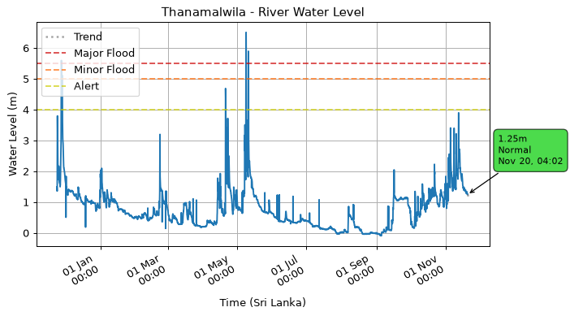

# lk_irrigation 🇱🇰

Realtime Data about *River Water Levels* in Sri Lanka, from the [Irrigation Deptartment](https://www.irrigation.gov.lk)'s [Hydrology and Disaster Management](https://www.irrigation.gov.lk/web/index.php?option=com_content&view=article&id=27&Itemid=128&lang=en) Division.

- [Complete Dataset](data/rwlds) with **325,822 measurements** from **39** stations.
- [Scrape and load logic](src/lk_irrigation/rwld/RiverWaterLevelDataLoadMixin.py)
- [Original Data source](https://www.arcgis.com/apps/dashboards/2cffe83c9ff5497d97375498bdf3ff38)

🇱🇰 River water alerts: 🟡 Dunamale — Alert
Source: Sri Lanka Irrigation Department https://www.irrigation.gov.lk
Repo: https://github.com/nuuuwan/lk_irrigation
## River Water Level Map

## Latest measurements

*There were **20** measurements in the last **1 hour**.*

| Measured At | Station (River Basin) | Level (m) | Alert Level | Rate-of-Rise (m/hr) | Rising Alert |
| --- | --- | ---: | --- | ---: | --- |
| 2026-11-26 03:03:14 | Norwood (Kelani Ganga) | 0.92 | 🟢 Normal | 0.000 |  |
| 2026-11-26 03:03:02 | Kithulgala (Kelani Ganga) | 1.86 | 🟢 Normal | 0.010 | 🔺 Rising |
| 2026-11-26 03:03:00 | Thawalama (Gin Ganga) | 2.30 | 🟢 Normal | 0.000 |  |
| 2026-11-26 03:02:52 | Manampitiya (Mahaweli Ganga) | 1.34 | 🟢 Normal | 0.049 | 🔺 Rising |
| 2026-11-26 03:02:46 | Dunamale (Aththanagalu Oya) | 3.82 | 🟡 Alert | 0.040 | 🔺 Rising |
| 2026-11-26 03:02:39 | Glencourse (Kelani Ganga) | 12.13 | 🟢 Normal | -0.108 |  |
| 2026-11-26 03:02:33 | Deraniyagala (Kelani Ganga) | 0.87 | 🟢 Normal | -0.081 |  |
| 2026-11-26 03:02:28 | Siyambalanduwa (Heda Oya) | 0.88 | 🟢 Normal | -0.020 |  |
| 2026-11-26 03:02:10 | Thanamalwila (Kirindi Oya) | 1.80 | 🟢 Normal | -0.020 |  |
| 2026-11-26 03:01:58 | Ellagawa (Kalu Ganga) | 6.10 | 🟢 Normal | -0.050 |  |
| 2026-11-26 03:01:56 | Giriulla (Maha Oya) | 3.60 | 🟢 Normal | 0.227 | 🔺 Rising |
| 2026-11-26 03:01:50 | Pitabeddara (Nilwala Ganga) | 1.29 | 🟢 Normal | 0.000 |  |
| 2026-11-26 03:01:28 | Yaka Wewa (Ma Oya) | 0.50 | 🟢 Normal | 0.000 |  |
| 2026-11-26 03:01:18 | Moragaswewa (Deduru Oya) | 2.68 | 🟢 Normal | 0.263 | 🔺 Rising |
| 2026-11-26 03:01:14 | Peradeniya (Mahaweli Ganga) | 3.72 | 🟢 Normal | -0.540 |  |
| 2026-11-26 03:01:08 | Thaldena (Mahaweli Ganga) | 0.78 | 🟢 Normal | -0.020 |  |
| 2026-11-26 03:00:38 | Wellawaya (Kirindi Oya) | 1.53 | 🟢 Normal | -0.973 |  |
| 2026-11-26 03:00:04 | Moraketiya (Walawe Ganga) | 1.90 | 🟢 Normal | -0.030 |  |
| 2026-11-26 03:00:01 | Wellawaya (Kirindi Oya) | 1.54 | 🟢 Normal | -0.973 |  |
| 2026-11-26 02:28:37 | Thawalama (Gin Ganga) | 2.30 | 🟢 Normal | 0.000 |  |

## Latest by Station

*⌛ = Latest measurement is older than **24 hours**.*

| Measured At | Station (River Basin) | Level (m) | Alert Level | Rate-of-Rise (m/hr) | Rising Alert |
| --- | --- | ---: | --- | ---: | --- |
| 2026-11-26 03:02:46 | Dunamale (Aththanagalu Oya) | 3.82 | 🟡 Alert | 0.040 | 🔺 Rising |
| 2026-11-25 20:05:34 | Magura (Kalu Ganga) | 3.40 | 🟢 Normal | 0.483 | 🔺 Rising |
| 2026-11-26 03:01:18 | Moragaswewa (Deduru Oya) | 2.68 | 🟢 Normal | 0.263 | 🔺 Rising |
| 2026-11-26 03:01:56 | Giriulla (Maha Oya) | 3.60 | 🟢 Normal | 0.227 | 🔺 Rising |
| 2026-11-26 02:04:13 | Hanwella (Kelani Ganga) | 3.76 | 🟢 Normal | 0.188 | 🔺 Rising |
| 2026-11-25 18:02:46 | Weraganthota (Mahaweli Ganga) | -1.84 | 🟢 Normal | 0.141 | 🔺 Rising |
| 2026-11-26 02:03:10 | Badalgama (Maha Oya) | 3.79 | 🟢 Normal | 0.108 | 🔺 Rising |
| 2026-11-26 02:05:46 | Nagalagam Street (Kelani Ganga) | 0.79 | 🟢 Normal | 0.075 | 🔺 Rising |
| 2026-11-25 18:02:35 | Thanthirimale (Malwathu Oya) | 1.47 | 🟢 Normal | 0.053 | 🔺 Rising |
| 2026-11-26 03:02:52 | Manampitiya (Mahaweli Ganga) | 1.34 | 🟢 Normal | 0.049 | 🔺 Rising |
| 2026-11-25 18:00:42 | Galgamuwa (Mee Oya) | 0.45 | 🟢 Normal | 0.033 | 🔺 Rising |
| 2026-11-26 02:07:50 | Katharagama (Menik Ganga) | 0.15 | 🟢 Normal | 0.027 | 🔺 Rising |
| 2026-11-26 02:02:04 | Kalawellawa (Millakanda) (Kalu Ganga) | 4.92 | 🟢 Normal | 0.015 | 🔺 Rising |
| 2026-11-26 03:03:02 | Kithulgala (Kelani Ganga) | 1.86 | 🟢 Normal | 0.010 | 🔺 Rising |
| 2026-11-26 03:01:28 | Yaka Wewa (Ma Oya) | 0.50 | 🟢 Normal | 0.000 |  |
| 2026-11-26 03:01:50 | Pitabeddara (Nilwala Ganga) | 1.29 | 🟢 Normal | 0.000 |  |
| 2026-11-26 03:03:14 | Norwood (Kelani Ganga) | 0.92 | 🟢 Normal | 0.000 |  |
| 2026-11-26 02:06:08 | Baddegama (Gin Ganga) | 1.88 | 🟢 Normal | 0.000 |  |
| 2026-11-26 03:03:00 | Thawalama (Gin Ganga) | 2.30 | 🟢 Normal | 0.000 |  |
| 2026-11-26 02:18:05 | Urawa (Nilwala Ganga) | 1.01 | 🟢 Normal | 0.000 |  |
| 2026-11-26 02:00:15 | Thalgahagoda (Nilwala Ganga) | 1.00 | 🟢 Normal | 0.000 |  |
| 2026-11-26 01:03:51 | Horowpothana (Yan Oya) | 2.70 | 🟢 Normal | -0.010 |  |
| 2026-11-26 02:00:07 | Nakkala (Kumbukkan Oya) | 1.00 | 🟢 Normal | -0.010 |  |
| 2026-11-26 00:07:27 | Kuda Oya (Kirindi Oya) | 1.70 | 🟢 Normal | -0.019 |  |
| 2026-11-26 03:02:28 | Siyambalanduwa (Heda Oya) | 0.88 | 🟢 Normal | -0.020 |  |
| 2026-11-26 03:01:08 | Thaldena (Mahaweli Ganga) | 0.78 | 🟢 Normal | -0.020 |  |
| 2026-11-26 03:02:10 | Thanamalwila (Kirindi Oya) | 1.80 | 🟢 Normal | -0.020 |  |
| 2026-11-22 17:02:02⌛ | Padiyathalawa (Maduru Oya) | 0.36 | 🟢 Normal | -0.022 |  |
| 2026-11-26 02:09:51 | Panadugama (Nilwala Ganga) | 4.14 | 🟢 Normal | -0.026 |  |
| 2026-11-26 02:01:30 | Nawalapitiya (Mahaweli Ganga) | 1.54 | 🟢 Normal | -0.030 |  |
| 2026-11-26 03:00:04 | Moraketiya (Walawe Ganga) | 1.90 | 🟢 Normal | -0.030 |  |
| 2026-11-26 01:02:56 | Putupaula (Kalu Ganga) | 1.28 | 🟢 Normal | -0.032 |  |
| 2026-11-26 03:01:58 | Ellagawa (Kalu Ganga) | 6.10 | 🟢 Normal | -0.050 |  |
| 2026-11-26 02:05:52 | Rathnapura (Kalu Ganga) | 2.69 | 🟢 Normal | -0.066 |  |
| 2026-11-26 03:02:33 | Deraniyagala (Kelani Ganga) | 0.87 | 🟢 Normal | -0.081 |  |
| 2026-11-26 03:02:39 | Glencourse (Kelani Ganga) | 12.13 | 🟢 Normal | -0.108 |  |
| 2026-11-26 02:05:10 | Holombuwa (Kelani Ganga) | 1.80 | 🟢 Normal | -0.241 |  |
| 2026-11-26 03:01:14 | Peradeniya (Mahaweli Ganga) | 3.72 | 🟢 Normal | -0.540 |  |
| 2026-11-26 03:00:38 | Wellawaya (Kirindi Oya) | 1.53 | 🟢 Normal | -0.973 |  |

## River Water Level Charts by Station

### Dunamale (Aththanagalu Oya)

### Magura (Kalu Ganga)

### Moragaswewa (Deduru Oya)

### Giriulla (Maha Oya)

### Hanwella (Kelani Ganga)

### Weraganthota (Mahaweli Ganga)

### Badalgama (Maha Oya)

### Nagalagam Street (Kelani Ganga)

### Thanthirimale (Malwathu Oya)

### Manampitiya (Mahaweli Ganga)

### Galgamuwa (Mee Oya)

### Katharagama (Menik Ganga)

### Kalawellawa (Millakanda) (Kalu Ganga)

.png)

### Kithulgala (Kelani Ganga)

### Yaka Wewa (Ma Oya)

### Pitabeddara (Nilwala Ganga)

### Norwood (Kelani Ganga)

### Baddegama (Gin Ganga)

### Thawalama (Gin Ganga)

### Urawa (Nilwala Ganga)

### Thalgahagoda (Nilwala Ganga)

### Horowpothana (Yan Oya)

### Nakkala (Kumbukkan Oya)

### Kuda Oya (Kirindi Oya)

### Siyambalanduwa (Heda Oya)

### Thaldena (Mahaweli Ganga)

### Thanamalwila (Kirindi Oya)

### Padiyathalawa (Maduru Oya)

### Panadugama (Nilwala Ganga)

### Nawalapitiya (Mahaweli Ganga)

### Moraketiya (Walawe Ganga)

### Putupaula (Kalu Ganga)

### Ellagawa (Kalu Ganga)

### Rathnapura (Kalu Ganga)

### Deraniyagala (Kelani Ganga)

### Glencourse (Kelani Ganga)

### Holombuwa (Kelani Ganga)

### Peradeniya (Mahaweli Ganga)

### Wellawaya (Kirindi Oya)

