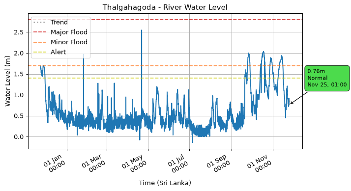
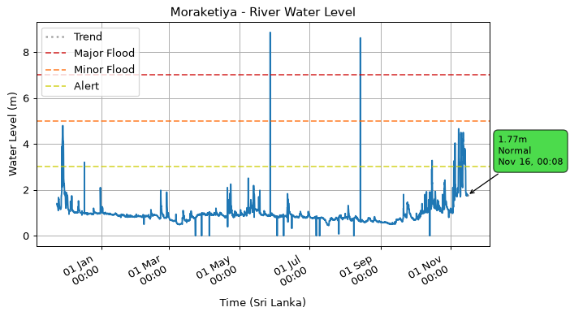

# lk_irrigation 🇱🇰

Realtime Data about *River Water Levels* in Sri Lanka, from the [Irrigation Deptartment](https://www.irrigation.gov.lk)'s [Hydrology and Disaster Management](https://www.irrigation.gov.lk/web/index.php?option=com_content&view=article&id=27&Itemid=128&lang=en) Division.

- [Complete Dataset](data/rwlds) with **316,352 measurements** from **39** stations.
- [Scrape and load logic](src/lk_irrigation/rwld/RiverWaterLevelDataLoadMixin.py)
- [Original Data source](https://www.arcgis.com/apps/dashboards/2cffe83c9ff5497d97375498bdf3ff38)

🇱🇰 River water alerts: 🟠 Thalgahagoda — Minor Flood
Source: Sri Lanka Irrigation Department https://www.irrigation.gov.lk
Repo: https://github.com/nuuuwan/lk_irrigation
## River Water Level Map

## Latest measurements

*There were **21** measurements in the last **1 hour**.*

| Measured At | Station (River Basin) | Level (m) | Alert Level | Rate-of-Rise (m/hr) | Rising Alert |
| --- | --- | ---: | --- | ---: | --- |
| 2026-11-15 09:03:33 | Moragaswewa (Deduru Oya) | 1.04 | 🟢 Normal | 0.000 |  |
| 2026-11-15 09:03:32 | Dunamale (Aththanagalu Oya) | 2.00 | 🟢 Normal | 0.000 |  |
| 2026-11-15 09:03:30 | Urawa (Nilwala Ganga) | 1.13 | 🟢 Normal | -0.011 |  |
| 2026-11-15 09:03:05 | Moraketiya (Walawe Ganga) | 1.78 | 🟢 Normal | -0.023 |  |
| 2026-11-15 09:02:50 | Hanwella (Kelani Ganga) | 2.51 | 🟢 Normal | -0.010 |  |
| 2026-11-15 09:02:41 | Katharagama (Menik Ganga) | 0.01 | 🟢 Normal | 0.010 | 🔺 Rising |
| 2026-11-15 09:02:31 | Deraniyagala (Kelani Ganga) | 0.83 | 🟢 Normal | 0.000 |  |
| 2026-11-15 09:02:17 | Nagalagam Street (Kelani Ganga) | 0.49 | 🟢 Normal | -0.060 |  |
| 2026-11-15 09:02:12 | Manampitiya (Mahaweli Ganga) | 1.25 | 🟢 Normal | 0.021 | 🔺 Rising |
| 2026-11-15 09:02:11 | Giriulla (Maha Oya) | 1.53 | 🟢 Normal | 0.000 |  |
| 2026-11-15 09:02:11 | Thanamalwila (Kirindi Oya) | 1.80 | 🟢 Normal | -0.010 |  |
| 2026-11-15 09:02:10 | Kuda Oya (Kirindi Oya) | 1.82 | 🟢 Normal | -0.010 |  |
| 2026-11-15 09:02:07 | Thawalama (Gin Ganga) | 2.03 | 🟢 Normal | -0.011 |  |
| 2026-11-15 09:02:00 | Siyambalanduwa (Heda Oya) | 0.56 | 🟢 Normal | 0.000 |  |
| 2026-11-15 09:01:48 | Pitabeddara (Nilwala Ganga) | 1.28 | 🟢 Normal | 0.000 |  |
| 2026-11-15 09:01:48 | Nawalapitiya (Mahaweli Ganga) | 1.33 | 🟢 Normal | 0.000 |  |
| 2026-11-15 09:01:44 | Holombuwa (Kelani Ganga) | 0.88 | 🟢 Normal | 0.000 |  |
| 2026-11-15 09:01:30 | Wellawaya (Kirindi Oya) | 1.48 | 🟢 Normal | -0.030 |  |
| 2026-11-15 09:01:27 | Weraganthota (Mahaweli Ganga) | -2.15 | 🟢 Normal | 0.041 | 🔺 Rising |
| 2026-11-15 09:01:23 | Peradeniya (Mahaweli Ganga) | 2.97 | 🟢 Normal | 0.011 | 🔺 Rising |
| 2026-11-15 09:01:00 | Thanthirimale (Malwathu Oya) | 1.55 | 🟢 Normal | -0.010 |  |

## Latest by Station

*⌛ = Latest measurement is older than **24 hours**.*

| Measured At | Station (River Basin) | Level (m) | Alert Level | Rate-of-Rise (m/hr) | Rising Alert |
| --- | --- | ---: | --- | ---: | --- |
| 2026-11-15 08:02:12 | Thalgahagoda (Nilwala Ganga) | 1.87 | 🟠 Minor Flood | 0.000 |  |
| 2026-11-15 09:01:27 | Weraganthota (Mahaweli Ganga) | -2.15 | 🟢 Normal | 0.041 | 🔺 Rising |
| 2026-11-15 09:02:12 | Manampitiya (Mahaweli Ganga) | 1.25 | 🟢 Normal | 0.021 | 🔺 Rising |
| 2026-11-15 09:01:23 | Peradeniya (Mahaweli Ganga) | 2.97 | 🟢 Normal | 0.011 | 🔺 Rising |
| 2026-11-15 09:02:41 | Katharagama (Menik Ganga) | 0.01 | 🟢 Normal | 0.010 | 🔺 Rising |
| 2026-11-15 09:03:33 | Moragaswewa (Deduru Oya) | 1.04 | 🟢 Normal | 0.000 |  |
| 2026-11-15 09:01:48 | Nawalapitiya (Mahaweli Ganga) | 1.33 | 🟢 Normal | 0.000 |  |
| 2026-11-15 08:13:16 | Yaka Wewa (Ma Oya) | 0.53 | 🟢 Normal | 0.000 |  |
| 2026-11-15 09:02:11 | Giriulla (Maha Oya) | 1.53 | 🟢 Normal | 0.000 |  |
| 2026-11-15 09:01:48 | Pitabeddara (Nilwala Ganga) | 1.28 | 🟢 Normal | 0.000 |  |
| 2026-11-15 09:02:31 | Deraniyagala (Kelani Ganga) | 0.83 | 🟢 Normal | 0.000 |  |
| 2026-11-15 07:43:48 | Padiyathalawa (Maduru Oya) | 0.55 | 🟢 Normal | 0.000 |  |
| 2026-11-15 09:02:00 | Siyambalanduwa (Heda Oya) | 0.56 | 🟢 Normal | 0.000 |  |
| 2026-11-15 09:03:32 | Dunamale (Aththanagalu Oya) | 2.00 | 🟢 Normal | 0.000 |  |
| 2026-11-15 08:07:26 | Badalgama (Maha Oya) | 2.85 | 🟢 Normal | 0.000 |  |
| 2026-11-15 09:01:44 | Holombuwa (Kelani Ganga) | 0.88 | 🟢 Normal | 0.000 |  |
| 2026-11-15 08:07:58 | Rathnapura (Kalu Ganga) | 2.02 | 🟢 Normal | -0.009 |  |
| 2026-11-15 08:07:35 | Glencourse (Kelani Ganga) | 10.66 | 🟢 Normal | -0.010 |  |
| 2026-11-15 09:02:11 | Thanamalwila (Kirindi Oya) | 1.80 | 🟢 Normal | -0.010 |  |
| 2026-11-15 08:03:39 | Ellagawa (Kalu Ganga) | 5.67 | 🟢 Normal | -0.010 |  |
| 2026-11-15 09:02:10 | Kuda Oya (Kirindi Oya) | 1.82 | 🟢 Normal | -0.010 |  |
| 2026-11-15 09:01:00 | Thanthirimale (Malwathu Oya) | 1.55 | 🟢 Normal | -0.010 |  |
| 2026-11-15 09:02:50 | Hanwella (Kelani Ganga) | 2.51 | 🟢 Normal | -0.010 |  |
| 2026-11-15 08:11:00 | Magura (Kalu Ganga) | 2.06 | 🟢 Normal | -0.010 |  |
| 2026-11-15 08:01:13 | Nakkala (Kumbukkan Oya) | 1.04 | 🟢 Normal | -0.010 |  |
| 2026-11-15 09:03:30 | Urawa (Nilwala Ganga) | 1.13 | 🟢 Normal | -0.011 |  |
| 2026-11-15 09:02:07 | Thawalama (Gin Ganga) | 2.03 | 🟢 Normal | -0.011 |  |
| 2026-11-15 08:18:49 | Galgamuwa (Mee Oya) | 0.30 | 🟢 Normal | -0.016 |  |
| 2026-11-15 08:09:47 | Panadugama (Nilwala Ganga) | 4.85 | 🟢 Normal | -0.018 |  |
| 2026-11-15 08:08:26 | Thaldena (Mahaweli Ganga) | 0.70 | 🟢 Normal | -0.019 |  |
| 2026-11-15 08:03:20 | Norwood (Kelani Ganga) | 1.08 | 🟢 Normal | -0.020 |  |
| 2026-11-15 09:03:05 | Moraketiya (Walawe Ganga) | 1.78 | 🟢 Normal | -0.023 |  |
| 2026-11-15 09:01:30 | Wellawaya (Kirindi Oya) | 1.48 | 🟢 Normal | -0.030 |  |
| 2026-11-15 08:05:12 | Kalawellawa (Millakanda) (Kalu Ganga) | 3.32 | 🟢 Normal | -0.031 |  |
| 2026-11-15 08:06:04 | Baddegama (Gin Ganga) | 2.79 | 🟢 Normal | -0.037 |  |
| 2026-11-15 08:02:07 | Kithulgala (Kelani Ganga) | 2.10 | 🟢 Normal | -0.041 |  |
| 2026-11-15 08:03:31 | Horowpothana (Yan Oya) | 2.08 | 🟢 Normal | -0.045 |  |
| 2026-11-15 08:05:55 | Putupaula (Kalu Ganga) | 0.97 | 🟢 Normal | -0.054 |  |
| 2026-11-15 09:02:17 | Nagalagam Street (Kelani Ganga) | 0.49 | 🟢 Normal | -0.060 |  |

## River Water Level Charts by Station

### Thalgahagoda (Nilwala Ganga)

### Weraganthota (Mahaweli Ganga)

### Manampitiya (Mahaweli Ganga)

### Peradeniya (Mahaweli Ganga)

### Katharagama (Menik Ganga)

### Moragaswewa (Deduru Oya)

### Nawalapitiya (Mahaweli Ganga)

### Yaka Wewa (Ma Oya)

### Giriulla (Maha Oya)

### Pitabeddara (Nilwala Ganga)

### Deraniyagala (Kelani Ganga)

### Padiyathalawa (Maduru Oya)

### Siyambalanduwa (Heda Oya)

### Dunamale (Aththanagalu Oya)

### Badalgama (Maha Oya)

### Holombuwa (Kelani Ganga)

### Rathnapura (Kalu Ganga)

### Glencourse (Kelani Ganga)

### Thanamalwila (Kirindi Oya)

### Ellagawa (Kalu Ganga)

### Kuda Oya (Kirindi Oya)

### Thanthirimale (Malwathu Oya)

### Hanwella (Kelani Ganga)

### Magura (Kalu Ganga)

### Nakkala (Kumbukkan Oya)

### Urawa (Nilwala Ganga)

### Thawalama (Gin Ganga)

### Galgamuwa (Mee Oya)

### Panadugama (Nilwala Ganga)

### Thaldena (Mahaweli Ganga)

### Norwood (Kelani Ganga)

### Moraketiya (Walawe Ganga)

### Wellawaya (Kirindi Oya)

### Kalawellawa (Millakanda) (Kalu Ganga)

.png)

### Baddegama (Gin Ganga)

### Kithulgala (Kelani Ganga)

### Horowpothana (Yan Oya)

### Putupaula (Kalu Ganga)

### Nagalagam Street (Kelani Ganga)

