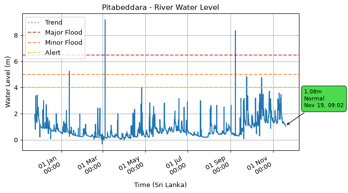

# lk_irrigation 🇱🇰

Realtime Data about *River Water Levels* in Sri Lanka, from the [Irrigation Deptartment](https://www.irrigation.gov.lk)'s [Hydrology and Disaster Management](https://www.irrigation.gov.lk/web/index.php?option=com_content&view=article&id=27&Itemid=128&lang=en) Division.

- [Complete Dataset](data/rwlds) with **327,434 measurements** from **39** stations.
- [Scrape and load logic](src/lk_irrigation/rwld/RiverWaterLevelDataLoadMixin.py)
- [Original Data source](https://www.arcgis.com/apps/dashboards/2cffe83c9ff5497d97375498bdf3ff38)

🇱🇰 River water alerts: 🟡 Dunamale — Alert; 🟡 Kalawellawa (Millakanda) — Alert; 🟡 Moraketiya — Alert
Source: Sri Lanka Irrigation Department https://www.irrigation.gov.lk
Repo: https://github.com/nuuuwan/lk_irrigation
## River Water Level Map

## Latest measurements

*There were **34** measurements in the last **1 hour**.*

| Measured At | Station (River Basin) | Level (m) | Alert Level | Rate-of-Rise (m/hr) | Rising Alert |
| --- | --- | ---: | --- | ---: | --- |
| 2026-11-27 22:19:18 | Thalgahagoda (Nilwala Ganga) | 0.91 | 🟢 Normal | 0.008 | 🔺 Rising |
| 2026-11-27 22:17:35 | Padiyathalawa (Maduru Oya) | 0.75 | 🟢 Normal | 0.000 |  |
| 2026-11-27 22:14:39 | Urawa (Nilwala Ganga) | 1.89 | 🟢 Normal | 0.000 |  |
| 2026-11-27 22:13:33 | Moragaswewa (Deduru Oya) | 2.90 | 🟢 Normal | -0.053 |  |
| 2026-11-27 22:11:40 | Dunamale (Aththanagalu Oya) | 3.49 | 🟡 Alert | 0.000 |  |
| 2026-11-27 22:11:23 | Badalgama (Maha Oya) | 4.11 | 🟢 Normal | -0.045 |  |
| 2026-11-27 22:08:19 | Baddegama (Gin Ganga) | 2.06 | 🟢 Normal | 0.029 | 🔺 Rising |
| 2026-11-27 22:07:51 | Norwood (Kelani Ganga) | 1.01 | 🟢 Normal | 0.023 | 🔺 Rising |
| 2026-11-27 22:06:50 | Nagalagam Street (Kelani Ganga) | 0.34 | 🟢 Normal | 0.000 |  |
| 2026-11-27 22:06:46 | Urawa (Nilwala Ganga) | 1.89 | 🟢 Normal | 0.000 |  |
| 2026-11-27 22:06:40 | Rathnapura (Kalu Ganga) | 3.25 | 🟢 Normal | -0.119 |  |
| 2026-11-27 22:06:09 | Holombuwa (Kelani Ganga) | 1.96 | 🟢 Normal | -0.234 |  |
| 2026-11-27 22:06:04 | Glencourse (Kelani Ganga) | 12.80 | 🟢 Normal | 0.124 | 🔺 Rising |
| 2026-11-27 22:04:40 | Hanwella (Kelani Ganga) | 3.46 | 🟢 Normal | 0.429 | 🔺 Rising |
| 2026-11-27 22:04:39 | Putupaula (Kalu Ganga) | 1.45 | 🟢 Normal | -0.010 |  |
| 2026-11-27 22:04:38 | Nawalapitiya (Mahaweli Ganga) | 1.50 | 🟢 Normal | 0.097 | 🔺 Rising |
| 2026-11-27 22:04:30 | Panadugama (Nilwala Ganga) | 4.72 | 🟢 Normal | 0.726 | 🔺 Rising |
| 2026-11-27 22:04:28 | Thawalama (Gin Ganga) | 2.40 | 🟢 Normal | -0.033 |  |
| 2026-11-27 22:04:21 | Kithulgala (Kelani Ganga) | 1.73 | 🟢 Normal | 0.030 | 🔺 Rising |
| 2026-11-27 22:04:18 | Yaka Wewa (Ma Oya) | 0.50 | 🟢 Normal | 0.000 |  |
| 2026-11-27 22:04:14 | Moraketiya (Walawe Ganga) | 3.68 | 🟡 Alert | -0.029 |  |
| 2026-11-27 22:03:51 | Manampitiya (Mahaweli Ganga) | 1.65 | 🟢 Normal | -0.049 |  |
| 2026-11-27 22:03:43 | Katharagama (Menik Ganga) | 0.26 | 🟢 Normal | -0.010 |  |
| 2026-11-27 22:03:41 | Magura (Kalu Ganga) | 3.70 | 🟢 Normal | 0.079 | 🔺 Rising |
| 2026-11-27 22:03:32 | Giriulla (Maha Oya) | 3.50 | 🟢 Normal | 0.190 | 🔺 Rising |
| 2026-11-27 22:03:28 | Kalawellawa (Millakanda) (Kalu Ganga) | 5.21 | 🟡 Alert | -0.020 |  |
| 2026-11-27 22:03:17 | Thanamalwila (Kirindi Oya) | 2.88 | 🟢 Normal | 0.780 | 🔺 Rising |
| 2026-11-27 22:02:46 | Siyambalanduwa (Heda Oya) | 1.28 | 🟢 Normal | 0.265 | 🔺 Rising |
| 2026-11-27 22:02:28 | Pitabeddara (Nilwala Ganga) | 2.52 | 🟢 Normal | -0.076 |  |
| 2026-11-27 22:02:07 | Deraniyagala (Kelani Ganga) | 0.91 | 🟢 Normal | 0.020 | 🔺 Rising |
| 2026-11-27 22:01:51 | Kuda Oya (Kirindi Oya) | 4.45 | 🟢 Normal | 0.905 | 🔺 Rising |
| 2026-11-27 22:01:44 | Ellagawa (Kalu Ganga) | 7.21 | 🟢 Normal | 0.233 | 🔺 Rising |
| 2026-11-27 22:01:31 | Nakkala (Kumbukkan Oya) | 1.12 | 🟢 Normal | 0.000 |  |
| 2026-11-27 22:00:12 | Wellawaya (Kirindi Oya) | 1.88 | 🟢 Normal | -0.040 |  |

## Latest by Station

*⌛ = Latest measurement is older than **24 hours**.*

| Measured At | Station (River Basin) | Level (m) | Alert Level | Rate-of-Rise (m/hr) | Rising Alert |
| --- | --- | ---: | --- | ---: | --- |
| 2026-11-27 22:11:40 | Dunamale (Aththanagalu Oya) | 3.49 | 🟡 Alert | 0.000 |  |
| 2026-11-27 22:03:28 | Kalawellawa (Millakanda) (Kalu Ganga) | 5.21 | 🟡 Alert | -0.020 |  |
| 2026-11-27 22:04:14 | Moraketiya (Walawe Ganga) | 3.68 | 🟡 Alert | -0.029 |  |
| 2026-11-27 22:01:51 | Kuda Oya (Kirindi Oya) | 4.45 | 🟢 Normal | 0.905 | 🔺 Rising |
| 2026-11-27 22:03:17 | Thanamalwila (Kirindi Oya) | 2.88 | 🟢 Normal | 0.780 | 🔺 Rising |
| 2026-11-27 22:04:30 | Panadugama (Nilwala Ganga) | 4.72 | 🟢 Normal | 0.726 | 🔺 Rising |
| 2026-11-27 22:04:40 | Hanwella (Kelani Ganga) | 3.46 | 🟢 Normal | 0.429 | 🔺 Rising |
| 2026-11-27 22:02:46 | Siyambalanduwa (Heda Oya) | 1.28 | 🟢 Normal | 0.265 | 🔺 Rising |
| 2026-11-27 22:01:44 | Ellagawa (Kalu Ganga) | 7.21 | 🟢 Normal | 0.233 | 🔺 Rising |
| 2026-11-27 22:03:32 | Giriulla (Maha Oya) | 3.50 | 🟢 Normal | 0.190 | 🔺 Rising |
| 2026-11-27 22:06:04 | Glencourse (Kelani Ganga) | 12.80 | 🟢 Normal | 0.124 | 🔺 Rising |
| 2026-11-27 22:04:38 | Nawalapitiya (Mahaweli Ganga) | 1.50 | 🟢 Normal | 0.097 | 🔺 Rising |
| 2026-11-27 22:03:41 | Magura (Kalu Ganga) | 3.70 | 🟢 Normal | 0.079 | 🔺 Rising |
| 2026-11-27 22:04:21 | Kithulgala (Kelani Ganga) | 1.73 | 🟢 Normal | 0.030 | 🔺 Rising |
| 2026-11-27 22:08:19 | Baddegama (Gin Ganga) | 2.06 | 🟢 Normal | 0.029 | 🔺 Rising |
| 2026-11-27 22:07:51 | Norwood (Kelani Ganga) | 1.01 | 🟢 Normal | 0.023 | 🔺 Rising |
| 2026-11-27 22:02:07 | Deraniyagala (Kelani Ganga) | 0.91 | 🟢 Normal | 0.020 | 🔺 Rising |
| 2026-11-27 22:19:18 | Thalgahagoda (Nilwala Ganga) | 0.91 | 🟢 Normal | 0.008 | 🔺 Rising |
| 2026-11-27 22:01:31 | Nakkala (Kumbukkan Oya) | 1.12 | 🟢 Normal | 0.000 |  |
| 2026-11-27 22:04:18 | Yaka Wewa (Ma Oya) | 0.50 | 🟢 Normal | 0.000 |  |
| 2026-11-27 18:04:37 | Galgamuwa (Mee Oya) | 0.88 | 🟢 Normal | 0.000 |  |
| 2026-11-27 22:17:35 | Padiyathalawa (Maduru Oya) | 0.75 | 🟢 Normal | 0.000 |  |
| 2026-11-27 22:06:50 | Nagalagam Street (Kelani Ganga) | 0.34 | 🟢 Normal | 0.000 |  |
| 2026-11-27 22:14:39 | Urawa (Nilwala Ganga) | 1.89 | 🟢 Normal | 0.000 |  |
| 2026-11-27 22:04:39 | Putupaula (Kalu Ganga) | 1.45 | 🟢 Normal | -0.010 |  |
| 2026-11-27 22:03:43 | Katharagama (Menik Ganga) | 0.26 | 🟢 Normal | -0.010 |  |
| 2026-11-27 21:00:10 | Horowpothana (Yan Oya) | 2.38 | 🟢 Normal | -0.010 |  |
| 2026-11-27 18:01:42 | Thanthirimale (Malwathu Oya) | 1.50 | 🟢 Normal | -0.031 |  |
| 2026-11-27 22:04:28 | Thawalama (Gin Ganga) | 2.40 | 🟢 Normal | -0.033 |  |
| 2026-11-27 22:00:12 | Wellawaya (Kirindi Oya) | 1.88 | 🟢 Normal | -0.040 |  |
| 2026-11-27 18:00:16 | Weraganthota (Mahaweli Ganga) | -1.98 | 🟢 Normal | -0.041 |  |
| 2026-11-27 22:11:23 | Badalgama (Maha Oya) | 4.11 | 🟢 Normal | -0.045 |  |
| 2026-11-27 22:03:51 | Manampitiya (Mahaweli Ganga) | 1.65 | 🟢 Normal | -0.049 |  |
| 2026-11-27 22:13:33 | Moragaswewa (Deduru Oya) | 2.90 | 🟢 Normal | -0.053 |  |
| 2026-11-27 22:02:28 | Pitabeddara (Nilwala Ganga) | 2.52 | 🟢 Normal | -0.076 |  |
| 2026-11-27 22:06:40 | Rathnapura (Kalu Ganga) | 3.25 | 🟢 Normal | -0.119 |  |
| 2026-11-27 21:09:29 | Peradeniya (Mahaweli Ganga) | 3.78 | 🟢 Normal | -0.130 |  |
| 2026-11-27 21:01:55 | Thaldena (Mahaweli Ganga) | 1.32 | 🟢 Normal | -0.209 |  |
| 2026-11-27 22:06:09 | Holombuwa (Kelani Ganga) | 1.96 | 🟢 Normal | -0.234 |  |

## River Water Level Charts by Station

### Dunamale (Aththanagalu Oya)

### Kalawellawa (Millakanda) (Kalu Ganga)

.png)

### Moraketiya (Walawe Ganga)

### Kuda Oya (Kirindi Oya)

### Thanamalwila (Kirindi Oya)

### Panadugama (Nilwala Ganga)

### Hanwella (Kelani Ganga)

### Siyambalanduwa (Heda Oya)

### Ellagawa (Kalu Ganga)

### Giriulla (Maha Oya)

### Glencourse (Kelani Ganga)

### Nawalapitiya (Mahaweli Ganga)

### Magura (Kalu Ganga)

### Kithulgala (Kelani Ganga)

### Baddegama (Gin Ganga)

### Norwood (Kelani Ganga)

### Deraniyagala (Kelani Ganga)

### Thalgahagoda (Nilwala Ganga)

### Nakkala (Kumbukkan Oya)

### Yaka Wewa (Ma Oya)

### Galgamuwa (Mee Oya)

### Padiyathalawa (Maduru Oya)

### Nagalagam Street (Kelani Ganga)

### Urawa (Nilwala Ganga)

### Putupaula (Kalu Ganga)

### Katharagama (Menik Ganga)

### Horowpothana (Yan Oya)

### Thanthirimale (Malwathu Oya)

### Thawalama (Gin Ganga)

### Wellawaya (Kirindi Oya)

### Weraganthota (Mahaweli Ganga)

### Badalgama (Maha Oya)

### Manampitiya (Mahaweli Ganga)

### Moragaswewa (Deduru Oya)

### Pitabeddara (Nilwala Ganga)

### Rathnapura (Kalu Ganga)

### Peradeniya (Mahaweli Ganga)

### Thaldena (Mahaweli Ganga)

### Holombuwa (Kelani Ganga)

