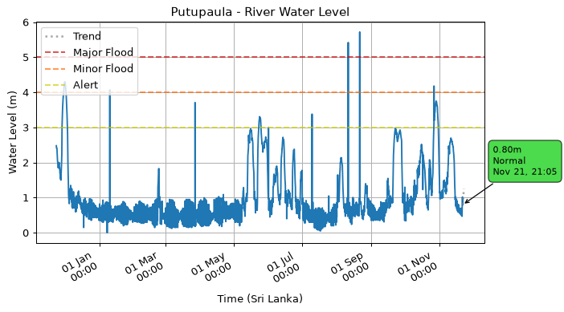
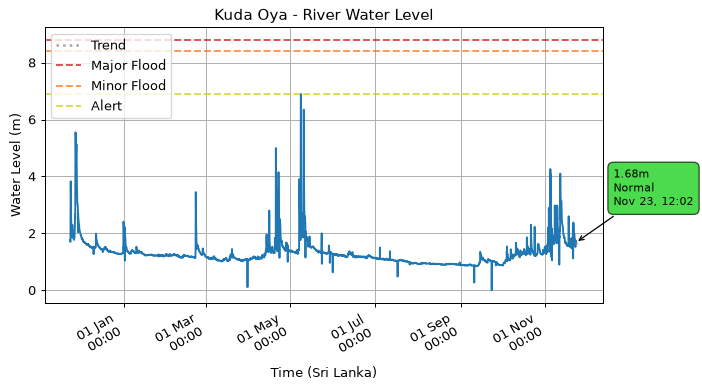

# lk_irrigation 🇱🇰

Realtime Data about *River Water Levels* in Sri Lanka, from the [Irrigation Deptartment](https://www.irrigation.gov.lk)'s [Hydrology and Disaster Management](https://www.irrigation.gov.lk/web/index.php?option=com_content&view=article&id=27&Itemid=128&lang=en) Division.

- [Complete Dataset](data/rwlds) with **321,386 measurements** from **39** stations.
- [Scrape and load logic](src/lk_irrigation/rwld/RiverWaterLevelDataLoadMixin.py)
- [Original Data source](https://www.arcgis.com/apps/dashboards/2cffe83c9ff5497d97375498bdf3ff38)

🇱🇰 River water alerts: No active alerts.
Source: Sri Lanka Irrigation Department https://www.irrigation.gov.lk
Repo: https://github.com/nuuuwan/lk_irrigation
## River Water Level Map

## Latest measurements

*There were **23** measurements in the last **1 hour**.*

| Measured At | Station (River Basin) | Level (m) | Alert Level | Rate-of-Rise (m/hr) | Rising Alert |
| --- | --- | ---: | --- | ---: | --- |
| 2026-11-21 01:03:14 | Giriulla (Maha Oya) | 1.17 | 🟢 Normal | -0.010 |  |
| 2026-11-21 01:03:03 | Moraketiya (Walawe Ganga) | 1.80 | 🟢 Normal | 0.000 |  |
| 2026-11-21 01:02:59 | Moragaswewa (Deduru Oya) | 0.34 | 🟢 Normal | 0.000 |  |
| 2026-11-21 01:02:57 | Kithulgala (Kelani Ganga) | 1.71 | 🟢 Normal | -0.010 |  |
| 2026-11-21 01:02:42 | Nakkala (Kumbukkan Oya) | 0.76 | 🟢 Normal | 0.000 |  |
| 2026-11-21 01:02:27 | Peradeniya (Mahaweli Ganga) | 3.45 | 🟢 Normal | -0.118 |  |
| 2026-11-21 01:02:06 | Thanamalwila (Kirindi Oya) | 1.14 | 🟢 Normal | 0.020 | 🔺 Rising |
| 2026-11-21 01:01:32 | Siyambalanduwa (Heda Oya) | 0.50 | 🟢 Normal | 0.000 |  |
| 2026-11-21 01:01:27 | Yaka Wewa (Ma Oya) | 0.48 | 🟢 Normal | 0.000 |  |
| 2026-11-21 01:01:04 | Manampitiya (Mahaweli Ganga) | 1.08 | 🟢 Normal | -0.010 |  |
| 2026-11-21 01:00:27 | Magura (Kalu Ganga) | 1.26 | 🟢 Normal | -0.011 |  |
| 2026-11-21 01:00:26 | Wellawaya (Kirindi Oya) | 1.35 | 🟢 Normal | 0.215 | 🔺 Rising |
| 2026-11-21 00:36:12 | Moraketiya (Walawe Ganga) | 1.80 | 🟢 Normal | 0.000 |  |
| 2026-11-21 00:20:24 | Katharagama (Menik Ganga) | -0.06 | 🟢 Normal | 0.000 |  |
| 2026-11-21 00:20:03 | Dunamale (Aththanagalu Oya) | 1.15 | 🟢 Normal | 0.000 |  |
| 2026-11-21 00:18:40 | Wellawaya (Kirindi Oya) | 1.20 | 🟢 Normal | 0.215 | 🔺 Rising |
| 2026-11-21 00:18:01 | Norwood (Kelani Ganga) | 0.90 | 🟢 Normal | 0.023 | 🔺 Rising |
| 2026-11-21 00:15:47 | Thalgahagoda (Nilwala Ganga) | 0.70 | 🟢 Normal | 0.048 | 🔺 Rising |
| 2026-11-21 00:13:43 | Holombuwa (Kelani Ganga) | 0.58 | 🟢 Normal | 0.000 |  |
| 2026-11-21 00:13:27 | Baddegama (Gin Ganga) | 1.20 | 🟢 Normal | 16.800 | 🔺 Rising |
| 2026-11-21 00:13:12 | Baddegama (Gin Ganga) | 1.13 | 🟢 Normal | 16.800 | 🔺 Rising |
| 2026-11-21 00:13:10 | Nagalagam Street (Kelani Ganga) | 0.70 | 🟢 Normal | 0.000 |  |
| 2026-11-21 00:12:17 | Panadugama (Nilwala Ganga) | 3.75 | 🟢 Normal | 0.000 |  |

## Latest by Station

*⌛ = Latest measurement is older than **24 hours**.*

| Measured At | Station (River Basin) | Level (m) | Alert Level | Rate-of-Rise (m/hr) | Rising Alert |
| --- | --- | ---: | --- | ---: | --- |
| 2026-11-21 00:13:27 | Baddegama (Gin Ganga) | 1.20 | 🟢 Normal | 16.800 | 🔺 Rising |
| 2026-11-21 00:07:42 | Urawa (Nilwala Ganga) | 2.25 | 🟢 Normal | 0.775 | 🔺 Rising |
| 2026-11-21 01:00:26 | Wellawaya (Kirindi Oya) | 1.35 | 🟢 Normal | 0.215 | 🔺 Rising |
| 2026-11-21 00:02:15 | Kalawellawa (Millakanda) (Kalu Ganga) | 2.35 | 🟢 Normal | 0.168 | 🔺 Rising |
| 2026-11-21 00:02:33 | Rathnapura (Kalu Ganga) | 1.50 | 🟢 Normal | 0.126 | 🔺 Rising |
| 2026-11-21 00:05:24 | Glencourse (Kelani Ganga) | 9.60 | 🟢 Normal | 0.113 | 🔺 Rising |
| 2026-11-21 00:03:49 | Deraniyagala (Kelani Ganga) | 0.87 | 🟢 Normal | 0.060 | 🔺 Rising |
| 2026-11-21 00:15:47 | Thalgahagoda (Nilwala Ganga) | 0.70 | 🟢 Normal | 0.048 | 🔺 Rising |
| 2026-11-21 00:08:25 | Ellagawa (Kalu Ganga) | 4.75 | 🟢 Normal | 0.037 | 🔺 Rising |
| 2026-11-21 00:05:01 | Hanwella (Kelani Ganga) | 1.11 | 🟢 Normal | 0.030 | 🔺 Rising |
| 2026-11-21 00:18:01 | Norwood (Kelani Ganga) | 0.90 | 🟢 Normal | 0.023 | 🔺 Rising |
| 2026-11-21 00:09:50 | Putupaula (Kalu Ganga) | 0.63 | 🟢 Normal | 0.021 | 🔺 Rising |
| 2026-11-21 01:02:06 | Thanamalwila (Kirindi Oya) | 1.14 | 🟢 Normal | 0.020 | 🔺 Rising |
| 2026-11-21 01:02:42 | Nakkala (Kumbukkan Oya) | 0.76 | 🟢 Normal | 0.000 |  |
| 2026-11-21 01:02:59 | Moragaswewa (Deduru Oya) | 0.34 | 🟢 Normal | 0.000 |  |
| 2026-11-21 01:01:27 | Yaka Wewa (Ma Oya) | 0.48 | 🟢 Normal | 0.000 |  |
| 2026-11-21 00:07:02 | Horowpothana (Yan Oya) | 1.90 | 🟢 Normal | 0.000 |  |
| 2026-11-20 18:00:42 | Galgamuwa (Mee Oya) | 0.14 | 🟢 Normal | 0.000 |  |
| 2026-11-21 00:09:39 | Pitabeddara (Nilwala Ganga) | 1.45 | 🟢 Normal | 0.000 |  |
| 2026-11-21 00:12:17 | Panadugama (Nilwala Ganga) | 3.75 | 🟢 Normal | 0.000 |  |
| 2026-11-19 14:01:52⌛ | Padiyathalawa (Maduru Oya) | 0.32 | 🟢 Normal | 0.000 |  |
| 2026-11-21 00:13:10 | Nagalagam Street (Kelani Ganga) | 0.70 | 🟢 Normal | 0.000 |  |
| 2026-11-21 01:03:03 | Moraketiya (Walawe Ganga) | 1.80 | 🟢 Normal | 0.000 |  |
| 2026-11-21 01:01:32 | Siyambalanduwa (Heda Oya) | 0.50 | 🟢 Normal | 0.000 |  |
| 2026-11-21 00:20:03 | Dunamale (Aththanagalu Oya) | 1.15 | 🟢 Normal | 0.000 |  |
| 2026-11-21 00:01:21 | Thaldena (Mahaweli Ganga) | 0.39 | 🟢 Normal | 0.000 |  |
| 2026-11-21 00:20:24 | Katharagama (Menik Ganga) | -0.06 | 🟢 Normal | 0.000 |  |
| 2026-11-21 00:02:12 | Badalgama (Maha Oya) | 2.36 | 🟢 Normal | 0.000 |  |
| 2026-11-21 00:13:43 | Holombuwa (Kelani Ganga) | 0.58 | 🟢 Normal | 0.000 |  |
| 2026-11-21 00:01:08 | Kuda Oya (Kirindi Oya) | 1.45 | 🟢 Normal | 0.000 |  |
| 2026-11-21 01:03:14 | Giriulla (Maha Oya) | 1.17 | 🟢 Normal | -0.010 |  |
| 2026-11-21 01:02:57 | Kithulgala (Kelani Ganga) | 1.71 | 🟢 Normal | -0.010 |  |
| 2026-11-21 01:01:04 | Manampitiya (Mahaweli Ganga) | 1.08 | 🟢 Normal | -0.010 |  |
| 2026-11-21 01:00:27 | Magura (Kalu Ganga) | 1.26 | 🟢 Normal | -0.011 |  |
| 2026-11-20 18:01:40 | Thanthirimale (Malwathu Oya) | 1.25 | 🟢 Normal | -0.011 |  |
| 2026-11-20 18:00:21 | Weraganthota (Mahaweli Ganga) | -2.17 | 🟢 Normal | -0.020 |  |
| 2026-11-21 00:06:13 | Thawalama (Gin Ganga) | 3.11 | 🟢 Normal | -0.059 |  |
| 2026-11-21 01:02:27 | Peradeniya (Mahaweli Ganga) | 3.45 | 🟢 Normal | -0.118 |  |
| 2026-11-21 00:03:10 | Nawalapitiya (Mahaweli Ganga) | 2.40 | 🟢 Normal | -0.511 |  |

## River Water Level Charts by Station

### Baddegama (Gin Ganga)

### Urawa (Nilwala Ganga)

### Wellawaya (Kirindi Oya)

### Kalawellawa (Millakanda) (Kalu Ganga)

.png)

### Rathnapura (Kalu Ganga)

### Glencourse (Kelani Ganga)

### Deraniyagala (Kelani Ganga)

### Thalgahagoda (Nilwala Ganga)

### Ellagawa (Kalu Ganga)

### Hanwella (Kelani Ganga)

### Norwood (Kelani Ganga)

### Putupaula (Kalu Ganga)

### Thanamalwila (Kirindi Oya)

### Nakkala (Kumbukkan Oya)

### Moragaswewa (Deduru Oya)

### Yaka Wewa (Ma Oya)

### Horowpothana (Yan Oya)

### Galgamuwa (Mee Oya)

### Pitabeddara (Nilwala Ganga)

### Panadugama (Nilwala Ganga)

### Padiyathalawa (Maduru Oya)

### Nagalagam Street (Kelani Ganga)

### Moraketiya (Walawe Ganga)

### Siyambalanduwa (Heda Oya)

### Dunamale (Aththanagalu Oya)

### Thaldena (Mahaweli Ganga)

### Katharagama (Menik Ganga)

### Badalgama (Maha Oya)

### Holombuwa (Kelani Ganga)

### Kuda Oya (Kirindi Oya)

### Giriulla (Maha Oya)

### Kithulgala (Kelani Ganga)

### Manampitiya (Mahaweli Ganga)

### Magura (Kalu Ganga)

### Thanthirimale (Malwathu Oya)

### Weraganthota (Mahaweli Ganga)

### Thawalama (Gin Ganga)

### Peradeniya (Mahaweli Ganga)

### Nawalapitiya (Mahaweli Ganga)

