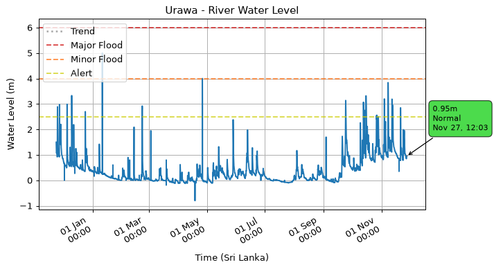

# lk_irrigation 🇱🇰

Realtime Data about *River Water Levels* in Sri Lanka, from the [Irrigation Deptartment](https://www.irrigation.gov.lk)'s [Hydrology and Disaster Management](https://www.irrigation.gov.lk/web/index.php?option=com_content&view=article&id=27&Itemid=128&lang=en) Division.

- [Complete Dataset](data/rwlds) with **317,185 measurements** from **39** stations.
- [Scrape and load logic](src/lk_irrigation/rwld/RiverWaterLevelDataLoadMixin.py)
- [Original Data source](https://www.arcgis.com/apps/dashboards/2cffe83c9ff5497d97375498bdf3ff38)

🇱🇰 River water alerts: 🟡 Thalgahagoda — Alert
Source: Sri Lanka Irrigation Department https://www.irrigation.gov.lk
Repo: https://github.com/nuuuwan/lk_irrigation
## River Water Level Map

## Latest measurements

*There were **37** measurements in the last **1 hour**.*

| Measured At | Station (River Basin) | Level (m) | Alert Level | Rate-of-Rise (m/hr) | Rising Alert |
| --- | --- | ---: | --- | ---: | --- |
| 2026-11-16 07:32:13 | Yaka Wewa (Ma Oya) | 0.53 | 🟢 Normal | 0.000 |  |
| 2026-11-16 07:16:21 | Pitabeddara (Nilwala Ganga) | 1.34 | 🟢 Normal | 0.000 |  |
| 2026-11-16 07:14:51 | Panadugama (Nilwala Ganga) | 4.56 | 🟢 Normal | -0.018 |  |
| 2026-11-16 07:10:39 | Urawa (Nilwala Ganga) | 1.06 | 🟢 Normal | 0.000 |  |
| 2026-11-16 07:08:49 | Padiyathalawa (Maduru Oya) | 0.55 | 🟢 Normal | 0.000 |  |
| 2026-11-16 07:08:41 | Magura (Kalu Ganga) | 1.85 | 🟢 Normal | -0.009 |  |
| 2026-11-16 07:08:32 | Rathnapura (Kalu Ganga) | 1.77 | 🟢 Normal | -0.009 |  |
| 2026-11-16 07:07:42 | Holombuwa (Kelani Ganga) | 0.79 | 🟢 Normal | 0.000 |  |
| 2026-11-16 07:07:17 | Thawalama (Gin Ganga) | 1.95 | 🟢 Normal | -0.009 |  |
| 2026-11-16 07:07:02 | Giriulla (Maha Oya) | 1.43 | 🟢 Normal | 0.000 |  |
| 2026-11-16 07:06:19 | Badalgama (Maha Oya) | 2.73 | 🟢 Normal | 0.000 |  |
| 2026-11-16 07:06:10 | Thaldena (Mahaweli Ganga) | 0.62 | 🟢 Normal | -0.010 |  |
| 2026-11-16 07:05:44 | Moraketiya (Walawe Ganga) | 1.72 | 🟢 Normal | -0.028 |  |
| 2026-11-16 07:04:58 | Moragaswewa (Deduru Oya) | 0.77 | 🟢 Normal | 0.000 |  |
| 2026-11-16 07:04:50 | Glencourse (Kelani Ganga) | 10.41 | 🟢 Normal | -0.010 |  |
| 2026-11-16 07:04:44 | Nagalagam Street (Kelani Ganga) | 0.72 | 🟢 Normal | -0.052 |  |
| 2026-11-16 07:04:42 | Hanwella (Kelani Ganga) | 2.25 | 🟢 Normal | 0.000 |  |
| 2026-11-16 07:04:37 | Katharagama (Menik Ganga) | -0.03 | 🟢 Normal | 0.000 |  |
| 2026-11-16 07:03:54 | Peradeniya (Mahaweli Ganga) | 2.80 | 🟢 Normal | 0.024 | 🔺 Rising |
| 2026-11-16 07:03:50 | Kalawellawa (Millakanda) (Kalu Ganga) | 2.85 | 🟢 Normal | -0.128 |  |
| 2026-11-16 07:03:32 | Ellagawa (Kalu Ganga) | 5.39 | 🟢 Normal | -0.010 |  |
| 2026-11-16 07:03:12 | Putupaula (Kalu Ganga) | 0.92 | 🟢 Normal | -0.039 |  |
| 2026-11-16 07:02:54 | Deraniyagala (Kelani Ganga) | 0.71 | 🟢 Normal | 0.000 |  |
| 2026-11-16 07:02:50 | Horowpothana (Yan Oya) | 2.05 | 🟢 Normal | 0.000 |  |
| 2026-11-16 07:02:35 | Norwood (Kelani Ganga) | 1.01 | 🟢 Normal | -0.010 |  |
| 2026-11-16 07:02:34 | Wellawaya (Kirindi Oya) | 1.42 | 🟢 Normal | -0.010 |  |
| 2026-11-16 07:02:12 | Thanamalwila (Kirindi Oya) | 1.47 | 🟢 Normal | 0.020 | 🔺 Rising |
| 2026-11-16 07:01:47 | Manampitiya (Mahaweli Ganga) | 1.32 | 🟢 Normal | 0.010 | 🔺 Rising |
| 2026-11-16 07:01:39 | Galgamuwa (Mee Oya) | 0.26 | 🟢 Normal | 0.000 |  |
| 2026-11-16 07:01:23 | Kithulgala (Kelani Ganga) | 1.98 | 🟢 Normal | -0.071 |  |
| 2026-11-16 07:01:19 | Nakkala (Kumbukkan Oya) | 0.95 | 🟢 Normal | -0.010 |  |
| 2026-11-16 07:01:10 | Kuda Oya (Kirindi Oya) | 1.64 | 🟢 Normal | -0.010 |  |
| 2026-11-16 07:01:09 | Siyambalanduwa (Heda Oya) | 0.54 | 🟢 Normal | 0.000 |  |
| 2026-11-16 07:01:05 | Dunamale (Aththanagalu Oya) | 1.80 | 🟢 Normal | 0.000 |  |
| 2026-11-16 07:00:53 | Weraganthota (Mahaweli Ganga) | -1.66 | 🟢 Normal | 0.443 | 🔺 Rising |
| 2026-11-16 07:00:43 | Thanthirimale (Malwathu Oya) | 1.52 | 🟢 Normal | 0.000 |  |
| 2026-11-16 07:00:07 | Nawalapitiya (Mahaweli Ganga) | 1.27 | 🟢 Normal | -0.010 |  |

## Latest by Station

*⌛ = Latest measurement is older than **24 hours**.*

| Measured At | Station (River Basin) | Level (m) | Alert Level | Rate-of-Rise (m/hr) | Rising Alert |
| --- | --- | ---: | --- | ---: | --- |
| 2026-11-16 06:03:03 | Thalgahagoda (Nilwala Ganga) | 1.57 | 🟡 Alert | -0.010 |  |
| 2026-11-16 07:00:53 | Weraganthota (Mahaweli Ganga) | -1.66 | 🟢 Normal | 0.443 | 🔺 Rising |
| 2026-11-16 07:03:54 | Peradeniya (Mahaweli Ganga) | 2.80 | 🟢 Normal | 0.024 | 🔺 Rising |
| 2026-11-16 07:02:12 | Thanamalwila (Kirindi Oya) | 1.47 | 🟢 Normal | 0.020 | 🔺 Rising |
| 2026-11-16 07:01:47 | Manampitiya (Mahaweli Ganga) | 1.32 | 🟢 Normal | 0.010 | 🔺 Rising |
| 2026-11-16 07:04:58 | Moragaswewa (Deduru Oya) | 0.77 | 🟢 Normal | 0.000 |  |
| 2026-11-16 07:32:13 | Yaka Wewa (Ma Oya) | 0.53 | 🟢 Normal | 0.000 |  |
| 2026-11-16 07:07:02 | Giriulla (Maha Oya) | 1.43 | 🟢 Normal | 0.000 |  |
| 2026-11-16 07:02:50 | Horowpothana (Yan Oya) | 2.05 | 🟢 Normal | 0.000 |  |
| 2026-11-16 07:01:39 | Galgamuwa (Mee Oya) | 0.26 | 🟢 Normal | 0.000 |  |
| 2026-11-16 07:16:21 | Pitabeddara (Nilwala Ganga) | 1.34 | 🟢 Normal | 0.000 |  |
| 2026-11-16 07:04:42 | Hanwella (Kelani Ganga) | 2.25 | 🟢 Normal | 0.000 |  |
| 2026-11-16 07:02:54 | Deraniyagala (Kelani Ganga) | 0.71 | 🟢 Normal | 0.000 |  |
| 2026-11-16 07:08:49 | Padiyathalawa (Maduru Oya) | 0.55 | 🟢 Normal | 0.000 |  |
| 2026-11-16 07:01:09 | Siyambalanduwa (Heda Oya) | 0.54 | 🟢 Normal | 0.000 |  |
| 2026-11-16 07:01:05 | Dunamale (Aththanagalu Oya) | 1.80 | 🟢 Normal | 0.000 |  |
| 2026-11-16 07:04:37 | Katharagama (Menik Ganga) | -0.03 | 🟢 Normal | 0.000 |  |
| 2026-11-16 07:06:19 | Badalgama (Maha Oya) | 2.73 | 🟢 Normal | 0.000 |  |
| 2026-11-16 07:07:42 | Holombuwa (Kelani Ganga) | 0.79 | 🟢 Normal | 0.000 |  |
| 2026-11-16 07:00:43 | Thanthirimale (Malwathu Oya) | 1.52 | 🟢 Normal | 0.000 |  |
| 2026-11-16 07:10:39 | Urawa (Nilwala Ganga) | 1.06 | 🟢 Normal | 0.000 |  |
| 2026-11-16 07:08:41 | Magura (Kalu Ganga) | 1.85 | 🟢 Normal | -0.009 |  |
| 2026-11-16 07:07:17 | Thawalama (Gin Ganga) | 1.95 | 🟢 Normal | -0.009 |  |
| 2026-11-16 07:08:32 | Rathnapura (Kalu Ganga) | 1.77 | 🟢 Normal | -0.009 |  |
| 2026-11-16 07:04:50 | Glencourse (Kelani Ganga) | 10.41 | 🟢 Normal | -0.010 |  |
| 2026-11-16 07:06:10 | Thaldena (Mahaweli Ganga) | 0.62 | 🟢 Normal | -0.010 |  |
| 2026-11-16 07:02:34 | Wellawaya (Kirindi Oya) | 1.42 | 🟢 Normal | -0.010 |  |
| 2026-11-16 07:01:10 | Kuda Oya (Kirindi Oya) | 1.64 | 🟢 Normal | -0.010 |  |
| 2026-11-16 07:00:07 | Nawalapitiya (Mahaweli Ganga) | 1.27 | 🟢 Normal | -0.010 |  |
| 2026-11-16 07:02:35 | Norwood (Kelani Ganga) | 1.01 | 🟢 Normal | -0.010 |  |
| 2026-11-16 07:01:19 | Nakkala (Kumbukkan Oya) | 0.95 | 🟢 Normal | -0.010 |  |
| 2026-11-16 07:03:32 | Ellagawa (Kalu Ganga) | 5.39 | 🟢 Normal | -0.010 |  |
| 2026-11-16 07:14:51 | Panadugama (Nilwala Ganga) | 4.56 | 🟢 Normal | -0.018 |  |
| 2026-11-16 06:10:46 | Baddegama (Gin Ganga) | 2.28 | 🟢 Normal | -0.022 |  |
| 2026-11-16 07:05:44 | Moraketiya (Walawe Ganga) | 1.72 | 🟢 Normal | -0.028 |  |
| 2026-11-16 07:03:12 | Putupaula (Kalu Ganga) | 0.92 | 🟢 Normal | -0.039 |  |
| 2026-11-16 07:04:44 | Nagalagam Street (Kelani Ganga) | 0.72 | 🟢 Normal | -0.052 |  |
| 2026-11-16 07:01:23 | Kithulgala (Kelani Ganga) | 1.98 | 🟢 Normal | -0.071 |  |
| 2026-11-16 07:03:50 | Kalawellawa (Millakanda) (Kalu Ganga) | 2.85 | 🟢 Normal | -0.128 |  |

## River Water Level Charts by Station

### Thalgahagoda (Nilwala Ganga)

### Weraganthota (Mahaweli Ganga)

### Peradeniya (Mahaweli Ganga)

### Thanamalwila (Kirindi Oya)

### Manampitiya (Mahaweli Ganga)

### Moragaswewa (Deduru Oya)

### Yaka Wewa (Ma Oya)

### Giriulla (Maha Oya)

### Horowpothana (Yan Oya)

### Galgamuwa (Mee Oya)

### Pitabeddara (Nilwala Ganga)

### Hanwella (Kelani Ganga)

### Deraniyagala (Kelani Ganga)

### Padiyathalawa (Maduru Oya)

### Siyambalanduwa (Heda Oya)

### Dunamale (Aththanagalu Oya)

### Katharagama (Menik Ganga)

### Badalgama (Maha Oya)

### Holombuwa (Kelani Ganga)

### Thanthirimale (Malwathu Oya)

### Urawa (Nilwala Ganga)

### Magura (Kalu Ganga)

### Thawalama (Gin Ganga)

### Rathnapura (Kalu Ganga)

### Glencourse (Kelani Ganga)

### Thaldena (Mahaweli Ganga)

### Wellawaya (Kirindi Oya)

### Kuda Oya (Kirindi Oya)

### Nawalapitiya (Mahaweli Ganga)

### Norwood (Kelani Ganga)

### Nakkala (Kumbukkan Oya)

### Ellagawa (Kalu Ganga)

### Panadugama (Nilwala Ganga)

### Baddegama (Gin Ganga)

### Moraketiya (Walawe Ganga)

### Putupaula (Kalu Ganga)

### Nagalagam Street (Kelani Ganga)

### Kithulgala (Kelani Ganga)

### Kalawellawa (Millakanda) (Kalu Ganga)

.png)

