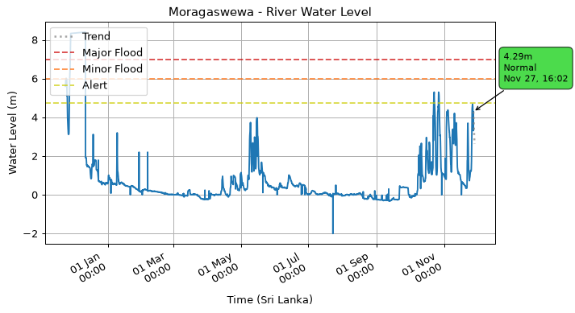

# lk_irrigation 🇱🇰

Realtime Data about *River Water Levels* in Sri Lanka, from the [Irrigation Deptartment](https://www.irrigation.gov.lk)'s [Hydrology and Disaster Management](https://www.irrigation.gov.lk/web/index.php?option=com_content&view=article&id=27&Itemid=128&lang=en) Division.

- [Complete Dataset](data/rwlds) with **324,737 measurements** from **39** stations.
- [Scrape and load logic](src/lk_irrigation/rwld/RiverWaterLevelDataLoadMixin.py)
- [Original Data source](https://www.arcgis.com/apps/dashboards/2cffe83c9ff5497d97375498bdf3ff38)

🇱🇰 River water alerts: 🟡 Moraketiya — Alert
Source: Sri Lanka Irrigation Department https://www.irrigation.gov.lk
Repo: https://github.com/nuuuwan/lk_irrigation
## River Water Level Map

## Latest measurements

*There were **33** measurements in the last **1 hour**.*

| Measured At | Station (River Basin) | Level (m) | Alert Level | Rate-of-Rise (m/hr) | Rising Alert |
| --- | --- | ---: | --- | ---: | --- |
| 2026-11-24 20:15:12 | Urawa (Nilwala Ganga) | 1.69 | 🟢 Normal | 0.203 | 🔺 Rising |
| 2026-11-24 20:13:30 | Norwood (Kelani Ganga) | 1.02 | 🟢 Normal | 0.053 | 🔺 Rising |
| 2026-11-24 20:12:28 | Rathnapura (Kalu Ganga) | 2.21 | 🟢 Normal | 0.210 | 🔺 Rising |
| 2026-11-24 20:11:24 | Katharagama (Menik Ganga) | -0.08 | 🟢 Normal | 0.000 |  |
| 2026-11-24 20:09:50 | Baddegama (Gin Ganga) | 1.80 | 🟢 Normal | 0.162 | 🔺 Rising |
| 2026-11-24 20:09:14 | Thawalama (Gin Ganga) | 2.79 | 🟢 Normal | 0.108 | 🔺 Rising |
| 2026-11-24 20:07:47 | Glencourse (Kelani Ganga) | 12.15 | 🟢 Normal | 0.568 | 🔺 Rising |
| 2026-11-24 20:07:15 | Panadugama (Nilwala Ganga) | 3.89 | 🟢 Normal | -0.043 |  |
| 2026-11-24 20:07:00 | Badalgama (Maha Oya) | 3.57 | 🟢 Normal | -0.020 |  |
| 2026-11-24 20:06:51 | Thalgahagoda (Nilwala Ganga) | 0.85 | 🟢 Normal | -0.028 |  |
| 2026-11-24 20:05:58 | Hanwella (Kelani Ganga) | 2.38 | 🟢 Normal | 0.288 | 🔺 Rising |
| 2026-11-24 20:05:41 | Kithulgala (Kelani Ganga) | 2.05 | 🟢 Normal | 0.000 |  |
| 2026-11-24 20:05:36 | Nagalagam Street (Kelani Ganga) | 0.27 | 🟢 Normal | 0.000 |  |
| 2026-11-24 20:05:08 | Deraniyagala (Kelani Ganga) | 0.61 | 🟢 Normal | -0.010 |  |
| 2026-11-24 20:04:55 | Nawalapitiya (Mahaweli Ganga) | 2.15 | 🟢 Normal | -0.393 |  |
| 2026-11-24 20:04:41 | Ellagawa (Kalu Ganga) | 5.52 | 🟢 Normal | 0.139 | 🔺 Rising |
| 2026-11-24 20:04:13 | Pitabeddara (Nilwala Ganga) | 1.48 | 🟢 Normal | 0.029 | 🔺 Rising |
| 2026-11-24 20:03:38 | Dunamale (Aththanagalu Oya) | 3.16 | 🟢 Normal | 0.445 | 🔺 Rising |
| 2026-11-24 20:03:22 | Peradeniya (Mahaweli Ganga) | 4.06 | 🟢 Normal | -0.040 |  |
| 2026-11-24 20:03:13 | Holombuwa (Kelani Ganga) | 2.58 | 🟢 Normal | 0.255 | 🔺 Rising |
| 2026-11-24 20:03:03 | Horowpothana (Yan Oya) | 2.35 | 🟢 Normal | 0.034 | 🔺 Rising |
| 2026-11-24 20:02:51 | Thanamalwila (Kirindi Oya) | 1.25 | 🟢 Normal | 0.010 | 🔺 Rising |
| 2026-11-24 20:02:49 | Magura (Kalu Ganga) | 2.87 | 🟢 Normal | 0.281 | 🔺 Rising |
| 2026-11-24 20:02:48 | Wellawaya (Kirindi Oya) | 1.23 | 🟢 Normal | 0.020 | 🔺 Rising |
| 2026-11-24 20:02:43 | Nakkala (Kumbukkan Oya) | 0.95 | 🟢 Normal | 0.108 | 🔺 Rising |
| 2026-11-24 20:02:20 | Giriulla (Maha Oya) | 2.63 | 🟢 Normal | 0.055 | 🔺 Rising |
| 2026-11-24 20:02:13 | Moraketiya (Walawe Ganga) | 3.15 | 🟡 Alert | 0.051 | 🔺 Rising |
| 2026-11-24 20:02:10 | Thaldena (Mahaweli Ganga) | 0.43 | 🟢 Normal | 0.021 | 🔺 Rising |
| 2026-11-24 20:02:04 | Moragaswewa (Deduru Oya) | 1.19 | 🟢 Normal | 0.030 | 🔺 Rising |
| 2026-11-24 20:01:44 | Yaka Wewa (Ma Oya) | 0.48 | 🟢 Normal | 0.000 |  |
| 2026-11-24 20:01:39 | Siyambalanduwa (Heda Oya) | 0.61 | 🟢 Normal | 0.060 | 🔺 Rising |
| 2026-11-24 20:01:32 | Manampitiya (Mahaweli Ganga) | 1.13 | 🟢 Normal | 0.000 |  |
| 2026-11-24 20:01:20 | Kuda Oya (Kirindi Oya) | 1.66 | 🟢 Normal | 0.000 |  |

## Latest by Station

*⌛ = Latest measurement is older than **24 hours**.*

| Measured At | Station (River Basin) | Level (m) | Alert Level | Rate-of-Rise (m/hr) | Rising Alert |
| --- | --- | ---: | --- | ---: | --- |
| 2026-11-24 20:02:13 | Moraketiya (Walawe Ganga) | 3.15 | 🟡 Alert | 0.051 | 🔺 Rising |
| 2026-11-24 20:07:47 | Glencourse (Kelani Ganga) | 12.15 | 🟢 Normal | 0.568 | 🔺 Rising |
| 2026-11-24 20:03:38 | Dunamale (Aththanagalu Oya) | 3.16 | 🟢 Normal | 0.445 | 🔺 Rising |
| 2026-11-24 20:05:58 | Hanwella (Kelani Ganga) | 2.38 | 🟢 Normal | 0.288 | 🔺 Rising |
| 2026-11-24 20:02:49 | Magura (Kalu Ganga) | 2.87 | 🟢 Normal | 0.281 | 🔺 Rising |
| 2026-11-24 20:03:13 | Holombuwa (Kelani Ganga) | 2.58 | 🟢 Normal | 0.255 | 🔺 Rising |
| 2026-11-24 20:12:28 | Rathnapura (Kalu Ganga) | 2.21 | 🟢 Normal | 0.210 | 🔺 Rising |
| 2026-11-24 20:15:12 | Urawa (Nilwala Ganga) | 1.69 | 🟢 Normal | 0.203 | 🔺 Rising |
| 2026-11-24 20:09:50 | Baddegama (Gin Ganga) | 1.80 | 🟢 Normal | 0.162 | 🔺 Rising |
| 2026-11-24 20:04:41 | Ellagawa (Kalu Ganga) | 5.52 | 🟢 Normal | 0.139 | 🔺 Rising |
| 2026-11-24 20:09:14 | Thawalama (Gin Ganga) | 2.79 | 🟢 Normal | 0.108 | 🔺 Rising |
| 2026-11-24 20:02:43 | Nakkala (Kumbukkan Oya) | 0.95 | 🟢 Normal | 0.108 | 🔺 Rising |
| 2026-11-24 20:01:39 | Siyambalanduwa (Heda Oya) | 0.61 | 🟢 Normal | 0.060 | 🔺 Rising |
| 2026-11-24 20:02:20 | Giriulla (Maha Oya) | 2.63 | 🟢 Normal | 0.055 | 🔺 Rising |
| 2026-11-24 20:13:30 | Norwood (Kelani Ganga) | 1.02 | 🟢 Normal | 0.053 | 🔺 Rising |
| 2026-11-24 18:01:32 | Kalawellawa (Millakanda) (Kalu Ganga) | 2.65 | 🟢 Normal | 0.051 | 🔺 Rising |
| 2026-11-24 20:03:03 | Horowpothana (Yan Oya) | 2.35 | 🟢 Normal | 0.034 | 🔺 Rising |
| 2026-11-24 20:02:04 | Moragaswewa (Deduru Oya) | 1.19 | 🟢 Normal | 0.030 | 🔺 Rising |
| 2026-11-24 20:04:13 | Pitabeddara (Nilwala Ganga) | 1.48 | 🟢 Normal | 0.029 | 🔺 Rising |
| 2026-11-24 20:02:10 | Thaldena (Mahaweli Ganga) | 0.43 | 🟢 Normal | 0.021 | 🔺 Rising |
| 2026-11-24 20:02:48 | Wellawaya (Kirindi Oya) | 1.23 | 🟢 Normal | 0.020 | 🔺 Rising |
| 2026-11-24 20:02:51 | Thanamalwila (Kirindi Oya) | 1.25 | 🟢 Normal | 0.010 | 🔺 Rising |
| 2026-11-24 20:05:41 | Kithulgala (Kelani Ganga) | 2.05 | 🟢 Normal | 0.000 |  |
| 2026-11-24 20:01:44 | Yaka Wewa (Ma Oya) | 0.48 | 🟢 Normal | 0.000 |  |
| 2026-11-24 18:02:13 | Galgamuwa (Mee Oya) | 0.39 | 🟢 Normal | 0.000 |  |
| 2026-11-24 20:05:36 | Nagalagam Street (Kelani Ganga) | 0.27 | 🟢 Normal | 0.000 |  |
| 2026-11-24 20:11:24 | Katharagama (Menik Ganga) | -0.08 | 🟢 Normal | 0.000 |  |
| 2026-11-24 20:01:32 | Manampitiya (Mahaweli Ganga) | 1.13 | 🟢 Normal | 0.000 |  |
| 2026-11-24 18:01:28 | Thanthirimale (Malwathu Oya) | 1.26 | 🟢 Normal | 0.000 |  |
| 2026-11-24 20:01:20 | Kuda Oya (Kirindi Oya) | 1.66 | 🟢 Normal | 0.000 |  |
| 2026-11-24 20:05:08 | Deraniyagala (Kelani Ganga) | 0.61 | 🟢 Normal | -0.010 |  |
| 2026-11-24 18:04:37 | Weraganthota (Mahaweli Ganga) | -2.50 | 🟢 Normal | -0.019 |  |
| 2026-11-24 20:07:00 | Badalgama (Maha Oya) | 3.57 | 🟢 Normal | -0.020 |  |
| 2026-11-22 17:02:02⌛ | Padiyathalawa (Maduru Oya) | 0.36 | 🟢 Normal | -0.022 |  |
| 2026-11-24 20:06:51 | Thalgahagoda (Nilwala Ganga) | 0.85 | 🟢 Normal | -0.028 |  |
| 2026-11-24 20:03:22 | Peradeniya (Mahaweli Ganga) | 4.06 | 🟢 Normal | -0.040 |  |
| 2026-11-24 20:07:15 | Panadugama (Nilwala Ganga) | 3.89 | 🟢 Normal | -0.043 |  |
| 2026-11-24 19:07:58 | Putupaula (Kalu Ganga) | 0.55 | 🟢 Normal | -0.073 |  |
| 2026-11-24 20:04:55 | Nawalapitiya (Mahaweli Ganga) | 2.15 | 🟢 Normal | -0.393 |  |

## River Water Level Charts by Station

### Moraketiya (Walawe Ganga)

### Glencourse (Kelani Ganga)

### Dunamale (Aththanagalu Oya)

### Hanwella (Kelani Ganga)

### Magura (Kalu Ganga)

### Holombuwa (Kelani Ganga)

### Rathnapura (Kalu Ganga)

### Urawa (Nilwala Ganga)

### Baddegama (Gin Ganga)

### Ellagawa (Kalu Ganga)

### Thawalama (Gin Ganga)

### Nakkala (Kumbukkan Oya)

### Siyambalanduwa (Heda Oya)

### Giriulla (Maha Oya)

### Norwood (Kelani Ganga)

### Kalawellawa (Millakanda) (Kalu Ganga)

.png)

### Horowpothana (Yan Oya)

### Moragaswewa (Deduru Oya)

### Pitabeddara (Nilwala Ganga)

### Thaldena (Mahaweli Ganga)

### Wellawaya (Kirindi Oya)

### Thanamalwila (Kirindi Oya)

### Kithulgala (Kelani Ganga)

### Yaka Wewa (Ma Oya)

### Galgamuwa (Mee Oya)

### Nagalagam Street (Kelani Ganga)

### Katharagama (Menik Ganga)

### Manampitiya (Mahaweli Ganga)

### Thanthirimale (Malwathu Oya)

### Kuda Oya (Kirindi Oya)

### Deraniyagala (Kelani Ganga)

### Weraganthota (Mahaweli Ganga)

### Badalgama (Maha Oya)

### Padiyathalawa (Maduru Oya)

### Thalgahagoda (Nilwala Ganga)

### Peradeniya (Mahaweli Ganga)

### Panadugama (Nilwala Ganga)

### Putupaula (Kalu Ganga)

### Nawalapitiya (Mahaweli Ganga)

