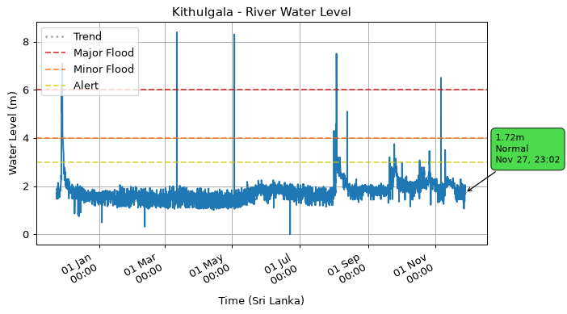

# lk_irrigation 🇱🇰

Realtime Data about *River Water Levels* in Sri Lanka, from the [Irrigation Deptartment](https://www.irrigation.gov.lk)'s [Hydrology and Disaster Management](https://www.irrigation.gov.lk/web/index.php?option=com_content&view=article&id=27&Itemid=128&lang=en) Division.

- [Complete Dataset](data/rwlds) with **320,372 measurements** from **39** stations.
- [Scrape and load logic](src/lk_irrigation/rwld/RiverWaterLevelDataLoadMixin.py)
- [Original Data source](https://www.arcgis.com/apps/dashboards/2cffe83c9ff5497d97375498bdf3ff38)

🇱🇰 River water alerts: No active alerts.
Source: Sri Lanka Irrigation Department https://www.irrigation.gov.lk
Repo: https://github.com/nuuuwan/lk_irrigation
## River Water Level Map

## Latest measurements

*There were **19** measurements in the last **1 hour**.*

| Measured At | Station (River Basin) | Level (m) | Alert Level | Rate-of-Rise (m/hr) | Rising Alert |
| --- | --- | ---: | --- | ---: | --- |
| 2026-11-19 21:03:24 | Dunamale (Aththanagalu Oya) | 1.33 | 🟢 Normal | 0.000 |  |
| 2026-11-19 21:03:18 | Nagalagam Street (Kelani Ganga) | 0.55 | 🟢 Normal | 0.030 | 🔺 Rising |
| 2026-11-19 21:02:40 | Yaka Wewa (Ma Oya) | 0.49 | 🟢 Normal | 0.000 |  |
| 2026-11-19 21:02:31 | Baddegama (Gin Ganga) | 1.16 | 🟢 Normal | -0.011 |  |
| 2026-11-19 21:02:28 | Ellagawa (Kalu Ganga) | 4.81 | 🟢 Normal | -0.010 |  |
| 2026-11-19 21:02:20 | Horowpothana (Yan Oya) | 1.80 | 🟢 Normal | 0.000 |  |
| 2026-11-19 21:02:20 | Thaldena (Mahaweli Ganga) | 0.45 | 🟢 Normal | 0.033 | 🔺 Rising |
| 2026-11-19 21:01:56 | Nakkala (Kumbukkan Oya) | 0.78 | 🟢 Normal | 0.000 |  |
| 2026-11-19 21:01:56 | Thanamalwila (Kirindi Oya) | 1.25 | 🟢 Normal | -0.010 |  |
| 2026-11-19 21:01:52 | Manampitiya (Mahaweli Ganga) | 1.07 | 🟢 Normal | 0.000 |  |
| 2026-11-19 21:01:52 | Kalawellawa (Millakanda) (Kalu Ganga) | 1.90 | 🟢 Normal | -0.022 |  |
| 2026-11-19 21:01:51 | Giriulla (Maha Oya) | 1.22 | 🟢 Normal | -0.010 |  |
| 2026-11-19 21:01:50 | Moragaswewa (Deduru Oya) | 0.48 | 🟢 Normal | 0.000 |  |
| 2026-11-19 21:01:47 | Wellawaya (Kirindi Oya) | 1.10 | 🟢 Normal | -0.375 |  |
| 2026-11-19 21:01:34 | Kuda Oya (Kirindi Oya) | 1.50 | 🟢 Normal | 0.000 |  |
| 2026-11-19 21:01:22 | Siyambalanduwa (Heda Oya) | 0.51 | 🟢 Normal | 0.000 |  |
| 2026-11-19 21:01:17 | Nawalapitiya (Mahaweli Ganga) | 1.13 | 🟢 Normal | 0.000 |  |
| 2026-11-19 21:00:11 | Wellawaya (Kirindi Oya) | 1.11 | 🟢 Normal | -0.375 |  |
| 2026-11-19 20:32:53 | Moragaswewa (Deduru Oya) | 0.48 | 🟢 Normal | 0.000 |  |

## Latest by Station

*⌛ = Latest measurement is older than **24 hours**.*

| Measured At | Station (River Basin) | Level (m) | Alert Level | Rate-of-Rise (m/hr) | Rising Alert |
| --- | --- | ---: | --- | ---: | --- |
| 2026-11-19 21:02:20 | Thaldena (Mahaweli Ganga) | 0.45 | 🟢 Normal | 0.033 | 🔺 Rising |
| 2026-11-19 21:03:18 | Nagalagam Street (Kelani Ganga) | 0.55 | 🟢 Normal | 0.030 | 🔺 Rising |
| 2026-11-19 20:02:59 | Peradeniya (Mahaweli Ganga) | 2.66 | 🟢 Normal | 0.010 | 🔺 Rising |
| 2026-11-19 20:02:25 | Putupaula (Kalu Ganga) | 0.56 | 🟢 Normal | 0.010 | 🔺 Rising |
| 2026-11-19 18:00:52 | Weraganthota (Mahaweli Ganga) | -2.03 | 🟢 Normal | 0.000 |  |
| 2026-11-19 21:01:56 | Nakkala (Kumbukkan Oya) | 0.78 | 🟢 Normal | 0.000 |  |
| 2026-11-19 21:01:50 | Moragaswewa (Deduru Oya) | 0.48 | 🟢 Normal | 0.000 |  |
| 2026-11-19 21:01:17 | Nawalapitiya (Mahaweli Ganga) | 1.13 | 🟢 Normal | 0.000 |  |
| 2026-11-19 21:02:40 | Yaka Wewa (Ma Oya) | 0.49 | 🟢 Normal | 0.000 |  |
| 2026-11-19 21:02:20 | Horowpothana (Yan Oya) | 1.80 | 🟢 Normal | 0.000 |  |
| 2026-11-19 20:02:24 | Magura (Kalu Ganga) | 1.36 | 🟢 Normal | 0.000 |  |
| 2026-11-19 20:03:32 | Pitabeddara (Nilwala Ganga) | 1.03 | 🟢 Normal | 0.000 |  |
| 2026-11-19 14:01:52 | Padiyathalawa (Maduru Oya) | 0.32 | 🟢 Normal | 0.000 |  |
| 2026-11-19 21:01:22 | Siyambalanduwa (Heda Oya) | 0.51 | 🟢 Normal | 0.000 |  |
| 2026-11-19 21:03:24 | Dunamale (Aththanagalu Oya) | 1.33 | 🟢 Normal | 0.000 |  |
| 2026-11-19 20:04:01 | Holombuwa (Kelani Ganga) | 0.60 | 🟢 Normal | 0.000 |  |
| 2026-11-19 21:01:52 | Manampitiya (Mahaweli Ganga) | 1.07 | 🟢 Normal | 0.000 |  |
| 2026-11-19 18:01:52 | Thanthirimale (Malwathu Oya) | 1.30 | 🟢 Normal | 0.000 |  |
| 2026-11-19 20:04:33 | Thawalama (Gin Ganga) | 1.60 | 🟢 Normal | 0.000 |  |
| 2026-11-19 20:08:53 | Urawa (Nilwala Ganga) | 0.84 | 🟢 Normal | 0.000 |  |
| 2026-11-19 20:07:17 | Thalgahagoda (Nilwala Ganga) | 0.45 | 🟢 Normal | 0.000 |  |
| 2026-11-19 21:01:34 | Kuda Oya (Kirindi Oya) | 1.50 | 🟢 Normal | 0.000 |  |
| 2026-11-19 18:05:17 | Galgamuwa (Mee Oya) | 0.16 | 🟢 Normal | -0.009 |  |
| 2026-11-19 21:02:28 | Ellagawa (Kalu Ganga) | 4.81 | 🟢 Normal | -0.010 |  |
| 2026-11-19 21:01:56 | Thanamalwila (Kirindi Oya) | 1.25 | 🟢 Normal | -0.010 |  |
| 2026-11-19 20:03:12 | Moraketiya (Walawe Ganga) | 1.89 | 🟢 Normal | -0.010 |  |
| 2026-11-19 21:01:51 | Giriulla (Maha Oya) | 1.22 | 🟢 Normal | -0.010 |  |
| 2026-11-19 20:06:39 | Glencourse (Kelani Ganga) | 9.40 | 🟢 Normal | -0.010 |  |
| 2026-11-19 20:02:26 | Panadugama (Nilwala Ganga) | 3.31 | 🟢 Normal | -0.010 |  |
| 2026-11-19 20:01:44 | Katharagama (Menik Ganga) | 0.20 | 🟢 Normal | -0.010 |  |
| 2026-11-19 21:02:31 | Baddegama (Gin Ganga) | 1.16 | 🟢 Normal | -0.011 |  |
| 2026-11-19 20:05:12 | Badalgama (Maha Oya) | 2.43 | 🟢 Normal | -0.011 |  |
| 2026-11-19 20:05:25 | Norwood (Kelani Ganga) | 0.85 | 🟢 Normal | -0.012 |  |
| 2026-11-19 20:06:48 | Rathnapura (Kalu Ganga) | 1.35 | 🟢 Normal | -0.020 |  |
| 2026-11-19 21:01:52 | Kalawellawa (Millakanda) (Kalu Ganga) | 1.90 | 🟢 Normal | -0.022 |  |
| 2026-11-19 20:02:23 | Hanwella (Kelani Ganga) | 1.27 | 🟢 Normal | -0.040 |  |
| 2026-11-19 20:04:40 | Deraniyagala (Kelani Ganga) | 0.49 | 🟢 Normal | -0.058 |  |
| 2026-11-19 20:04:08 | Kithulgala (Kelani Ganga) | 1.67 | 🟢 Normal | -0.249 |  |
| 2026-11-19 21:01:47 | Wellawaya (Kirindi Oya) | 1.10 | 🟢 Normal | -0.375 |  |

## River Water Level Charts by Station

### Thaldena (Mahaweli Ganga)

### Nagalagam Street (Kelani Ganga)

### Peradeniya (Mahaweli Ganga)

### Putupaula (Kalu Ganga)

### Weraganthota (Mahaweli Ganga)

### Nakkala (Kumbukkan Oya)

### Moragaswewa (Deduru Oya)

### Nawalapitiya (Mahaweli Ganga)

### Yaka Wewa (Ma Oya)

### Horowpothana (Yan Oya)

### Magura (Kalu Ganga)

### Pitabeddara (Nilwala Ganga)

### Padiyathalawa (Maduru Oya)

### Siyambalanduwa (Heda Oya)

### Dunamale (Aththanagalu Oya)

### Holombuwa (Kelani Ganga)

### Manampitiya (Mahaweli Ganga)

### Thanthirimale (Malwathu Oya)

### Thawalama (Gin Ganga)

### Urawa (Nilwala Ganga)

### Thalgahagoda (Nilwala Ganga)

### Kuda Oya (Kirindi Oya)

### Galgamuwa (Mee Oya)

### Ellagawa (Kalu Ganga)

### Thanamalwila (Kirindi Oya)

### Moraketiya (Walawe Ganga)

### Giriulla (Maha Oya)

### Glencourse (Kelani Ganga)

### Panadugama (Nilwala Ganga)

### Katharagama (Menik Ganga)

### Baddegama (Gin Ganga)

### Badalgama (Maha Oya)

### Norwood (Kelani Ganga)

### Rathnapura (Kalu Ganga)

### Kalawellawa (Millakanda) (Kalu Ganga)

.png)

### Hanwella (Kelani Ganga)

### Deraniyagala (Kelani Ganga)

### Kithulgala (Kelani Ganga)

### Wellawaya (Kirindi Oya)

