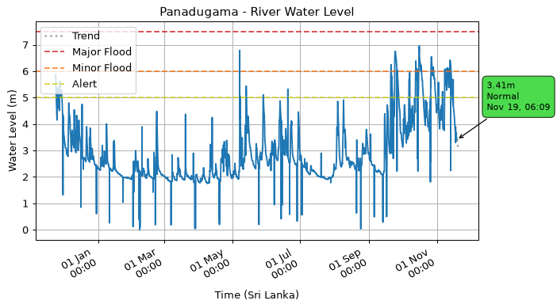

# lk_irrigation 🇱🇰

Realtime Data about *River Water Levels* in Sri Lanka, from the [Irrigation Deptartment](https://www.irrigation.gov.lk)'s [Hydrology and Disaster Management](https://www.irrigation.gov.lk/web/index.php?option=com_content&view=article&id=27&Itemid=128&lang=en) Division.

- [Complete Dataset](data/rwlds) with **320,972 measurements** from **39** stations.
- [Scrape and load logic](src/lk_irrigation/rwld/RiverWaterLevelDataLoadMixin.py)
- [Original Data source](https://www.arcgis.com/apps/dashboards/2cffe83c9ff5497d97375498bdf3ff38)

🇱🇰 River water alerts: No active alerts.
Source: Sri Lanka Irrigation Department https://www.irrigation.gov.lk
Repo: https://github.com/nuuuwan/lk_irrigation
## River Water Level Map

## Latest measurements

*There were **19** measurements in the last **1 hour**.*

| Measured At | Station (River Basin) | Level (m) | Alert Level | Rate-of-Rise (m/hr) | Rising Alert |
| --- | --- | ---: | --- | ---: | --- |
| 2026-11-20 14:02:57 | Thanamalwila (Kirindi Oya) | 1.16 | 🟢 Normal | -0.078 |  |
| 2026-11-20 14:02:45 | Badalgama (Maha Oya) | 2.38 | 🟢 Normal | 0.000 |  |
| 2026-11-20 14:02:45 | Norwood (Kelani Ganga) | 0.84 | 🟢 Normal | -0.010 |  |
| 2026-11-20 14:02:35 | Kalawellawa (Millakanda) (Kalu Ganga) | 2.31 | 🟢 Normal | -0.020 |  |
| 2026-11-20 14:02:23 | Hanwella (Kelani Ganga) | 1.26 | 🟢 Normal | 0.000 |  |
| 2026-11-20 14:02:12 | Nagalagam Street (Kelani Ganga) | 0.49 | 🟢 Normal | -0.060 |  |
| 2026-11-20 14:01:37 | Nawalapitiya (Mahaweli Ganga) | 1.13 | 🟢 Normal | 0.000 |  |
| 2026-11-20 14:01:31 | Weraganthota (Mahaweli Ganga) | -2.03 | 🟢 Normal | -0.010 |  |
| 2026-11-20 14:01:26 | Glencourse (Kelani Ganga) | 9.55 | 🟢 Normal | -0.010 |  |
| 2026-11-20 14:01:20 | Yaka Wewa (Ma Oya) | 0.48 | 🟢 Normal | 0.000 |  |
| 2026-11-20 14:01:11 | Kithulgala (Kelani Ganga) | 1.70 | 🟢 Normal | 0.000 |  |
| 2026-11-20 14:01:04 | Nakkala (Kumbukkan Oya) | 0.77 | 🟢 Normal | 0.000 |  |
| 2026-11-20 14:00:41 | Kuda Oya (Kirindi Oya) | 1.51 | 🟢 Normal | -0.014 |  |
| 2026-11-20 14:00:38 | Thaldena (Mahaweli Ganga) | 0.43 | 🟢 Normal | 0.010 | 🔺 Rising |
| 2026-11-20 13:31:30 | Katharagama (Menik Ganga) | 0.06 | 🟢 Normal | -0.007 |  |
| 2026-11-20 13:18:37 | Thalgahagoda (Nilwala Ganga) | 0.65 | 🟢 Normal | 0.000 |  |
| 2026-11-20 13:18:13 | Galgamuwa (Mee Oya) | 0.15 | 🟢 Normal | 0.000 |  |
| 2026-11-20 13:17:44 | Kuda Oya (Kirindi Oya) | 1.52 | 🟢 Normal | -0.014 |  |
| 2026-11-20 13:17:05 | Thanamalwila (Kirindi Oya) | 1.22 | 🟢 Normal | -0.078 |  |

## Latest by Station

*⌛ = Latest measurement is older than **24 hours**.*

| Measured At | Station (River Basin) | Level (m) | Alert Level | Rate-of-Rise (m/hr) | Rising Alert |
| --- | --- | ---: | --- | ---: | --- |
| 2026-11-20 14:00:38 | Thaldena (Mahaweli Ganga) | 0.43 | 🟢 Normal | 0.010 | 🔺 Rising |
| 2026-11-20 12:01:33 | Manampitiya (Mahaweli Ganga) | 1.03 | 🟢 Normal | 0.010 | 🔺 Rising |
| 2026-11-20 13:04:41 | Putupaula (Kalu Ganga) | 0.70 | 🟢 Normal | 0.010 | 🔺 Rising |
| 2026-11-20 13:09:51 | Baddegama (Gin Ganga) | 1.15 | 🟢 Normal | 0.009 | 🔺 Rising |
| 2026-11-20 14:01:11 | Kithulgala (Kelani Ganga) | 1.70 | 🟢 Normal | 0.000 |  |
| 2026-11-20 13:03:30 | Wellawaya (Kirindi Oya) | 1.15 | 🟢 Normal | 0.000 |  |
| 2026-11-20 14:01:04 | Nakkala (Kumbukkan Oya) | 0.77 | 🟢 Normal | 0.000 |  |
| 2026-11-20 14:01:37 | Nawalapitiya (Mahaweli Ganga) | 1.13 | 🟢 Normal | 0.000 |  |
| 2026-11-20 14:01:20 | Yaka Wewa (Ma Oya) | 0.48 | 🟢 Normal | 0.000 |  |
| 2026-11-20 13:02:12 | Giriulla (Maha Oya) | 1.18 | 🟢 Normal | 0.000 |  |
| 2026-11-20 13:00:54 | Horowpothana (Yan Oya) | 1.87 | 🟢 Normal | 0.000 |  |
| 2026-11-20 13:18:13 | Galgamuwa (Mee Oya) | 0.15 | 🟢 Normal | 0.000 |  |
| 2026-11-20 13:02:04 | Pitabeddara (Nilwala Ganga) | 1.00 | 🟢 Normal | 0.000 |  |
| 2026-11-20 14:02:23 | Hanwella (Kelani Ganga) | 1.26 | 🟢 Normal | 0.000 |  |
| 2026-11-20 13:03:50 | Panadugama (Nilwala Ganga) | 3.31 | 🟢 Normal | 0.000 |  |
| 2026-11-19 14:01:52⌛ | Padiyathalawa (Maduru Oya) | 0.32 | 🟢 Normal | 0.000 |  |
| 2026-11-20 13:00:22 | Moraketiya (Walawe Ganga) | 1.80 | 🟢 Normal | 0.000 |  |
| 2026-11-20 13:06:40 | Siyambalanduwa (Heda Oya) | 0.52 | 🟢 Normal | 0.000 |  |
| 2026-11-20 13:00:29 | Dunamale (Aththanagalu Oya) | 1.30 | 🟢 Normal | 0.000 |  |
| 2026-11-20 14:02:45 | Badalgama (Maha Oya) | 2.38 | 🟢 Normal | 0.000 |  |
| 2026-11-20 13:05:14 | Holombuwa (Kelani Ganga) | 0.60 | 🟢 Normal | 0.000 |  |
| 2026-11-20 13:03:34 | Thanthirimale (Malwathu Oya) | 1.28 | 🟢 Normal | 0.000 |  |
| 2026-11-20 13:01:32 | Thawalama (Gin Ganga) | 1.59 | 🟢 Normal | 0.000 |  |
| 2026-11-20 13:04:12 | Urawa (Nilwala Ganga) | 0.81 | 🟢 Normal | 0.000 |  |
| 2026-11-20 13:18:37 | Thalgahagoda (Nilwala Ganga) | 0.65 | 🟢 Normal | 0.000 |  |
| 2026-11-20 13:31:30 | Katharagama (Menik Ganga) | 0.06 | 🟢 Normal | -0.007 |  |
| 2026-11-20 13:03:39 | Magura (Kalu Ganga) | 1.29 | 🟢 Normal | -0.010 |  |
| 2026-11-20 13:05:33 | Ellagawa (Kalu Ganga) | 4.73 | 🟢 Normal | -0.010 |  |
| 2026-11-20 14:01:31 | Weraganthota (Mahaweli Ganga) | -2.03 | 🟢 Normal | -0.010 |  |
| 2026-11-20 14:02:45 | Norwood (Kelani Ganga) | 0.84 | 🟢 Normal | -0.010 |  |
| 2026-11-20 14:01:26 | Glencourse (Kelani Ganga) | 9.55 | 🟢 Normal | -0.010 |  |
| 2026-11-20 14:00:41 | Kuda Oya (Kirindi Oya) | 1.51 | 🟢 Normal | -0.014 |  |
| 2026-11-20 13:02:48 | Moragaswewa (Deduru Oya) | 0.44 | 🟢 Normal | -0.020 |  |
| 2026-11-20 13:02:15 | Peradeniya (Mahaweli Ganga) | 2.58 | 🟢 Normal | -0.020 |  |
| 2026-11-20 14:02:35 | Kalawellawa (Millakanda) (Kalu Ganga) | 2.31 | 🟢 Normal | -0.020 |  |
| 2026-11-20 13:03:29 | Deraniyagala (Kelani Ganga) | 0.52 | 🟢 Normal | -0.039 |  |
| 2026-11-20 12:07:21 | Rathnapura (Kalu Ganga) | 1.18 | 🟢 Normal | -0.048 |  |
| 2026-11-20 14:02:12 | Nagalagam Street (Kelani Ganga) | 0.49 | 🟢 Normal | -0.060 |  |
| 2026-11-20 14:02:57 | Thanamalwila (Kirindi Oya) | 1.16 | 🟢 Normal | -0.078 |  |

## River Water Level Charts by Station

### Thaldena (Mahaweli Ganga)

### Manampitiya (Mahaweli Ganga)

### Putupaula (Kalu Ganga)

### Baddegama (Gin Ganga)

### Kithulgala (Kelani Ganga)

### Wellawaya (Kirindi Oya)

### Nakkala (Kumbukkan Oya)

### Nawalapitiya (Mahaweli Ganga)

### Yaka Wewa (Ma Oya)

### Giriulla (Maha Oya)

### Horowpothana (Yan Oya)

### Galgamuwa (Mee Oya)

### Pitabeddara (Nilwala Ganga)

### Hanwella (Kelani Ganga)

### Panadugama (Nilwala Ganga)

### Padiyathalawa (Maduru Oya)

### Moraketiya (Walawe Ganga)

### Siyambalanduwa (Heda Oya)

### Dunamale (Aththanagalu Oya)

### Badalgama (Maha Oya)

### Holombuwa (Kelani Ganga)

### Thanthirimale (Malwathu Oya)

### Thawalama (Gin Ganga)

### Urawa (Nilwala Ganga)

### Thalgahagoda (Nilwala Ganga)

### Katharagama (Menik Ganga)

### Magura (Kalu Ganga)

### Ellagawa (Kalu Ganga)

### Weraganthota (Mahaweli Ganga)

### Norwood (Kelani Ganga)

### Glencourse (Kelani Ganga)

### Kuda Oya (Kirindi Oya)

### Moragaswewa (Deduru Oya)

### Peradeniya (Mahaweli Ganga)

### Kalawellawa (Millakanda) (Kalu Ganga)

.png)

### Deraniyagala (Kelani Ganga)

### Rathnapura (Kalu Ganga)

### Nagalagam Street (Kelani Ganga)

### Thanamalwila (Kirindi Oya)

