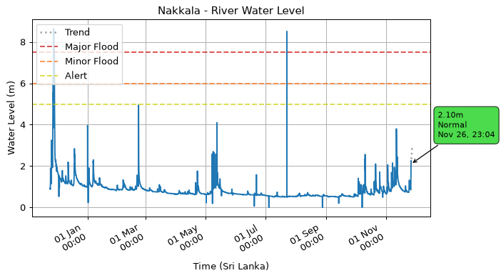

# lk_irrigation 🇱🇰

Realtime Data about *River Water Levels* in Sri Lanka, from the [Irrigation Deptartment](https://www.irrigation.gov.lk)'s [Hydrology and Disaster Management](https://www.irrigation.gov.lk/web/index.php?option=com_content&view=article&id=27&Itemid=128&lang=en) Division.

- [Complete Dataset](data/rwlds) with **323,213 measurements** from **39** stations.
- [Scrape and load logic](src/lk_irrigation/rwld/RiverWaterLevelDataLoadMixin.py)
- [Original Data source](https://www.arcgis.com/apps/dashboards/2cffe83c9ff5497d97375498bdf3ff38)

🇱🇰 River water alerts: No active alerts.
Source: Sri Lanka Irrigation Department https://www.irrigation.gov.lk
Repo: https://github.com/nuuuwan/lk_irrigation
## River Water Level Map

## Latest measurements

*There were **17** measurements in the last **1 hour**.*

| Measured At | Station (River Basin) | Level (m) | Alert Level | Rate-of-Rise (m/hr) | Rising Alert |
| --- | --- | ---: | --- | ---: | --- |
| 2026-11-23 03:02:59 | Thawalama (Gin Ganga) | 2.87 | 🟢 Normal | -0.082 |  |
| 2026-11-23 03:02:54 | Glencourse (Kelani Ganga) | 9.59 | 🟢 Normal | -0.010 |  |
| 2026-11-23 03:02:49 | Peradeniya (Mahaweli Ganga) | 2.81 | 🟢 Normal | -0.175 |  |
| 2026-11-23 03:02:39 | Thanamalwila (Kirindi Oya) | 1.49 | 🟢 Normal | 0.010 | 🔺 Rising |
| 2026-11-23 03:02:24 | Siyambalanduwa (Heda Oya) | 0.48 | 🟢 Normal | 0.000 |  |
| 2026-11-23 03:02:13 | Giriulla (Maha Oya) | 1.39 | 🟢 Normal | -0.010 |  |
| 2026-11-23 03:01:54 | Yaka Wewa (Ma Oya) | 0.48 | 🟢 Normal | 0.000 |  |
| 2026-11-23 03:01:44 | Hanwella (Kelani Ganga) | 1.08 | 🟢 Normal | 0.010 | 🔺 Rising |
| 2026-11-23 03:01:33 | Moragaswewa (Deduru Oya) | 2.15 | 🟢 Normal | -0.061 |  |
| 2026-11-23 03:01:28 | Nakkala (Kumbukkan Oya) | 0.75 | 🟢 Normal | 0.000 |  |
| 2026-11-23 03:01:13 | Kuda Oya (Kirindi Oya) | 1.58 | 🟢 Normal | 0.062 | 🔺 Rising |
| 2026-11-23 03:00:21 | Wellawaya (Kirindi Oya) | 1.26 | 🟢 Normal | -0.020 |  |
| 2026-11-23 02:55:15 | Rathnapura (Kalu Ganga) | 2.22 | 🟢 Normal | -0.005 |  |
| 2026-11-23 02:44:25 | Panadugama (Nilwala Ganga) | 4.26 | 🟢 Normal | -0.015 |  |
| 2026-11-23 02:29:25 | Badalgama (Maha Oya) | 2.72 | 🟢 Normal | -0.054 |  |
| 2026-11-23 02:28:32 | Putupaula (Kalu Ganga) | 0.90 | 🟢 Normal | 0.059 | 🔺 Rising |
| 2026-11-23 02:27:06 | Magura (Kalu Ganga) | 1.39 | 🟢 Normal | -0.004 |  |

## Latest by Station

*⌛ = Latest measurement is older than **24 hours**.*

| Measured At | Station (River Basin) | Level (m) | Alert Level | Rate-of-Rise (m/hr) | Rising Alert |
| --- | --- | ---: | --- | ---: | --- |
| 2026-11-23 02:07:13 | Baddegama (Gin Ganga) | 1.40 | 🟢 Normal | 504.000 | 🔺 Rising |
| 2026-11-23 02:04:30 | Thaldena (Mahaweli Ganga) | 0.40 | 🟢 Normal | 72.000 | 🔺 Rising |
| 2026-11-23 02:04:50 | Kalawellawa (Millakanda) (Kalu Ganga) | 2.18 | 🟢 Normal | 5.478 | 🔺 Rising |
| 2026-11-23 03:01:13 | Kuda Oya (Kirindi Oya) | 1.58 | 🟢 Normal | 0.062 | 🔺 Rising |
| 2026-11-23 02:28:32 | Putupaula (Kalu Ganga) | 0.90 | 🟢 Normal | 0.059 | 🔺 Rising |
| 2026-11-22 18:00:53 | Weraganthota (Mahaweli Ganga) | -2.45 | 🟢 Normal | 0.030 | 🔺 Rising |
| 2026-11-23 03:01:44 | Hanwella (Kelani Ganga) | 1.08 | 🟢 Normal | 0.010 | 🔺 Rising |
| 2026-11-23 03:02:39 | Thanamalwila (Kirindi Oya) | 1.49 | 🟢 Normal | 0.010 | 🔺 Rising |
| 2026-11-23 03:01:28 | Nakkala (Kumbukkan Oya) | 0.75 | 🟢 Normal | 0.000 |  |
| 2026-11-23 02:04:38 | Nawalapitiya (Mahaweli Ganga) | 1.13 | 🟢 Normal | 0.000 |  |
| 2026-11-23 03:01:54 | Yaka Wewa (Ma Oya) | 0.48 | 🟢 Normal | 0.000 |  |
| 2026-11-23 02:12:24 | Horowpothana (Yan Oya) | 2.11 | 🟢 Normal | 0.000 |  |
| 2026-11-22 18:00:10 | Galgamuwa (Mee Oya) | 0.41 | 🟢 Normal | 0.000 |  |
| 2026-11-22 21:02:08 | Pitabeddara (Nilwala Ganga) | 1.26 | 🟢 Normal | 0.000 |  |
| 2026-11-23 02:03:35 | Norwood (Kelani Ganga) | 0.84 | 🟢 Normal | 0.000 |  |
| 2026-11-23 02:02:32 | Ellagawa (Kalu Ganga) | 5.60 | 🟢 Normal | 0.000 |  |
| 2026-11-23 03:02:24 | Siyambalanduwa (Heda Oya) | 0.48 | 🟢 Normal | 0.000 |  |
| 2026-11-23 01:02:26 | Dunamale (Aththanagalu Oya) | 1.14 | 🟢 Normal | 0.000 |  |
| 2026-11-23 02:06:41 | Katharagama (Menik Ganga) | -0.09 | 🟢 Normal | 0.000 |  |
| 2026-11-22 18:02:00 | Thanthirimale (Malwathu Oya) | 1.56 | 🟢 Normal | 0.000 |  |
| 2026-11-23 02:08:24 | Thalgahagoda (Nilwala Ganga) | 0.90 | 🟢 Normal | 0.000 |  |
| 2026-11-23 02:27:06 | Magura (Kalu Ganga) | 1.39 | 🟢 Normal | -0.004 |  |
| 2026-11-23 02:55:15 | Rathnapura (Kalu Ganga) | 2.22 | 🟢 Normal | -0.005 |  |
| 2026-11-23 03:02:54 | Glencourse (Kelani Ganga) | 9.59 | 🟢 Normal | -0.010 |  |
| 2026-11-23 03:02:13 | Giriulla (Maha Oya) | 1.39 | 🟢 Normal | -0.010 |  |
| 2026-11-23 02:06:54 | Kithulgala (Kelani Ganga) | 1.82 | 🟢 Normal | -0.011 |  |
| 2026-11-23 02:44:25 | Panadugama (Nilwala Ganga) | 4.26 | 🟢 Normal | -0.015 |  |
| 2026-11-23 03:00:21 | Wellawaya (Kirindi Oya) | 1.26 | 🟢 Normal | -0.020 |  |
| 2026-11-22 17:02:02 | Padiyathalawa (Maduru Oya) | 0.36 | 🟢 Normal | -0.022 |  |
| 2026-11-23 02:13:46 | Nagalagam Street (Kelani Ganga) | 0.79 | 🟢 Normal | -0.037 |  |
| 2026-11-23 02:07:11 | Deraniyagala (Kelani Ganga) | 0.52 | 🟢 Normal | -0.039 |  |
| 2026-11-23 02:05:50 | Holombuwa (Kelani Ganga) | 0.58 | 🟢 Normal | -0.043 |  |
| 2026-11-23 00:00:36 | Moraketiya (Walawe Ganga) | 2.75 | 🟢 Normal | -0.051 |  |
| 2026-11-23 02:29:25 | Badalgama (Maha Oya) | 2.72 | 🟢 Normal | -0.054 |  |
| 2026-11-23 03:01:33 | Moragaswewa (Deduru Oya) | 2.15 | 🟢 Normal | -0.061 |  |
| 2026-11-23 03:02:59 | Thawalama (Gin Ganga) | 2.87 | 🟢 Normal | -0.082 |  |
| 2026-11-23 02:02:03 | Manampitiya (Mahaweli Ganga) | 1.60 | 🟢 Normal | -0.087 |  |
| 2026-11-23 03:02:49 | Peradeniya (Mahaweli Ganga) | 2.81 | 🟢 Normal | -0.175 |  |
| 2026-11-23 02:04:44 | Urawa (Nilwala Ganga) | 0.80 | 🟢 Normal | -1.565 |  |

## River Water Level Charts by Station

### Baddegama (Gin Ganga)

### Thaldena (Mahaweli Ganga)

### Kalawellawa (Millakanda) (Kalu Ganga)

.png)

### Kuda Oya (Kirindi Oya)

### Putupaula (Kalu Ganga)

### Weraganthota (Mahaweli Ganga)

### Hanwella (Kelani Ganga)

### Thanamalwila (Kirindi Oya)

### Nakkala (Kumbukkan Oya)

### Nawalapitiya (Mahaweli Ganga)

### Yaka Wewa (Ma Oya)

### Horowpothana (Yan Oya)

### Galgamuwa (Mee Oya)

### Pitabeddara (Nilwala Ganga)

### Norwood (Kelani Ganga)

### Ellagawa (Kalu Ganga)

### Siyambalanduwa (Heda Oya)

### Dunamale (Aththanagalu Oya)

### Katharagama (Menik Ganga)

### Thanthirimale (Malwathu Oya)

### Thalgahagoda (Nilwala Ganga)

### Magura (Kalu Ganga)

### Rathnapura (Kalu Ganga)

### Glencourse (Kelani Ganga)

### Giriulla (Maha Oya)

### Kithulgala (Kelani Ganga)

### Panadugama (Nilwala Ganga)

### Wellawaya (Kirindi Oya)

### Padiyathalawa (Maduru Oya)

### Nagalagam Street (Kelani Ganga)

### Deraniyagala (Kelani Ganga)

### Holombuwa (Kelani Ganga)

### Moraketiya (Walawe Ganga)

### Badalgama (Maha Oya)

### Moragaswewa (Deduru Oya)

### Thawalama (Gin Ganga)

### Manampitiya (Mahaweli Ganga)

### Peradeniya (Mahaweli Ganga)

### Urawa (Nilwala Ganga)

