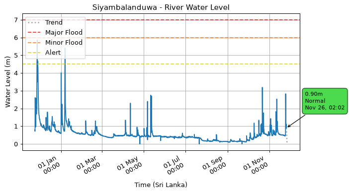

# lk_irrigation 🇱🇰

Realtime Data about *River Water Levels* in Sri Lanka, from the [Irrigation Deptartment](https://www.irrigation.gov.lk)'s [Hydrology and Disaster Management](https://www.irrigation.gov.lk/web/index.php?option=com_content&view=article&id=27&Itemid=128&lang=en) Division.

- [Complete Dataset](data/rwlds) with **320,825 measurements** from **39** stations.
- [Scrape and load logic](src/lk_irrigation/rwld/RiverWaterLevelDataLoadMixin.py)
- [Original Data source](https://www.arcgis.com/apps/dashboards/2cffe83c9ff5497d97375498bdf3ff38)

🇱🇰 River water alerts: No active alerts.
Source: Sri Lanka Irrigation Department https://www.irrigation.gov.lk
Repo: https://github.com/nuuuwan/lk_irrigation
## River Water Level Map

## Latest measurements

*There were **20** measurements in the last **1 hour**.*

| Measured At | Station (River Basin) | Level (m) | Alert Level | Rate-of-Rise (m/hr) | Rising Alert |
| --- | --- | ---: | --- | ---: | --- |
| 2026-11-20 10:03:17 | Magura (Kalu Ganga) | 1.30 | 🟢 Normal | 0.000 |  |
| 2026-11-20 10:03:07 | Siyambalanduwa (Heda Oya) | 0.52 | 🟢 Normal | 0.000 |  |
| 2026-11-20 10:03:06 | Deraniyagala (Kelani Ganga) | 0.52 | 🟢 Normal | 0.030 | 🔺 Rising |
| 2026-11-20 10:03:03 | Thanthirimale (Malwathu Oya) | 1.28 | 🟢 Normal | 0.000 |  |
| 2026-11-20 10:03:03 | Hanwella (Kelani Ganga) | 1.27 | 🟢 Normal | -0.010 |  |
| 2026-11-20 10:03:01 | Wellawaya (Kirindi Oya) | 1.07 | 🟢 Normal | 4.909 | 🔺 Rising |
| 2026-11-20 10:02:53 | Putupaula (Kalu Ganga) | 0.65 | 🟢 Normal | 0.041 | 🔺 Rising |
| 2026-11-20 10:02:43 | Thanamalwila (Kirindi Oya) | 1.28 | 🟢 Normal | -0.010 |  |
| 2026-11-20 10:02:43 | Ellagawa (Kalu Ganga) | 4.75 | 🟢 Normal | 0.000 |  |
| 2026-11-20 10:02:39 | Wellawaya (Kirindi Oya) | 1.04 | 🟢 Normal | 4.909 | 🔺 Rising |
| 2026-11-20 10:02:30 | Pitabeddara (Nilwala Ganga) | 1.01 | 🟢 Normal | 0.000 |  |
| 2026-11-20 10:02:18 | Thawalama (Gin Ganga) | 1.61 | 🟢 Normal | -0.011 |  |
| 2026-11-20 10:01:55 | Kuda Oya (Kirindi Oya) | 1.57 | 🟢 Normal | -0.021 |  |
| 2026-11-20 10:01:49 | Thaldena (Mahaweli Ganga) | 0.42 | 🟢 Normal | 0.000 |  |
| 2026-11-20 10:01:27 | Giriulla (Maha Oya) | 1.18 | 🟢 Normal | 0.000 |  |
| 2026-11-20 10:01:24 | Manampitiya (Mahaweli Ganga) | 1.02 | 🟢 Normal | -0.010 |  |
| 2026-11-20 10:01:20 | Nakkala (Kumbukkan Oya) | 0.77 | 🟢 Normal | 0.000 |  |
| 2026-11-20 10:00:54 | Moraketiya (Walawe Ganga) | 1.80 | 🟢 Normal | -0.020 |  |
| 2026-11-20 10:00:53 | Weraganthota (Mahaweli Ganga) | -2.02 | 🟢 Normal | 0.000 |  |
| 2026-11-20 09:24:40 | Thalgahagoda (Nilwala Ganga) | 0.64 | 🟢 Normal | 0.000 |  |

## Latest by Station

*⌛ = Latest measurement is older than **24 hours**.*

| Measured At | Station (River Basin) | Level (m) | Alert Level | Rate-of-Rise (m/hr) | Rising Alert |
| --- | --- | ---: | --- | ---: | --- |
| 2026-11-20 10:03:01 | Wellawaya (Kirindi Oya) | 1.07 | 🟢 Normal | 4.909 | 🔺 Rising |
| 2026-11-20 10:02:53 | Putupaula (Kalu Ganga) | 0.65 | 🟢 Normal | 0.041 | 🔺 Rising |
| 2026-11-20 09:01:21 | Nagalagam Street (Kelani Ganga) | 0.58 | 🟢 Normal | 0.033 | 🔺 Rising |
| 2026-11-20 10:03:06 | Deraniyagala (Kelani Ganga) | 0.52 | 🟢 Normal | 0.030 | 🔺 Rising |
| 2026-11-20 09:03:14 | Norwood (Kelani Ganga) | 0.86 | 🟢 Normal | 0.010 | 🔺 Rising |
| 2026-11-20 10:00:53 | Weraganthota (Mahaweli Ganga) | -2.02 | 🟢 Normal | 0.000 |  |
| 2026-11-20 10:01:20 | Nakkala (Kumbukkan Oya) | 0.77 | 🟢 Normal | 0.000 |  |
| 2026-11-20 09:01:30 | Moragaswewa (Deduru Oya) | 0.47 | 🟢 Normal | 0.000 |  |
| 2026-11-20 09:01:22 | Nawalapitiya (Mahaweli Ganga) | 1.11 | 🟢 Normal | 0.000 |  |
| 2026-11-20 09:02:53 | Yaka Wewa (Ma Oya) | 0.48 | 🟢 Normal | 0.000 |  |
| 2026-11-20 10:01:27 | Giriulla (Maha Oya) | 1.18 | 🟢 Normal | 0.000 |  |
| 2026-11-20 09:02:58 | Horowpothana (Yan Oya) | 1.88 | 🟢 Normal | 0.000 |  |
| 2026-11-20 09:04:55 | Galgamuwa (Mee Oya) | 0.15 | 🟢 Normal | 0.000 |  |
| 2026-11-20 10:03:17 | Magura (Kalu Ganga) | 1.30 | 🟢 Normal | 0.000 |  |
| 2026-11-20 10:02:30 | Pitabeddara (Nilwala Ganga) | 1.01 | 🟢 Normal | 0.000 |  |
| 2026-11-20 10:02:43 | Ellagawa (Kalu Ganga) | 4.75 | 🟢 Normal | 0.000 |  |
| 2026-11-20 09:07:30 | Baddegama (Gin Ganga) | 1.12 | 🟢 Normal | 0.000 |  |
| 2026-11-20 09:03:41 | Panadugama (Nilwala Ganga) | 3.25 | 🟢 Normal | 0.000 |  |
| 2026-11-19 14:01:52 | Padiyathalawa (Maduru Oya) | 0.32 | 🟢 Normal | 0.000 |  |
| 2026-11-20 10:03:07 | Siyambalanduwa (Heda Oya) | 0.52 | 🟢 Normal | 0.000 |  |
| 2026-11-20 10:01:49 | Thaldena (Mahaweli Ganga) | 0.42 | 🟢 Normal | 0.000 |  |
| 2026-11-20 09:07:49 | Holombuwa (Kelani Ganga) | 0.60 | 🟢 Normal | 0.000 |  |
| 2026-11-20 09:10:10 | Rathnapura (Kalu Ganga) | 1.25 | 🟢 Normal | 0.000 |  |
| 2026-11-20 10:03:03 | Thanthirimale (Malwathu Oya) | 1.28 | 🟢 Normal | 0.000 |  |
| 2026-11-20 09:03:01 | Peradeniya (Mahaweli Ganga) | 2.62 | 🟢 Normal | 0.000 |  |
| 2026-11-20 09:07:28 | Urawa (Nilwala Ganga) | 0.82 | 🟢 Normal | 0.000 |  |
| 2026-11-20 09:24:40 | Thalgahagoda (Nilwala Ganga) | 0.64 | 🟢 Normal | 0.000 |  |
| 2026-11-20 09:16:03 | Dunamale (Aththanagalu Oya) | 1.30 | 🟢 Normal | -0.009 |  |
| 2026-11-20 09:04:29 | Katharagama (Menik Ganga) | 0.08 | 🟢 Normal | -0.010 |  |
| 2026-11-20 10:01:24 | Manampitiya (Mahaweli Ganga) | 1.02 | 🟢 Normal | -0.010 |  |
| 2026-11-20 09:06:39 | Kithulgala (Kelani Ganga) | 1.56 | 🟢 Normal | -0.010 |  |
| 2026-11-20 10:03:03 | Hanwella (Kelani Ganga) | 1.27 | 🟢 Normal | -0.010 |  |
| 2026-11-20 10:02:43 | Thanamalwila (Kirindi Oya) | 1.28 | 🟢 Normal | -0.010 |  |
| 2026-11-20 09:02:55 | Badalgama (Maha Oya) | 2.40 | 🟢 Normal | -0.011 |  |
| 2026-11-20 10:02:18 | Thawalama (Gin Ganga) | 1.61 | 🟢 Normal | -0.011 |  |
| 2026-11-20 09:04:23 | Glencourse (Kelani Ganga) | 9.54 | 🟢 Normal | -0.011 |  |
| 2026-11-20 10:00:54 | Moraketiya (Walawe Ganga) | 1.80 | 🟢 Normal | -0.020 |  |
| 2026-11-20 10:01:55 | Kuda Oya (Kirindi Oya) | 1.57 | 🟢 Normal | -0.021 |  |
| 2026-11-20 09:05:07 | Kalawellawa (Millakanda) (Kalu Ganga) | 2.06 | 🟢 Normal | -0.039 |  |

## River Water Level Charts by Station

### Wellawaya (Kirindi Oya)

### Putupaula (Kalu Ganga)

### Nagalagam Street (Kelani Ganga)

### Deraniyagala (Kelani Ganga)

### Norwood (Kelani Ganga)

### Weraganthota (Mahaweli Ganga)

### Nakkala (Kumbukkan Oya)

### Moragaswewa (Deduru Oya)

### Nawalapitiya (Mahaweli Ganga)

### Yaka Wewa (Ma Oya)

### Giriulla (Maha Oya)

### Horowpothana (Yan Oya)

### Galgamuwa (Mee Oya)

### Magura (Kalu Ganga)

### Pitabeddara (Nilwala Ganga)

### Ellagawa (Kalu Ganga)

### Baddegama (Gin Ganga)

### Panadugama (Nilwala Ganga)

### Padiyathalawa (Maduru Oya)

### Siyambalanduwa (Heda Oya)

### Thaldena (Mahaweli Ganga)

### Holombuwa (Kelani Ganga)

### Rathnapura (Kalu Ganga)

### Thanthirimale (Malwathu Oya)

### Peradeniya (Mahaweli Ganga)

### Urawa (Nilwala Ganga)

### Thalgahagoda (Nilwala Ganga)

### Dunamale (Aththanagalu Oya)

### Katharagama (Menik Ganga)

### Manampitiya (Mahaweli Ganga)

### Kithulgala (Kelani Ganga)

### Hanwella (Kelani Ganga)

### Thanamalwila (Kirindi Oya)

### Badalgama (Maha Oya)

### Thawalama (Gin Ganga)

### Glencourse (Kelani Ganga)

### Moraketiya (Walawe Ganga)

### Kuda Oya (Kirindi Oya)

### Kalawellawa (Millakanda) (Kalu Ganga)

.png)

