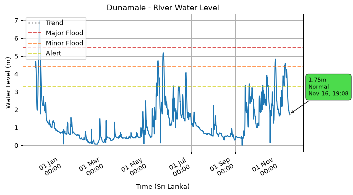

# lk_irrigation 🇱🇰

Realtime Data about *River Water Levels* in Sri Lanka, from the [Irrigation Deptartment](https://www.irrigation.gov.lk)'s [Hydrology and Disaster Management](https://www.irrigation.gov.lk/web/index.php?option=com_content&view=article&id=27&Itemid=128&lang=en) Division.

- [Complete Dataset](data/rwlds) with **318,325 measurements** from **39** stations.
- [Scrape and load logic](src/lk_irrigation/rwld/RiverWaterLevelDataLoadMixin.py)
- [Original Data source](https://www.arcgis.com/apps/dashboards/2cffe83c9ff5497d97375498bdf3ff38)

🇱🇰 River water alerts: No active alerts.
Source: Sri Lanka Irrigation Department https://www.irrigation.gov.lk
Repo: https://github.com/nuuuwan/lk_irrigation
## River Water Level Map

## Latest measurements

*There were **18** measurements in the last **1 hour**.*

| Measured At | Station (River Basin) | Level (m) | Alert Level | Rate-of-Rise (m/hr) | Rising Alert |
| --- | --- | ---: | --- | ---: | --- |
| 2026-11-17 14:02:53 | Kithulgala (Kelani Ganga) | 2.15 | 🟢 Normal | 0.081 | 🔺 Rising |
| 2026-11-17 14:02:50 | Galgamuwa (Mee Oya) | 0.24 | 🟢 Normal | 0.000 |  |
| 2026-11-17 14:02:46 | Katharagama (Menik Ganga) | -0.06 | 🟢 Normal | 0.000 |  |
| 2026-11-17 14:02:42 | Deraniyagala (Kelani Ganga) | 0.56 | 🟢 Normal | -0.040 |  |
| 2026-11-17 14:02:41 | Kalawellawa (Millakanda) (Kalu Ganga) | 2.46 | 🟢 Normal | 0.020 | 🔺 Rising |
| 2026-11-17 14:02:31 | Hanwella (Kelani Ganga) | 1.98 | 🟢 Normal | -0.020 |  |
| 2026-11-17 14:02:08 | Kuda Oya (Kirindi Oya) | 1.57 | 🟢 Normal | -0.011 |  |
| 2026-11-17 14:01:38 | Yaka Wewa (Ma Oya) | 0.52 | 🟢 Normal | 0.000 |  |
| 2026-11-17 14:01:30 | Nakkala (Kumbukkan Oya) | 0.88 | 🟢 Normal | 0.000 |  |
| 2026-11-17 14:01:22 | Wellawaya (Kirindi Oya) | 1.30 | 🟢 Normal | -0.010 |  |
| 2026-11-17 14:01:21 | Moragaswewa (Deduru Oya) | 0.64 | 🟢 Normal | -0.010 |  |
| 2026-11-17 14:01:19 | Dunamale (Aththanagalu Oya) | 1.71 | 🟢 Normal | 0.000 |  |
| 2026-11-17 14:01:06 | Nawalapitiya (Mahaweli Ganga) | 1.21 | 🟢 Normal | 0.000 |  |
| 2026-11-17 14:01:06 | Nagalagam Street (Kelani Ganga) | 0.52 | 🟢 Normal | 0.000 |  |
| 2026-11-17 14:00:48 | Siyambalanduwa (Heda Oya) | 0.52 | 🟢 Normal | 0.000 |  |
| 2026-11-17 14:00:46 | Giriulla (Maha Oya) | 1.33 | 🟢 Normal | 0.000 |  |
| 2026-11-17 14:00:26 | Thanamalwila (Kirindi Oya) | 1.40 | 🟢 Normal | 0.000 |  |
| 2026-11-17 14:00:25 | Manampitiya (Mahaweli Ganga) | 1.12 | 🟢 Normal | 0.000 |  |

## Latest by Station

*⌛ = Latest measurement is older than **24 hours**.*

| Measured At | Station (River Basin) | Level (m) | Alert Level | Rate-of-Rise (m/hr) | Rising Alert |
| --- | --- | ---: | --- | ---: | --- |
| 2026-11-17 14:02:53 | Kithulgala (Kelani Ganga) | 2.15 | 🟢 Normal | 0.081 | 🔺 Rising |
| 2026-11-17 13:04:20 | Putupaula (Kalu Ganga) | 0.63 | 🟢 Normal | 0.031 | 🔺 Rising |
| 2026-11-17 13:03:19 | Weraganthota (Mahaweli Ganga) | -2.12 | 🟢 Normal | 0.029 | 🔺 Rising |
| 2026-11-17 14:02:41 | Kalawellawa (Millakanda) (Kalu Ganga) | 2.46 | 🟢 Normal | 0.020 | 🔺 Rising |
| 2026-11-17 14:01:30 | Nakkala (Kumbukkan Oya) | 0.88 | 🟢 Normal | 0.000 |  |
| 2026-11-17 14:01:06 | Nawalapitiya (Mahaweli Ganga) | 1.21 | 🟢 Normal | 0.000 |  |
| 2026-11-17 14:01:38 | Yaka Wewa (Ma Oya) | 0.52 | 🟢 Normal | 0.000 |  |
| 2026-11-17 14:00:46 | Giriulla (Maha Oya) | 1.33 | 🟢 Normal | 0.000 |  |
| 2026-11-17 14:02:50 | Galgamuwa (Mee Oya) | 0.24 | 🟢 Normal | 0.000 |  |
| 2026-11-17 13:12:03 | Magura (Kalu Ganga) | 1.62 | 🟢 Normal | 0.000 |  |
| 2026-11-17 13:03:37 | Norwood (Kelani Ganga) | 0.94 | 🟢 Normal | 0.000 |  |
| 2026-11-17 13:07:40 | Padiyathalawa (Maduru Oya) | 0.39 | 🟢 Normal | 0.000 |  |
| 2026-11-17 14:01:06 | Nagalagam Street (Kelani Ganga) | 0.52 | 🟢 Normal | 0.000 |  |
| 2026-11-17 14:00:48 | Siyambalanduwa (Heda Oya) | 0.52 | 🟢 Normal | 0.000 |  |
| 2026-11-17 14:01:19 | Dunamale (Aththanagalu Oya) | 1.71 | 🟢 Normal | 0.000 |  |
| 2026-11-17 14:02:46 | Katharagama (Menik Ganga) | -0.06 | 🟢 Normal | 0.000 |  |
| 2026-11-17 13:03:10 | Badalgama (Maha Oya) | 2.60 | 🟢 Normal | 0.000 |  |
| 2026-11-17 14:00:25 | Manampitiya (Mahaweli Ganga) | 1.12 | 🟢 Normal | 0.000 |  |
| 2026-11-17 13:02:03 | Thanthirimale (Malwathu Oya) | 1.35 | 🟢 Normal | 0.000 |  |
| 2026-11-17 13:08:39 | Urawa (Nilwala Ganga) | 0.95 | 🟢 Normal | 0.000 |  |
| 2026-11-17 13:14:12 | Thalgahagoda (Nilwala Ganga) | 1.10 | 🟢 Normal | 0.000 |  |
| 2026-11-17 14:00:26 | Thanamalwila (Kirindi Oya) | 1.40 | 🟢 Normal | 0.000 |  |
| 2026-11-17 13:11:55 | Rathnapura (Kalu Ganga) | 1.48 | 🟢 Normal | -0.009 |  |
| 2026-11-17 13:03:03 | Horowpothana (Yan Oya) | 1.90 | 🟢 Normal | -0.010 |  |
| 2026-11-17 13:05:48 | Thawalama (Gin Ganga) | 1.79 | 🟢 Normal | -0.010 |  |
| 2026-11-17 13:04:27 | Pitabeddara (Nilwala Ganga) | 1.21 | 🟢 Normal | -0.010 |  |
| 2026-11-17 13:06:28 | Baddegama (Gin Ganga) | 1.67 | 🟢 Normal | -0.010 |  |
| 2026-11-17 14:01:21 | Moragaswewa (Deduru Oya) | 0.64 | 🟢 Normal | -0.010 |  |
| 2026-11-17 14:01:22 | Wellawaya (Kirindi Oya) | 1.30 | 🟢 Normal | -0.010 |  |
| 2026-11-17 13:02:46 | Ellagawa (Kalu Ganga) | 5.09 | 🟢 Normal | -0.010 |  |
| 2026-11-17 13:04:03 | Holombuwa (Kelani Ganga) | 0.70 | 🟢 Normal | -0.010 |  |
| 2026-11-17 14:02:08 | Kuda Oya (Kirindi Oya) | 1.57 | 🟢 Normal | -0.011 |  |
| 2026-11-17 13:06:12 | Peradeniya (Mahaweli Ganga) | 2.68 | 🟢 Normal | -0.018 |  |
| 2026-11-17 14:02:31 | Hanwella (Kelani Ganga) | 1.98 | 🟢 Normal | -0.020 |  |
| 2026-11-17 13:02:17 | Glencourse (Kelani Ganga) | 10.22 | 🟢 Normal | -0.021 |  |
| 2026-11-17 13:04:48 | Panadugama (Nilwala Ganga) | 3.78 | 🟢 Normal | -0.030 |  |
| 2026-11-17 14:02:42 | Deraniyagala (Kelani Ganga) | 0.56 | 🟢 Normal | -0.040 |  |
| 2026-11-17 13:03:13 | Thaldena (Mahaweli Ganga) | 0.50 | 🟢 Normal | -0.051 |  |
| 2026-11-17 13:02:06 | Moraketiya (Walawe Ganga) | 1.25 | 🟢 Normal | -0.273 |  |

## River Water Level Charts by Station

### Kithulgala (Kelani Ganga)

### Putupaula (Kalu Ganga)

### Weraganthota (Mahaweli Ganga)

### Kalawellawa (Millakanda) (Kalu Ganga)

.png)

### Nakkala (Kumbukkan Oya)

### Nawalapitiya (Mahaweli Ganga)

### Yaka Wewa (Ma Oya)

### Giriulla (Maha Oya)

### Galgamuwa (Mee Oya)

### Magura (Kalu Ganga)

### Norwood (Kelani Ganga)

### Padiyathalawa (Maduru Oya)

### Nagalagam Street (Kelani Ganga)

### Siyambalanduwa (Heda Oya)

### Dunamale (Aththanagalu Oya)

### Katharagama (Menik Ganga)

### Badalgama (Maha Oya)

### Manampitiya (Mahaweli Ganga)

### Thanthirimale (Malwathu Oya)

### Urawa (Nilwala Ganga)

### Thalgahagoda (Nilwala Ganga)

### Thanamalwila (Kirindi Oya)

### Rathnapura (Kalu Ganga)

### Horowpothana (Yan Oya)

### Thawalama (Gin Ganga)

### Pitabeddara (Nilwala Ganga)

### Baddegama (Gin Ganga)

### Moragaswewa (Deduru Oya)

### Wellawaya (Kirindi Oya)

### Ellagawa (Kalu Ganga)

### Holombuwa (Kelani Ganga)

### Kuda Oya (Kirindi Oya)

### Peradeniya (Mahaweli Ganga)

### Hanwella (Kelani Ganga)

### Glencourse (Kelani Ganga)

### Panadugama (Nilwala Ganga)

### Deraniyagala (Kelani Ganga)

### Thaldena (Mahaweli Ganga)

### Moraketiya (Walawe Ganga)

