# lk_irrigation 🇱🇰

Realtime Data about *River Water Levels* in Sri Lanka, from the [Irrigation Deptartment](https://www.irrigation.gov.lk)'s [Hydrology and Disaster Management](https://www.irrigation.gov.lk/web/index.php?option=com_content&view=article&id=27&Itemid=128&lang=en) Division.

- [Complete Dataset](data/rwlds) with **295,730 measurements** from **39** stations.
- [Scrape and load logic](src/lk_irrigation/rwld/RiverWaterLevelDataLoadMixin.py)
- [Original Data source](https://www.arcgis.com/apps/dashboards/2cffe83c9ff5497d97375498bdf3ff38)

🇱🇰 River water alerts: 🟡 Kalawellawa (Millakanda) — Alert; 🟡 Moragaswewa — Alert
Source: Sri Lanka Irrigation Department https://www.irrigation.gov.lk
Repo: https://github.com/nuuuwan/lk_irrigation
## River Water Level Map

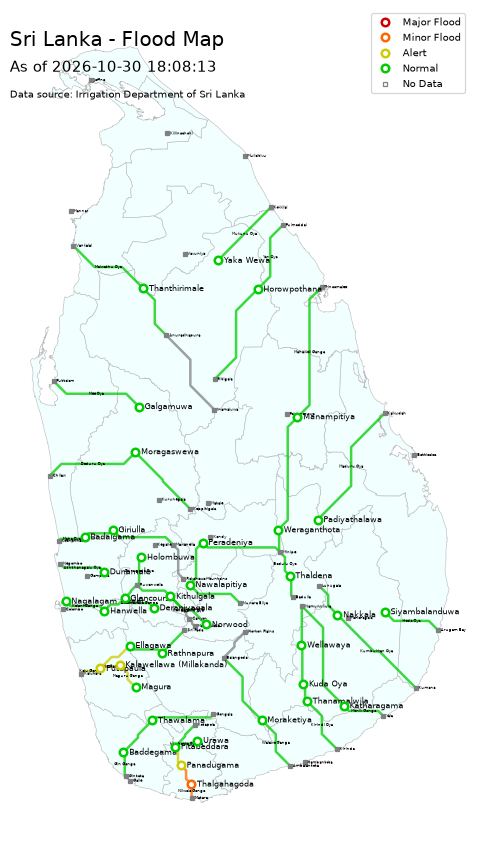

## Latest measurements

*There were **40** measurements in the last **1 hour**.*

| Measured At | Station (River Basin) | Level (m) | Alert Level | Rate-of-Rise (m/hr) | Rising Alert |
| --- | --- | ---: | --- | ---: | --- |
| 2026-10-23 11:21:15 | Thawalama (Gin Ganga) | 2.13 | 🟢 Normal | -0.017 |  |
| 2026-10-23 11:18:00 | Thanthirimale (Malwathu Oya) | 2.17 | 🟢 Normal | -0.008 |  |
| 2026-10-23 11:17:33 | Urawa (Nilwala Ganga) | 0.86 | 🟢 Normal | 0.000 |  |
| 2026-10-23 11:12:04 | Urawa (Nilwala Ganga) | 0.86 | 🟢 Normal | 0.000 |  |
| 2026-10-23 11:11:23 | Katharagama (Menik Ganga) | -0.23 | 🟢 Normal | 0.000 |  |
| 2026-10-23 11:10:58 | Baddegama (Gin Ganga) | 2.28 | 🟢 Normal | -0.019 |  |
| 2026-10-23 11:10:34 | Rathnapura (Kalu Ganga) | 3.65 | 🟢 Normal | -0.107 |  |
| 2026-10-23 11:07:55 | Kithulgala (Kelani Ganga) | 1.98 | 🟢 Normal | -0.171 |  |
| 2026-10-23 11:07:53 | Panadugama (Nilwala Ganga) | 4.39 | 🟢 Normal | -0.030 |  |
| 2026-10-23 11:07:24 | Pitabeddara (Nilwala Ganga) | 1.55 | 🟢 Normal | -0.052 |  |
| 2026-10-23 11:06:30 | Galgamuwa (Mee Oya) | 2.61 | 🟢 Normal | -0.010 |  |
| 2026-10-23 11:05:57 | Horowpothana (Yan Oya) | 3.03 | 🟢 Normal | -0.022 |  |
| 2026-10-23 11:05:04 | Holombuwa (Kelani Ganga) | 1.13 | 🟢 Normal | -0.030 |  |
| 2026-10-23 11:05:03 | Badalgama (Maha Oya) | 3.52 | 🟢 Normal | -0.039 |  |
| 2026-10-23 11:05:00 | Giriulla (Maha Oya) | 2.20 | 🟢 Normal | -0.048 |  |
| 2026-10-23 11:04:37 | Hanwella (Kelani Ganga) | 4.12 | 🟢 Normal | -0.058 |  |
| 2026-10-23 11:04:34 | Dunamale (Aththanagalu Oya) | 2.68 | 🟢 Normal | -0.042 |  |
| 2026-10-23 11:04:33 | Thalgahagoda (Nilwala Ganga) | 1.18 | 🟢 Normal | 0.000 |  |
| 2026-10-23 11:03:56 | Siyambalanduwa (Heda Oya) | 0.59 | 🟢 Normal | -0.010 |  |
| 2026-10-23 11:03:50 | Glencourse (Kelani Ganga) | 11.51 | 🟢 Normal | -0.089 |  |
| 2026-10-23 11:03:23 | Magura (Kalu Ganga) | 2.01 | 🟢 Normal | -0.086 |  |
| 2026-10-23 11:03:21 | Peradeniya (Mahaweli Ganga) | 2.82 | 🟢 Normal | -0.052 |  |
| 2026-10-23 11:03:15 | Kalawellawa (Millakanda) (Kalu Ganga) | 5.08 | 🟡 Alert | -0.020 |  |
| 2026-10-23 11:03:09 | Moraketiya (Walawe Ganga) | 1.17 | 🟢 Normal | -0.021 |  |
| 2026-10-23 11:02:53 | Deraniyagala (Kelani Ganga) | 0.99 | 🟢 Normal | 0.010 | 🔺 Rising |
| 2026-10-23 11:02:42 | Norwood (Kelani Ganga) | 1.05 | 🟢 Normal | -0.010 |  |
| 2026-10-23 11:02:31 | Putupaula (Kalu Ganga) | 1.98 | 🟢 Normal | -0.010 |  |
| 2026-10-23 11:02:09 | Thaldena (Mahaweli Ganga) | 0.40 | 🟢 Normal | 0.021 | 🔺 Rising |
| 2026-10-23 11:02:08 | Thanamalwila (Kirindi Oya) | 1.21 | 🟢 Normal | -0.010 |  |
| 2026-10-23 11:01:56 | Yaka Wewa (Ma Oya) | 0.63 | 🟢 Normal | -0.010 |  |
| 2026-10-23 11:01:53 | Wellawaya (Kirindi Oya) | 1.41 | 🟢 Normal | -0.010 |  |
| 2026-10-23 11:01:42 | Nakkala (Kumbukkan Oya) | 0.83 | 🟢 Normal | -0.010 |  |
| 2026-10-23 11:01:42 | Kuda Oya (Kirindi Oya) | 1.34 | 🟢 Normal | 0.000 |  |
| 2026-10-23 11:01:39 | Weraganthota (Mahaweli Ganga) | -2.44 | 🟢 Normal | 0.360 | 🔺 Rising |
| 2026-10-23 11:01:16 | Manampitiya (Mahaweli Ganga) | 1.14 | 🟢 Normal | 0.021 | 🔺 Rising |
| 2026-10-23 11:01:11 | Moragaswewa (Deduru Oya) | 4.79 | 🟡 Alert | -0.021 |  |
| 2026-10-23 11:01:09 | Padiyathalawa (Maduru Oya) | 0.42 | 🟢 Normal | -0.032 |  |
| 2026-10-23 11:01:07 | Ellagawa (Kalu Ganga) | 7.63 | 🟢 Normal | -0.021 |  |
| 2026-10-23 11:00:52 | Nagalagam Street (Kelani Ganga) | 0.85 | 🟢 Normal | 0.091 | 🔺 Rising |
| 2026-10-23 11:00:45 | Nawalapitiya (Mahaweli Ganga) | 1.22 | 🟢 Normal | -0.102 |  |

## Latest by Station

*⌛ = Latest measurement is older than **24 hours**.*

| Measured At | Station (River Basin) | Level (m) | Alert Level | Rate-of-Rise (m/hr) | Rising Alert |
| --- | --- | ---: | --- | ---: | --- |
| 2026-10-23 11:03:15 | Kalawellawa (Millakanda) (Kalu Ganga) | 5.08 | 🟡 Alert | -0.020 |  |
| 2026-10-23 11:01:11 | Moragaswewa (Deduru Oya) | 4.79 | 🟡 Alert | -0.021 |  |
| 2026-10-23 11:01:39 | Weraganthota (Mahaweli Ganga) | -2.44 | 🟢 Normal | 0.360 | 🔺 Rising |
| 2026-10-23 11:00:52 | Nagalagam Street (Kelani Ganga) | 0.85 | 🟢 Normal | 0.091 | 🔺 Rising |
| 2026-10-23 11:02:09 | Thaldena (Mahaweli Ganga) | 0.40 | 🟢 Normal | 0.021 | 🔺 Rising |
| 2026-10-23 11:01:16 | Manampitiya (Mahaweli Ganga) | 1.14 | 🟢 Normal | 0.021 | 🔺 Rising |
| 2026-10-23 11:02:53 | Deraniyagala (Kelani Ganga) | 0.99 | 🟢 Normal | 0.010 | 🔺 Rising |
| 2026-10-23 11:11:23 | Katharagama (Menik Ganga) | -0.23 | 🟢 Normal | 0.000 |  |
| 2026-10-23 11:17:33 | Urawa (Nilwala Ganga) | 0.86 | 🟢 Normal | 0.000 |  |
| 2026-10-23 11:04:33 | Thalgahagoda (Nilwala Ganga) | 1.18 | 🟢 Normal | 0.000 |  |
| 2026-10-23 11:01:42 | Kuda Oya (Kirindi Oya) | 1.34 | 🟢 Normal | 0.000 |  |
| 2026-10-23 11:18:00 | Thanthirimale (Malwathu Oya) | 2.17 | 🟢 Normal | -0.008 |  |
| 2026-10-23 11:01:42 | Nakkala (Kumbukkan Oya) | 0.83 | 🟢 Normal | -0.010 |  |
| 2026-10-23 11:06:30 | Galgamuwa (Mee Oya) | 2.61 | 🟢 Normal | -0.010 |  |
| 2026-10-23 11:01:53 | Wellawaya (Kirindi Oya) | 1.41 | 🟢 Normal | -0.010 |  |
| 2026-10-23 11:02:08 | Thanamalwila (Kirindi Oya) | 1.21 | 🟢 Normal | -0.010 |  |
| 2026-10-23 11:01:56 | Yaka Wewa (Ma Oya) | 0.63 | 🟢 Normal | -0.010 |  |
| 2026-10-23 11:02:42 | Norwood (Kelani Ganga) | 1.05 | 🟢 Normal | -0.010 |  |
| 2026-10-23 11:03:56 | Siyambalanduwa (Heda Oya) | 0.59 | 🟢 Normal | -0.010 |  |
| 2026-10-23 11:02:31 | Putupaula (Kalu Ganga) | 1.98 | 🟢 Normal | -0.010 |  |
| 2026-10-23 11:21:15 | Thawalama (Gin Ganga) | 2.13 | 🟢 Normal | -0.017 |  |
| 2026-10-23 11:10:58 | Baddegama (Gin Ganga) | 2.28 | 🟢 Normal | -0.019 |  |
| 2026-10-23 11:03:09 | Moraketiya (Walawe Ganga) | 1.17 | 🟢 Normal | -0.021 |  |
| 2026-10-23 11:01:07 | Ellagawa (Kalu Ganga) | 7.63 | 🟢 Normal | -0.021 |  |
| 2026-10-23 11:05:57 | Horowpothana (Yan Oya) | 3.03 | 🟢 Normal | -0.022 |  |
| 2026-10-23 11:07:53 | Panadugama (Nilwala Ganga) | 4.39 | 🟢 Normal | -0.030 |  |
| 2026-10-23 11:05:04 | Holombuwa (Kelani Ganga) | 1.13 | 🟢 Normal | -0.030 |  |
| 2026-10-23 11:01:09 | Padiyathalawa (Maduru Oya) | 0.42 | 🟢 Normal | -0.032 |  |
| 2026-10-23 11:05:03 | Badalgama (Maha Oya) | 3.52 | 🟢 Normal | -0.039 |  |
| 2026-10-23 11:04:34 | Dunamale (Aththanagalu Oya) | 2.68 | 🟢 Normal | -0.042 |  |
| 2026-10-23 11:05:00 | Giriulla (Maha Oya) | 2.20 | 🟢 Normal | -0.048 |  |
| 2026-10-23 11:07:24 | Pitabeddara (Nilwala Ganga) | 1.55 | 🟢 Normal | -0.052 |  |
| 2026-10-23 11:03:21 | Peradeniya (Mahaweli Ganga) | 2.82 | 🟢 Normal | -0.052 |  |
| 2026-10-23 11:04:37 | Hanwella (Kelani Ganga) | 4.12 | 🟢 Normal | -0.058 |  |
| 2026-10-23 11:03:23 | Magura (Kalu Ganga) | 2.01 | 🟢 Normal | -0.086 |  |
| 2026-10-23 11:03:50 | Glencourse (Kelani Ganga) | 11.51 | 🟢 Normal | -0.089 |  |
| 2026-10-23 11:00:45 | Nawalapitiya (Mahaweli Ganga) | 1.22 | 🟢 Normal | -0.102 |  |
| 2026-10-23 11:10:34 | Rathnapura (Kalu Ganga) | 3.65 | 🟢 Normal | -0.107 |  |
| 2026-10-23 11:07:55 | Kithulgala (Kelani Ganga) | 1.98 | 🟢 Normal | -0.171 |  |

## River Water Level Charts by Station

### Kalawellawa (Millakanda) (Kalu Ganga)

.png)

### Moragaswewa (Deduru Oya)

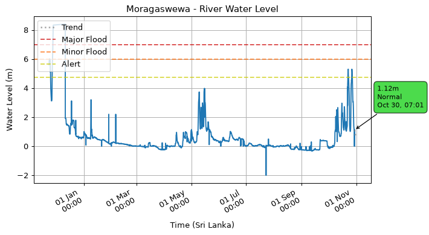

### Weraganthota (Mahaweli Ganga)

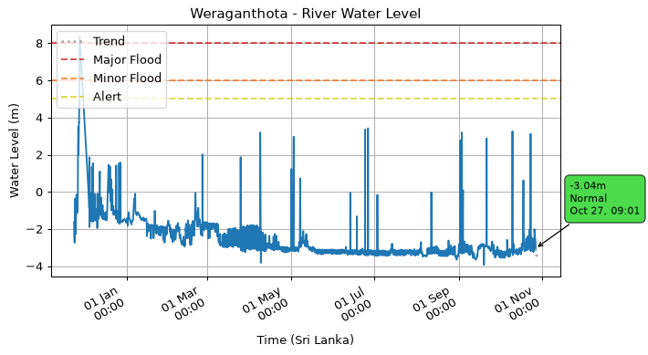

### Nagalagam Street (Kelani Ganga)

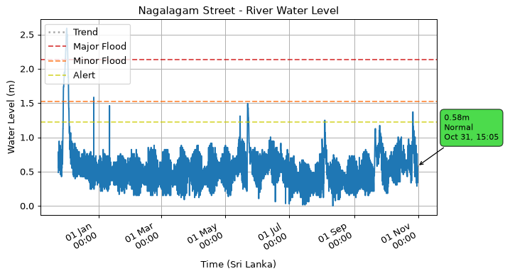

### Thaldena (Mahaweli Ganga)

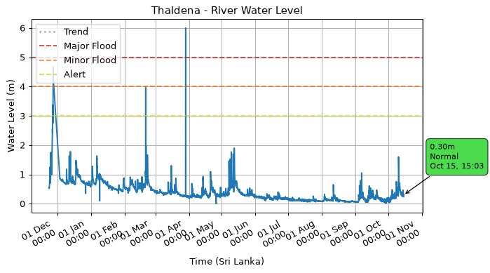

### Manampitiya (Mahaweli Ganga)

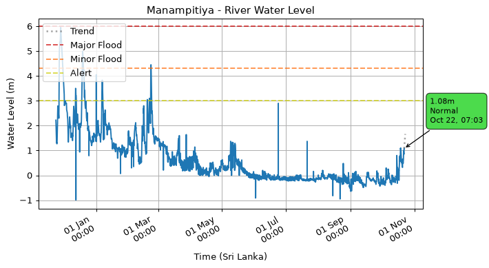

### Deraniyagala (Kelani Ganga)

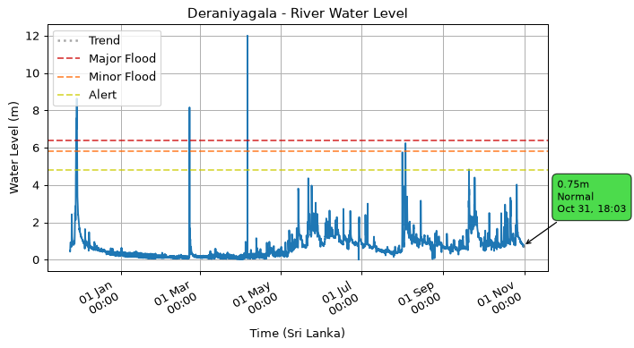

### Katharagama (Menik Ganga)

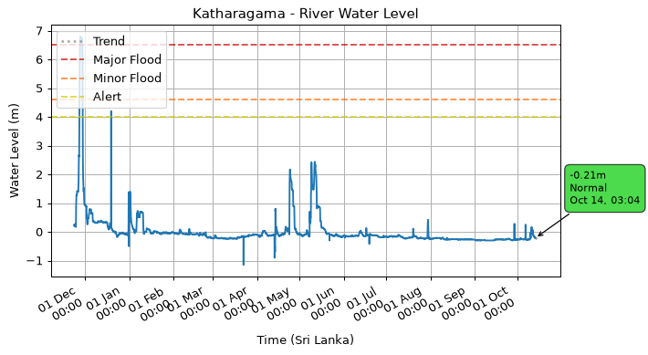

### Urawa (Nilwala Ganga)

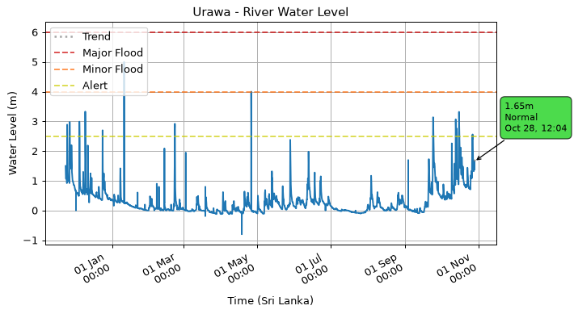

### Thalgahagoda (Nilwala Ganga)

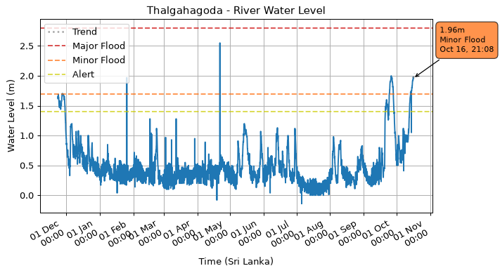

### Kuda Oya (Kirindi Oya)

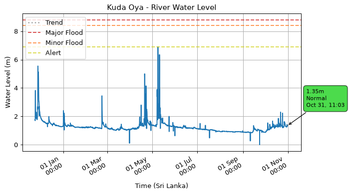

### Thanthirimale (Malwathu Oya)

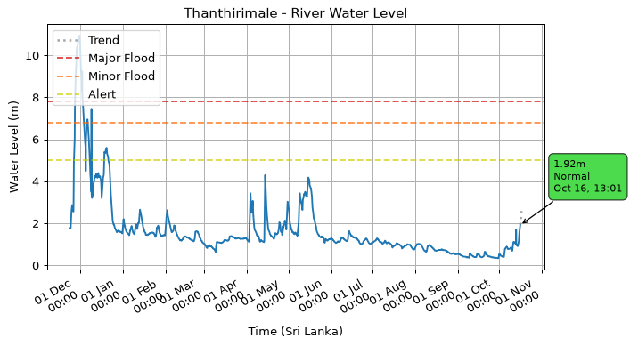

### Nakkala (Kumbukkan Oya)

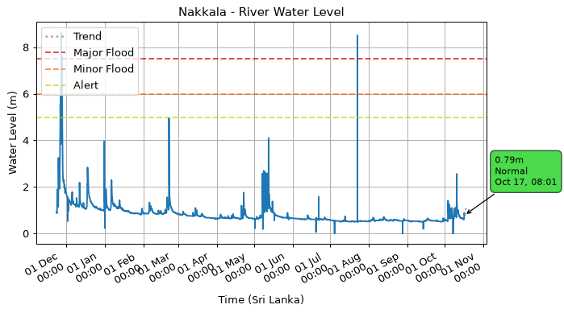

### Galgamuwa (Mee Oya)

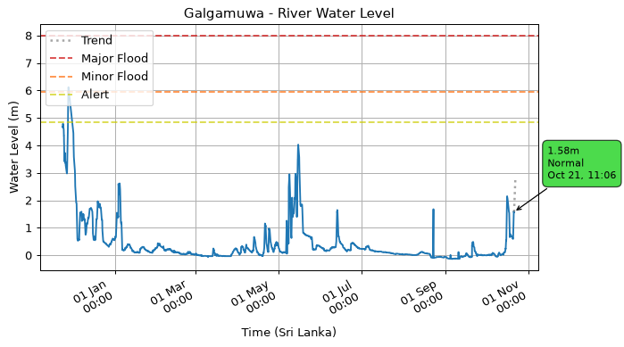

### Wellawaya (Kirindi Oya)

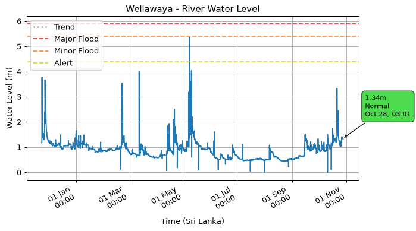

### Thanamalwila (Kirindi Oya)

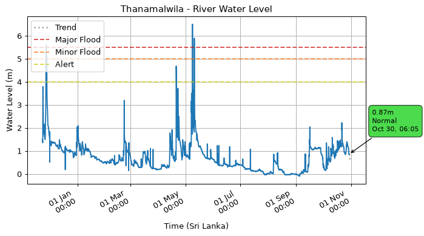

### Yaka Wewa (Ma Oya)

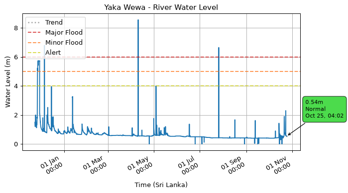

### Norwood (Kelani Ganga)

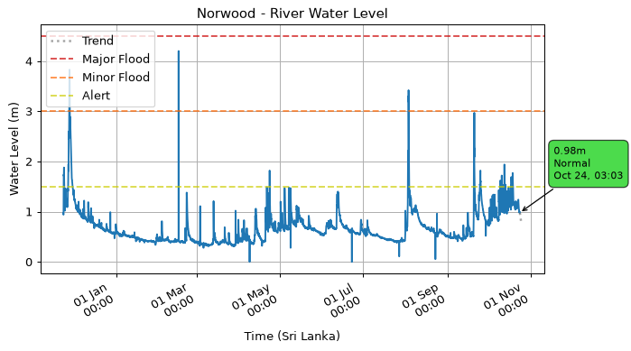

### Siyambalanduwa (Heda Oya)

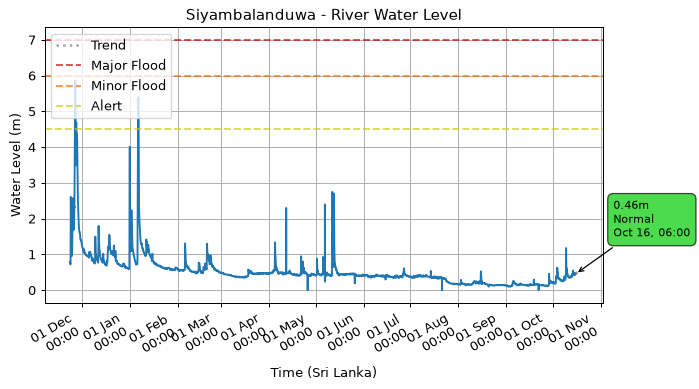

### Putupaula (Kalu Ganga)

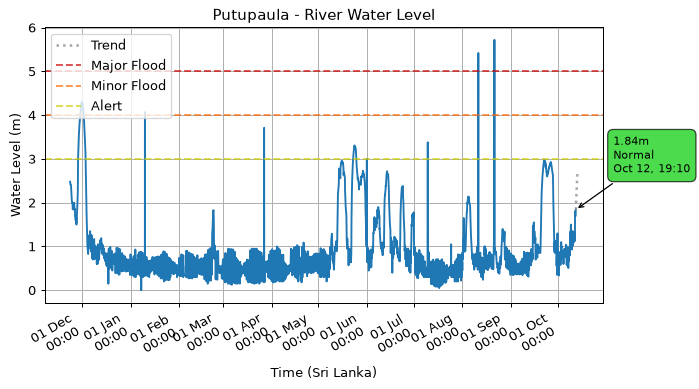

### Thawalama (Gin Ganga)

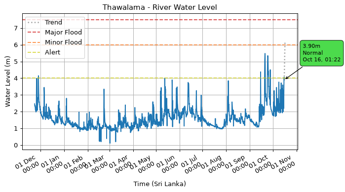

### Baddegama (Gin Ganga)

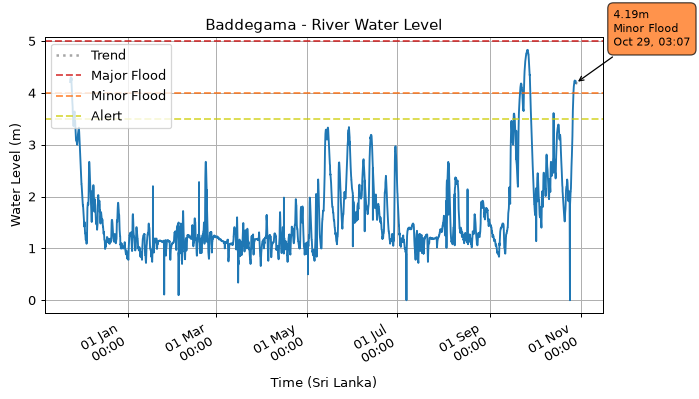

### Moraketiya (Walawe Ganga)

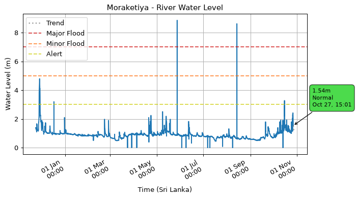

### Ellagawa (Kalu Ganga)

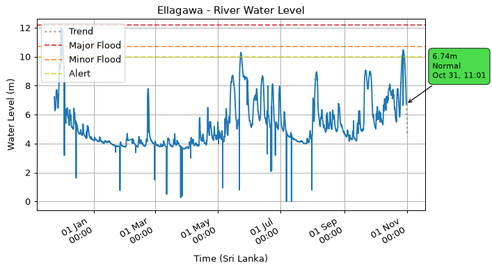

### Horowpothana (Yan Oya)

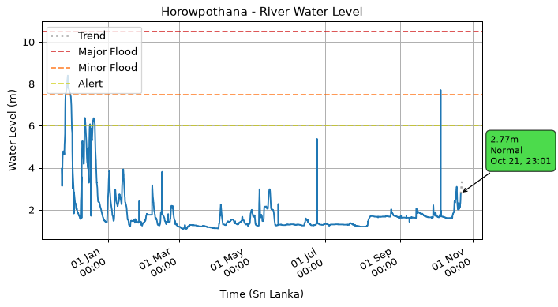

### Panadugama (Nilwala Ganga)

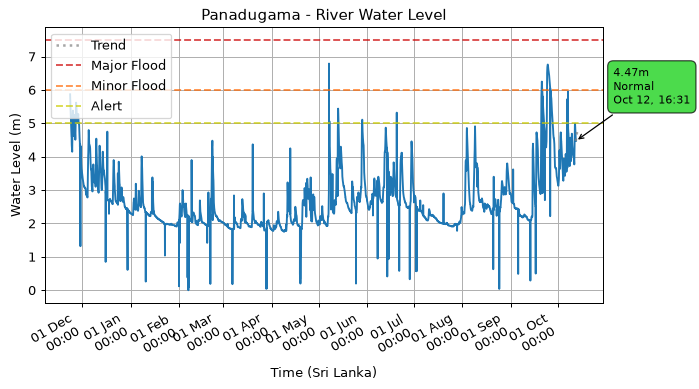

### Holombuwa (Kelani Ganga)

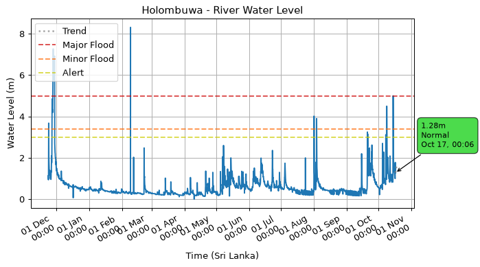

### Padiyathalawa (Maduru Oya)

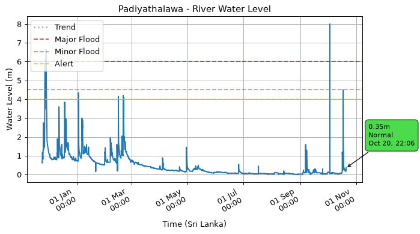

### Badalgama (Maha Oya)

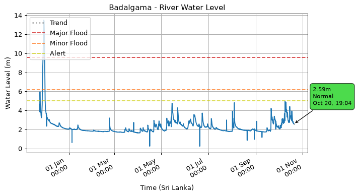

### Dunamale (Aththanagalu Oya)

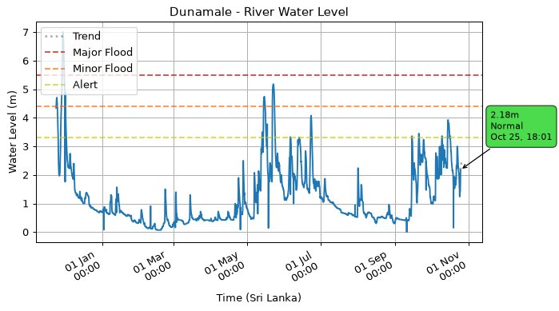

### Giriulla (Maha Oya)

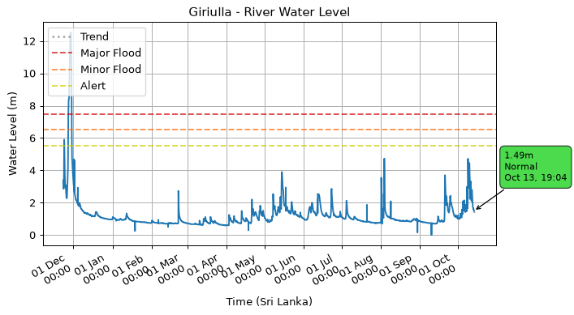

### Pitabeddara (Nilwala Ganga)

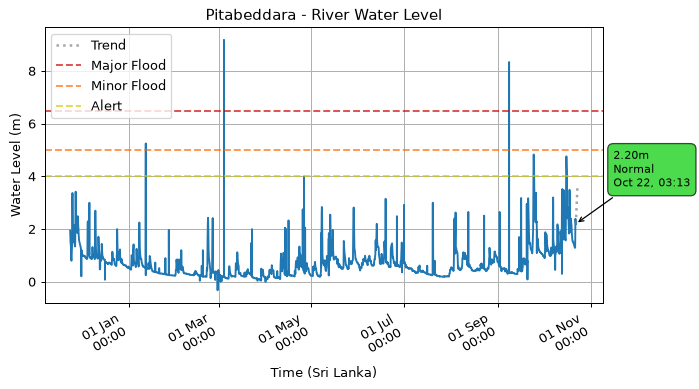

### Peradeniya (Mahaweli Ganga)

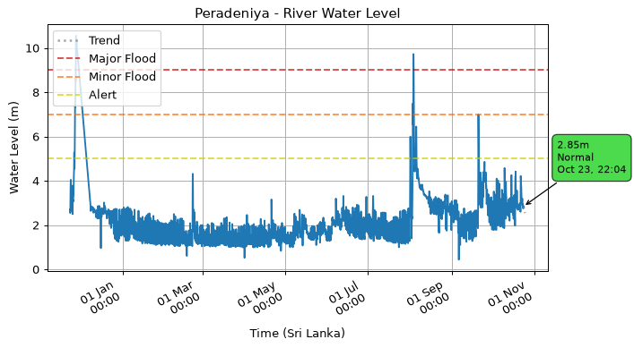

### Hanwella (Kelani Ganga)

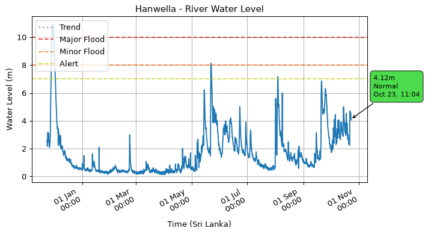

### Magura (Kalu Ganga)

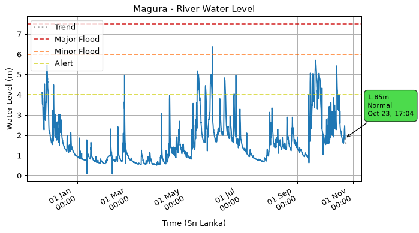

### Glencourse (Kelani Ganga)

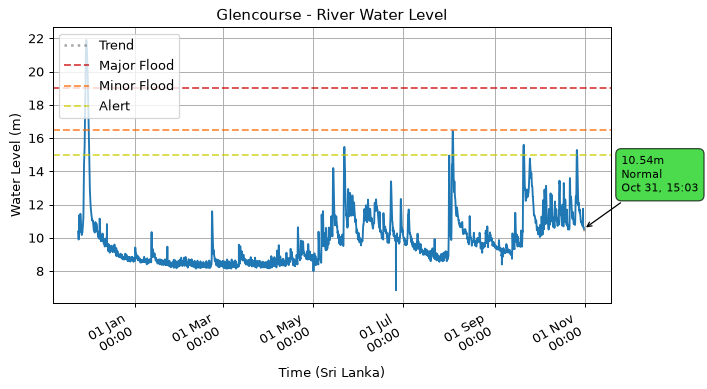

### Nawalapitiya (Mahaweli Ganga)

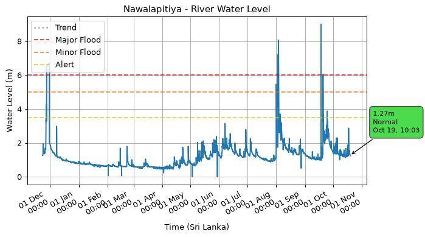

### Rathnapura (Kalu Ganga)

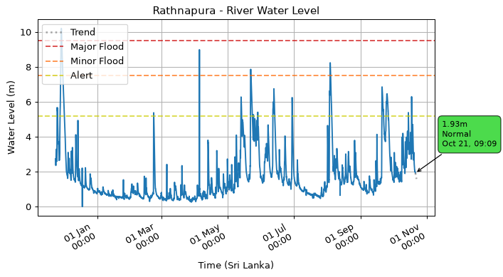

### Kithulgala (Kelani Ganga)

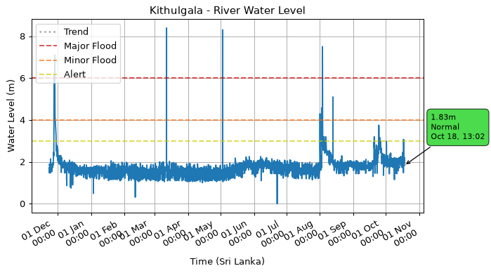

