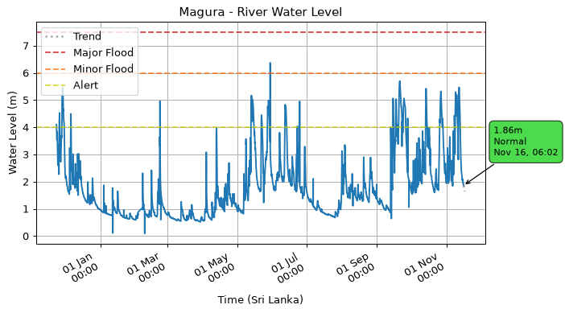

# lk_irrigation 🇱🇰

Realtime Data about *River Water Levels* in Sri Lanka, from the [Irrigation Deptartment](https://www.irrigation.gov.lk)'s [Hydrology and Disaster Management](https://www.irrigation.gov.lk/web/index.php?option=com_content&view=article&id=27&Itemid=128&lang=en) Division.

- [Complete Dataset](data/rwlds) with **325,905 measurements** from **39** stations.
- [Scrape and load logic](src/lk_irrigation/rwld/RiverWaterLevelDataLoadMixin.py)
- [Original Data source](https://www.arcgis.com/apps/dashboards/2cffe83c9ff5497d97375498bdf3ff38)

🇱🇰 River water alerts: 🟡 Dunamale — Alert
Source: Sri Lanka Irrigation Department https://www.irrigation.gov.lk
Repo: https://github.com/nuuuwan/lk_irrigation
## River Water Level Map

## Latest measurements

*There were **36** measurements in the last **1 hour**.*

| Measured At | Station (River Basin) | Level (m) | Alert Level | Rate-of-Rise (m/hr) | Rising Alert |
| --- | --- | ---: | --- | ---: | --- |
| 2026-11-26 05:20:43 | Ellagawa (Kalu Ganga) | 6.10 | 🟢 Normal | 0.000 |  |
| 2026-11-26 05:18:00 | Moraketiya (Walawe Ganga) | 1.90 | 🟢 Normal | 0.000 |  |
| 2026-11-26 05:13:01 | Kalawellawa (Millakanda) (Kalu Ganga) | 4.97 | 🟢 Normal | 0.009 | 🔺 Rising |
| 2026-11-26 05:09:44 | Baddegama (Gin Ganga) | 1.90 | 🟢 Normal | 0.009 | 🔺 Rising |
| 2026-11-26 05:09:01 | Horowpothana (Yan Oya) | 2.57 | 🟢 Normal | -180.000 |  |
| 2026-11-26 05:09:00 | Horowpothana (Yan Oya) | 2.62 | 🟢 Normal | -180.000 |  |
| 2026-11-26 05:07:50 | Nagalagam Street (Kelani Ganga) | 0.85 | 🟢 Normal | 0.000 |  |
| 2026-11-26 05:06:32 | Thalgahagoda (Nilwala Ganga) | 1.06 | 🟢 Normal | 0.320 | 🔺 Rising |
| 2026-11-26 05:06:23 | Pitabeddara (Nilwala Ganga) | 1.28 | 🟢 Normal | 0.000 |  |
| 2026-11-26 05:06:20 | Katharagama (Menik Ganga) | 0.22 | 🟢 Normal | -0.010 |  |
| 2026-11-26 05:06:19 | Putupaula (Kalu Ganga) | 1.30 | 🟢 Normal | 0.199 | 🔺 Rising |
| 2026-11-26 05:05:26 | Urawa (Nilwala Ganga) | 1.00 | 🟢 Normal | 0.000 |  |
| 2026-11-26 05:05:01 | Peradeniya (Mahaweli Ganga) | 3.42 | 🟢 Normal | -0.115 |  |
| 2026-11-26 05:05:01 | Holombuwa (Kelani Ganga) | 1.50 | 🟢 Normal | -0.051 |  |
| 2026-11-26 05:04:55 | Kuda Oya (Kirindi Oya) | 1.71 | 🟢 Normal | 0.048 | 🔺 Rising |
| 2026-11-26 05:04:51 | Siyambalanduwa (Heda Oya) | 0.78 | 🟢 Normal | -0.043 |  |
| 2026-11-26 05:04:29 | Hanwella (Kelani Ganga) | 3.93 | 🟢 Normal | 0.039 | 🔺 Rising |
| 2026-11-26 05:03:29 | Giriulla (Maha Oya) | 3.75 | 🟢 Normal | 0.049 | 🔺 Rising |
| 2026-11-26 05:03:26 | Badalgama (Maha Oya) | 4.15 | 🟢 Normal | 0.129 | 🔺 Rising |
| 2026-11-26 05:03:24 | Deraniyagala (Kelani Ganga) | 0.79 | 🟢 Normal | -0.040 |  |
| 2026-11-26 05:03:12 | Norwood (Kelani Ganga) | 0.91 | 🟢 Normal | -0.010 |  |
| 2026-11-26 05:03:07 | Wellawaya (Kirindi Oya) | 1.50 | 🟢 Normal | -0.020 |  |
| 2026-11-26 05:02:44 | Kithulgala (Kelani Ganga) | 1.70 | 🟢 Normal | 0.000 |  |
| 2026-11-26 05:02:22 | Dunamale (Aththanagalu Oya) | 3.92 | 🟡 Alert | 0.040 | 🔺 Rising |
| 2026-11-26 05:02:20 | Glencourse (Kelani Ganga) | 11.87 | 🟢 Normal | -0.144 |  |
| 2026-11-26 05:02:17 | Manampitiya (Mahaweli Ganga) | 1.96 | 🟢 Normal | 0.242 | 🔺 Rising |
| 2026-11-26 05:02:10 | Nawalapitiya (Mahaweli Ganga) | 1.39 | 🟢 Normal | 0.674 | 🔺 Rising |
| 2026-11-26 05:02:07 | Thanamalwila (Kirindi Oya) | 1.75 | 🟢 Normal | -0.030 |  |
| 2026-11-26 05:02:07 | Thawalama (Gin Ganga) | 2.18 | 🟢 Normal | -0.097 |  |
| 2026-11-26 05:01:24 | Yaka Wewa (Ma Oya) | 0.50 | 🟢 Normal | 0.000 |  |
| 2026-11-26 05:01:15 | Rathnapura (Kalu Ganga) | 2.46 | 🟢 Normal | -0.074 |  |
| 2026-11-26 05:00:55 | Thalgahagoda (Nilwala Ganga) | 1.03 | 🟢 Normal | 0.320 | 🔺 Rising |
| 2026-11-26 05:00:40 | Moragaswewa (Deduru Oya) | 3.06 | 🟢 Normal | 0.225 | 🔺 Rising |
| 2026-11-26 05:00:32 | Nakkala (Kumbukkan Oya) | 0.95 | 🟢 Normal | -0.031 |  |
| 2026-11-26 05:00:28 | Thaldena (Mahaweli Ganga) | 0.70 | 🟢 Normal | -0.040 |  |
| 2026-11-26 04:56:11 | Panadugama (Nilwala Ganga) | 4.06 | 🟢 Normal | -0.023 |  |

## Latest by Station

*⌛ = Latest measurement is older than **24 hours**.*

| Measured At | Station (River Basin) | Level (m) | Alert Level | Rate-of-Rise (m/hr) | Rising Alert |
| --- | --- | ---: | --- | ---: | --- |
| 2026-11-26 05:02:22 | Dunamale (Aththanagalu Oya) | 3.92 | 🟡 Alert | 0.040 | 🔺 Rising |
| 2026-11-26 05:02:10 | Nawalapitiya (Mahaweli Ganga) | 1.39 | 🟢 Normal | 0.674 | 🔺 Rising |
| 2026-11-25 20:05:34 | Magura (Kalu Ganga) | 3.40 | 🟢 Normal | 0.483 | 🔺 Rising |
| 2026-11-26 05:06:32 | Thalgahagoda (Nilwala Ganga) | 1.06 | 🟢 Normal | 0.320 | 🔺 Rising |
| 2026-11-26 05:02:17 | Manampitiya (Mahaweli Ganga) | 1.96 | 🟢 Normal | 0.242 | 🔺 Rising |
| 2026-11-26 05:00:40 | Moragaswewa (Deduru Oya) | 3.06 | 🟢 Normal | 0.225 | 🔺 Rising |
| 2026-11-26 05:06:19 | Putupaula (Kalu Ganga) | 1.30 | 🟢 Normal | 0.199 | 🔺 Rising |
| 2026-11-25 18:02:46 | Weraganthota (Mahaweli Ganga) | -1.84 | 🟢 Normal | 0.141 | 🔺 Rising |
| 2026-11-26 05:03:26 | Badalgama (Maha Oya) | 4.15 | 🟢 Normal | 0.129 | 🔺 Rising |
| 2026-11-25 18:02:35 | Thanthirimale (Malwathu Oya) | 1.47 | 🟢 Normal | 0.053 | 🔺 Rising |
| 2026-11-26 05:03:29 | Giriulla (Maha Oya) | 3.75 | 🟢 Normal | 0.049 | 🔺 Rising |
| 2026-11-26 05:04:55 | Kuda Oya (Kirindi Oya) | 1.71 | 🟢 Normal | 0.048 | 🔺 Rising |
| 2026-11-26 05:04:29 | Hanwella (Kelani Ganga) | 3.93 | 🟢 Normal | 0.039 | 🔺 Rising |
| 2026-11-25 18:00:42 | Galgamuwa (Mee Oya) | 0.45 | 🟢 Normal | 0.033 | 🔺 Rising |
| 2026-11-26 05:09:44 | Baddegama (Gin Ganga) | 1.90 | 🟢 Normal | 0.009 | 🔺 Rising |
| 2026-11-26 05:13:01 | Kalawellawa (Millakanda) (Kalu Ganga) | 4.97 | 🟢 Normal | 0.009 | 🔺 Rising |
| 2026-11-26 05:02:44 | Kithulgala (Kelani Ganga) | 1.70 | 🟢 Normal | 0.000 |  |
| 2026-11-26 05:01:24 | Yaka Wewa (Ma Oya) | 0.50 | 🟢 Normal | 0.000 |  |
| 2026-11-26 05:06:23 | Pitabeddara (Nilwala Ganga) | 1.28 | 🟢 Normal | 0.000 |  |
| 2026-11-26 05:20:43 | Ellagawa (Kalu Ganga) | 6.10 | 🟢 Normal | 0.000 |  |
| 2026-11-26 05:07:50 | Nagalagam Street (Kelani Ganga) | 0.85 | 🟢 Normal | 0.000 |  |
| 2026-11-26 05:18:00 | Moraketiya (Walawe Ganga) | 1.90 | 🟢 Normal | 0.000 |  |
| 2026-11-26 05:05:26 | Urawa (Nilwala Ganga) | 1.00 | 🟢 Normal | 0.000 |  |
| 2026-11-26 05:06:20 | Katharagama (Menik Ganga) | 0.22 | 🟢 Normal | -0.010 |  |
| 2026-11-26 05:03:12 | Norwood (Kelani Ganga) | 0.91 | 🟢 Normal | -0.010 |  |
| 2026-11-26 05:03:07 | Wellawaya (Kirindi Oya) | 1.50 | 🟢 Normal | -0.020 |  |
| 2026-11-22 17:02:02⌛ | Padiyathalawa (Maduru Oya) | 0.36 | 🟢 Normal | -0.022 |  |
| 2026-11-26 04:56:11 | Panadugama (Nilwala Ganga) | 4.06 | 🟢 Normal | -0.023 |  |
| 2026-11-26 05:02:07 | Thanamalwila (Kirindi Oya) | 1.75 | 🟢 Normal | -0.030 |  |
| 2026-11-26 05:00:32 | Nakkala (Kumbukkan Oya) | 0.95 | 🟢 Normal | -0.031 |  |
| 2026-11-26 05:03:24 | Deraniyagala (Kelani Ganga) | 0.79 | 🟢 Normal | -0.040 |  |
| 2026-11-26 05:00:28 | Thaldena (Mahaweli Ganga) | 0.70 | 🟢 Normal | -0.040 |  |
| 2026-11-26 05:04:51 | Siyambalanduwa (Heda Oya) | 0.78 | 🟢 Normal | -0.043 |  |
| 2026-11-26 05:05:01 | Holombuwa (Kelani Ganga) | 1.50 | 🟢 Normal | -0.051 |  |
| 2026-11-26 05:01:15 | Rathnapura (Kalu Ganga) | 2.46 | 🟢 Normal | -0.074 |  |
| 2026-11-26 05:02:07 | Thawalama (Gin Ganga) | 2.18 | 🟢 Normal | -0.097 |  |
| 2026-11-26 05:05:01 | Peradeniya (Mahaweli Ganga) | 3.42 | 🟢 Normal | -0.115 |  |
| 2026-11-26 05:02:20 | Glencourse (Kelani Ganga) | 11.87 | 🟢 Normal | -0.144 |  |
| 2026-11-26 05:09:01 | Horowpothana (Yan Oya) | 2.57 | 🟢 Normal | -180.000 |  |

## River Water Level Charts by Station

### Dunamale (Aththanagalu Oya)

### Nawalapitiya (Mahaweli Ganga)

### Magura (Kalu Ganga)

### Thalgahagoda (Nilwala Ganga)

### Manampitiya (Mahaweli Ganga)

### Moragaswewa (Deduru Oya)

### Putupaula (Kalu Ganga)

### Weraganthota (Mahaweli Ganga)

### Badalgama (Maha Oya)

### Thanthirimale (Malwathu Oya)

### Giriulla (Maha Oya)

### Kuda Oya (Kirindi Oya)

### Hanwella (Kelani Ganga)

### Galgamuwa (Mee Oya)

### Baddegama (Gin Ganga)

### Kalawellawa (Millakanda) (Kalu Ganga)

.png)

### Kithulgala (Kelani Ganga)

### Yaka Wewa (Ma Oya)

### Pitabeddara (Nilwala Ganga)

### Ellagawa (Kalu Ganga)

### Nagalagam Street (Kelani Ganga)

### Moraketiya (Walawe Ganga)

### Urawa (Nilwala Ganga)

### Katharagama (Menik Ganga)

### Norwood (Kelani Ganga)

### Wellawaya (Kirindi Oya)

### Padiyathalawa (Maduru Oya)

### Panadugama (Nilwala Ganga)

### Thanamalwila (Kirindi Oya)

### Nakkala (Kumbukkan Oya)

### Deraniyagala (Kelani Ganga)

### Thaldena (Mahaweli Ganga)

### Siyambalanduwa (Heda Oya)

### Holombuwa (Kelani Ganga)

### Rathnapura (Kalu Ganga)

### Thawalama (Gin Ganga)

### Peradeniya (Mahaweli Ganga)

### Glencourse (Kelani Ganga)

### Horowpothana (Yan Oya)

