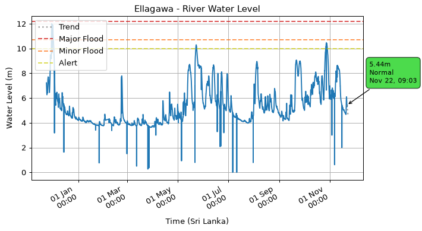

# lk_irrigation 🇱🇰

Realtime Data about *River Water Levels* in Sri Lanka, from the [Irrigation Deptartment](https://www.irrigation.gov.lk)'s [Hydrology and Disaster Management](https://www.irrigation.gov.lk/web/index.php?option=com_content&view=article&id=27&Itemid=128&lang=en) Division.

- [Complete Dataset](data/rwlds) with **316,724 measurements** from **39** stations.
- [Scrape and load logic](src/lk_irrigation/rwld/RiverWaterLevelDataLoadMixin.py)
- [Original Data source](https://www.arcgis.com/apps/dashboards/2cffe83c9ff5497d97375498bdf3ff38)

🇱🇰 River water alerts: 🟠 Thalgahagoda — Minor Flood
Source: Sri Lanka Irrigation Department https://www.irrigation.gov.lk
Repo: https://github.com/nuuuwan/lk_irrigation
## River Water Level Map

## Latest measurements

*There were **41** measurements in the last **1 hour**.*

| Measured At | Station (River Basin) | Level (m) | Alert Level | Rate-of-Rise (m/hr) | Rising Alert |
| --- | --- | ---: | --- | ---: | --- |
| 2026-11-15 18:26:00 | Padiyathalawa (Maduru Oya) | 0.55 | 🟢 Normal | 0.000 |  |
| 2026-11-15 18:10:23 | Thalgahagoda (Nilwala Ganga) | 1.75 | 🟠 Minor Flood | 0.000 |  |
| 2026-11-15 18:07:25 | Holombuwa (Kelani Ganga) | 0.85 | 🟢 Normal | 0.000 |  |
| 2026-11-15 18:07:18 | Rathnapura (Kalu Ganga) | 1.95 | 🟢 Normal | 0.029 | 🔺 Rising |
| 2026-11-15 18:06:38 | Panadugama (Nilwala Ganga) | 4.70 | 🟢 Normal | -0.010 |  |
| 2026-11-15 18:05:03 | Kuda Oya (Kirindi Oya) | 1.69 | 🟢 Normal | 0.000 |  |
| 2026-11-15 18:05:02 | Thawalama (Gin Ganga) | 1.99 | 🟢 Normal | 0.022 | 🔺 Rising |
| 2026-11-15 18:04:55 | Thaldena (Mahaweli Ganga) | 0.66 | 🟢 Normal | -0.010 |  |
| 2026-11-15 18:04:21 | Urawa (Nilwala Ganga) | 1.08 | 🟢 Normal | 0.000 |  |
| 2026-11-15 18:04:19 | Horowpothana (Yan Oya) | 2.07 | 🟢 Normal | 0.000 |  |
| 2026-11-15 18:04:01 | Dunamale (Aththanagalu Oya) | 1.88 | 🟢 Normal | 0.000 |  |
| 2026-11-15 18:04:00 | Baddegama (Gin Ganga) | 2.45 | 🟢 Normal | -0.029 |  |
| 2026-11-15 18:03:15 | Glencourse (Kelani Ganga) | 10.48 | 🟢 Normal | 0.000 |  |
| 2026-11-15 18:02:54 | Moraketiya (Walawe Ganga) | 1.75 | 🟢 Normal | 0.000 |  |
| 2026-11-15 18:02:45 | Katharagama (Menik Ganga) | -0.02 | 🟢 Normal | -0.010 |  |
| 2026-11-15 18:02:42 | Nakkala (Kumbukkan Oya) | 0.98 | 🟢 Normal | -0.010 |  |
| 2026-11-15 18:02:39 | Norwood (Kelani Ganga) | 1.03 | 🟢 Normal | -0.010 |  |
| 2026-11-15 18:02:38 | Deraniyagala (Kelani Ganga) | 0.77 | 🟢 Normal | -0.030 |  |
| 2026-11-15 18:02:34 | Ellagawa (Kalu Ganga) | 5.52 | 🟢 Normal | -0.021 |  |
| 2026-11-15 18:02:34 | Moragaswewa (Deduru Oya) | 0.91 | 🟢 Normal | -0.040 |  |
| 2026-11-15 18:02:26 | Giriulla (Maha Oya) | 1.50 | 🟢 Normal | -0.010 |  |
| 2026-11-15 18:02:19 | Hanwella (Kelani Ganga) | 2.33 | 🟢 Normal | -0.010 |  |
| 2026-11-15 18:02:15 | Peradeniya (Mahaweli Ganga) | 2.82 | 🟢 Normal | -0.011 |  |
| 2026-11-15 18:02:11 | Manampitiya (Mahaweli Ganga) | 1.28 | 🟢 Normal | -0.011 |  |
| 2026-11-15 18:02:10 | Thanamalwila (Kirindi Oya) | 1.57 | 🟢 Normal | -0.030 |  |
| 2026-11-15 18:02:08 | Badalgama (Maha Oya) | 2.81 | 🟢 Normal | 0.000 |  |
| 2026-11-15 18:01:59 | Weraganthota (Mahaweli Ganga) | -1.94 | 🟢 Normal | -0.181 |  |
| 2026-11-15 18:01:47 | Yaka Wewa (Ma Oya) | 0.52 | 🟢 Normal | 0.000 |  |
| 2026-11-15 18:01:35 | Nagalagam Street (Kelani Ganga) | 0.61 | 🟢 Normal | -0.183 |  |
| 2026-11-15 18:01:32 | Kalawellawa (Millakanda) (Kalu Ganga) | 3.23 | 🟢 Normal | -0.010 |  |
| 2026-11-15 18:01:29 | Magura (Kalu Ganga) | 1.95 | 🟢 Normal | -0.017 |  |
| 2026-11-15 18:01:25 | Dunamale (Aththanagalu Oya) | 1.88 | 🟢 Normal | 0.000 |  |
| 2026-11-15 18:01:23 | Pitabeddara (Nilwala Ganga) | 1.29 | 🟢 Normal | 0.000 |  |
| 2026-11-15 18:01:22 | Galgamuwa (Mee Oya) | 0.29 | 🟢 Normal | -0.011 |  |
| 2026-11-15 18:01:18 | Putupaula (Kalu Ganga) | 0.90 | 🟢 Normal | -0.020 |  |
| 2026-11-15 18:01:13 | Wellawaya (Kirindi Oya) | 1.42 | 🟢 Normal | 0.000 |  |
| 2026-11-15 18:01:10 | Kithulgala (Kelani Ganga) | 2.07 | 🟢 Normal | -0.010 |  |
| 2026-11-15 18:00:57 | Nawalapitiya (Mahaweli Ganga) | 1.31 | 🟢 Normal | 0.000 |  |
| 2026-11-15 18:00:52 | Siyambalanduwa (Heda Oya) | 0.56 | 🟢 Normal | 0.000 |  |
| 2026-11-15 18:00:37 | Thanthirimale (Malwathu Oya) | 1.50 | 🟢 Normal | 0.000 |  |
| 2026-11-15 17:51:35 | Nagalagam Street (Kelani Ganga) | 0.64 | 🟢 Normal | -0.183 |  |

## Latest by Station

*⌛ = Latest measurement is older than **24 hours**.*

| Measured At | Station (River Basin) | Level (m) | Alert Level | Rate-of-Rise (m/hr) | Rising Alert |
| --- | --- | ---: | --- | ---: | --- |
| 2026-11-15 18:10:23 | Thalgahagoda (Nilwala Ganga) | 1.75 | 🟠 Minor Flood | 0.000 |  |
| 2026-11-15 18:07:18 | Rathnapura (Kalu Ganga) | 1.95 | 🟢 Normal | 0.029 | 🔺 Rising |
| 2026-11-15 18:05:02 | Thawalama (Gin Ganga) | 1.99 | 🟢 Normal | 0.022 | 🔺 Rising |
| 2026-11-15 18:01:13 | Wellawaya (Kirindi Oya) | 1.42 | 🟢 Normal | 0.000 |  |
| 2026-11-15 18:00:57 | Nawalapitiya (Mahaweli Ganga) | 1.31 | 🟢 Normal | 0.000 |  |
| 2026-11-15 18:01:47 | Yaka Wewa (Ma Oya) | 0.52 | 🟢 Normal | 0.000 |  |
| 2026-11-15 18:04:19 | Horowpothana (Yan Oya) | 2.07 | 🟢 Normal | 0.000 |  |
| 2026-11-15 18:01:23 | Pitabeddara (Nilwala Ganga) | 1.29 | 🟢 Normal | 0.000 |  |
| 2026-11-15 18:26:00 | Padiyathalawa (Maduru Oya) | 0.55 | 🟢 Normal | 0.000 |  |
| 2026-11-15 18:03:15 | Glencourse (Kelani Ganga) | 10.48 | 🟢 Normal | 0.000 |  |
| 2026-11-15 18:02:54 | Moraketiya (Walawe Ganga) | 1.75 | 🟢 Normal | 0.000 |  |
| 2026-11-15 18:00:52 | Siyambalanduwa (Heda Oya) | 0.56 | 🟢 Normal | 0.000 |  |
| 2026-11-15 18:04:01 | Dunamale (Aththanagalu Oya) | 1.88 | 🟢 Normal | 0.000 |  |
| 2026-11-15 18:02:08 | Badalgama (Maha Oya) | 2.81 | 🟢 Normal | 0.000 |  |
| 2026-11-15 18:07:25 | Holombuwa (Kelani Ganga) | 0.85 | 🟢 Normal | 0.000 |  |
| 2026-11-15 18:00:37 | Thanthirimale (Malwathu Oya) | 1.50 | 🟢 Normal | 0.000 |  |
| 2026-11-15 18:04:21 | Urawa (Nilwala Ganga) | 1.08 | 🟢 Normal | 0.000 |  |
| 2026-11-15 18:05:03 | Kuda Oya (Kirindi Oya) | 1.69 | 🟢 Normal | 0.000 |  |
| 2026-11-15 18:02:26 | Giriulla (Maha Oya) | 1.50 | 🟢 Normal | -0.010 |  |
| 2026-11-15 18:02:42 | Nakkala (Kumbukkan Oya) | 0.98 | 🟢 Normal | -0.010 |  |
| 2026-11-15 18:06:38 | Panadugama (Nilwala Ganga) | 4.70 | 🟢 Normal | -0.010 |  |
| 2026-11-15 18:02:19 | Hanwella (Kelani Ganga) | 2.33 | 🟢 Normal | -0.010 |  |
| 2026-11-15 18:02:39 | Norwood (Kelani Ganga) | 1.03 | 🟢 Normal | -0.010 |  |
| 2026-11-15 18:04:55 | Thaldena (Mahaweli Ganga) | 0.66 | 🟢 Normal | -0.010 |  |
| 2026-11-15 18:01:32 | Kalawellawa (Millakanda) (Kalu Ganga) | 3.23 | 🟢 Normal | -0.010 |  |
| 2026-11-15 18:01:10 | Kithulgala (Kelani Ganga) | 2.07 | 🟢 Normal | -0.010 |  |
| 2026-11-15 18:02:45 | Katharagama (Menik Ganga) | -0.02 | 🟢 Normal | -0.010 |  |
| 2026-11-15 18:02:11 | Manampitiya (Mahaweli Ganga) | 1.28 | 🟢 Normal | -0.011 |  |
| 2026-11-15 18:01:22 | Galgamuwa (Mee Oya) | 0.29 | 🟢 Normal | -0.011 |  |
| 2026-11-15 18:02:15 | Peradeniya (Mahaweli Ganga) | 2.82 | 🟢 Normal | -0.011 |  |
| 2026-11-15 18:01:29 | Magura (Kalu Ganga) | 1.95 | 🟢 Normal | -0.017 |  |
| 2026-11-15 18:01:18 | Putupaula (Kalu Ganga) | 0.90 | 🟢 Normal | -0.020 |  |
| 2026-11-15 18:02:34 | Ellagawa (Kalu Ganga) | 5.52 | 🟢 Normal | -0.021 |  |
| 2026-11-15 18:04:00 | Baddegama (Gin Ganga) | 2.45 | 🟢 Normal | -0.029 |  |
| 2026-11-15 18:02:38 | Deraniyagala (Kelani Ganga) | 0.77 | 🟢 Normal | -0.030 |  |
| 2026-11-15 18:02:10 | Thanamalwila (Kirindi Oya) | 1.57 | 🟢 Normal | -0.030 |  |
| 2026-11-15 18:02:34 | Moragaswewa (Deduru Oya) | 0.91 | 🟢 Normal | -0.040 |  |
| 2026-11-15 18:01:59 | Weraganthota (Mahaweli Ganga) | -1.94 | 🟢 Normal | -0.181 |  |
| 2026-11-15 18:01:35 | Nagalagam Street (Kelani Ganga) | 0.61 | 🟢 Normal | -0.183 |  |

## River Water Level Charts by Station

### Thalgahagoda (Nilwala Ganga)

### Rathnapura (Kalu Ganga)

### Thawalama (Gin Ganga)

### Wellawaya (Kirindi Oya)

### Nawalapitiya (Mahaweli Ganga)

### Yaka Wewa (Ma Oya)

### Horowpothana (Yan Oya)

### Pitabeddara (Nilwala Ganga)

### Padiyathalawa (Maduru Oya)

### Glencourse (Kelani Ganga)

### Moraketiya (Walawe Ganga)

### Siyambalanduwa (Heda Oya)

### Dunamale (Aththanagalu Oya)

### Badalgama (Maha Oya)

### Holombuwa (Kelani Ganga)

### Thanthirimale (Malwathu Oya)

### Urawa (Nilwala Ganga)

### Kuda Oya (Kirindi Oya)

### Giriulla (Maha Oya)

### Nakkala (Kumbukkan Oya)

### Panadugama (Nilwala Ganga)

### Hanwella (Kelani Ganga)

### Norwood (Kelani Ganga)

### Thaldena (Mahaweli Ganga)

### Kalawellawa (Millakanda) (Kalu Ganga)

.png)

### Kithulgala (Kelani Ganga)

### Katharagama (Menik Ganga)

### Manampitiya (Mahaweli Ganga)

### Galgamuwa (Mee Oya)

### Peradeniya (Mahaweli Ganga)

### Magura (Kalu Ganga)

### Putupaula (Kalu Ganga)

### Ellagawa (Kalu Ganga)

### Baddegama (Gin Ganga)

### Deraniyagala (Kelani Ganga)

### Thanamalwila (Kirindi Oya)

### Moragaswewa (Deduru Oya)

### Weraganthota (Mahaweli Ganga)

### Nagalagam Street (Kelani Ganga)

