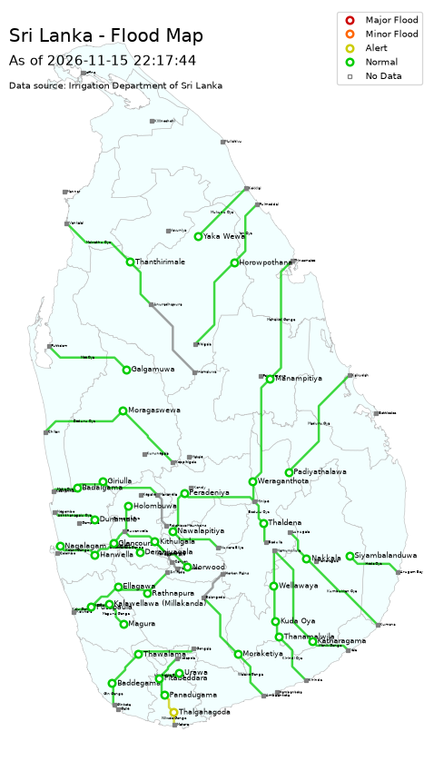

# lk_irrigation 🇱🇰

Realtime Data about *River Water Levels* in Sri Lanka, from the [Irrigation Deptartment](https://www.irrigation.gov.lk)'s [Hydrology and Disaster Management](https://www.irrigation.gov.lk/web/index.php?option=com_content&view=article&id=27&Itemid=128&lang=en) Division.

- [Complete Dataset](data/rwlds) with **317,575 measurements** from **39** stations.
- [Scrape and load logic](src/lk_irrigation/rwld/RiverWaterLevelDataLoadMixin.py)
- [Original Data source](https://www.arcgis.com/apps/dashboards/2cffe83c9ff5497d97375498bdf3ff38)

🇱🇰 River water alerts: No active alerts.
Source: Sri Lanka Irrigation Department https://www.irrigation.gov.lk
Repo: https://github.com/nuuuwan/lk_irrigation
## River Water Level Map

## Latest measurements

*There were **39** measurements in the last **1 hour**.*

| Measured At | Station (River Basin) | Level (m) | Alert Level | Rate-of-Rise (m/hr) | Rising Alert |
| --- | --- | ---: | --- | ---: | --- |
| 2026-11-16 17:20:40 | Dunamale (Aththanagalu Oya) | 1.75 | 🟢 Normal | -0.011 |  |
| 2026-11-16 17:13:20 | Magura (Kalu Ganga) | 1.76 | 🟢 Normal | -0.021 |  |
| 2026-11-16 17:13:01 | Thawalama (Gin Ganga) | 1.89 | 🟢 Normal | -0.009 |  |
| 2026-11-16 17:12:19 | Urawa (Nilwala Ganga) | 1.03 | 🟢 Normal | 0.000 |  |
| 2026-11-16 17:10:14 | Baddegama (Gin Ganga) | 2.00 | 🟢 Normal | -0.030 |  |
| 2026-11-16 17:07:48 | Thalgahagoda (Nilwala Ganga) | 1.33 | 🟢 Normal | 0.000 |  |
| 2026-11-16 17:07:35 | Horowpothana (Yan Oya) | 2.02 | 🟢 Normal | 0.000 |  |
| 2026-11-16 17:06:43 | Peradeniya (Mahaweli Ganga) | 2.83 | 🟢 Normal | 0.010 | 🔺 Rising |
| 2026-11-16 17:06:07 | Nagalagam Street (Kelani Ganga) | 0.66 | 🟢 Normal | 0.000 |  |
| 2026-11-16 17:05:55 | Panadugama (Nilwala Ganga) | 4.36 | 🟢 Normal | -0.011 |  |
| 2026-11-16 17:05:52 | Glencourse (Kelani Ganga) | 10.37 | 🟢 Normal | 0.011 | 🔺 Rising |
| 2026-11-16 17:05:30 | Katharagama (Menik Ganga) | -0.04 | 🟢 Normal | -0.010 |  |
| 2026-11-16 17:05:29 | Galgamuwa (Mee Oya) | 0.28 | 🟢 Normal | 0.000 |  |
| 2026-11-16 17:04:40 | Badalgama (Maha Oya) | 2.70 | 🟢 Normal | 0.000 |  |
| 2026-11-16 17:04:12 | Nawalapitiya (Mahaweli Ganga) | 1.24 | 🟢 Normal | 0.000 |  |
| 2026-11-16 17:04:08 | Putupaula (Kalu Ganga) | 0.81 | 🟢 Normal | 0.040 | 🔺 Rising |
| 2026-11-16 17:04:05 | Kuda Oya (Kirindi Oya) | 1.60 | 🟢 Normal | -0.010 |  |
| 2026-11-16 17:03:51 | Moraketiya (Walawe Ganga) | 1.70 | 🟢 Normal | 0.000 |  |
| 2026-11-16 17:03:43 | Manampitiya (Mahaweli Ganga) | 1.41 | 🟢 Normal | 0.000 |  |
| 2026-11-16 17:03:29 | Holombuwa (Kelani Ganga) | 0.76 | 🟢 Normal | 0.000 |  |
| 2026-11-16 17:03:11 | Wellawaya (Kirindi Oya) | 1.30 | 🟢 Normal | 0.000 |  |
| 2026-11-16 17:03:08 | Rathnapura (Kalu Ganga) | 1.73 | 🟢 Normal | 0.029 | 🔺 Rising |
| 2026-11-16 17:03:04 | Weraganthota (Mahaweli Ganga) | -1.87 | 🟢 Normal | 0.039 | 🔺 Rising |
| 2026-11-16 17:02:47 | Yaka Wewa (Ma Oya) | 0.53 | 🟢 Normal | 0.000 |  |
| 2026-11-16 17:02:47 | Hanwella (Kelani Ganga) | 2.13 | 🟢 Normal | 0.000 |  |
| 2026-11-16 17:02:45 | Deraniyagala (Kelani Ganga) | 0.66 | 🟢 Normal | 0.000 |  |
| 2026-11-16 17:02:36 | Ellagawa (Kalu Ganga) | 5.26 | 🟢 Normal | -0.020 |  |
| 2026-11-16 17:02:34 | Moragaswewa (Deduru Oya) | 0.65 | 🟢 Normal | -0.010 |  |
| 2026-11-16 17:02:25 | Kithulgala (Kelani Ganga) | 1.90 | 🟢 Normal | -0.157 |  |
| 2026-11-16 17:02:24 | Nakkala (Kumbukkan Oya) | 0.92 | 🟢 Normal | -0.010 |  |
| 2026-11-16 17:02:12 | Kalawellawa (Millakanda) (Kalu Ganga) | 2.78 | 🟢 Normal | -0.040 |  |
| 2026-11-16 17:02:09 | Thaldena (Mahaweli Ganga) | 0.60 | 🟢 Normal | 0.011 | 🔺 Rising |
| 2026-11-16 17:02:01 | Norwood (Kelani Ganga) | 0.99 | 🟢 Normal | 0.000 |  |
| 2026-11-16 17:01:44 | Pitabeddara (Nilwala Ganga) | 1.33 | 🟢 Normal | 0.000 |  |
| 2026-11-16 17:01:35 | Thanamalwila (Kirindi Oya) | 1.49 | 🟢 Normal | 0.000 |  |
| 2026-11-16 17:01:24 | Thanthirimale (Malwathu Oya) | 1.50 | 🟢 Normal | 0.000 |  |
| 2026-11-16 17:01:02 | Giriulla (Maha Oya) | 1.41 | 🟢 Normal | 0.000 |  |
| 2026-11-16 17:01:02 | Padiyathalawa (Maduru Oya) | 0.42 | 🟢 Normal | -0.022 |  |
| 2026-11-16 17:00:10 | Siyambalanduwa (Heda Oya) | 0.54 | 🟢 Normal | 0.000 |  |

## Latest by Station

*⌛ = Latest measurement is older than **24 hours**.*

| Measured At | Station (River Basin) | Level (m) | Alert Level | Rate-of-Rise (m/hr) | Rising Alert |
| --- | --- | ---: | --- | ---: | --- |
| 2026-11-16 17:04:08 | Putupaula (Kalu Ganga) | 0.81 | 🟢 Normal | 0.040 | 🔺 Rising |
| 2026-11-16 17:03:04 | Weraganthota (Mahaweli Ganga) | -1.87 | 🟢 Normal | 0.039 | 🔺 Rising |
| 2026-11-16 17:03:08 | Rathnapura (Kalu Ganga) | 1.73 | 🟢 Normal | 0.029 | 🔺 Rising |
| 2026-11-16 17:05:52 | Glencourse (Kelani Ganga) | 10.37 | 🟢 Normal | 0.011 | 🔺 Rising |
| 2026-11-16 17:02:09 | Thaldena (Mahaweli Ganga) | 0.60 | 🟢 Normal | 0.011 | 🔺 Rising |
| 2026-11-16 17:06:43 | Peradeniya (Mahaweli Ganga) | 2.83 | 🟢 Normal | 0.010 | 🔺 Rising |
| 2026-11-16 17:03:11 | Wellawaya (Kirindi Oya) | 1.30 | 🟢 Normal | 0.000 |  |
| 2026-11-16 17:04:12 | Nawalapitiya (Mahaweli Ganga) | 1.24 | 🟢 Normal | 0.000 |  |
| 2026-11-16 17:02:47 | Yaka Wewa (Ma Oya) | 0.53 | 🟢 Normal | 0.000 |  |
| 2026-11-16 17:01:02 | Giriulla (Maha Oya) | 1.41 | 🟢 Normal | 0.000 |  |
| 2026-11-16 17:07:35 | Horowpothana (Yan Oya) | 2.02 | 🟢 Normal | 0.000 |  |
| 2026-11-16 17:05:29 | Galgamuwa (Mee Oya) | 0.28 | 🟢 Normal | 0.000 |  |
| 2026-11-16 17:01:44 | Pitabeddara (Nilwala Ganga) | 1.33 | 🟢 Normal | 0.000 |  |
| 2026-11-16 17:02:01 | Norwood (Kelani Ganga) | 0.99 | 🟢 Normal | 0.000 |  |
| 2026-11-16 17:02:47 | Hanwella (Kelani Ganga) | 2.13 | 🟢 Normal | 0.000 |  |
| 2026-11-16 17:02:45 | Deraniyagala (Kelani Ganga) | 0.66 | 🟢 Normal | 0.000 |  |
| 2026-11-16 17:06:07 | Nagalagam Street (Kelani Ganga) | 0.66 | 🟢 Normal | 0.000 |  |
| 2026-11-16 17:03:51 | Moraketiya (Walawe Ganga) | 1.70 | 🟢 Normal | 0.000 |  |
| 2026-11-16 17:00:10 | Siyambalanduwa (Heda Oya) | 0.54 | 🟢 Normal | 0.000 |  |
| 2026-11-16 17:04:40 | Badalgama (Maha Oya) | 2.70 | 🟢 Normal | 0.000 |  |
| 2026-11-16 17:03:29 | Holombuwa (Kelani Ganga) | 0.76 | 🟢 Normal | 0.000 |  |
| 2026-11-16 17:03:43 | Manampitiya (Mahaweli Ganga) | 1.41 | 🟢 Normal | 0.000 |  |
| 2026-11-16 17:01:24 | Thanthirimale (Malwathu Oya) | 1.50 | 🟢 Normal | 0.000 |  |
| 2026-11-16 17:12:19 | Urawa (Nilwala Ganga) | 1.03 | 🟢 Normal | 0.000 |  |
| 2026-11-16 17:07:48 | Thalgahagoda (Nilwala Ganga) | 1.33 | 🟢 Normal | 0.000 |  |
| 2026-11-16 17:01:35 | Thanamalwila (Kirindi Oya) | 1.49 | 🟢 Normal | 0.000 |  |
| 2026-11-16 17:13:01 | Thawalama (Gin Ganga) | 1.89 | 🟢 Normal | -0.009 |  |
| 2026-11-16 17:05:30 | Katharagama (Menik Ganga) | -0.04 | 🟢 Normal | -0.010 |  |
| 2026-11-16 17:04:05 | Kuda Oya (Kirindi Oya) | 1.60 | 🟢 Normal | -0.010 |  |
| 2026-11-16 17:02:34 | Moragaswewa (Deduru Oya) | 0.65 | 🟢 Normal | -0.010 |  |
| 2026-11-16 17:02:24 | Nakkala (Kumbukkan Oya) | 0.92 | 🟢 Normal | -0.010 |  |
| 2026-11-16 17:20:40 | Dunamale (Aththanagalu Oya) | 1.75 | 🟢 Normal | -0.011 |  |
| 2026-11-16 17:05:55 | Panadugama (Nilwala Ganga) | 4.36 | 🟢 Normal | -0.011 |  |
| 2026-11-16 17:02:36 | Ellagawa (Kalu Ganga) | 5.26 | 🟢 Normal | -0.020 |  |
| 2026-11-16 17:13:20 | Magura (Kalu Ganga) | 1.76 | 🟢 Normal | -0.021 |  |
| 2026-11-16 17:01:02 | Padiyathalawa (Maduru Oya) | 0.42 | 🟢 Normal | -0.022 |  |
| 2026-11-16 17:10:14 | Baddegama (Gin Ganga) | 2.00 | 🟢 Normal | -0.030 |  |
| 2026-11-16 17:02:12 | Kalawellawa (Millakanda) (Kalu Ganga) | 2.78 | 🟢 Normal | -0.040 |  |
| 2026-11-16 17:02:25 | Kithulgala (Kelani Ganga) | 1.90 | 🟢 Normal | -0.157 |  |

## River Water Level Charts by Station

### Putupaula (Kalu Ganga)

### Weraganthota (Mahaweli Ganga)

### Rathnapura (Kalu Ganga)

### Glencourse (Kelani Ganga)

### Thaldena (Mahaweli Ganga)

### Peradeniya (Mahaweli Ganga)

### Wellawaya (Kirindi Oya)

### Nawalapitiya (Mahaweli Ganga)

### Yaka Wewa (Ma Oya)

### Giriulla (Maha Oya)

### Horowpothana (Yan Oya)

### Galgamuwa (Mee Oya)

### Pitabeddara (Nilwala Ganga)

### Norwood (Kelani Ganga)

### Hanwella (Kelani Ganga)

### Deraniyagala (Kelani Ganga)

### Nagalagam Street (Kelani Ganga)

### Moraketiya (Walawe Ganga)

### Siyambalanduwa (Heda Oya)

### Badalgama (Maha Oya)

### Holombuwa (Kelani Ganga)

### Manampitiya (Mahaweli Ganga)

### Thanthirimale (Malwathu Oya)

### Urawa (Nilwala Ganga)

### Thalgahagoda (Nilwala Ganga)

### Thanamalwila (Kirindi Oya)

### Thawalama (Gin Ganga)

### Katharagama (Menik Ganga)

### Kuda Oya (Kirindi Oya)

### Moragaswewa (Deduru Oya)

### Nakkala (Kumbukkan Oya)

### Dunamale (Aththanagalu Oya)

### Panadugama (Nilwala Ganga)

### Ellagawa (Kalu Ganga)

### Magura (Kalu Ganga)

### Padiyathalawa (Maduru Oya)

### Baddegama (Gin Ganga)

### Kalawellawa (Millakanda) (Kalu Ganga)

.png)

### Kithulgala (Kelani Ganga)

