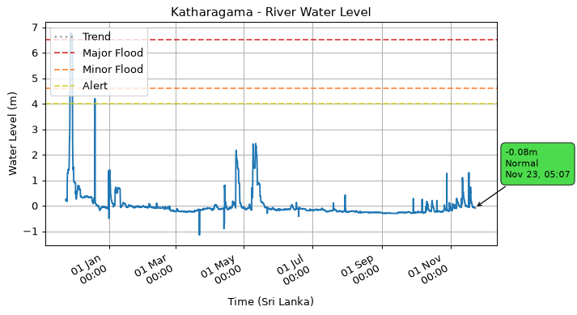

# lk_irrigation 🇱🇰

Realtime Data about *River Water Levels* in Sri Lanka, from the [Irrigation Deptartment](https://www.irrigation.gov.lk)'s [Hydrology and Disaster Management](https://www.irrigation.gov.lk/web/index.php?option=com_content&view=article&id=27&Itemid=128&lang=en) Division.

- [Complete Dataset](data/rwlds) with **326,328 measurements** from **39** stations.
- [Scrape and load logic](src/lk_irrigation/rwld/RiverWaterLevelDataLoadMixin.py)
- [Original Data source](https://www.arcgis.com/apps/dashboards/2cffe83c9ff5497d97375498bdf3ff38)

🇱🇰 River water alerts: 🟡 Kalawellawa (Millakanda) — Alert; 🟡 Dunamale — Alert
Source: Sri Lanka Irrigation Department https://www.irrigation.gov.lk
Repo: https://github.com/nuuuwan/lk_irrigation
## River Water Level Map

## Latest measurements

*There were **39** measurements in the last **1 hour**.*

| Measured At | Station (River Basin) | Level (m) | Alert Level | Rate-of-Rise (m/hr) | Rising Alert |
| --- | --- | ---: | --- | ---: | --- |
| 2026-11-26 16:22:05 | Baddegama (Gin Ganga) | 1.76 | 🟢 Normal | -0.025 |  |
| 2026-11-26 16:17:56 | Dunamale (Aththanagalu Oya) | 3.47 | 🟡 Alert | -0.087 |  |
| 2026-11-26 16:17:24 | Horowpothana (Yan Oya) | 2.39 | 🟢 Normal | 0.008 | 🔺 Rising |
| 2026-11-26 16:16:50 | Magura (Kalu Ganga) | 3.37 | 🟢 Normal | 0.380 | 🔺 Rising |
| 2026-11-26 16:14:40 | Urawa (Nilwala Ganga) | 0.89 | 🟢 Normal | -0.011 |  |
| 2026-11-26 16:12:07 | Ellagawa (Kalu Ganga) | 6.15 | 🟢 Normal | 0.187 | 🔺 Rising |
| 2026-11-26 16:11:56 | Panadugama (Nilwala Ganga) | 3.70 | 🟢 Normal | -0.038 |  |
| 2026-11-26 16:09:05 | Norwood (Kelani Ganga) | 1.33 | 🟢 Normal | -0.037 |  |
| 2026-11-26 16:08:18 | Peradeniya (Mahaweli Ganga) | 3.80 | 🟢 Normal | -0.073 |  |
| 2026-11-26 16:07:45 | Galgamuwa (Mee Oya) | 1.22 | 🟢 Normal | -0.019 |  |
| 2026-11-26 16:07:45 | Glencourse (Kelani Ganga) | 10.60 | 🟢 Normal | 0.010 | 🔺 Rising |
| 2026-11-26 16:07:38 | Siyambalanduwa (Heda Oya) | 0.68 | 🟢 Normal | 0.000 |  |
| 2026-11-26 16:07:21 | Nagalagam Street (Kelani Ganga) | 0.76 | 🟢 Normal | -0.056 |  |
| 2026-11-26 16:06:50 | Moraketiya (Walawe Ganga) | 2.60 | 🟢 Normal | 15.429 | 🔺 Rising |
| 2026-11-26 16:06:43 | Moraketiya (Walawe Ganga) | 2.57 | 🟢 Normal | 15.429 | 🔺 Rising |
| 2026-11-26 16:06:27 | Thawalama (Gin Ganga) | 1.90 | 🟢 Normal | 0.057 | 🔺 Rising |
| 2026-11-26 16:05:49 | Pitabeddara (Nilwala Ganga) | 1.22 | 🟢 Normal | 0.000 |  |
| 2026-11-26 16:05:48 | Putupaula (Kalu Ganga) | 1.44 | 🟢 Normal | 0.066 | 🔺 Rising |
| 2026-11-26 16:05:43 | Holombuwa (Kelani Ganga) | 1.02 | 🟢 Normal | -0.010 |  |
| 2026-11-26 16:05:37 | Manampitiya (Mahaweli Ganga) | 1.90 | 🟢 Normal | -0.066 |  |
| 2026-11-26 16:05:16 | Nawalapitiya (Mahaweli Ganga) | 1.95 | 🟢 Normal | 0.342 | 🔺 Rising |
| 2026-11-26 16:05:16 | Thaldena (Mahaweli Ganga) | 0.52 | 🟢 Normal | 0.000 |  |
| 2026-11-26 16:05:02 | Badalgama (Maha Oya) | 3.93 | 🟢 Normal | -0.039 |  |
| 2026-11-26 16:04:08 | Weraganthota (Mahaweli Ganga) | -1.99 | 🟢 Normal | 0.000 |  |
| 2026-11-26 16:03:51 | Katharagama (Menik Ganga) | 0.09 | 🟢 Normal | 0.000 |  |
| 2026-11-26 16:03:41 | Hanwella (Kelani Ganga) | 3.08 | 🟢 Normal | -0.078 |  |
| 2026-11-26 16:03:28 | Deraniyagala (Kelani Ganga) | 0.63 | 🟢 Normal | 0.000 |  |
| 2026-11-26 16:03:23 | Padiyathalawa (Maduru Oya) | 0.42 | 🟢 Normal | 0.000 |  |
| 2026-11-26 16:03:22 | Nakkala (Kumbukkan Oya) | 0.85 | 🟢 Normal | -0.012 |  |
| 2026-11-26 16:03:06 | Kithulgala (Kelani Ganga) | 1.80 | 🟢 Normal | 0.117 | 🔺 Rising |
| 2026-11-26 16:02:49 | Rathnapura (Kalu Ganga) | 1.93 | 🟢 Normal | 0.040 | 🔺 Rising |
| 2026-11-26 16:02:15 | Kalawellawa (Millakanda) (Kalu Ganga) | 5.04 | 🟡 Alert | 0.000 |  |
| 2026-11-26 16:02:05 | Thanamalwila (Kirindi Oya) | 1.58 | 🟢 Normal | -0.010 |  |
| 2026-11-26 16:01:53 | Giriulla (Maha Oya) | 2.75 | 🟢 Normal | -0.061 |  |
| 2026-11-26 16:01:42 | Yaka Wewa (Ma Oya) | 0.51 | 🟢 Normal | 0.000 |  |
| 2026-11-26 16:01:37 | Kuda Oya (Kirindi Oya) | 1.71 | 🟢 Normal | -0.010 |  |
| 2026-11-26 16:01:34 | Moragaswewa (Deduru Oya) | 4.54 | 🟢 Normal | 0.031 | 🔺 Rising |
| 2026-11-26 16:01:31 | Thanthirimale (Malwathu Oya) | 1.62 | 🟢 Normal | 0.010 | 🔺 Rising |
| 2026-11-26 16:01:14 | Wellawaya (Kirindi Oya) | 1.39 | 🟢 Normal | 0.039 | 🔺 Rising |

## Latest by Station

*⌛ = Latest measurement is older than **24 hours**.*

| Measured At | Station (River Basin) | Level (m) | Alert Level | Rate-of-Rise (m/hr) | Rising Alert |
| --- | --- | ---: | --- | ---: | --- |
| 2026-11-26 16:02:15 | Kalawellawa (Millakanda) (Kalu Ganga) | 5.04 | 🟡 Alert | 0.000 |  |
| 2026-11-26 16:17:56 | Dunamale (Aththanagalu Oya) | 3.47 | 🟡 Alert | -0.087 |  |
| 2026-11-26 16:06:50 | Moraketiya (Walawe Ganga) | 2.60 | 🟢 Normal | 15.429 | 🔺 Rising |
| 2026-11-26 16:16:50 | Magura (Kalu Ganga) | 3.37 | 🟢 Normal | 0.380 | 🔺 Rising |
| 2026-11-26 16:05:16 | Nawalapitiya (Mahaweli Ganga) | 1.95 | 🟢 Normal | 0.342 | 🔺 Rising |
| 2026-11-26 16:12:07 | Ellagawa (Kalu Ganga) | 6.15 | 🟢 Normal | 0.187 | 🔺 Rising |
| 2026-11-26 16:03:06 | Kithulgala (Kelani Ganga) | 1.80 | 🟢 Normal | 0.117 | 🔺 Rising |
| 2026-11-26 16:05:48 | Putupaula (Kalu Ganga) | 1.44 | 🟢 Normal | 0.066 | 🔺 Rising |
| 2026-11-26 16:06:27 | Thawalama (Gin Ganga) | 1.90 | 🟢 Normal | 0.057 | 🔺 Rising |
| 2026-11-26 16:02:49 | Rathnapura (Kalu Ganga) | 1.93 | 🟢 Normal | 0.040 | 🔺 Rising |
| 2026-11-26 16:01:14 | Wellawaya (Kirindi Oya) | 1.39 | 🟢 Normal | 0.039 | 🔺 Rising |
| 2026-11-26 16:01:34 | Moragaswewa (Deduru Oya) | 4.54 | 🟢 Normal | 0.031 | 🔺 Rising |
| 2026-11-26 16:07:45 | Glencourse (Kelani Ganga) | 10.60 | 🟢 Normal | 0.010 | 🔺 Rising |
| 2026-11-26 16:01:31 | Thanthirimale (Malwathu Oya) | 1.62 | 🟢 Normal | 0.010 | 🔺 Rising |
| 2026-11-26 16:17:24 | Horowpothana (Yan Oya) | 2.39 | 🟢 Normal | 0.008 | 🔺 Rising |
| 2026-11-26 16:04:08 | Weraganthota (Mahaweli Ganga) | -1.99 | 🟢 Normal | 0.000 |  |
| 2026-11-26 16:01:42 | Yaka Wewa (Ma Oya) | 0.51 | 🟢 Normal | 0.000 |  |
| 2026-11-26 16:05:49 | Pitabeddara (Nilwala Ganga) | 1.22 | 🟢 Normal | 0.000 |  |
| 2026-11-26 16:03:28 | Deraniyagala (Kelani Ganga) | 0.63 | 🟢 Normal | 0.000 |  |
| 2026-11-26 16:03:23 | Padiyathalawa (Maduru Oya) | 0.42 | 🟢 Normal | 0.000 |  |
| 2026-11-26 16:07:38 | Siyambalanduwa (Heda Oya) | 0.68 | 🟢 Normal | 0.000 |  |
| 2026-11-26 16:05:16 | Thaldena (Mahaweli Ganga) | 0.52 | 🟢 Normal | 0.000 |  |
| 2026-11-26 16:03:51 | Katharagama (Menik Ganga) | 0.09 | 🟢 Normal | 0.000 |  |
| 2026-11-26 15:15:57 | Thalgahagoda (Nilwala Ganga) | 0.85 | 🟢 Normal | 0.000 |  |
| 2026-11-26 16:02:05 | Thanamalwila (Kirindi Oya) | 1.58 | 🟢 Normal | -0.010 |  |
| 2026-11-26 16:01:37 | Kuda Oya (Kirindi Oya) | 1.71 | 🟢 Normal | -0.010 |  |
| 2026-11-26 16:05:43 | Holombuwa (Kelani Ganga) | 1.02 | 🟢 Normal | -0.010 |  |
| 2026-11-26 16:14:40 | Urawa (Nilwala Ganga) | 0.89 | 🟢 Normal | -0.011 |  |
| 2026-11-26 16:03:22 | Nakkala (Kumbukkan Oya) | 0.85 | 🟢 Normal | -0.012 |  |
| 2026-11-26 16:07:45 | Galgamuwa (Mee Oya) | 1.22 | 🟢 Normal | -0.019 |  |
| 2026-11-26 16:22:05 | Baddegama (Gin Ganga) | 1.76 | 🟢 Normal | -0.025 |  |
| 2026-11-26 16:09:05 | Norwood (Kelani Ganga) | 1.33 | 🟢 Normal | -0.037 |  |
| 2026-11-26 16:11:56 | Panadugama (Nilwala Ganga) | 3.70 | 🟢 Normal | -0.038 |  |
| 2026-11-26 16:05:02 | Badalgama (Maha Oya) | 3.93 | 🟢 Normal | -0.039 |  |
| 2026-11-26 16:07:21 | Nagalagam Street (Kelani Ganga) | 0.76 | 🟢 Normal | -0.056 |  |
| 2026-11-26 16:01:53 | Giriulla (Maha Oya) | 2.75 | 🟢 Normal | -0.061 |  |
| 2026-11-26 16:05:37 | Manampitiya (Mahaweli Ganga) | 1.90 | 🟢 Normal | -0.066 |  |
| 2026-11-26 16:08:18 | Peradeniya (Mahaweli Ganga) | 3.80 | 🟢 Normal | -0.073 |  |
| 2026-11-26 16:03:41 | Hanwella (Kelani Ganga) | 3.08 | 🟢 Normal | -0.078 |  |

## River Water Level Charts by Station

### Kalawellawa (Millakanda) (Kalu Ganga)

.png)

### Dunamale (Aththanagalu Oya)

### Moraketiya (Walawe Ganga)

### Magura (Kalu Ganga)

### Nawalapitiya (Mahaweli Ganga)

### Ellagawa (Kalu Ganga)

### Kithulgala (Kelani Ganga)

### Putupaula (Kalu Ganga)

### Thawalama (Gin Ganga)

### Rathnapura (Kalu Ganga)

### Wellawaya (Kirindi Oya)

### Moragaswewa (Deduru Oya)

### Glencourse (Kelani Ganga)

### Thanthirimale (Malwathu Oya)

### Horowpothana (Yan Oya)

### Weraganthota (Mahaweli Ganga)

### Yaka Wewa (Ma Oya)

### Pitabeddara (Nilwala Ganga)

### Deraniyagala (Kelani Ganga)

### Padiyathalawa (Maduru Oya)

### Siyambalanduwa (Heda Oya)

### Thaldena (Mahaweli Ganga)

### Katharagama (Menik Ganga)

### Thalgahagoda (Nilwala Ganga)

### Thanamalwila (Kirindi Oya)

### Kuda Oya (Kirindi Oya)

### Holombuwa (Kelani Ganga)

### Urawa (Nilwala Ganga)

### Nakkala (Kumbukkan Oya)

### Galgamuwa (Mee Oya)

### Baddegama (Gin Ganga)

### Norwood (Kelani Ganga)

### Panadugama (Nilwala Ganga)

### Badalgama (Maha Oya)

### Nagalagam Street (Kelani Ganga)

### Giriulla (Maha Oya)

### Manampitiya (Mahaweli Ganga)

### Peradeniya (Mahaweli Ganga)

### Hanwella (Kelani Ganga)

