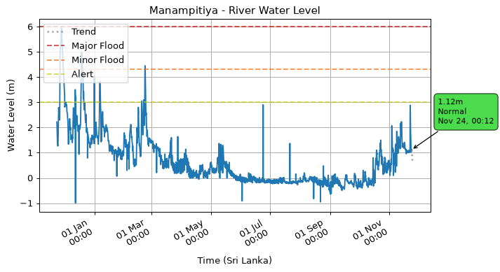

# lk_irrigation 🇱🇰

Realtime Data about *River Water Levels* in Sri Lanka, from the [Irrigation Deptartment](https://www.irrigation.gov.lk)'s [Hydrology and Disaster Management](https://www.irrigation.gov.lk/web/index.php?option=com_content&view=article&id=27&Itemid=128&lang=en) Division.

- [Complete Dataset](data/rwlds) with **319,098 measurements** from **39** stations.
- [Scrape and load logic](src/lk_irrigation/rwld/RiverWaterLevelDataLoadMixin.py)
- [Original Data source](https://www.arcgis.com/apps/dashboards/2cffe83c9ff5497d97375498bdf3ff38)

🇱🇰 River water alerts: No active alerts.
Source: Sri Lanka Irrigation Department https://www.irrigation.gov.lk
Repo: https://github.com/nuuuwan/lk_irrigation
## River Water Level Map

## Latest measurements

*There were **24** measurements in the last **1 hour**.*

| Measured At | Station (River Basin) | Level (m) | Alert Level | Rate-of-Rise (m/hr) | Rising Alert |
| --- | --- | ---: | --- | ---: | --- |
| 2026-11-18 11:03:07 | Deraniyagala (Kelani Ganga) | 0.57 | 🟢 Normal | -0.040 |  |
| 2026-11-18 11:03:07 | Norwood (Kelani Ganga) | 0.91 | 🟢 Normal | -0.010 |  |
| 2026-11-18 11:03:07 | Thawalama (Gin Ganga) | 1.64 | 🟢 Normal | -0.093 |  |
| 2026-11-18 11:02:51 | Dunamale (Aththanagalu Oya) | 1.60 | 🟢 Normal | -0.043 |  |
| 2026-11-18 11:02:50 | Galgamuwa (Mee Oya) | 0.19 | 🟢 Normal | 0.000 |  |
| 2026-11-18 11:02:45 | Hanwella (Kelani Ganga) | 1.88 | 🟢 Normal | -0.010 |  |
| 2026-11-18 11:02:43 | Wellawaya (Kirindi Oya) | 1.32 | 🟢 Normal | -0.030 |  |
| 2026-11-18 11:02:20 | Nagalagam Street (Kelani Ganga) | 0.50 | 🟢 Normal | -0.016 |  |
| 2026-11-18 11:02:14 | Katharagama (Menik Ganga) | 0.21 | 🟢 Normal | 0.000 |  |
| 2026-11-18 11:02:14 | Manampitiya (Mahaweli Ganga) | 0.98 | 🟢 Normal | 0.019 | 🔺 Rising |
| 2026-11-18 11:02:10 | Thanamalwila (Kirindi Oya) | 1.35 | 🟢 Normal | -0.010 |  |
| 2026-11-18 11:02:08 | Weraganthota (Mahaweli Ganga) | -2.03 | 🟢 Normal | -0.010 |  |
| 2026-11-18 11:01:55 | Yaka Wewa (Ma Oya) | 0.51 | 🟢 Normal | 0.000 |  |
| 2026-11-18 11:01:54 | Thalgahagoda (Nilwala Ganga) | 0.93 | 🟢 Normal | 0.000 |  |
| 2026-11-18 11:01:32 | Thaldena (Mahaweli Ganga) | 0.45 | 🟢 Normal | -0.062 |  |
| 2026-11-18 11:01:13 | Padiyathalawa (Maduru Oya) | 0.37 | 🟢 Normal | 0.000 |  |
| 2026-11-18 11:00:55 | Thanthirimale (Malwathu Oya) | 1.32 | 🟢 Normal | 0.000 |  |
| 2026-11-18 11:00:47 | Giriulla (Maha Oya) | 1.29 | 🟢 Normal | 0.000 |  |
| 2026-11-18 11:00:38 | Horowpothana (Yan Oya) | 1.83 | 🟢 Normal | -0.010 |  |
| 2026-11-18 11:00:38 | Moragaswewa (Deduru Oya) | 0.59 | 🟢 Normal | -0.013 |  |
| 2026-11-18 11:00:22 | Pitabeddara (Nilwala Ganga) | 1.18 | 🟢 Normal | 0.000 |  |
| 2026-11-18 11:00:13 | Nakkala (Kumbukkan Oya) | 0.83 | 🟢 Normal | 0.000 |  |
| 2026-11-18 10:31:05 | Urawa (Nilwala Ganga) | 0.87 | 🟢 Normal | -0.009 |  |
| 2026-11-18 10:29:00 | Thanthirimale (Malwathu Oya) | 1.32 | 🟢 Normal | 0.000 |  |

## Latest by Station

*⌛ = Latest measurement is older than **24 hours**.*

| Measured At | Station (River Basin) | Level (m) | Alert Level | Rate-of-Rise (m/hr) | Rising Alert |
| --- | --- | ---: | --- | ---: | --- |
| 2026-11-18 11:02:14 | Manampitiya (Mahaweli Ganga) | 0.98 | 🟢 Normal | 0.019 | 🔺 Rising |
| 2026-11-18 11:00:13 | Nakkala (Kumbukkan Oya) | 0.83 | 🟢 Normal | 0.000 |  |
| 2026-11-18 10:01:03 | Nawalapitiya (Mahaweli Ganga) | 1.19 | 🟢 Normal | 0.000 |  |
| 2026-11-18 11:01:55 | Yaka Wewa (Ma Oya) | 0.51 | 🟢 Normal | 0.000 |  |
| 2026-11-18 11:00:47 | Giriulla (Maha Oya) | 1.29 | 🟢 Normal | 0.000 |  |
| 2026-11-18 11:02:50 | Galgamuwa (Mee Oya) | 0.19 | 🟢 Normal | 0.000 |  |
| 2026-11-18 11:00:22 | Pitabeddara (Nilwala Ganga) | 1.18 | 🟢 Normal | 0.000 |  |
| 2026-11-18 10:06:02 | Ellagawa (Kalu Ganga) | 5.06 | 🟢 Normal | 0.000 |  |
| 2026-11-18 10:02:51 | Baddegama (Gin Ganga) | 1.50 | 🟢 Normal | 0.000 |  |
| 2026-11-18 10:04:42 | Panadugama (Nilwala Ganga) | 3.67 | 🟢 Normal | 0.000 |  |
| 2026-11-18 11:01:13 | Padiyathalawa (Maduru Oya) | 0.37 | 🟢 Normal | 0.000 |  |
| 2026-11-18 10:13:01 | Moraketiya (Walawe Ganga) | 1.13 | 🟢 Normal | 0.000 |  |
| 2026-11-18 10:02:32 | Siyambalanduwa (Heda Oya) | 0.52 | 🟢 Normal | 0.000 |  |
| 2026-11-18 11:02:14 | Katharagama (Menik Ganga) | 0.21 | 🟢 Normal | 0.000 |  |
| 2026-11-18 10:02:28 | Rathnapura (Kalu Ganga) | 1.49 | 🟢 Normal | 0.000 |  |
| 2026-11-18 11:00:55 | Thanthirimale (Malwathu Oya) | 1.32 | 🟢 Normal | 0.000 |  |
| 2026-11-18 11:01:54 | Thalgahagoda (Nilwala Ganga) | 0.93 | 🟢 Normal | 0.000 |  |
| 2026-11-18 10:31:05 | Urawa (Nilwala Ganga) | 0.87 | 🟢 Normal | -0.009 |  |
| 2026-11-18 10:05:23 | Kuda Oya (Kirindi Oya) | 1.59 | 🟢 Normal | -0.010 |  |
| 2026-11-18 10:04:53 | Magura (Kalu Ganga) | 1.53 | 🟢 Normal | -0.010 |  |
| 2026-11-18 10:06:18 | Badalgama (Maha Oya) | 2.56 | 🟢 Normal | -0.010 |  |
| 2026-11-18 11:02:08 | Weraganthota (Mahaweli Ganga) | -2.03 | 🟢 Normal | -0.010 |  |
| 2026-11-18 11:02:45 | Hanwella (Kelani Ganga) | 1.88 | 🟢 Normal | -0.010 |  |
| 2026-11-18 11:03:07 | Norwood (Kelani Ganga) | 0.91 | 🟢 Normal | -0.010 |  |
| 2026-11-18 11:02:10 | Thanamalwila (Kirindi Oya) | 1.35 | 🟢 Normal | -0.010 |  |
| 2026-11-18 11:00:38 | Horowpothana (Yan Oya) | 1.83 | 🟢 Normal | -0.010 |  |
| 2026-11-18 10:04:23 | Holombuwa (Kelani Ganga) | 0.68 | 🟢 Normal | -0.011 |  |
| 2026-11-18 11:00:38 | Moragaswewa (Deduru Oya) | 0.59 | 🟢 Normal | -0.013 |  |
| 2026-11-18 11:02:20 | Nagalagam Street (Kelani Ganga) | 0.50 | 🟢 Normal | -0.016 |  |
| 2026-11-18 10:04:04 | Glencourse (Kelani Ganga) | 10.14 | 🟢 Normal | -0.020 |  |
| 2026-11-18 10:04:44 | Peradeniya (Mahaweli Ganga) | 2.60 | 🟢 Normal | -0.028 |  |
| 2026-11-18 10:01:40 | Kithulgala (Kelani Ganga) | 1.99 | 🟢 Normal | -0.030 |  |
| 2026-11-18 10:04:11 | Putupaula (Kalu Ganga) | 0.71 | 🟢 Normal | -0.030 |  |
| 2026-11-18 11:02:43 | Wellawaya (Kirindi Oya) | 1.32 | 🟢 Normal | -0.030 |  |
| 2026-11-18 11:03:07 | Deraniyagala (Kelani Ganga) | 0.57 | 🟢 Normal | -0.040 |  |
| 2026-11-18 11:02:51 | Dunamale (Aththanagalu Oya) | 1.60 | 🟢 Normal | -0.043 |  |
| 2026-11-18 10:05:14 | Kalawellawa (Millakanda) (Kalu Ganga) | 2.74 | 🟢 Normal | -0.061 |  |
| 2026-11-18 11:01:32 | Thaldena (Mahaweli Ganga) | 0.45 | 🟢 Normal | -0.062 |  |
| 2026-11-18 11:03:07 | Thawalama (Gin Ganga) | 1.64 | 🟢 Normal | -0.093 |  |

## River Water Level Charts by Station

### Manampitiya (Mahaweli Ganga)

### Nakkala (Kumbukkan Oya)

### Nawalapitiya (Mahaweli Ganga)

### Yaka Wewa (Ma Oya)

### Giriulla (Maha Oya)

### Galgamuwa (Mee Oya)

### Pitabeddara (Nilwala Ganga)

### Ellagawa (Kalu Ganga)

### Baddegama (Gin Ganga)

### Panadugama (Nilwala Ganga)

### Padiyathalawa (Maduru Oya)

### Moraketiya (Walawe Ganga)

### Siyambalanduwa (Heda Oya)

### Katharagama (Menik Ganga)

### Rathnapura (Kalu Ganga)

### Thanthirimale (Malwathu Oya)

### Thalgahagoda (Nilwala Ganga)

### Urawa (Nilwala Ganga)

### Kuda Oya (Kirindi Oya)

### Magura (Kalu Ganga)

### Badalgama (Maha Oya)

### Weraganthota (Mahaweli Ganga)

### Hanwella (Kelani Ganga)

### Norwood (Kelani Ganga)

### Thanamalwila (Kirindi Oya)

### Horowpothana (Yan Oya)

### Holombuwa (Kelani Ganga)

### Moragaswewa (Deduru Oya)

### Nagalagam Street (Kelani Ganga)

### Glencourse (Kelani Ganga)

### Peradeniya (Mahaweli Ganga)

### Kithulgala (Kelani Ganga)

### Putupaula (Kalu Ganga)

### Wellawaya (Kirindi Oya)

### Deraniyagala (Kelani Ganga)

### Dunamale (Aththanagalu Oya)

### Kalawellawa (Millakanda) (Kalu Ganga)

.png)

### Thaldena (Mahaweli Ganga)

### Thawalama (Gin Ganga)

